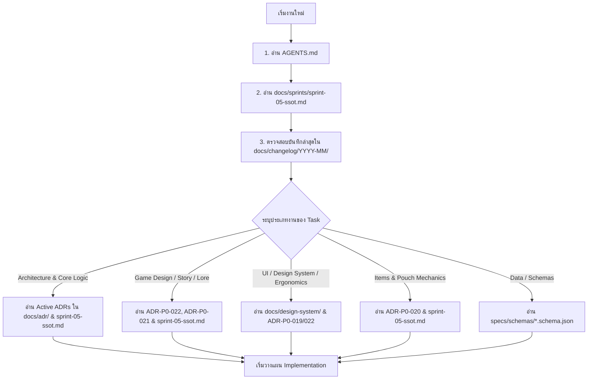
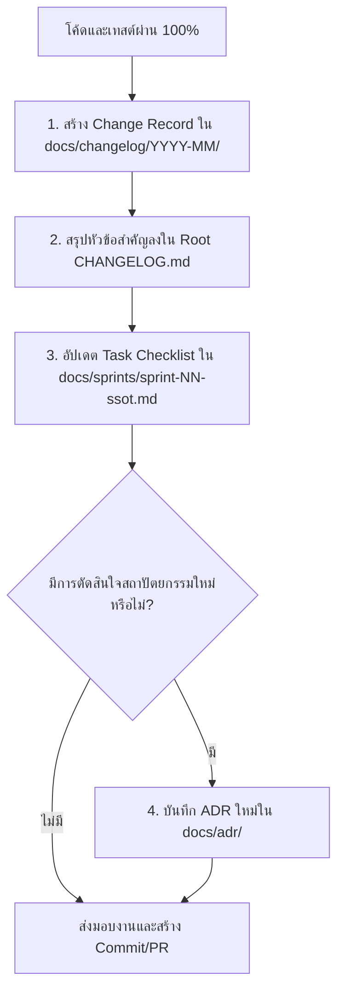

# JaoKob Master Documentation Portal & Engineering Operating Manual

ยินดีต้อนรับสู่ศูนย์กลางเอกสาร ข้อกำหนด และคู่มือปฏิบัติการวิศวกรรมของโครงการ **JaoKob (เจ้ากบ)**  
ระบบเอกสารและกระบวนการทำงานในโฟลเดอร์นี้ถูกจัดระเบียบตามมาตรฐานวิศวกรรมระดับโลก:
- **ISO/IEC/IEEE 12207:2017:** Systems and software engineering - Software life cycle processes
- **ISO/IEC/IEEE 29148:2018:** Systems and software engineering - Life cycle processes - Requirements engineering
- **ISO/IEC 25010:2011:** Systems and software quality requirements and evaluation (SQuaRE)
- **WCAG 2.2 Level AA:** Web Content Accessibility Guidelines

เอกสารนี้ทำหน้าที่เป็น **Single Source of Truth (SSOT)** และคู่มือนำทางสำหรับนักพัฒนาและ AI Agent ทุกตัวในการทำงานร่วมกันอย่างมีวินัย ตรวจสอบย้อนกลับได้ และไร้ข้อผิดพลาด

> [!IMPORTANT]
> **ระบบลำดับชั้นความศักดิ์สิทธิ์ของเอกสาร (The Four-Tier Authority Hierarchy ตาม [ADR-P0-023](adr/ADR-P0-023-documentation-hygiene-and-ssot-hierarchy.md))**
> เพื่อป้องกันปัญหาการอ่านเอกสารเก่าล้าหลัง (Documentation Rot) โครงการแบ่งเอกสารเป็น 4 ระดับอย่างเด็ดขาด หากมีเนื้อหาขัดแย้ง ให้ยึดถือระดับที่สูงกว่าเสมอ:
> 1. **Tier 1 — พระราชบัญญัติสูงสุดและแผนงานปัจจุบัน (Supreme Active SSOT & Governance):**
>    - [Sprint 5 Execution SSOT](sprints/sprint-05-ssot.md) (พิมพ์เขียว 4 Value Slices PR #19–22)
>    - Active Accepted ADRs ใน [`docs/adr/`](adr/): [ADR-P0-022](adr/ADR-P0-022-visual-novel-ergonomics-living-keepsake-lore-and-sprint-streamlining.md) (สัจจะตัวละครตุ๊กตามีชีวิต 45 ซม., VN Ergonomics), [ADR-P0-021](adr/ADR-P0-021-narrative-resonance-authentic-adventure-and-branching-integrity.md) (Anti-slop, 3 ฉากจบที่มีความหมาย), [ADR-P0-020](adr/ADR-P0-020-adventure-keepsake-pouch-and-item-system.md) (Pouch 4 ช่อง ของ 6 ชิ้น), [ADR-P0-019](adr/ADR-P0-019-visual-novel-runtime-ergonomics-and-design-system-mandate.md), [ADR-P0-023](adr/ADR-P0-023-documentation-hygiene-and-ssot-hierarchy.md)
>    - แผนส่งมอบและผังติดตาม: [02-adr022-remediation-contract.md](proposals/sprint-05-planning/02-adr022-remediation-contract.md), [sprint-05-execution-matrix.md](traceability/sprint-05-execution-matrix.md)
> 2. **Tier 2 — สัญญาข้อกำหนดการออกแบบ (Active Design & Narrative Contracts):**
>    - โฟลเดอร์ [`docs/design-system/`](design-system/) (เช่น [visual-novel-specification.md](design-system/visual-novel-specification.md))
>    - Machine-readable Data Contracts ใน [`specs/schemas/`](../specs/schemas/)
> 3. **Tier 3 — ฐานข้อมูลการผสานงานรอบก่อนหน้า (Integrated Sprint Baselines):**
>    - [Sprint 4 SSOT](sprints/sprint-04-ssot.md) (Integrated baseline ที่ commit `d1af293`, 1,060/1,060 tests pass)
> 4. **Tier 4 — คลังเอกสารประวัติศาสตร์และข้อเสนอ (Historical Archives & Proposals - READ ONLY):**
>    - [`docs/phase-0/`](phase-0/): เอกสารรากฐานเดิม (31 สิงหาคม 2026) **Superceded แล้ว ห้ามนำมาใช้อ้างอิงเป็น Active Requirements**
>    - [`docs/proposals/`](proposals/): บันทึกการวิจัยและข้อเสนอรอบที่ปิดแล้ว
>    - [`docs/sprints/`](sprints/) (Sprints 1–3): บันทึกประวัติรอบงานในอดีต

**Current work: Sprint 5 under Accepted ADR-P0-022.** [SSOT 0.2](sprints/sprint-05-ssot.md) adopts **four value slices / twenty tasks**, with planned PR #19–22 for VN/runtime foundations, living-keepsake Act 1 and Act 2, Acts 3–5/cinematic endings, and Grand Keepsake/device acceptance. Implementation is **0/20 tasks, 0/4 execution PRs**. The direction is ready for Slice 1 contracts/design work; the planning update remains [Draft PR #18](https://github.com/T3thr/JaoKob/pull/18). [Remediation contract](proposals/sprint-05-planning/02-adr022-remediation-contract.md), [trace matrix](traceability/sprint-05-execution-matrix.md), [CR-0006](rfc/CR-0006-sprint-05-complete-story-and-package-boundaries.md) and [latest audit](changelog/2026-10/2026-10-18-0023-sprint-05-adr022-replanning.md) define the accepted overrides and remaining implementation evidence.

**Current Canon/UI authority:** [ADR-P0-022](adr/ADR-P0-022-visual-novel-ergonomics-living-keepsake-lore-and-sprint-streamlining.md) replaces the biological opening with crochet childhood → adult living keepsake about 45 cm in a blue shirt before the storm. It mandates the VN overhaul, separate HUD/tools, silent successful saving, inline narrative choices, cinematic beats and **Save Format 2**. Exact old stories stay archived; there is no guessed conversion from biological history into the revised lore. [Assessment 0.2](proposals/sprint-05-planning/01-readiness-assessment.md) separates the reported critical feedback, inspected references and future acceptance.

**Integrated baseline: Sprint 4.** All five PRs and twelve tasks are integrated, including [PR #17](https://github.com/T3thr/JaoKob/pull/17) at `4c0bd28`; current `develop` baseline is `d1af293`. The **2026-10-17** baseline rerun passed **1,060/1,060 unit tests** and **1,096 design trajectories**; it was not rerun for the 2026-10-18 documentation revision and does not prove revised UI/lore or later-act runtime. See [Sprint 4 SSOT](sprints/sprint-04-ssot.md), [closeout contract](design-system/sprint-04-closeout-contract.md) and [audit](changelog/2026-10/2026-10-17-1400-sprint-04-slice-05-closeout.md). Human Thai/art/audio, physical-device and assistive-technology gates lacking recorded acceptance remain explicit Sprint 5 work; merge is not evidence that those checks ran.

**Runtime/promotion boundary:** Normal New Game now uses content3/schema2/Save2,28nodes/47edges/70dialogues,30 localized intent entries,five original2D images and three optional moments. Existing2.1 saves continue on their exact archived graph, including independent checkpoint cursors and proved Save1 chains; no2.1→3 cursor migration is invented. Published schemas and legacy bytes remain immutable. [Consolidated evidence](../tests/e2e/evidence/sprint-04/slice-05/README.md) separates automated browser/rollback/performance results from human Thai/art/audio/device/AT acceptance. The [Act2–5 handoff](proposals/sprint-04-overhaul/05-act-2-5-map-and-endings.md) and adult red-heart art gap stay Sprint5 work. No later-act runtime,3D,merge or deployment is inferred.

**Proposal archive:** ข้อเสนอการยกระดับสู่ Interactive Light Novel RPG และ Asset Customization Pipeline สำหรับ Phase 2 / Sprint 3 ดู [JKB-PROP-P2-001 Proposal](proposals/phase-02-visual-novel-architecture/01-visual-novel-transformation-tech-lead-proposal.md); มติที่ใช้จริงอยู่ใน Sprint 3 SSOT/CR-0003; proposal เป็นข้อมูลประวัติ

**Governing architecture:** [ADR-P0-015](adr/ADR-P0-015-interactive-light-novel-presentation.md) is the presentation foundation. [ADR-P0-019](adr/ADR-P0-019-visual-novel-runtime-ergonomics-and-design-system-mandate.md), [ADR-P0-020](adr/ADR-P0-020-adventure-keepsake-pouch-and-item-system.md), [ADR-P0-021](adr/ADR-P0-021-narrative-resonance-authentic-adventure-and-branching-integrity.md), และ [ADR-P0-023](adr/ADR-P0-023-documentation-hygiene-and-ssot-hierarchy.md) remain binding where ADR22 does not supersede them; the remediation contract contains the exact crosswalk. Sprint 4 delivered Session History; remaining controls/full-release scope are audited in T0/T5/T18. Earlier deferrals are historical scope, not permanent waivers.

---

## 1. แผนผังโครงสร้างโฟลเดอร์ของโครงการ (Repository Directory Standard)

เพื่อให้การทำงานร่วมกันระหว่างมนุษย์และ AI มีระเบียบและไม่เกิดการวางไฟล์ผิดที่ ทุกคนต้องปฏิบัติตามผังโครงสร้างนี้:

```text
JaoKob/
├── AGENTS.md                      <-- กฎระเบียบสูงสุดของ Repository สำหรับ AI Agent
├── CHANGELOG.md                   <-- บันทึกการเปลี่ยนแปลงระดับ Release ภาพรวม (Keep a Changelog)
├── README.md                      <-- ข้อมูลโครงการสาธารณะ
├── .gitignore                     <-- รายการไฟล์ละเว้น (เฉพาะ OS/Artifacts ไม่ละเว้น Docs/Specs)
├── docs/                          <-- ศูนย์รวมเอกสารและข้อกำหนดของโครงการ
│   ├── README.md                  <-- (ไฟล์นี้) คู่มือการปฏิบัติงานและสารบัญนำทางเอกสาร
│   ├── ORGANIZATION-LOG.md        <-- บันทึกประวัติการจัดระเบียบโครงสร้างเอกสาร
│   ├── proposals/                 <-- ข้อเสนอทางเทคนิค การวิจัย และ Brainstorming ก่อนเปิด RFC/Sprint
│   │   ├── README.md              <-- สารบัญข้อเสนอและการใช้งาน
│   │   ├── phase-02-visual-novel-architecture/ <-- ข้อเสนอ Phase 2 Visual Novel Transformation
│   │   ├── sprint-04-overhaul/    <-- Act 1 redesign และแผนส่งต่อ Act 2–5
│   │   └── sprint-05-planning/    <-- Readiness assessment และหลักฐาน baseline
│   ├── raw/                       <-- พื้นที่รับไฟล์ดิบ/สื่อร่างชั่วคราวก่อนจัดหมวดหมู่
│   ├── changelog/                 <-- คลังบันทึกประวัติการทำงานระดับ Execution Session (ISO 12207)
│   │   ├── README.md              <-- มาตรฐานและแม่แบบการบันทึกระดับวัน-เวลา
│   │   ├── 2026-08/               <-- บันทึกประจำเดือนสิงหาคม 2026
│   │   ├── 2026-09/               <-- บันทึกประจำเดือนกันยายน 2026
│   │   └── 2026-10/               <-- บันทึกประจำเดือนตุลาคม 2026
│   ├── sprints/                   <-- เอกสาร SSOT ประจำรอบการพัฒนา (Sprint Execution)
│   │   ├── sprint-01-ssot.md      <-- Baseline Sprint 1: Core Vertical Slice
│   │   ├── sprint-02-ssot.md      <-- Integrated Sprint 2: Content Engine & Canonical Act 1
│   │   ├── sprint-03-ssot.md      <-- Integrated Sprint 3: Interactive Light Novel RPG benchmark
│   │   ├── sprint-04-ssot.md      <-- Integrated Sprint 4: Visual Novel, Pouch, History, Act 1
│   │   └── sprint-05-ssot.md      <-- Active planning draft: complete story and package boundaries
│   ├── phase-0/                   <-- คลังเอกสารประวัติศาสตร์รากฐาน (HISTORICAL ARCHIVES - Superseded by ADRs & Sprint SSOT)
│   │   ├── README.md              <-- ป้ายเตือนและดัชนีเอกสาร Phase 0
│   │   ├── 00-phase-0-charter.md  <-- [Historical] ขอบเขต กฎบัตร และมาตรฐานอ้างอิง
│   │   ├── 01-game-design-document.md <-- [Historical] Superseded by ADR-020/021/022
│   │   ├── 02-narrative-bible.md  <-- [Historical] Superseded by ADR-021/022 & Sprint 5 SSOT
│   │   ├── 03-software-requirements-specification.md <-- [Historical] SRS Phase 0
│   │   ├── 04-architecture-blueprint.md <-- [Historical] Superseded by ADR-014/015/019/022
│   │   ├── 05-production-directory-plan.md <-- [Historical] ผังโฟลเดอร์เดิม
│   │   ├── 06-ai-agent-engineering-guide.md <-- [Historical] Governed by AGENTS.md
│   │   ├── 07-git-governance-and-deployment-runbook.md <-- [Historical] Git Runbook เดิม
│   │   └── 08-verification-traceability-and-quality-gates.md <-- [Historical] Verification เดิม
│   ├── adr/                       <-- Architecture Decision Records คำตัดสินสถาปัตยกรรมสูงสุดที่มีผลผูกพัน (Tier 1)
│   ├── design-system/             <-- สัญญาและข้อกำหนดการออกแบบ Visual Novel และ Ergonomics (Tier 2)
│   └── traceability/              <-- Matrix ตรวจสอบย้อนกลับของแต่ละ Sprint
├── specs/                         <-- Machine-Readable Data Contracts (JSON Schemas Draft 2020-12)
│   ├── README.md                  <-- สารบัญ Schema และ Versioning Contract
│   └── schemas/                   <-- สัญญาข้อมูล 7 ฉบับ (character, dialogue, event, ฯลฯ)
├── src/                           <-- Production Source Code (Pure ES Modules, Clean Architecture)
│   ├── bootstrap/                 <-- จุดเดียวที่เชื่อม Adapters เข้ากับ Core Ports (Composition Root)
│   ├── core/                      <-- Pure Domain Logic (ห้ามเรียก DOM, window, localStorage)
│   ├── ui/                        <-- UI Adapters (DOM Renderer, CSS, Accessibility)
│   └── data/                      <-- Data Adapters (LocalStorage Persistence, Content, i18n)
├── tests/                         <-- Automated Test Suites
│   ├── unit/                      <-- Unit Tests สำหรับ Core Logic
│   └── fixtures/                  <-- ข้อมูลตัวอย่างสำหรับทดสอบ
└── .agents/                       <-- Skills, Standards และ Workflows ประจำระบบของ AI
```

---

## 2. ขั้นตอนก่อนเริ่มงานสำหรับ AI Agent ("ก่อนทำงานควรอ่านอะไร")

> [!WARNING]
> **ข้อห้ามเด็ดขาด (Strict Prohibition): ห้ามอ่านเอกสารใน `docs/phase-0/` เป็น Active Requirements!**  
> เอกสารใน `docs/phase-0/` (เช่น `01-game-design-document.md` และ `02-narrative-bible.md`) เป็นเพียง **Historical Archive** ที่ถูกแทนที่แล้ว สัจจะตัวละครตุ๊กตามีชีวิต 45 ซม., เสื้อผ้า, การเล่าเรื่อง 5 องก์, และระบบ UI ปัจจุบันถูกควบคุมโดย **ADR-P0-022, ADR-P0-021, ADR-P0-020** และ **Sprint 5 Execution SSOT** เท่านั้น

เพื่อประหยัด Token และป้องกันการหลุดกรอบสถาปัตยกรรม AI Agent ต้องปฏิบัติตามลำดับการโหลดบริบทดังนี้:



### Checklist ที่ต้องตรวจสอบก่อนเริ่มเขียนโค้ด (Definition of Ready - DoR):
1. [ ] **อ่าน [`AGENTS.md`](../AGENTS.md):** ยืนยันข้อห้าม Boundary และขอบเขตความปลอดภัย
2. [ ] **อ่าน SSOT ประจำ Sprint:** ใช้ [Sprint 5 SSOT](sprints/sprint-05-ssot.md) สำหรับงานปัจจุบัน และ [Sprint 4 SSOT](sprints/sprint-04-ssot.md) สำหรับ integrated baseline ตรวจสถานะอนุมัติของแต่ละ Task ก่อน implementation
3. [ ] **อ่าน Active ADRs:** ตรวจสอบ [ADR-P0-022](adr/ADR-P0-022-visual-novel-ergonomics-living-keepsake-lore-and-sprint-streamlining.md), [ADR-P0-021](adr/ADR-P0-021-narrative-resonance-authentic-adventure-and-branching-integrity.md), [ADR-P0-020](adr/ADR-P0-020-adventure-keepsake-pouch-and-item-system.md) ตามขอบเขตงาน
4. [ ] **อ่าน Change Record ล่าสุด:** เลือกตามวันเวลาจาก [`docs/changelog/`](changelog/) รวมเดือนปัจจุบัน เพื่อทราบสถานะก่อนหน้า
5. [ ] **ตรวจสอบ Requirement ID:** ทราบแน่ชัดว่างานที่กำลังจะทำตอบโจทย์ Requirement ID ใด (เช่น `FR-STA-001`, `FR-ENG-001`, `GDD-LORE-001`)

---

## 3. ขั้นตอนหลังทำงานเสร็จสำหรับ AI Agent ("หลังทำงานควรอัปเดตอะไรใน docs")

เมื่อพัฒนาโค้ดและรัน Automated Tests ผ่านครบถ้วนแล้ว **งานจะยังไม่ถือว่าเสร็จสมบูรณ์ (Not Done)** จนกว่า AI Agent จะอัปเดตเอกสารตาม 4 ขั้นตอนนี้:



### Checklist ที่ต้องอัปเดตก่อนส่งมอบงาน (Definition of Done - DoD Documentation Gate):
1. [ ] **สร้าง Execution Change Record:** สร้างไฟล์ใหม่ใน `docs/changelog/YYYY-MM/YYYY-MM-DD-HHmm-<slug>.md` ตามแม่แบบใน [`docs/changelog/README.md`](changelog/README.md) โดยระบุวันเวลา, วัตถุประสงค์, Requirement IDs, รายการไฟล์ที่แก้ และผลการทดสอบ
2. [ ] **อัปเดต Root [`CHANGELOG.md`](../CHANGELOG.md):** เพิ่มสรุปสั้น 1-3 บรรทัดภายใต้หัวข้อ Release หรือ Unreleased พร้อมทำลิงก์ Markdown ชี้ไปยังไฟล์ Change Record ในข้อ 1
3. [ ] **อัปเดตสถานะใน Sprint SSOT:** เปิด [Active Sprint SSOT](sprints/sprint-05-ssot.md) ลงทะเบียน Record ใน Section 7 และทำเครื่องหมาย `[x]` เฉพาะงานที่ส่งมอบจริง ไม่ปิด implementation WBS ด้วยงานวางแผน
4. [ ] **บันทึก ADR (ถ้ามี):** หากมีการตัดสินใจทางสถาปัตยกรรมที่เปลี่ยนไปจาก Phase 0 ให้บันทึก ADR ฉบับใหม่ใน [`docs/adr/`](adr/)

---

## 4. มาตรฐานวิศวกรรมที่นำมาใช้ (Governance & Compliance Mapping)

| มาตรฐานสากล | การนำมาใช้ในโครงสร้างเอกสารของ JaoKob |
|---|---|
| **ISO/IEC/IEEE 12207:2017** | กระบวนการ Configuration Management, Traceability Chain, Audit Trail ใน `docs/changelog/` |
| **ISO/IEC/IEEE 29148:2018** | โครงสร้างข้อกำหนดความต้องการซอฟต์แวร์ใน `docs/phase-0/03-software-requirements-specification.md` |
| **ISO/IEC 25010:2011** | โครงสร้าง Non-Functional Requirements ครอบคลุมทั้ง 8 ด้านคุณภาพ |
| **WCAG 2.2 Level AA** | เกณฑ์การเข้าถึงสำหรับผู้พิการและเทคโนโลยีช่วยเหลือใน `src/ui/accessibility/` |
