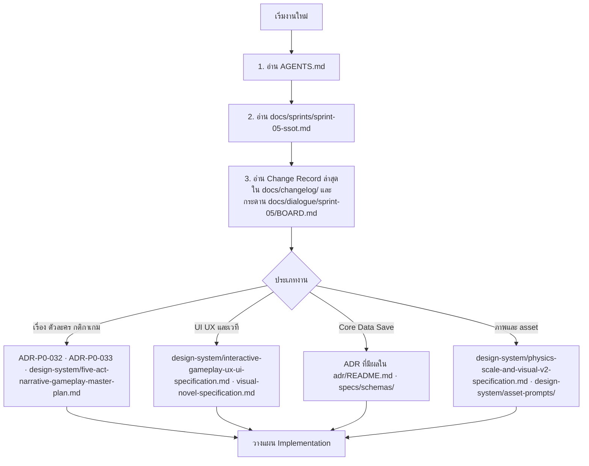

# JaoKob Documentation Portal

ทางเข้าเดียวของเอกสารทั้งหมดในโครงการ **JaoKob (เจ้ากบ)** อ่านหน้านี้แล้วต้องรู้ทันทีว่าไฟล์ไหนคือกติกาปัจจุบัน ไฟล์ไหนคือสัญญาออกแบบ และไฟล์ไหนคือประวัติศาสตร์ที่ห้ามใช้ตัดสินงานใหม่

| ข้อมูล | ค่า |
|---|---|
| **ขั้นของโครงการ** | Sprint 5 Implementation เริ่ม 2026-11-01 บน `develop` |
| **กติกาเรื่องและเกมเพลย์ปัจจุบัน** | [ADR-P0-032 v2.0](adr/ADR-P0-032-living-fantasy-canon-peuak-miracle-doll-and-vn-stage-blocking.md) และ [ADR-P0-033](adr/ADR-P0-033-interactive-tactical-adventure-gameplay-and-dynamic-stage-revolution.md) |
| **แผนงานปัจจุบัน** | [Sprint 5 SSOT](sprints/sprint-05-ssot.md) |
| **กระดานสื่อสาร Agent** | [Sprint 5 Board](dialogue/sprint-05/BOARD.md) |
| **มาตรฐานอ้างอิง** | ISO/IEC/IEEE 12207:2017 · ISO/IEC/IEEE 29148:2018 · ISO/IEC 25010:2011 · WCAG 2.2 AA · Clean Architecture |
| **โครงสร้างนี้สถาปนาโดย** | `CR-20261031-0420` |

---

## 1. ลำดับชั้นอำนาจเอกสาร 4 ระดับ ([ADR-P0-023](adr/ADR-P0-023-documentation-hygiene-and-ssot-hierarchy.md))

เมื่อเอกสารขัดกัน ระดับที่สูงกว่าชนะเสมอ ระดับของแต่ละโฟลเดอร์เขียนไว้ใน README ของโฟลเดอร์นั้น

| ระดับ | ความหมาย | อยู่ที่ |
|---|---|---|
| **Tier 1 · กติกาและแผนปัจจุบัน** | ADR ที่มีผล · Sprint SSOT ปัจจุบัน · สัญญาส่งมอบของ Sprint นี้ | [adr/](adr/) (สถานะใน [adr/README.md](adr/README.md)) · [sprints/sprint-05-ssot.md](sprints/sprint-05-ssot.md) · [traceability/sprint-05-execution-matrix.md](traceability/sprint-05-execution-matrix.md) · [proposals/sprint-05-planning/](proposals/sprint-05-planning/) (เฉพาะส่วนวิศวกรรม) |
| **Tier 2 · สัญญาออกแบบ** | บท กติกาเกม ฟิสิกส์ UX/UI ที่โค้ด Sprint 5 ต้องทำตาม | [design-system/](design-system/) · [../specs/schemas/](../specs/schemas/) |
| **Tier 3 · ฐานที่รวมเข้าระบบแล้ว** | สิ่งที่โค้ดปัจจุบันบน `develop` ทำอยู่จริง | [sprints/sprint-04-ssot.md](sprints/sprint-04-ssot.md) · [design-system/visual-novel-specification.md](design-system/visual-novel-specification.md) และสัญญา runtime ของ Sprint 3–4 |
| **Tier 4 · ประวัติศาสตร์ (อ่านอย่างเดียว)** | เหตุผลและหลักฐานในอดีต ห้ามใช้ตัดสินงานใหม่ | [archive/](archive/) · [sprints/](sprints/) Sprint 1–3 · [proposals/](proposals/) ที่ปิดแล้ว · [rfc/](rfc/) · [changelog/](changelog/) · [dialogue/archive/](dialogue/archive/) |

> [!WARNING]
> ห้ามใช้เอกสารใน [archive/](archive/) ตัดสินเนื้อเรื่อง กติกาเกม หรือสถาปัตยกรรมใหม่ โดยเฉพาะ [archive/phase-0/](archive/phase-0/) ที่ยังบรรยายกบชีววิทยาและเวลาเล่นหลายชั่วโมง ซึ่งถูกแทนที่หมดแล้ว

## 2. แผนที่โครงการ

```text
jao-kob/
├── index.html          ทางเข้าเกม (runtime)
├── src/                โค้ดเกมแบบ Clean Architecture: core · data · ui · bootstrap
├── assets/             ภาพ เสียง ฟอนต์ และ provenance ของ asset ทุกชิ้น
├── specs/              สัญญาที่เครื่องอ่านได้: JSON Schema และ allowlist ของ release
├── tests/              unit · schema · design · docs · release · e2e และหลักฐานการทดสอบ
├── docs/
│   ├── README.md       หน้านี้
│   ├── adr/            Tier 1 · พระราชบัญญัติสถาปัตยกรรมและเนื้อเรื่อง
│   ├── sprints/        แผนราย Sprint (05 = Tier 1 · 04 = Tier 3 · 01–03 = Tier 4)
│   ├── traceability/   ผัง Requirement ↔ งาน ↔ เทสต์
│   ├── design-system/  Tier 2 · บท 5 องก์ กติกาเกม ฟิสิกส์ UX/UI และเครื่องมือพิสูจน์
│   ├── proposals/      งานวิจัยและข้อเสนอ (sprint-05-planning ยังมีผลเฉพาะส่วนวิศวกรรม)
│   ├── rfc/            คำขอเปลี่ยนแปลง CR-000N
│   ├── changelog/      บันทึกการเปลี่ยนแปลงทุกรอบ (audit trail)
│   ├── dialogue/       กระดานสื่อสาร Agent ราย Sprint และคลังกระดานเก่า
│   ├── raw/            พื้นที่รับไฟล์ดิบก่อนจัดหมวด
│   └── archive/        Tier 4 · Phase 0 · พิมพ์เขียวก่อน ADR-032 · บันทึกรอบงานเก่า
├── AGENTS.md           กติกาสูงสุดของ Agent ทุกตัว
├── CLAUDE.md · .cursorrules · .github/ · .agents/   ทางเข้าของเครื่องมือแต่ละตัว ชี้กลับมาที่ AGENTS.md
└── CHANGELOG.md        สรุปการเปลี่ยนแปลงระดับ release
```

## 3. ก่อนเริ่มงาน (Definition of Ready)



1. [ ] อ่าน [AGENTS.md](../AGENTS.md) และยืนยันตัวตน Git `T3thr <t.theerapat33@gmail.com>`
2. [ ] อ่าน [Sprint 5 SSOT](sprints/sprint-05-ssot.md) และรู้ว่างานนี้คือ Task ใด
3. [ ] ตรวจสถานะ ADR ใน [adr/README.md](adr/README.md) ก่อนอ้าง ADR ใด ๆ
4. [ ] อ่าน Change Record ล่าสุดใน [changelog/](changelog/) และกระดาน [Sprint 5 Board](dialogue/sprint-05/BOARD.md)
5. [ ] ระบุ Requirement ID ที่งานนี้ตอบ

## 4. หลังทำงานเสร็จ (Definition of Done ด้านเอกสาร)

1. [ ] สร้าง Change Record `changelog/YYYY-MM/YYYY-MM-DD-HHmm-<slug>.md` ตาม [changelog/README.md](changelog/README.md)
2. [ ] สรุป 1–3 บรรทัดใน [CHANGELOG.md](../CHANGELOG.md)
3. [ ] ลงทะเบียน Record ID ใน Section 7 ของ [Sprint 5 SSOT](sprints/sprint-05-ssot.md) และติ๊ก WBS เฉพาะงานที่เสร็จจริง
4. [ ] ถ้ามีการตัดสินใจสถาปัตยกรรมใหม่ เขียน ADR ใน [adr/](adr/) และอัปเดต [adr/README.md](adr/README.md)
5. [ ] เขียนสารส่งมอบลง [Sprint 5 Board](dialogue/sprint-05/BOARD.md) ตาม [dialogue/README.md](dialogue/README.md)
6. [ ] รันการตรวจของ repository ให้ผ่านทั้งหมด

```bash
node --test 'tests/unit/**/*.test.js'
node tests/docs/check-doc-links.mjs
```

## 5. กติกาความสะอาดของเอกสาร

| กติกา | รายละเอียด |
|---|---|
| **ไฟล์เดียวต่อความจริงหนึ่งเรื่อง** | ห้ามคัดลอกไฟล์ซ้ำ ถ้าโฟลเดอร์ไหนต้องใช้ไฟล์ของที่อื่น ให้ลิงก์ด้วย relative path ไปยังต้นฉบับ ไฟล์ซ้ำที่ถูกลบมีดัชนีชื่อ `deduplicated-aliases.json` ในโฟลเดอร์หลักฐานนั้น |
| **ลิงก์เป็น relative เสมอ** | ห้ามใช้ `file:///` หรือ path ของเครื่องใด ๆ · `node tests/docs/check-doc-links.mjs` ต้องผ่าน |
| **ไม่ใช้เครื่องหมายดอลลาร์และ LaTeX กับสูตร** | เขียนสูตรด้วย Unicode เช่น `M = D ÷ d` (ข้อยกเว้นเดียวคือคีย์ของ JSON Schema เช่น `$ref` ในบล็อกโค้ด) |
| **ชื่อตัวละคร** | สะกด `เปี๊ยก` แบบเดียวทั้งโครงการ |
| **ไม่มีชื่อ Agent ใน Git** | ห้ามชื่อ Agent หรือโมเดลใน commit, PR และชื่อ branch (ดู [AGENTS.md §5](../AGENTS.md)) |
| **ย้ายแทนลบ** | เอกสารที่หมดอายุย้ายเข้า [archive/](archive/) พร้อมป้ายกำกับ ไม่ลบทิ้ง (ADR-P0-023 §3) ยกเว้นไฟล์ที่ซ้ำกันทุกไบต์ |

## 6. มาตรฐานที่ใช้และใช้ตรงไหน

| มาตรฐาน | ใช้ในโครงการนี้ |
|---|---|
| ISO/IEC/IEEE 12207:2017 (Configuration Management, Traceability) | [changelog/](changelog/) · Sprint SSOT §7 · [traceability/](traceability/) |
| ISO/IEC/IEEE 29148:2018 (Requirements Engineering) | Requirement ID ใน Sprint SSOT และผังใน [traceability/](traceability/) |
| ISO/IEC 25010:2011 (Product Quality) | เกณฑ์คุณภาพใน Sprint SSOT และ [AGENTS.md](../AGENTS.md) §11 |
| WCAG 2.2 AA | [design-system/visual-novel-specification.md](design-system/visual-novel-specification.md) · [design-system/interactive-gameplay-ux-ui-specification.md](design-system/interactive-gameplay-ux-ui-specification.md) |
| Clean Architecture · Ports and Adapters | [../src/README.md](../src/README.md) |
| Documentation as Code (Diátaxis แยกคู่มือ ข้อกำหนด และประวัติ) | ระดับเอกสาร 4 ระดับข้างบน และ README ประจำโฟลเดอร์ |
