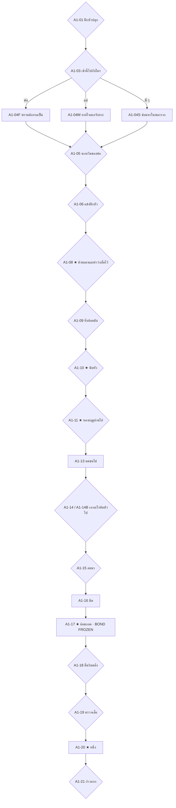

# Act 1 Blueprint — The Home That Counts Us In
# พิมพ์เขียวองก์ 1: บ้านที่นับเราเป็นหนึ่งในนั้น

| Document control | Value |
|---|---|
| ID / version | `JKB-ND-A1-BLUEPRINT` / **1.0.0** (รื้อสร้างทั้งฉบับ แทน rev.0.7 ซึ่งดูได้จากประวัติ git) |
| Date | 2026-10-21, Asia/Bangkok |
| Authority | [ADR-P0-031](../../adr/ADR-P0-031-act1-4-narrative-rebuild-item-contract-and-balance-model.md) · ADR-P0-030 · ADR-P0-029 · ADR-P0-028 · [มหาพิมพ์เขียว 5 องก์](five-act-narrative-gameplay-master-plan-v1.1-archived.md) |
| Author | Claude (Supreme Narrative Architect) |
| Status | **พิมพ์เขียวฉบับสมบูรณ์ พร้อมบททุกโหนด** · รอ PO ตรวจภาษาไทย |
| Runtime | **8–10 นาทีต่อหนึ่งรอบเล่น** วัดจากตัวบทจริงด้วย [act1-4-runtime-ledger.mjs](../../design-system/evidence/act1-4-runtime-ledger.mjs) (§7) |
| Math | ตัวเลขทุกตัวตรงกับ [act1-4-balance-model.mjs](../../design-system/evidence/act1-4-balance-model.mjs) |

> **รูปแบบบท:** บรรทัด `>` คือหนึ่งหน้าจอ VN · `{tag}` คือบรรทัดที่แสดงเฉพาะเมื่อเงื่อนไขเป็นจริง (`!` = ไม่เป็นจริง) · `pace` ใช้ค่าของ `dialogue.schema.json` (slow/normal/fast) · `emotion` ใช้ 10 ค่าของ schema · `silence` คือความเงียบหลังบรรทัดสุดท้ายของโหนด
>
> **แท็กที่ใช้ในองก์นี้:** `father` / `mother` / `siblings` (ใช้เวลาเช้ากับใคร) · `whistle` / `stone` / `pod` (ของที่พกไป) · `none` (ไม่พกอะไร) · `carried` (พกอย่างน้อยหนึ่งชิ้น) · `belief_father` (เชื่อว่าพ่ออุ้ม ไม่ใส่แท็กหมายถึงแม่)

---

## 0. หน้าที่ขององก์นี้

ผู้เล่นต้องรักครอบครัวนี้ก่อนจะเสียมันไป และต้องเก็บของสี่อย่างไว้ในใจโดยไม่รู้ตัว:

1. **ด้ายแดงที่แม่ "เผื่อไว้"** ซึ่งแม่ดึงออกมาจากโบว์สีแดงของตัวเอง
2. **การนับหัวทุกคืน** โดยเจ้ากบเป็น "สาม" คนสุดท้ายเสมอ
3. **ของสามชิ้นจากสามคน:** นกหวีดของพ่อ หินใสของพี่บัว ฝักบัวของพี่แหน
4. **เบาะแสของอ้อมกอดในพายุ** ที่เขาอธิบายปัดทิ้งเอง และความเข้าใจผิดว่าพ่อหรือแม่ยังอยู่ข้างหน้า

โครงสามท่อน: **วันหนึ่งในวัยเด็ก** (A1-01 ถึง A1-10) → **หลายฤดูผ่านไป** (A1-11 ถึง A1-12) → **พายุแรกของฤดูฝน** (A1-13 ถึง A1-21)

---

## 1. ระบบในองก์นี้

| ระบบ | สิ่งที่เกิด |
|---|---|
| Triad Skill | A1-03 เลือกตามใครไปตอนเช้า ได้ Hunter's Instinct (พ่อ) · Calming Breath (แม่) · Keen Eye (พี่ ๆ) ติดตัวทั้งเกม |
| รอยจำ (`family.imprint.*`) | ทุกตัวเลือกที่เลือกอยู่กับใคร เพิ่มรอยจำของคนนั้น คนที่รอยจำสูงสุดคือเสียงที่ดังที่สุดตอนใช้ Memory Willpower |
| ของจากบ้าน | ได้ครบสามชิ้นในวัยเด็ก แต่พกได้สูงสุดสองชิ้นใน A1-14 ที่เหลือแม่เก็บไว้ที่รัง (`a1.left_at_nest.*`) |
| ด้ายแดง | อยู่บนเสื้อ ยังไม่นับเป็นไอเทม (เข้ากระเป๋าใน Act 3) |
| ความเชื่อ | A1-10 นอนข้างพ่อ → `story.embrace_belief = father` นอกนั้น → `mother` |
| Bond ครอบครัว | `family.bond_thread` เต็มทุกเส้นทาง และแช่แข็งแบบเงียบที่ A1-17 (ADR-027) |
| Memory Willpower | เปิดครั้งแรกที่ A1-19 เมื่อใจ ≤ 50 |

**ค่า Status ตลอดองก์** (ตรงกับแบบจำลอง)

| จุด | HP | ใจ | STA |
|---|---|---|---|
| เริ่มเกม | 80 | 70 | 100 |
| ก่อนพายุ (หลัง A1-13) | 80 | 85 | 95 |
| หลังอ้อมกอด (A1-17) | 45 (ฝักบัว 50) | 35 (หินใส 40) | 40 |
| **จบองก์ (ทุกเส้นทาง)** | **50–65** | **35–55** | **55** |

---

## 2. ผังโหนด

เลขโหนดที่หายไป (A1-02, A1-07, A1-12) ถูกรวมเข้าโหนดข้างเคียงเพื่อให้เวลาเล่นอยู่ใน 8–10 นาที เลขเหล่านี้สงวนไว้ ห้ามนำกลับมาใช้กับความหมายอื่น

---

## 3. ภาพรวมโหนด

| ID | ชื่อ | ตัวเลือก | ระบบ | CG |
|---|---|---|---|---|
| A1-01 | ฝักบัวปลุก | 3 | รอยจำ | `a1-pod-wake` |
| A1-03 | เช้านี้ไปกับใคร | 3 | **Triad Skill** | — |
| A1-04F/M/S | บทเรียนของแต่ละคน | — | ใจ +5 | `a1-father-reeds` / `a1-mother-breath` / `a1-root-seek` |
| A1-05 | นกหวีดของพ่อ | 3 | ได้ `item_reed_whistle` (เก็บที่รัง) | — |
| A1-06 | แข่งฝักบัว | 3 | ได้ `item_lotus_pod` เมล็ด 3 (เก็บที่รัง) | `a1-pod-race` |
| A1-08 | ด้ายแดงและคำว่าเผื่อไว้ | 2 | ใจ +5 · ด้ายแดงบนเสื้อ | `a1-mother-red-thread` |
| A1-09 | หิ่งห้อยดับ | 2 | ได้ `item_dewdrop_stone` (เก็บที่รัง) | `a1-fireflies` |
| A1-10 | นับหัว | 3 | ใจ +5 · `story.embrace_belief` | `a1-head-count` |
| A1-11 | หลายฤดูผ่านไป | 3 | เติบโตเป็นราว 45 ซม. · รอยจำ | `a1-growth` |
| A1-13 | มดขนไข่ | — | STA −5 | — |
| A1-14/14B | เอาอะไรติดตัวไป | 4 + 4 | **กระเป๋า: พกได้ 0–2 ชิ้น** | — |
| A1-15 | ลมมา | 3 | STA −20 · ใจ −10 · `a1.storm.*` | `a1-storm-wind` |
| A1-16 | มืด | — | HP −20 · STA −35 · ใจ −20 (ของที่พกเปลี่ยนค่า) | — |
| A1-17 | อ้อมกอด | — | HP −15 · ใจ −20 · **FROZEN** | `a1-mysterious-embrace` |
| A1-18 | ตื่นริมตลิ่ง | 3 | ความเข้าใจผิดถือกำเนิด | `a1-riverbank-wake` |
| A1-19 | ตรวจเสื้อ | 2 + Willpower 2 | Memory Willpower ครั้งแรก | — |
| A1-20 | หนึ่ง | — | ใจ −5 · พักคืน STA ≥ 55 | `a1-count-one` |
| A1-21 | ก้าวแรก | 2 | `clinging_ache` / `inner_resilience` | — |

---

## 4. บท

### A1-01 · ฝักบัวปลุก
`pace: normal` `emotion: warm` `CG: a1-pod-wake` `silence: 0s`

> เช้าวันนั้นเริ่มด้วยเสียงกรุ๊งกริ๊งข้างหู
> พี่แหนเขย่าฝักบัวแห้งอยู่เหนือจมูกเขา ทั้งที่ตัวยังซุกอยู่ในผ้าห่ม "ตื่น ตื่น ตื่น"
> พ่อยืนดูลมอยู่ที่ขอบใบบัว หนวดกระตุกหนึ่งที ซึ่งในบ้านนี้แปลว่าพ่อกำลังยิ้ม
> แม่ฮัมเพลงขณะติดกระดุมเสื้อลายดอกให้พี่บัว เข็มเล่มเล็กเสียบอยู่ตรงโบว์สีแดงของแม่
> เจ้ากบตัวเล็กที่สุดในบ้าน เสื้อยืดสีฟ้าอ่อนคอกลมของเขายังยับจากการนอน

**ตัวเลือก**

1. **ก · แกล้งหลับต่อ** · ผล: รอยจำพี่ +1
   > เสียงกรุ๊งกริ๊งดังขึ้นอีกเท่าตัว จนพ่อเรียก "แหน" คำเดียว พี่แหนก็หดมือกลับเข้าผ้าห่ม
2. **ข · แย่งฝักมาเขย่าคืน** · ผล: รอยจำพี่ +1
   > พี่แหนร้องกรี๊ดแล้วม้วนผ้าห่มกลิ้งไปชนพี่บัว "สองคนนี้" พี่บัวถอนใจเหมือนผู้ใหญ่
3. **ค · ไปฟ้องแม่** · ผล: รอยจำแม่ +1
   > "พี่เขาอยากให้ลูกตื่นมาเล่นด้วยจ้ะ" แม่ว่า แล้วฮัมเพลงต่อ

### A1-03 · เช้านี้ไปกับใคร
`pace: normal` `emotion: curious` `CG: —` `silence: 0s`

> พอแดดพ้นกอกก ทุกคนก็แยกย้ายไปทำงานของตัวเอง
> พ่อถือมีดเปลือกหอยไปทางริมกก แม่หิ้วตะกร้าไปใต้ใบบัวใหญ่ พี่ทั้งสองวิ่งแข่งกันไปซอกรากบัว

**ตัวเลือก**

1. **ก · ตามพ่อ** · ผล: Hunter's Instinct · รอยจำพ่อ +2 → A1-04F
2. **ข · ตามแม่** · ผล: Calming Breath · รอยจำแม่ +2 → A1-04M
3. **ค · ตามพี่ ๆ** · ผล: Keen Eye · รอยจำพี่ +2 → A1-04S

### A1-04F · พรานต้องรอเป็น
`pace: slow` `emotion: warm` `CG: a1-father-reeds` `silence: 0s`

> พ่อนั่งบนก้านบัวที่ล้มพาดน้ำ แล้วไม่ขยับอีกเลย เจ้ากบนั่งได้ไม่ถึงสิบลมหายใจก็เริ่มยุกยิก
> "ช้า ๆ นะ" พ่อว่า "ลมยังไม่มา"
> แล้วลมก็มาจริง ๆ ตั๊กแตนตัวหนึ่งกระโดดหนีลมมาเกาะตรงหน้าพอดี เขาตวัดลิ้นออกไป แล้วได้ตั๊กแตนตัวแรกในชีวิต
> ระหว่างรอ พ่อเหลาปล้องกกจนมีรอยบาก แล้วเป่าให้ฟัง ต่ำหนึ่งที สูงหนึ่งที
> "จำไว้ ต่ำแล้วสูง"

ผล: ใจ +5 · Hunter's Instinct · `whistle.father_note`

### A1-04M · หายใจสองจังหวะ
`pace: slow` `emotion: tender` `CG: a1-mother-breath` `silence: 0s`

> ใต้ใบบัวใหญ่ แสงที่ลอดลงมาเป็นสีเขียว แม่สอนเขาเด็ดฝักบัวอ่อน ซึ่งส่วนใหญ่เขาเด็ดผิดฝัก
> แล้วแมลงปอตัวใหญ่ก็โฉบต่ำจนเกือบชนหัว เขาตัวแข็ง หัวใจเต้นดังอยู่ในหู
> แม่ไม่ดึงเขาเข้าหาตัว แม่นั่งลงตรงหน้า "หายใจเข้า นับสอง หายใจออก นับสอง"
> พอครบสามรอบ แมลงปอก็บินไปแล้ว
> แม่แตะอกเขาเบา ๆ สองที ตรงที่หัวใจเพิ่งเต้นช้าลง

ผล: ใจ +5 · Calming Breath

### A1-04S · ซ่อนหาในซอกราก
`pace: fast` `emotion: curious` `CG: a1-root-seek` `silence: 0s`

> พี่บัวสั่งให้นับถึงสิบ ส่วนพี่แหนกระโดดลงน้ำดังตูมจนไม่ต้องเดาว่าซ่อนอยู่ไหน
> เจ้ากบคลานเข้าซอกรากที่มืดที่สุด ข้างในเย็นและเงียบจนเขาอยากกลับออกไป
> แล้วจุดแสงเล็ก ๆ ก็วาบขึ้นตรงพื้น หินใสก้อนเท่าปลายนิ้ว เหมือนหยดน้ำที่แข็งตัว
> "เจอแล้ว!" พี่บัวโผล่มาข้างหลังแล้วรีบเอามือปิดหิน "อันนี้ของพี่ ห้ามบอกใคร"
> "พี่หาเจอทุกที" เขาบ่น
> "ก็ดูที่ก้านบัวสิ ก้านไหนสั่นทั้งที่ไม่มีลม ข้างใต้ก็มีใครอยู่"

ผล: ใจ +5 · Keen Eye

### A1-05 · นกหวีดของพ่อ
`pace: normal` `emotion: warm` `CG: —` `silence: 0s`

> ตอนเที่ยง พ่อวางปล้องกกที่มีรอยบากลงบนมือเขา
> {!father} พ่อเป่าให้ฟังหนึ่งที เสียงต่ำ แล้วเสียงสูง
> "หลงทางเมื่อไหร่ เป่ามัน" พ่อว่า "พ่อจะได้ยิน"
> แม่สอนให้สอดไว้ใต้ชายเสื้อ "ของสำคัญต้องมีที่อยู่จ้ะ"

**ตัวเลือก**

1. **ก · ลองเป่าทันที**
   > เสียงที่ออกมาเหมือนเป็ดสะอึก พี่แหนหัวเราะจนผ้าห่มหลุด หนวดพ่อกระตุกสองที
2. **ข · ถามว่าถ้าพ่อไม่ได้ยินล่ะ**
   > พ่อนิ่งไปนิดหนึ่ง หนวดไม่กระตุกเลย "พ่อได้ยินเสมอ"
3. **ค · กอดขาพ่อ** · ผล: รอยจำพ่อ +1
   > พ่อยืนนิ่งให้กอด จนแม่ต้องเรียกไปกินข้าว

### A1-06 · แข่งฝักบัว
`pace: fast` `emotion: warm` `CG: a1-pod-race` `silence: 0s`

> บ่ายนั้นพี่แหนจัดแข่งฝักบัวลอยน้ำ ไม่มีใครเคยชนะพี่แหน ทุกคนรู้ว่าเพราะอะไร แต่ไม่มีใครจับได้
> พอเริ่ม ฝักของพี่แหนก็พุ่งไปเหมือนมีใครเป่าตามหลัง ซึ่งก็มีจริง ๆ

**ตัวเลือก**

1. **ก · เป่าตามบ้าง**
   > ฝักทั้งสองหมุนติ้วชนกันกลางน้ำ สองพี่น้องหัวเราะจนไม่มีใครเป่าต่อไหว
2. **ข · แข่งอย่างซื่อ ๆ**
   > เขาแพ้ไปสามช่วงตัว พี่แหนชูมือ แต่มองเขานานกว่าปกตินิดหนึ่ง
3. **ค · แกล้งให้พี่ชนะ** · ผล: รอยจำพี่ +1
   > เขากดฝักตัวเองไว้ใต้น้ำ พี่แหนเห็น แต่ไม่ได้ว่าอะไร

> หลังแข่ง พี่แหนยื่นฝักใบนั้นมาให้เฉย ๆ "ลอยเก่งที่สุดในบึงแล้ว ให้เลย จะได้ไม่มีใครแพ้พี่อีก"
> พี่แหนเขย่าให้ฟังหนึ่งที กรุ๊งกริ๊ง "ข้างในมีเมล็ดสามเมล็ด อย่ากินหมดล่ะ"

### A1-08 · ★ ด้ายแดงและคำว่าเผื่อไว้
`pace: slow` `emotion: tender` `CG: a1-mother-red-thread` `silence: 4s`

> เขาวิ่งจะเอาฝักไปอวดแม่ แล้วชายเสื้อก็เกี่ยวปลายกก แคว่ก
> แม่ไม่ดุสักคำ แม่อุ้มเขาขึ้นมานั่งบนตัก แล้วถอดเข็มที่เสียบไว้ตรงโบว์ออกมา
> จากนั้นแม่ก็ดึงด้ายเส้นหนึ่งออกจากริมโบว์สีแดงของตัวเอง "โบว์แม่สั้นลงนิดเดียว ไม่มีใครเห็นหรอกจ้ะ"
> ฝีแรกทำเขาสะดุ้ง ทั้งที่เข็มไม่ได้แตะตัวเขาเลย
> "นิ่ง ๆ จ้ะ เดี๋ยวเข็มหลงทาง"
> เขานิ่งจนได้ยินแม่ฮัมเพลงอยู่ในคอ
> พอเย็บเสร็จ แม่ไม่กัดด้ายทิ้ง แม่พันด้ายที่เหลือรอบนิ้ว แล้วสอดเก็บไว้ใต้ชายเสื้อด้านใน
> "เก็บไว้ทำไมฮะ"
> แม่ตบชายเสื้อเบา ๆ สองที
> "เผื่อไว้"

**ตัวเลือก**

1. **ก · แตะรอยเย็บสีแดง** · ผล: ใจ +5
   > ด้ายแดงนูนขึ้นจากเนื้อผ้านิดเดียว พอให้ปลายนิ้วจำได้
2. **ข · กอดแม่** · ผล: ใจ +5 · รอยจำแม่ +1
   > แม่ยังฮัมเพลงต่อ ไม่หยุดเลยสักท่อน

### A1-09 · หิ่งห้อยดับ
`pace: slow` `emotion: afraid` `CG: a1-fireflies` `silence: 0s`

> ค่ำนั้นหิ่งห้อยเต็มบึง แล้วก็ค่อย ๆ ดับไปทีละตัว
> เจ้ากบกลัวความมืด ทุกคนในบ้านรู้ ยกเว้นตัวเขาเองที่คิดว่าไม่มีใครรู้
> พี่บัวมานั่งข้าง ๆ แล้วแบมือ บนฝ่ามือคือหินใสที่ยังมีแสงหิ่งห้อยตัวสุดท้ายค้างอยู่ข้างใน
> {siblings} ก้อนเดียวกับที่ห้ามบอกใครเมื่อเช้า
> "ของพี่นะ ให้ยืม เอาไว้ส่องตอนมืด" แล้วก็เสริมโดยไม่มองหน้า "อย่าทำหายล่ะ"

**ตัวเลือก**

1. **ก · บอกว่ากลัว**
   > "รู้แล้ว" พี่บัวว่า เหมือนรู้มาตั้งนานแล้ว
2. **ข · บอกว่าไม่ได้กลัว**
   > "ไม่กลัวก็ถือไว้เฉย ๆ" พี่บัวว่า แล้วขยับมานั่งใกล้ขึ้นอีกนิด

### A1-10 · ★ นับหัว
`pace: slow` `emotion: tender` `CG: a1-head-count` `silence: 2s`

> ก่อนนอน แม่เดินไล่แตะหัวลูกทีละตัว
> "หนึ่ง" พี่บัว "สอง" พี่แหน ที่ซุกผ้าห่มจนเห็นแต่ตา
> "สาม" มือแม่มาหยุดบนหัวเขาเป็นคนสุดท้ายเสมอ
> "ครบแล้ว" แม่ว่า แล้วถึงจะยอมหลับตา

**ตัวเลือก** (ทุกทาง: ใจ +5)

1. **ก · นอนข้างพ่อ** · ผล: `story.embrace_belief = father` · รอยจำพ่อ +1
   > ตัวพ่ออุ่นและนิ่งเหมือนหินอาบแดด เขาหลับก่อนจะนับลมหายใจพ่อได้ถึงสิบ
2. **ข · นอนข้างแม่** · ผล: `story.embrace_belief = mother` · รอยจำแม่ +1
   > เสียงฮัมเพลงเบาลงเรื่อย ๆ จนเขาไม่แน่ใจว่าใครหลับก่อน
3. **ค · เบียดพี่ ๆ ใต้ผ้าห่ม** · ผล: `story.embrace_belief = mother` · รอยจำพี่ +1
   > ผ้าห่มของพี่แหนคลุมได้สามตัวพอดีอีกครั้ง

### A1-11 · ★ หลายฤดูผ่านไป
`pace: slow` `emotion: hopeful` `CG: a1-growth` `silence: 3s`

> ฝนมา ฝนไป แล้วก็มาอีก หิ่งห้อยกลับมาทุกปี การนับหัวไม่เคยขาดสักคืน
> แล้วเช้าวันหนึ่ง เจ้ากบยืดตัวขึ้นจากรัง และมองเห็นทั้งบึงได้โดยไม่ต้องเขย่ง
> เสื้อยืดสีฟ้าตัวเดิมยืดตามตัวเขามาทุกฤดู สีเข้มขึ้น และพอดีตัว ฝีเข็มแดงของแม่ยังอยู่ครบทุกฝี
> หนวดพ่อกระตุกติดกันสามที ซึ่งไม่เคยเกิดขึ้นมาก่อน
> พี่บัวเอาหลังชนหลังเขา แล้วประกาศว่า "ยังเตี้ยกว่าพี่อยู่ดี" ทั้งที่ทุกคนเห็นว่าไม่จริง
> "ตัวยืด เสื้อก็ยืดตาม" พี่แหนว่า "สมชื่อเสื้อยืดจริง ๆ"

**ตัวเลือก**

1. **ก · ให้แม่จัดคอเสื้อ** · ผล: รอยจำแม่ +1
   > แม่จัดให้ ทั้งที่มันเข้าที่อยู่แล้ว
2. **ข · หันให้พ่อดู** · ผล: รอยจำพ่อ +1
   > พ่อพยักหน้าหนึ่งที ช้ากว่าทุกครั้งที่เคยพยักหน้าให้
3. **ค · ไล่ตีพี่แหน** · ผล: รอยจำพี่ +1
   > พี่แหนม้วนผ้าห่มกลิ้งหนีรอบใบบัว เสียงหัวเราะดังไปทั้งบึง

### A1-13 · มดขนไข่
`pace: normal` `emotion: afraid` `CG: —` `silence: 1s`

> เช้าวันหนึ่งในต้นฤดูฝน อากาศหนักผิดปกติ
> พ่อนั่งยองดูแถวมดที่ไต่ขึ้นก้านบัว มดทุกตัวคาบไข่สีขาวไว้ "มดขนไข่" พ่อว่า แค่นั้น
> แม่เงยมองฟ้าที่ยังเป็นสีฟ้าอยู่ดี ๆ แล้วเดินไล่แตะหัวลูกทีละตัว หนึ่ง สอง สาม
> แม่ไม่เคยนับตอนกลางวัน

ผล: STA −5 (ทุกคนช่วยกันผูกรัง)

### A1-14 · ★ เอาอะไรติดตัวไป
`pace: normal` `emotion: urgent` `CG: —` `silence: 0s`

> ลมเปลี่ยนทิศเป็นครั้งที่สามของวัน
> "ของสำคัญ เก็บไว้ใต้ชายเสื้อนะ" แม่บอก "เอาไปแค่ที่จำเป็นจ้ะ ที่เหลือแม่เก็บไว้ให้"
> ใต้ชายเสื้อมีที่พอสำหรับสองชิ้น

**ตัวเลือก** (ชิ้นแรก)

1. **ก · นกหวีดของพ่อ** · ผล: collect `item_reed_whistle`
   > พ่อแตะนกหวีดหนึ่งที "ต่ำแล้วสูง"
2. **ข · หินใสของพี่บัว** · ผล: collect `item_dewdrop_stone`
   > "ให้ยืมนะ ไม่ได้ให้" พี่บัวว่า แล้วหันไปทางอื่น
3. **ค · ฝักบัวของพี่แหน** · ผล: collect `item_lotus_pod` (เมล็ด 3)
   > พี่แหนเขย่าฟังอีกที กรุ๊งกริ๊ง "ยังครบสาม"
4. **ง · ไม่เอาอะไรไปเลย** · ผล: ไม่พกของ · ข้าม A1-14B
   > "เดี๋ยวก็กลับ" เขาบอกตัวเอง แล้ววางทุกชิ้นเรียงไว้ที่มุมเดิม

### A1-14B · ชิ้นที่สอง
`pace: normal` `emotion: urgent` `CG: —` `silence: 0s`

> ยังมีที่ว่างอีกหนึ่งชิ้น

**ตัวเลือก** (แสดงเฉพาะของที่ยังไม่ได้เลือก)

1. **ก · นกหวีดของพ่อ** · ผล: collect `item_reed_whistle`
   > นกหวีดแนบลงข้างชิ้นแรกพอดี
2. **ข · หินใสของพี่บัว** · ผล: collect `item_dewdrop_stone`
   > หินใสเย็นวาบเมื่อแตะท้อง
3. **ค · ฝักบัวของพี่แหน** · ผล: collect `item_lotus_pod` (เมล็ด 3)
   > ฝักดังกรุ๊งกริ๊งทุกครั้งที่เขาขยับตัว
4. **ง · พอแล้ว** · ผล: พกชิ้นเดียว
   > ชิ้นที่เหลือ แม่ห่อใบบัวเก็บไว้ให้ตรงมุมเดิม

> แม่จัดของใต้ชายเสื้อให้แนบตัว แล้วตบชายเสื้อเบา ๆ สองที

ของที่ไม่ได้พกตั้ง `a1.left_at_nest.<ชื่อ>` ไว้สำหรับ Act 5

### A1-15 · ลมมา
`pace: fast` `emotion: urgent` `CG: a1-storm-wind` `silence: 0s`

> ลมมาโดยไม่บอกล่วงหน้าอีกต่อไป ใบบัวใหญ่ม้วนขึ้นทั้งใบ ฝนไม่ได้ตกลงมา ฝนพุ่งมาข้าง ๆ

**ตัวเลือก** (ทุกทาง: STA −20 · ใจ −10)

1. **ก · ยึดก้านบัว** · ผล: `a1.storm.held_stem`
   > ก้านบัวโค้งลง โค้งลงอีก แล้วก็หักดังเป๊าะ
2. **ข · ตะโกนเรียกทุกคน** · ผล: `a1.storm.called_family`
   > เสียงของเขาไปได้ไม่ถึงครึ่งใบบัว คลื่นลูกหนึ่งยกตัวขึ้นจากข้างหลัง
3. **ค · คว้าผ้าห่มพี่แหน** · ผล: `a1.storm.saved_blanket`
   > เขาคว้าผ้าห่มที่ปลิวไว้ได้ โยนคืนให้พี่ทันพอดี แต่มือที่ว่างลงไม่มีอะไรให้เกาะอีกแล้ว

### A1-16 · มืด
`pace: fast` `emotion: afraid` `CG: —` `silence: 0s`

> น้ำไม่ได้พาเขาไหลไป น้ำโยน ดึง และกดเขาลง มืดกว่าตอนหิ่งห้อยดับเป็นร้อยเท่า
> {stone} หินของพี่บัววาบขึ้นใต้ชายเสื้อหนึ่งครั้ง เป็นแสงเดียวในความมืดทั้งหมด
> {pod} ฝักบัวของพี่แหนลอยดึงเขาขึ้นไปหายใจได้อีกหนึ่งครั้ง
> {whistle} เขาเป่านกหวีดสุดแรง แต่เสียงหายไปในน้ำหมด
> {none} มือเขาคว้าหาอะไรสักอย่าง แต่ไม่มีอะไรให้คว้า

ผล: HP −20 (พกฝักบัว: −15) · STA −35 · ใจ −20 (พกหินใส: −15)

### A1-17 · ★ อ้อมกอด
`pace: slow` `emotion: tender` `CG: a1-mysterious-embrace` `silence: 8s`

> น้ำกดเขาจมลงไปอีกครั้ง แล้วก็มีบางอย่างช้อนเขาขึ้นมา
> อุ่น ตัวใหญ่ และสั่นอยู่เหมือนกัน
> ฝนยังดังอยู่รอบตัว แต่ไม่ตกใส่หัวเขาอีกแล้ว
> ข้างหูมีเสียงหัวใจเต้นเร็วมาก เร็วกว่าของแม่
> {!belief_father} *แม่คงวิ่งมาไกล*
> {belief_father} *พ่อคงวิ่งมาไกล*
> มีเสียงพูดอะไรซ้ำ ๆ อยู่ใกล้ ๆ แต่ฝนดังเกินกว่าจะฟังออก
> กลิ่นก็ไม่ใช่กลิ่นบึง เหมือนกลิ่นแดดที่ติดอยู่บนอะไรสักอย่าง
> *คงเพราะฝน*
> แล้วทุกอย่างก็มืดลง

ผล: HP −15 · ใจ −20 · `family.bond_thread` FROZEN แบบเฟดเงียบ ห้ามมีป๊อปอัป และซ่อน UI ตลอด 8 วินาที (ADR-027/028)

**เบาะแสห้าอย่าง** ที่ Act 5 จะสะท้อนกลับ: ตัวใหญ่ที่สั่นอยู่ · ฝนหยุดตกใส่หัวแต่ยังได้ยินเสียง (ร่ม) · หัวใจเต้นเร็วกว่าของแม่ · เสียงพูดซ้ำ ๆ ที่ฟังไม่ออก · กลิ่นแดด

### A1-18 · ตื่นริมตลิ่ง
`pace: slow` `emotion: lonely` `CG: a1-riverbank-wake` `silence: 2s`

> เขาตื่นใต้ชะง่อนดินริมตลิ่ง ตรงที่น้ำท่วมไม่ถึง ตัวเปียกและหนักไปทั้งตัว
> ข้างตัวมีถ้วยจิ๋วสีฟ้าซีด แข็งและเรียบ มีร่องเกลียววนรอบขอบ ไม่ใช่ของในบึง ข้างในมีน้ำใสอยู่เต็ม
> ข้าง ๆ มีแผ่นกรอบสีเหลืองชิ้นเล็ก กลิ่นหวานเหมือนน้ำผึ้ง
> {!belief_father} *แม่ทิ้งไว้ให้... แล้วแม่ไปไหน*
> {belief_father} *พ่อทิ้งไว้ให้... แล้วพ่อไปไหน*
> หญ้ารอบตัวล้มราบไปทางที่น้ำไหลไป
> {!belief_father} *แม่คงไปตามหาพี่ ๆ*
> {belief_father} *พ่อคงไปตามหาพี่ ๆ*

**ตัวเลือก**

1. **ก · กินของที่วางไว้** · ผล: HP +10 · ใจ +5 · STA +10
   > แผ่นกรอบละลายในปากเป็นรสหวานที่เขาไม่รู้จัก
2. **ข · ออกล่าแมลงเอง** · ผล: HP +10 · ใจ +5 · STA +10 (มี Hunter's Instinct) หรือ 0
   > {father} เขานั่งนิ่งรอลมอย่างที่พ่อสอน แล้วตวัดได้จิ้งหรีดโดยไม่ต้องลุก
   > {!father} เขาไล่จิ้งหรีดรอบกอหญ้าสามรอบ กว่าจะได้มาตัวหนึ่งก็หอบ
3. **ค · เก็บไว้เผื่อพ่อแม่กลับมา** · ผล: HP +5 · STA +5 · ใจ +5 · `a1.saved_snack`
   > เขาห่อแผ่นกรอบด้วยใบหญ้า แล้วสอดไว้ใต้ชายเสื้อ

### A1-19 · ตรวจเสื้อ
`pace: slow` `emotion: tender` `CG: —` `silence: 0s`

> ฝีเข็มแดงของแม่อยู่ครบทุกฝี ไม่ปริเลยสักฝีเดียว
> {carried} เพราะชายเสื้อไม่ปริ ของที่สอดไว้ข้างในจึงยังอยู่ครบ
> ด้ายที่แม่พันไว้ยังขดอยู่ตรงเดิม ส่วนที่ปริคือตะเข็บคอเสื้อ

**ตัวเลือก**

1. **ก · แตะรอยเย็บของแม่** · ผล: ใจ +5
   > ด้ายแดงยังนูนขึ้นมาเท่าเดิม
2. **ข · บิดเสื้อให้แห้ง** · ผล: STA −5 · HP +5
   > น้ำโคลนไหลออกเป็นสาย ตัวเบาขึ้นและอุ่นขึ้นนิดหนึ่ง
3. **ค · นึกถึงเสียงที่บ้าน** (แสดงเมื่อใจ ≤ 50 · Memory Willpower) · ผล: ใจ +15 · `clinging_ache` +1
   > เสียงที่คุ้นที่สุดดังขึ้นในใจ ชัดเหมือนอยู่ข้าง ๆ แล้วก็จางไป
4. **ง · ลุกขึ้นยืนเอง** (แสดงเมื่อใจ ≤ 50) · ผล: STA −10 · ใจ +10 · `inner_resilience` +1
   > ขายังสั่น แต่ยังยืนอยู่

เสียงใน Memory Willpower ใช้รอยจำที่สูงสุด: พ่อ "ช้า ๆ นะ ลมยังไม่มา" · แม่ "นิ่ง ๆ จ้ะ" · พี่ ๆ เสียงหัวเราะใต้ผ้าห่ม

### A1-20 · ★ หนึ่ง
`pace: slow` `emotion: lonely` `CG: a1-count-one` `silence: 5s`

> คืนนั้นเขานอนใต้ชะง่อนดินตัวคนเดียว ไม่มีหิ่งห้อย ไม่มีเสียงฮัมเพลง
> {stone} หินของพี่บัวส่องแสงจาง ๆ ในกำมือ พอให้เห็นว่ามือของตัวเองยังอยู่
> ก่อนหลับ เขานับอย่างที่แม่นับทุกคืน
> "หนึ่ง"
> แล้วก็ไม่มีใครให้นับต่อ

ผล: ใจ −5 · พักทั้งคืน STA อย่างน้อย 55

### A1-21 · ก้าวแรก
`pace: normal` `emotion: hopeful` `CG: —` `silence: 0s`

> เช้ามาถึงพร้อมฟ้าสีเทา เขายืนขึ้น ยังไม่ชินกับความสูงของตัวเองเลย
> {!belief_father} *แม่ไปทางน้ำ ข้าจะไปตามแม่*
> {belief_father} *พ่อไปทางน้ำ ข้าจะไปตามพ่อ*

**ตัวเลือก**

1. **ก · เดินตามน้ำไป** · ผล: `inner_resilience` +1 · `story.act1_complete`
   > เขาก้าวเท้าแรกลงบนโคลนนุ่ม แล้วก้าวที่สอง
2. **ข · หันมองทางที่มา** · ผล: `clinging_ache` +1 · `story.act1_complete`
   > ข้างหลังมีแต่น้ำขุ่นกับกิ่งไม้หัก เขามองอยู่นาน แล้วจึงหันกลับมาเดินตามน้ำ

---

## 5. ของสามชิ้นจากสามคน

| ไอเทม | ผู้ให้ | ประโยคของผู้ให้ | หน้าที่ในองก์นี้ | สิ่งที่ปูไว้ |
|---|---|---|---|---|
| `item_reed_whistle` นกหวีดปล้องกก | พ่อ | "หลงทางเมื่อไหร่ เป่ามัน พ่อจะได้ยิน" | A1-16 เป่าในน้ำแต่เสียงหาย | Act 4 A4-03: พ่อไม่ได้ยิน แต่มีคนได้ยิน |
| `item_dewdrop_stone` หินหยดน้ำ (หินใส) | พี่บัว | "ของพี่นะ ให้ยืม เอาไว้ส่องตอนมืด" | A1-16 แสงเดียวในน้ำ (ใจ −15 แทน −20) · A1-20 แสงในกำมือ | แสงในท่อ Act 2 · การเลิกกลัวความมืดใน Act 4 |
| `item_lotus_pod` ฝักบัวแห้ง (เมล็ด 3) | พี่แหน | "ลอยเก่งที่สุดในบึงแล้ว ให้เลย" | A1-16 ลอยดึงขึ้นหายใจ (HP −15 แทน −20) | ทุ่นช่วยหนูใน Act 4 · เมล็ดสามเมล็ดแบ่งให้ใครได้ตลอดทาง |
| ด้ายแดงของแม่ (ยังไม่ใช่ไอเทม) | แม่ | "เผื่อไว้" | รอยเย็บไม่ปริ ของใต้ชายเสื้อจึงไม่หาย (A1-19) | ผูกคอเสื้อใน Act 2 · เข้ากระเป๋าใน Act 3 |

ของที่ไม่ได้พกจะถูกตั้ง `a1.left_at_nest.*` และรออยู่ที่รังสำหรับ Act 5

---

## 6. ส่งต่อ Act 2

| ค่า / flag | ใช้ที่ |
|---|---|
| Triad Skill | Four Keys ทุกด่านใน Act 2–4 |
| `item_*` ที่พก · `seeds` | ตาข่าย (A2-A4) · ท่อมืด (A2-B1) · แมลงสาบแมน (A2-B6, B9) |
| `a1.saved_snack` | ยื่นให้เพื่อนตอนพบกัน และเพื่อนบอกว่า "ของกรอบนี่มาจากเมือง" |
| `story.embrace_belief` | คำว่าพ่อหรือแม่ในทุกบรรทัดของความเชื่อ |
| `a1.storm.*` | ความทรงจำใน Act 2 ("ผ้าห่มของพี่แหนปลอดภัยไหมนะ") |
| `family.imprint.*` | เสียงใน Memory Willpower |
| `clinging_ache` · `inner_resilience` | สะสมต่อจนถึง Act 5 |

---

## 7. Runtime Ledger (วัดจากบทจริง)

วัดด้วย `node docs/design-system/evidence/act1-4-runtime-ledger.mjs` ผลอยู่ในรายงานการวัดของ ADR-P0-031 §D9 และใน change record ของรอบนี้ วิธีคิด: ตัวอักษรไทยที่อ่าน (ไม่นับช่องว่าง) ÷ 800 ตัวต่อนาที + 0.5 วินาทีต่อหนึ่งหน้าจอ + 6 วินาทีต่อหนึ่งการตัดสินใจ + 3 วินาทีต่อ CG + ความเงียบ

---

## 8. Verification

- [ ] ไม่มีคำต้องห้ามตาม ADR-P0-029 D1 · ใช้ "เสื้อยืด" และ "คอเสื้อ" ตลอด
- [ ] ไม่มีตัวละครใดเรียกเขาว่า "เจ้ากบ" ออกเสียง (LA-01)
- [ ] ทุกเส้นทางผ่าน A1-08 · A1-10 · A1-17 · A1-20
- [ ] ไม่มี `clinging_ache` ใน Auto Cutscene (เพิ่มได้เฉพาะ A1-19 ค และ A1-21 ข ซึ่งผู้เล่นเลือกเอง)
- [ ] A1-17 ซ่อน UI 8 วินาที และ FROZEN แบบเงียบ
- [ ] ค่าปลายองก์ตรงกับแบบจำลอง: HP 50–65 · ใจ 35–55 · STA 55
- [ ] เวลาเล่นทุกเส้นทาง 8–10 นาทีตาม Runtime Ledger

— End of Act 1 Blueprint 1.0.0 —
