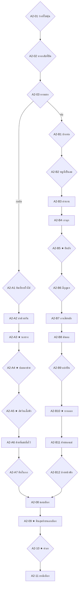

# Act 2 Blueprint — Two Wilds, One Farewell
# พิมพ์เขียวองก์ 2: สองป่า หนึ่งคำลา

| Document control | Value |
|---|---|
| ID / version | `JKB-ND-A2-BLUEPRINT` / **1.0.0** (รื้อสร้างทั้งฉบับ แทน rev.0.2 ซึ่งดูได้จากประวัติ git) |
| Date | 2026-10-21, Asia/Bangkok |
| Authority | [ADR-P0-031](../../adr/ADR-P0-031-act1-4-narrative-rebuild-item-contract-and-balance-model.md) · ADR-P0-030 · ADR-P0-028 · ADR-P0-027 · ADR-P0-026 · [มหาพิมพ์เขียว 5 องก์](five-act-narrative-gameplay-master-plan-v1.1-archived.md) |
| Depends on | [Act 1 Blueprint 1.0.0](act1-living-keepsake-rewrite-blueprint-v1.0-archived.md) |
| Author | Claude (Supreme Narrative Architect) |
| Status | **พิมพ์เขียวฉบับสมบูรณ์ พร้อมบททุกโหนด** · รอ PO ตรวจภาษาไทย |
| Runtime | **8–10 นาทีต่อเส้นทาง** วัดจากตัวบทจริงด้วย [act1-4-runtime-ledger.mjs](../../design-system/evidence/act1-4-runtime-ledger.mjs) |
| Math | ตัวเลขทุกตัวตรงกับ [act1-4-balance-model.mjs](../../design-system/evidence/act1-4-balance-model.mjs) |

> **รูปแบบบท:** เหมือน Act 1 · ตัวเลือกที่มี `แสดงเมื่อ {tag}` จะแสดงเฉพาะเมื่อผู้เล่นมีทักษะหรือของนั้น
>
> **แท็กเพิ่มเติม:** `route_a` / `route_b` · `snack` (เก็บแผ่นกรอบไว้ใน A1-18) · `seeds` (ฝักบัวยังมีเมล็ด) · `scraped` (ปีกนกถลอก) · `reformed` (เงาจิ๋วกลับใจ)

---

## 0. หน้าที่ขององก์นี้

1. **เหตุผลที่กลับบ้านไม่ได้** ต้องเห็นด้วยตา (ADR-021 D3) และ **เหตุผลที่ต้องเข้าเมือง** ต้องมาจากความเข้าใจผิดของเขาเอง ไม่ใช่สัมผัสลึกลับ
2. **มิตรภาพที่มีเดิมพันถึงชีวิต:** เส้นกออ้อ นกกระจอกติดตาข่ายเพราะบินไปเตือนเขาเรื่องนกยาง เขาจึงช่วยมันกลับ · เส้นท่อ เขายืนบังหนูท่อที่กลัวแมลงสาบแมนยิ่งกว่า
3. **ฉายา "อัศวินเสื้อฟ้า"** ทั้งสองเส้นทาง ด้วยเหตุผลของแต่ละทาง
4. **การนับหัวครั้งแรกที่ครบสาม** แล้วจึงตามด้วยคำลาที่ขัดกันด้วยความรัก และสายตาที่บอกผู้เล่นว่าเพื่อนจะตามมา

เส้นทางทั้งสองยาวเท่ากันในเชิงเวลาและเชิงค่า (§1) แต่ให้ประสบการณ์คนละแบบ: กออ้อคือการถูกปกป้องแล้วปกป้องกลับ ท่อคือการปกป้องทั้งที่ตัวเองก็กลัว

---

## 1. ระบบในองก์นี้

| ระบบ | กออ้อ | ท่อ |
|---|---|---|
| Bond เริ่ม | นกกระจอก 20 (25 ถ้าเป่านกหวีดหรือแบ่งแผ่นกรอบ) | หนูท่อ 25 |
| วิกฤต | นกยาง + ตาข่ายเอ็น (A2-A3 ถึง A2-A5) | แมลงสาบแมน (A2-B3 ถึง A2-B10) |
| สี่กุญแจ | A2-A4 มี 7 ทาง | A2-B1 มี 4 ทาง · A2-B6 มี 7 ทาง |
| ประตูความกล้า | A2-A3 (ใจ ≥ 30) | A2-B1 (ใจ ≥ 30) |
| พัก | A2-A7 HP +10 · STA +20 | A2-B12 HP +15..20 · STA +20..25 (ADR-030 D3.2) |
| ร่วมกัน | A2-09 คืนสุดท้ายนอกเมือง: ใจ +15 (อย่างน้อย 55) · Bond +10 ทั้งคู่ · STA อย่างน้อย 70 · HP อย่างน้อย 65 | |

**ค่าปลายองก์ (จากแบบจำลอง)**

| เส้นทาง | HP | ใจ | STA | Bond นก | Bond หนู |
|---|---|---|---|---|---|
| กออ้อ | 65–85 | 55–80 | 70 | 65–70 | 30 |
| ท่อ | 65–85 | 45–88 | 70–75 | 30 | 55–60 |

ใจของเส้นท่อกว้างกว่า เพราะ Calming Breath ลดความกลัวได้ครึ่งหนึ่ง และการไล่เงาจิ๋วไป (A2-B9 ค) มีราคาของมัน ทุกเส้นทางไม่ต้องใช้ Grace

---

## 2. ผังโหนด

---

## 3. ภาพรวมโหนด

| ID | ชื่อ | ตัวเลือก | ระบบ | CG |
|---|---|---|---|---|
| A2-01 | ร่างที่ไม่คุ้น | 3 | STA | `a2-new-body` |
| A2-02 | ทางกลับที่ปิด | 1 + Willpower 2 | ใจ −5 | `a2-blocked-return` |
| A2-03 | ทางแยก | 2 | `route` | `a2-route-split` |
| A2-A1 | หินที่หายใจได้ | 3 | Bond นก เริ่ม | `a2-sparrow-meet` |
| A2-A2 | ล่าด้วยกัน | — | HP +10 · Bond +10 | — |
| A2-A3 | นกยาง | — | ใจ −10 · ประตูความกล้า | `a2-egret` |
| A2-A4 | ปลดตาข่าย | สี่กุญแจ 7 | Bond +15 (ADR-030) | — |
| A2-A5 | อัศวินเสื้อฟ้า | 3 | ใจ +10 · Bond +5 · `a2.knight_named` | `a2-snare-rescue` |
| A2-A6 | ด้ายที่แม่เผื่อไว้ | — | ใจ +5 | `a2-red-thread-tie` |
| A2-A7 | คืนในกก | 3 | HP +10 · STA +20 · ใจ +5 · Bond +5 | — |
| A2-B1 | ปากท่อ | สี่กุญแจ 4 | ประตูความกล้า | `a2-culvert-mouth` |
| A2-B2 | หนูที่เป็นลม | 3 | Bond หนู เริ่ม 25 | `a2-rat-meet` |
| A2-B3 | ตำนาน | — | — | — |
| A2-B4 | เงาลุก | — | ใจ −15 (แม่: −7) | `a2-shadow-rises` |
| A2-B5 | ยืนบัง | 3 | Bond +10 · `inner_resilience` +1 · `a2.stood_guard` | — |
| A2-B6 | สี่กุญแจ | 7 | STA | — |
| A2-B7 | เงาเสียหลัก | — | ใจ +5 | — |
| A2-B8 | ต้นตอ | — | — | `a2-tiny-shadow` |
| A2-B9 | แบ่งปัน | 3 | `boss.reformed_beacon` | — |
| A2-B10 | ทางออก | — | `a2.knight_named` | `a2-glass-beacon` |
| A2-B11 | ด้ายของแม่ | — | ใจ +5 | — |
| A2-B12 | ล้างหน้าพัก | 2 | HP +15..20 · STA +20..25 · Bond +5 | — |
| A2-08 | ขอบเมือง | — | เพื่อนอีกตัว Bond 20 | `a2-friends-meet` |
| A2-09 | คืนสุดท้ายนอกเมือง | — | ใจ · Bond · พัก | `a2-three-under-tin` |
| A2-10 | คำลา | 2 | ใจ −10 · `clinging_ache` / `inner_resilience` | `a2-great-farewell` |
| A2-11 | ธรณีเมือง | — | `story.act2_complete` | — |

---

## 4. บท

### A2-01 · ร่างที่ไม่คุ้น
`pace: normal` `emotion: curious` `CG: a2-new-body` `silence: 0s`

> ที่บ้าน เขากระโดดจากใบบัวไปใบบัว ที่นี่ไม่มีใบบัว มีแต่โคลน กิ่งไม้หัก และหญ้าที่สูงแค่เอว
> โคลนดูดเท้าทุกก้าว เสื้อที่ยังชื้นถ่วงไหล่ลงทุกครั้งที่ขยับแขน
> {!belief_father} *แม่เดินทางนี้มาก่อนแล้ว* เขาบอกตัวเอง *แม่ยังไปได้ ข้าก็ไปได้*
> {belief_father} *พ่อเดินทางนี้มาก่อนแล้ว* เขาบอกตัวเอง *พ่อยังไปได้ ข้าก็ไปได้*

**ตัวเลือก**

1. **ก · เดินช้า ๆ เลาะตลิ่ง** · ผล: STA −5
   > เขาเดินช้าจนนับก้าวได้ แต่ไม่มีก้าวไหนที่ล้ม
2. **ข · กระโดดข้ามกิ่งไม้** · ผล: STA −10 · ใจ +5
   > เขาลอยข้ามกิ่งไม้ไปได้ไกลกว่าที่คิด แล้วหัวเราะออกมาคนเดียวเป็นครั้งแรกตั้งแต่พายุ
3. **ค · นิ่งฟังลมแบบพ่อ** · ผล: —
   > ลมพัดมาจากทางน้ำไหล พาเสียงที่ไม่ใช่เสียงบึงมาด้วย เสียงหึ่ง ๆ ไกล ๆ ที่ไม่ยอมเงียบ

### A2-02 · ทางกลับที่ปิด
`pace: slow` `emotion: grieving` `CG: a2-blocked-return` `silence: 4s`

> เขาลองเดินทวนน้ำกลับไปทางบึง
> ทางน้ำเดิมเต็มไปด้วยตะกอนกับกิ่งไม้ที่พายุอัดไว้แน่นเป็นกำแพง น้ำที่เหลือไหลแรงสวนลงมาจนยืนไม่อยู่
> {!belief_father} "แม่!" เขาตะโกน แล้วรอ
> {belief_father} "พ่อ!" เขาตะโกน แล้วรอ
> มีแต่เสียงน้ำตอบกลับมา

**ตัวเลือก**

1. **ก · หันหลังลงตามน้ำ** · ผล: ใจ −5
   > เขาหันหลังให้บึงเป็นครั้งแรก ทั้งที่ไม่อยากหัน
2. **ข · นึกถึงเสียงที่บ้าน** · แสดงเมื่อ ใจ ≤ 50 · ผล: ใจ −5 แล้ว +15 · `clinging_ache` +1
   > เสียงที่คุ้นที่สุดดังขึ้นในใจ แล้วก็จางไปพร้อมเสียงน้ำ
3. **ค · เช็ดหน้าแล้วเดินต่อ** · แสดงเมื่อ ใจ ≤ 50 · ผล: ใจ −5 แล้ว +10 · STA −10 · `inner_resilience` +1
   > เขาเช็ดหน้าด้วยหลังมือ แล้วเดินลงตามน้ำโดยไม่หันกลับ

### A2-03 · ทางแยก
`pace: normal` `emotion: curious` `CG: a2-route-split` `silence: 0s`

> ลำน้ำแยกเป็นสองสาย
> สายหนึ่งเลาะไปตามกอกออ้อที่ยาวสุดตา ทางยาวแต่สว่าง
> อีกสายมุดหายเข้าไปในท่อปูนใต้ถนน ทางสั้นแต่มืดสนิท
> {stone} หินของพี่บัวเย็นวาบขึ้นมาใต้ชายเสื้อ หรือเขาคิดไปเอง

**ตัวเลือก**

1. **ก · ทางกออ้อ** · ผล: `route = reeds`
2. **ข · ทางท่อ** · ผล: `route = drain`

### A2-A1 · หินที่หายใจได้
`pace: normal` `emotion: warm` `CG: a2-sparrow-meet` `silence: 0s`

> เขานั่งพักบนตอไม้ในกอกออ้อ แล้วก็มีอะไรเบา ๆ ลงมาเกาะบนหัว
> "หินก้อนนี้อุ่น ๆ" เสียงเล็ก ๆ พูดอยู่เหนือหัว "แถมหายใจได้ด้วย ๆ"
> นกกระจอกตัวหนึ่งชะโงกหน้าลงมามองเขากลับหัว "เจ้าไม่ใช่หินเหรอ"
> "ข้าเป็นกบ"
> "กบใส่เสื้อ ๆ" มันพูดซ้ำ เหมือนต้องได้ยินตัวเองพูดอีกทีถึงจะเชื่อ
> "งั้นข้าเรียกเจ้าว่าเจ้าเสื้อฟ้าแล้วกัน" มันตัดสินใจเองเสร็จสรรพ

**ตัวเลือก** (ทุกทาง: ใจ +5)

1. **ก · ทักทายกลับ** · ผล: Bond นก 20
   > "ข้าไม่มีชื่อหรอก ๆ" นกว่า "ใคร ๆ ในกอกกเรียกข้าว่าเจ้าปากมาก ข้าก็ไม่รู้ว่าทำไม ๆ"
2. **ข · เป่านกหวีดให้ฟัง** · แสดงเมื่อ {whistle} · ผล: Bond นก 25 · `whistle.sparrow_promise`
   > เสียงต่ำแล้วสูง นกเอียงคอฟัง แล้วร้องตามได้เกือบเหมือน "เสียงนี้ดี ๆ ได้ยินเมื่อไหร่ ข้าจะมา"
3. **ค · แบ่งแผ่นกรอบให้** · แสดงเมื่อ {snack} · ผล: Bond นก 25 · `a2.snack_clue`
   > นกจิกไปคำหนึ่งแล้วตาโต "ของกรอบ ๆ นี่มาจากเมืองนะ คนในเมืองชอบทำหล่น ๆ"
   > *เมือง* เขาจำคำนั้นไว้

### A2-A2 · ล่าด้วยกัน
`pace: fast` `emotion: warm` `CG: —` `silence: 0s`

> นกกระจอกบินนำ ชี้ตั๊กแตนให้ทีละตัว "ตรงนั้น ๆ ตรงนั้นอีก ไม่ใช่ตรงนั้น ตรงนี้ ๆ"
> {father} เขานั่งนิ่งรอลมอย่างที่พ่อสอน แล้วตวัดได้ทุกตัวที่นกชี้ นกกระจอกถึงกับเงียบไปหนึ่งอึดใจ
> {!father} เขาพลาดสองตัวแรก ตัวที่สามถึงได้ นกกระจอกปรบปีกให้เหมือนเป็นเรื่องใหญ่ที่สุดในกอกก
> ท้องอิ่มเป็นครั้งแรกตั้งแต่พายุ

**ตัวเลือก** (ทุกทาง: HP +10 · STA −5 หรือ 0 ถ้ามี Hunter's Instinct · Bond นก +10)

1. **ก · แบ่งตั๊กแตนตัวใหญ่ที่สุดให้นก**
   > "ตัวเท่าหัวข้าเลยนะนั่น ๆ" นกกระจอกถอยหนีไปครึ่งกิ่ง "เจ้ากินเถอะ ข้าดูเฉย ๆ ก็อิ่มแล้ว"
2. **ข · ถามว่านกกินอะไร**
   > "เมล็ดหญ้า หนอนตัวเล็ก ๆ แล้วก็ข้าวที่คนทำหล่น ๆ" มันว่า "คนทำหล่นเก่งมาก ข้าชอบคน"

### A2-A3 · ★ นกยาง
`pace: fast` `emotion: afraid` `CG: a2-egret` `silence: 0s`

> แล้วนกกระจอกก็เงียบไปกะทันหัน
> เงาขาวยาวเงาหนึ่งก้าวช้า ๆ อยู่ในน้ำตื้นหน้ากอกก นกยางตัวสูงกว่าเขาสองเท่า คองอเหมือนคันเบ็ด
> นกยางกินกบ ใคร ๆ ในบึงก็รู้
> มันยังไม่เห็นเขา แต่คอของมันค่อย ๆ หมุนมาทางกอกกทีละนิด
> นกกระจอกถลาออกไปส่งเสียงจากอีกฝั่ง ล่อให้นกยางหันไปทางอื่น
> แล้วปีกข้างหนึ่งของมันก็เกี่ยวเข้ากับเส้นเอ็นใส ๆ ที่ขึงอยู่ระหว่างต้นอ้อ ตาข่ายเก่าที่ใครสักคนทิ้งไว้
> ยิ่งดิ้น เอ็นยิ่งรัด และนกยางก็หันกลับมาตามเสียงนั้นแล้ว

ผล: ใจ −10 · **ประตูความกล้า** (ใจ ≥ 30 ผ่านเลย ถ้าไม่ถึงต้องใช้ Calming Breath / Memory Willpower / ยืนหยัดเอง)

### A2-A4 · ★ ปลดตาข่าย
`pace: fast` `emotion: urgent` `CG: —` `silence: 0s`

> เจ้ากบวิ่งลุยโคลนไปหานก ตัวยังสั่นอยู่ทุกก้าว
> "อย่าดิ้น ๆ" เขาบอก ใช้คำพูดแบบนกเองโดยไม่รู้ตัว
> เส้นเอ็นพันปีกไว้สามรอบ และนกยางยกเท้าข้างหนึ่งขึ้นจากน้ำแล้ว

**ตัวเลือก** (สี่กุญแจ · ทุกทาง: Bond นก +15)

1. **ก · หาปมที่รับแรง** · แสดงเมื่อ {father} · ผล: STA −5
   > เขามองเส้นเอ็นอย่างที่พ่อมองลม จนเห็นปมเดียวที่ดึงทุกเส้นไว้ แล้วค่อย ๆ คลายมันด้วยนิ้ว
2. **ข · หายใจสองจังหวะให้นกฟัง** · แสดงเมื่อ {mother} · ผล: STA −10
   > "หายใจเข้า นับสอง" เขากระซิบ นกหยุดดิ้น เอ็นจึงหยุดรัด แล้วเขาก็แกะทีละเส้นได้ทัน
3. **ค · หาของมีคม** · แสดงเมื่อ {siblings} · ผล: STA −10
   > ก้านอ้อต้นหนึ่งสั่นทั้งที่ไม่มีลม เขาก้มดูโคนของมัน แล้วเจอเปลือกหอยกาบคมกริบโผล่จากโคลน
4. **ง · ชูหินใสรับแสง** · แสดงเมื่อ {stone} · ผล: STA −5
   > แสงในหินทำให้เส้นเอ็นที่แทบมองไม่เห็นวาวขึ้นทีละเส้น เขาเห็นชัดว่าต้องปลดเส้นไหนก่อน
5. **จ · เป่านกหวีดไล่นกยาง** · แสดงเมื่อ {whistle} · ผล: STA −10
   > เสียงแหลมดังลั่นกอกก นกยางสะดุ้งถอยไปสามก้าว พอให้เขาแกะเอ็นได้ช้า ๆ
6. **ฉ · เขย่าฝักบัวปลอบ** · แสดงเมื่อ {pod,seeds} · ผล: STA −10
   > เสียงกรุ๊งกริ๊งเบา ๆ เหมือนฝนตกบนบึง นกค่อย ๆ หยุดดิ้น
7. **ช · ดึงด้วยมือเปล่า** · ผล: HP −5 · STA −15 · `sparrow.wing_scraped`
   > เขาดึงเอ็นด้วยมือเปล่า มันบาดฝ่ามือเป็นเส้น แต่เขาไม่ปล่อย

### A2-A5 · ★ อัศวินเสื้อฟ้า
`pace: slow` `emotion: relieved` `CG: a2-snare-rescue` `silence: 3s`

> เส้นสุดท้ายหลุดออก นกกระจอกร่วงลงมาในมือเขาพอดี
> ทั้งสองหมอบนิ่งอยู่ในกอกก จนเงาขาวยาวเดินผ่านไปช้า ๆ แล้วหายไปทางปลายน้ำ
> นกกระจอกซบหัวลงกับมือเล็ก ๆ ของเขา ตัวยังสั่นอยู่
> "เจ้ายืนอยู่ตรงหน้านกยาง ทั้งที่ตัวสั่น" มันว่า เสียงเบากว่าทุกครั้ง
> "อัศวินชัด ๆ อัศวินเสื้อฟ้า"

**ตัวเลือก** (ทุกทาง: ใจ +10 · Bond นก +5 · `a2.knight_named`)

1. **ก · ตรวจปีกให้**
   > {scraped} ปีกมีรอยถลอกยาว เขาเป่าลมเบา ๆ ให้ อย่างที่แม่เคยเป่าแผลให้เขา
   > {!scraped} ปีกไม่เป็นอะไรเลยสักขน นกกระจอกกางให้ดูสองรอบเพื่อพิสูจน์
2. **ข · แบ่งเมล็ดบัวให้** · แสดงเมื่อ {pod,seeds} · ผล: เมล็ด −1
   > นกกินเมล็ดบัวหมดในสามคำ "อร่อยกว่าหนอนอีก ๆ" ฝักบัวเบาลงนิดหนึ่ง
3. **ค · นั่งเงียบ ๆ ด้วยกัน**
   > ไม่มีใครพูดอะไรอีก จนลมในกอกกกลับมาส่ายเบา ๆ

### A2-A6 · ด้ายที่แม่เผื่อไว้
`pace: slow` `emotion: tender` `CG: a2-red-thread-tie` `silence: 4s`

> ตอนพักเหนื่อย ลมเย็นลอดตะเข็บคอเสื้อที่ปริจนเขาตัวสั่น
> เขาล้วงมือเข้าไปใต้ชายเสื้อด้านใน ด้ายยังอยู่ เปียก แต่ยังพันเป็นวงอย่างที่แม่พันไว้
> เขาคลายมันออกทีละรอบ ช้าเท่าตอนที่แม่พันมันเข้าไป แล้วร้อยรั้งตะเข็บคอเสื้อให้หุบเข้าหากัน
> นกกระจอกเกาะดูอยู่บนกิ่งอ้อ ไม่ส่งเสียงเลยสักคำ ซึ่งไม่เคยเกิดขึ้น
> *เผื่อไว้* แม่ว่าไว้อย่างนั้น

ผล: ใจ +5

### A2-A7 · คืนในกก
`pace: slow` `emotion: warm` `CG: —` `silence: 0s`

> คืนนั้นนกกระจอกเกาะต้นอ้อเหนือหัวเขา และไม่ยอมหลับเพราะยังพูดไม่จบ
> มันมีความเห็นเรื่องหนอนทุกชนิด ไม่ชอบแมลงวันเลยสักตัว และคิดว่าเป็ดเป็นนกที่เสียงดังเกินจำเป็น
> "เจ้าจะไปไหน ๆ" มันถามในที่สุด
> {!belief_father} "ไปตามแม่" เขาตอบ "แม่ถูกพายุพัดมาเหมือนข้า แม่วางข้าไว้ริมตลิ่งแล้วไปตามหาพี่ ๆ"
> {belief_father} "ไปตามพ่อ" เขาตอบ "พ่อถูกพายุพัดมาเหมือนข้า พ่อวางข้าไว้ริมตลิ่งแล้วไปตามหาพี่ ๆ"
> นกกระจอกเงียบไปนาน ซึ่งเป็นครั้งแรกของคืนนั้น
> "ฝูงของข้าย้ายรังไปตอนข้าป่วย" มันพูดขึ้นมาเอง "ไม่มีใครรอ ข้าก็เลยอยู่กอกกนี้มาตั้งแต่นั้น ๆ"
> "ไม่มีใครนับเหรอ" เขาถาม
> "นับอะไร" มันถามกลับ แล้วก็ไม่ได้รอคำตอบ
> "งั้นข้าจะพาไปถึงขอบเมือง" มันว่า "หลังจากนั้นค่อยว่ากัน ๆ"

**ตัวเลือก** (ทุกทาง: HP +10 · STA +20 · ใจ +5 · Bond นก +5)

1. **ก · เล่าเรื่องการนับหัวของแม่**
   > นกกระจอกฟังจนจบ แล้วนับนิ้วเท้าตัวเองดูว่ามีครบไหม ครบ
2. **ข · เล่าเรื่องพี่แหนกับฝักบัว**
   > "แกล้งเป่าฝักให้ชนะทุกที ๆ" นกหัวเราะจนเกือบตกกิ่ง "ข้าชอบพี่แหนแล้ว"
3. **ค · ถามเรื่องเมือง**
   > "เมืองไม่มีวันมืดสนิท ๆ" นกว่า "ไฟเปิดทั้งคืน คนเดินทั้งคืน ไม่มีใครมองลงมาข้างล่างเลย"

### A2-B1 · ปากท่อ
`pace: slow` `emotion: afraid` `CG: a2-culvert-mouth` `silence: 0s`

> ปากท่อปูนกว้างกว่าตัวเขาไม่มาก ขอบบนสูงพ้นหัวไปแค่คืบเดียว
> ข้างในมืดจนมองไม่เห็นว่ามันยาวแค่ไหน มีแต่เสียงน้ำหยดก้องกลับมา
> เจ้ากบกลัวความมืด และตอนนี้ไม่มีพี่บัวมานั่งข้าง ๆ

**ตัวเลือก** (สี่กุญแจ · ทุกทาง: STA −5 · แล้วเข้าประตูความกล้า)

1. **ก · หายใจสองจังหวะ** · แสดงเมื่อ {mother} · ผล: ใจ −5
   > หายใจเข้า นับสอง หายใจออก นับสอง แล้วเขาก็ก้าวเข้าไป
2. **ข · ชูหินใสส่องทาง** · แสดงเมื่อ {stone} · ผล: ใจ 0
   > แสงจากหินพอให้เห็นผนังโค้งสองข้าง ความมืดเลยมีขอบเขตขึ้นมา
3. **ค · เป่านกหวีดฟังเสียงสะท้อน** · แสดงเมื่อ {whistle} · ผล: ใจ 0
   > เสียงต่ำแล้วสูงวิ่งไปในท่อแล้วก้องกลับมาช้ามาก ท่อยาวมาก แต่เขารู้แล้วว่ามีทางออก
4. **ง · ก้าวเข้าไปทั้งที่กลัว** · ผล: ใจ −10
   > เขาก้าวเข้าไปทั้งที่ขาไม่อยากก้าว

### A2-B2 · หนูที่เป็นลม
`pace: normal` `emotion: curious` `CG: a2-rat-meet` `silence: 0s`

> ลึกเข้าไปในท่อ มีตัวกลม ๆ ตัวหนึ่งคุ้ยเศษใบไม้อยู่
> มันหันมาเจอเขาพอดี กบสูงเท่าครึ่งท่อ ใส่เสื้อ ยืนสองขา
> มันร้อง "อุ๊ย" หนึ่งที แล้วล้มตึงไปทั้งตัว
> หนูท่อเป็นลม
> ข้าง ๆ ตัวมันมีกองของวาว ๆ เรียงไว้เป็นระเบียบ ช้อนพลาสติกหัก เศษกระเบื้องลายดอก ลูกปัดหนึ่งเม็ด ของที่ใครสักคนเก็บสะสมมานานและไม่เคยมีใครให้อวด

**ตัวเลือก** (ทุกทาง: Bond หนู 25 · ใจ +5)

1. **ก · พัดให้ฟื้น**
   > เขาพัดลมให้อยู่นานจนหนวดหนูกระดิก "แกไม่ใช่ผีท่อเหรอ" มันถามเสียงอ่อย
2. **ข · ยื่นแผ่นกรอบให้ดม** · แสดงเมื่อ {snack} · ผล: `a2.snack_clue`
   > หนูฟื้นทันทีที่ได้กลิ่น "ของจากเมือง!" มันว่า "แกไปเมืองมาเหรอ"
   > เขาทวนคำนั้นในใจซ้ำ ๆ *เมือง*
3. **ค · เป่านกหวีดเบา ๆ** · แสดงเมื่อ {whistle} · ผล: `whistle.rat_promise`
   > หนูสะดุ้งตื่นแล้วฟังจนจบ "เสียงนี้ข้าจำได้แล้ว ได้ยินที่ไหน ข้าจะตามไปทุกท่อ"

### A2-B3 · ตำนาน
`pace: slow` `emotion: afraid` `CG: —` `silence: 0s`

> หนูท่อพาเขาเดินลึกเข้าไป แล้วก็หยุด หันมากระซิบ
> "ข้างหน้ามีเรื่องเล่าอยู่เรื่องหนึ่งนะ... แมลงสาบแมน"
> "ตัวใหญ่เท่าผนัง หนวดยาวกวาดได้ทั้งท่อ ใครเห็นแล้วก็ไม่กล้าเดินผ่านอีกเลย"
> ที่บึงไม่มีอะไรชื่อแบบนี้
> {father} ท้องเขาร้องขึ้นมาเองอย่างไม่ถูกจังหวะ หนูท่อหันขวับ "อย่าแม้แต่จะคิด"

### A2-B4 · เงาลุก
`pace: slow` `emotion: afraid` `CG: a2-shadow-rises` `silence: 2s`

> เงาดำแผ่ขึ้นบนผนังโค้งของท่อ ปีกเงาสองข้างพองกาง หนวดเส้นยาวกวาดผ่านเพดานช้า ๆ
> ผิวน้ำขังใต้เท้าสะท้อนมันซ้ำอีกตัวหนึ่ง กลับหัว
> ใบไม้แห้งตามพื้นสั่นตามเสียงลมที่ลอดตะแกรงลงมา
> หนูท่อถอยมาหลบหลังข้อเท้าเจ้ากบ ตัวสั่นจนขนตั้ง

ผล: ใจ −15 (มี Calming Breath: −7)

### A2-B5 · ★ ยืนบัง
`pace: slow` `emotion: afraid` `CG: —` `silence: 2s`

> เจ้ากบก็กลัว ขาเขาอยากถอยมากกว่าใคร
> แต่ข้างหลังเขามีตัวที่กลัวยิ่งกว่า
> เขาจึงไม่ถอย
> {mother} เขาหายใจเข้าลึกสองจังหวะอย่างที่แม่สอน แล้วผ่อนออกช้า ๆ ให้หนูได้ยิน

**ตัวเลือก** (ทุกทางคือการปกป้อง · ผล: Bond หนู +10 · `inner_resilience` +1 · `a2.stood_guard`)

1. **ก · ยืนบังหนูไว้**
   > เขาขยับไปยืนตรงกลาง ระหว่างหนูกับผนัง
2. **ข · จับมือหนูไว้แน่น**
   > มือหนูเล็กและเย็น แต่บีบตอบกลับมา
3. **ค · กระซิบให้หนูหลับตา**
   > "หลับตาไว้ ข้าดูเอง"

### A2-B6 · สี่กุญแจ
`pace: fast` `emotion: urgent` `CG: —` `silence: 0s`

> เงาบนผนังโยกไปมา ใหญ่ขึ้นทุกครั้งที่ลำแสงจากข้างบนสั่น

**ตัวเลือก**

1. **ก · ให้หนูพาอ้อมไปหาต้นแสง** · แสดงเมื่อ Bond หนู ≥ 30 · ผล: STA −5
   > "ทางนี้ ข้ารู้ทุกซอก" หนูกระซิบ แล้วพาลัดเลาะไปตามขอบท่อ
2. **ข · ดูว่าเงาสั่นตามอะไร** · แสดงเมื่อ {siblings} · ผล: STA −5
   > เงาสั่นพร้อมแสงทุกครั้ง เหมือนก้านบัวที่สั่นทั้งที่ไม่มีลม ข้างใต้ต้องมีใครอยู่
3. **ค · กระโดดให้เงาตัวเองขึ้นผนัง** · ผล: STA −15
   > เงาของเขาขึ้นไปบนผนัง ใหญ่พอ ๆ กับเงานั้น เงาต่อเงา
4. **ง · ส่องหินใสย้อนแสง** · แสดงเมื่อ {stone} · ผล: STA 0
   > แสงจากหินตัดเข้ากลางเงา เงาแหว่งเป็นรู เขาเห็นเลยว่ามันบางแค่ไหน
5. **จ · เป่านกหวีดเสียงดัง** · แสดงเมื่อ {whistle} · ผล: STA −5
   > เงาสะดุ้งสุดตัว ทั้งที่เงาไม่ควรสะดุ้งเป็น
6. **ฉ · เขย่าฝักบัวให้ก้อง** · แสดงเมื่อ {pod,seeds} · ผล: STA −5
   > เสียงกรุ๊งกริ๊งก้องไปทั้งท่อเหมือนฝนตก เงาหดวูบ
7. **ช · เดินฝ่าเข้าไปตรง ๆ** · ผล: STA −15
   > เขาเดินฝ่าเข้าไปในเงานั้น แล้วก็พบว่าเงาไม่มีน้ำหนักเลย

### A2-B7 · เงาเสียหลัก
`pace: normal` `emotion: relieved` `CG: —` `silence: 0s`

> เงาบนผนังเซไปทางหนึ่ง แล้วเซกลับอีกทาง หนวดยาวสองเส้นพันกันเอง
> แล้วมันก็หงายหลังลงไปกองบนเพดานท่อ ทั้งที่ไม่มีอะไรล้มจริง ๆ สักอย่าง
> หนูท่อหลุดหัวเราะออกมาหนึ่งที แล้วรีบเอามือปิดปาก

ผล: ใจ +5

### A2-B8 · ต้นตอ
`pace: slow` `emotion: curious` `CG: a2-tiny-shadow` `silence: 2s`

> เจ้ากบไล่สายตาตามลำแสงขึ้นไป ใกล้ฝาท่อมีเศษกระจกชิ้นเล็กติดอยู่ในซี่ตะแกรง รับแสงจากข้างบนสะท้อนลงมา
> ตรงกลางลำแสงนั้น มีเงาก้อนกลมตัวจิ๋วยืนตัวสั่นอยู่ ตาโตสองดวงวาวขึ้นในความมืด
> ตัวมันเล็กกว่าฝักบัวของพี่แหนเสียอีก
> ที่มันยืนกลางแสง ก็เพื่อจะได้ดูตัวใหญ่
> มันอยู่ในท่อนี้คนเดียวมานานแค่ไหนแล้วก็ไม่รู้

### A2-B9 · แบ่งปัน
`pace: slow` `emotion: tender` `CG: —` `silence: 0s`

> เจ้ากบนึกถึงคืนแรกริมตลิ่ง ที่เขานับได้แค่หนึ่ง

**ตัวเลือก**

1. **ก · แบ่งเมล็ดบัวให้** · แสดงเมื่อ {pod,seeds} · ผล: เมล็ด −1 · ใจ +10 · Bond หนู +10 · `boss.reformed_beacon`
   > เงาจิ๋วกินเมล็ดบัวด้วยเสียงดุ๊กดิ๊กดีใจ แล้วกระเถิบเข้ามาใกล้ขึ้นอีกนิด
2. **ข · นั่งลงเงียบ ๆ ข้างมัน** · ผล: ใจ +10 · Bond หนู +10 · `boss.reformed_beacon`
   > เขานั่งลงห่างพอดี ไม่ใกล้จนมันกลัว ไม่ไกลจนมันคิดว่าถูกทิ้ง
3. **ค · ไล่มันไป** · ผล: ใจ −5 · STA −5 · Bond หนู +5
   > เงาจิ๋วมุดหนีเข้าซอกไป ลำแสงยังตกลงบนผนังเหมือนเดิม

### A2-B10 · ★ ทางออก
`pace: slow` `emotion: hopeful` `CG: a2-glass-beacon` `silence: 3s`

> {reformed} เงาจิ๋วปีนขึ้นซี่ตะแกรง ใช้ตัวกลม ๆ ดันเศษกระจกให้เอียง
> {reformed} ลำแสงหันไปทอดยาวตามทางท่อ ไกลออกไปมีปากท่อสว่างอยู่ปลายทาง
> {reformed} เงาจิ๋วโบกตัวไปมาสองสามที แล้วมุดหายเข้าซอกไป
> {!reformed} หนูท่อพาเดินในความมืดตามความจำ ช้ากว่า แต่ไม่หลงสักเลี้ยว
> "แก..." หนูท่อมองหน้าเจ้ากบ "แกปราบแมลงสาบแมนได้"
> {reformed} "ข้าไม่ได้ปราบมัน" เจ้ากบว่า "มันแค่กลัว"
> "งั้นต่อไปใครถามถึงแมลงสาบแมน" หนูว่า "ข้าจะเล่าว่ามีอัศวินเสื้อฟ้าคนหนึ่ง ไม่ยอมถอยให้มัน"

ผล: `a2.knight_named`

### A2-B11 · ด้ายของแม่
`pace: slow` `emotion: tender` `CG: —` `silence: 3s`

> ที่ปากท่อ ลมเย็นพัดสวนเข้ามาจนตะเข็บคอเสื้อที่ปริเปิดอ้า
> เขาล้วงด้ายที่แม่พันเก็บไว้ออกมาจากใต้ชายเสื้อ มันยังขดเป็นวงอย่างที่แม่พัน
> หนูท่อช่วยจับคอเสื้อให้หุบไว้ ส่วนเขาร้อยด้ายรั้งทีละรู ช้า ๆ อย่างที่แม่ทำ
> "ด้ายใครน่ะ" หนูถาม
> "ของแม่" เขาตอบ "แม่เผื่อไว้"

ผล: ใจ +5

### A2-B12 · ล้างหน้าพัก
`pace: slow` `emotion: relieved` `CG: —` `silence: 0s`

> นอกปากท่อมีแอ่งน้ำฝนใสแจ๋ว
> หนูท่อล้างหน้าอย่างพิถีพิถัน ล้างหนวดทีละเส้น ล้างหลังหูสองรอบ แล้วก็ยังไม่พอใจ

**ตัวเลือก** (ทุกทาง: ใจ +5 · Bond หนู +5)

1. **ก · ดื่มน้ำแล้วนอนพัก** · ผล: HP +20 · STA +20
   > น้ำเย็นไหลลงคอ เขาหลับไปตอนที่หนูยังล้างหนวดไม่เสร็จ
2. **ข · ล้างเสื้อแล้วนอนพัก** · ผล: HP +15 · STA +25
   > โคลนจากท่อละลายออกจากเสื้อยืดสีฟ้า สีเดิมกลับมาครึ่งหนึ่ง

### A2-08 · ขอบเมือง
`pace: normal` `emotion: warm` `CG: a2-friends-meet` `silence: 0s`

> ลำน้ำพาเขามาถึงชายป่าละเมาะ ตรงที่ทุ่งหญ้าเริ่มกลายเป็นถนน
> {route_a} นกกระจอกส่งเสียงทักใครบางคนใต้รากไม้ "เจ้าหนูขี้ตกใจ ยังไม่ตายอีกเหรอ ๆ"
> {route_a} หนูท่อตัวกลมโผล่ออกมา "นกปากมาก ยังไม่หุบปากอีกเหรอ"
> {route_b} หนูท่อชี้ขึ้นไปบนกิ่งไม้ "นั่นไง นกปากมาก ทั้งป่ามีตัวเดียว"
> {route_b} นกกระจอกตัวหนึ่งโฉบลงมา "เจ้าหนูขี้ตกใจ นี่เพื่อนใหม่เหรอ ๆ"
> สองตัวนั้นรู้จักกันมานานพอจะแกล้งกันได้ทุกประโยค

ผล: เพื่อนอีกตัว Bond 20

### A2-09 · ★ คืนสุดท้ายนอกเมือง
`pace: slow` `emotion: warm` `CG: a2-three-under-tin` `silence: 3s`

> คืนนั้นทั้งสามนอนเบียดกันใต้แผ่นสังกะสีเก่า
> "ที่บ้านข้า แม่นับหัวทุกคืน" เจ้ากบเล่า
> "นับทำไม ๆ"
> "ให้รู้ว่าอยู่ครบ"
> เขาแตะหัวนกกระจอก "หนึ่ง" แตะหัวหนูท่อ "สอง" แล้วแตะหัวตัวเอง "สาม"
> ไม่มีใครพูดอะไรอยู่ครู่หนึ่ง
> "ของที่พายุพัดมา ไปจบที่เมืองทั้งนั้นแหละ" หนูท่อพูดขึ้นในความมืด
> "ข้าบินผ่านเมืองมาเยอะ ไม่เคยเห็นกบใส่เสื้อเลยสักตัว" นกกระจอกว่า "นอกจากเจ้า ๆ"
> {!belief_father} "แม่ไม่ใส่เสื้อ" เจ้ากบตอบ "แม่มีโบว์"
> {belief_father} "พ่อไม่ใส่เสื้อ" เจ้ากบตอบ "พ่อมีหนวด"
> {route_a} แล้วหนูก็เล่าเรื่องแมลงสาบแมนในท่อจนนกขนลุกทั้งตัว เจ้ากบบอกหนูว่า "ถ้าเจอเมื่อไหร่ ข้าจะยืนบังเจ้าเอง"
> {route_b} แล้วหนูก็เล่าเรื่องอัศวินเสื้อฟ้าให้นกฟัง เกินจริงไปสามเท่า

ผล: ใจ +15 (อย่างน้อย 55) · Bond +10 ทั้งคู่ · STA อย่างน้อย 70 · HP อย่างน้อย 65 · กออ้อ: `a2.promised_rat`

### A2-10 · ★ คำลา
`pace: slow` `emotion: grieving` `CG: a2-great-farewell` `silence: 5s`

> เช้าวันรุ่งขึ้น ทั้งสามยืนอยู่ที่ขอบเมือง เสียงรถดังมาเป็นระลอกเหมือนพายุที่ไม่ยอมจบ
> "อย่าไปเลย" หนูท่อพูดเป็นครั้งที่สาม "ข้างในนั้นเสียงดัง คนเยอะ ไม่มีที่ให้หลบ"
> {!belief_father} "แม่อาจอยู่ในนั้น"
> {belief_father} "พ่ออาจอยู่ในนั้น"
> นกกระจอกอ้าปากจะเถียง แล้วก็หุบลง
> หลังประโยคนั้น ไม่มีใครพูดอะไรได้อีก
> นกกระจอกบินลงมาเกาะไหล่เขานานหนึ่งอึดใจ หนูท่อเอาหัวซบข้อเท้าเขานานเท่ากัน

**ตัวเลือก** (ทุกทาง: ใจ −10)

1. **ก · หันกลับไปมองอีกครั้ง** · ผล: `clinging_ache` +1
   > พอพ้นทางเลี้ยว เขาหันกลับไปมอง เงาเล็ก ๆ สองเงายังยืนอยู่ตรงนั้น
2. **ข · มองไปข้างหน้า** · ผล: `inner_resilience` +1
   > เขาไม่หันกลับ เพราะรู้ว่าถ้าหัน ขาจะไม่ยอมเดินต่อ

### A2-11 · ธรณีเมือง
`pace: slow` `emotion: hopeful` `CG: —` `silence: 3s`

> ข้างหลังเขา นกกระจอกหันไปมองหนูท่อ
> หนูท่อพยักหน้า
> ทั้งสองไม่ได้พูดอะไรกันเลย

ผล: `story.act2_complete` · ผู้เล่นรู้ก่อนเจ้ากบว่าเพื่อนจะตามมา

---

## 5. ไอเทม · Bond · Status ในองก์นี้

| ไอเทม | กออ้อ | ท่อ |
|---|---|---|
| นกหวีดของพ่อ | A2-A1 นกรับปากว่า "ได้ยินเมื่อไหร่ ข้าจะมา" · A2-A4 ไล่นกยาง | A2-B1 ฟังเสียงสะท้อนรู้ความยาวท่อ · A2-B2 หนูรับปากว่าจะตามเสียงนี้ไปทุกท่อ · A2-B6 เงาสะดุ้ง |
| หินใสของพี่บัว | A2-A4 ทำให้เอ็นใสวาวขึ้น (STA ถูกที่สุด) | A2-B1 ทำให้ความมืดมีขอบเขต · A2-B6 ตัดกลางเงา (STA 0) |
| ฝักบัวของพี่แหน | A2-A4 เสียงปลอบนก · A2-A5 เมล็ดให้นก | A2-B6 เสียงก้องเหมือนฝน · A2-B9 เมล็ดให้เงาจิ๋ว |
| แผ่นกรอบที่เก็บไว้ | A2-A1 นกบอกว่ามาจากเมือง | A2-B2 หนูบอกว่ามาจากเมือง |
| ด้ายของแม่ | A2-A6 ผูกคอเสื้อเอง | A2-B11 หนูช่วยจับ เจ้ากบพูดคำว่า "เผื่อไว้" เอง |

ของทุกชิ้นยัง `held` เมื่อจบองก์ (ADR-028 D6) ยกเว้นเมล็ดบัวที่แบ่งไปซึ่งเป็นตัวนับ ไม่ใช่ไอเทม

**การตอบแทนกัน:** กออ้อ นกเสี่ยงเพื่อเขาก่อน แล้วเขาช่วยนกกลับ · ท่อ เขายืนบังหนูทั้งที่ตัวเองกลัว ทั้งสองแบบจะสลับบทบาทกันใน Act 4 (A4-03, A4-06)

---

## 6. ส่งต่อ Act 3

| ค่า / flag | ใช้ที่ |
|---|---|
| `bond_sparrow` · `bond_rat` | ความเร็วในการช่วยชีวิตที่ A4-04 |
| `whistle.sparrow_promise` · `whistle.rat_promise` | A4-03 เสียงตอบกลับกลางพายุ |
| `a2.knight_named` | Act 5 H07 |
| `a2.promised_rat` | Act 4 ทางล่าง: รักษาสัญญายืนบังหนู |
| `boss.reformed_beacon` | Act 4 ทางล่าง: เงาจิ๋วกลับมาช่วยส่องทาง |
| `a2.snack_clue` | เหตุผลเพิ่มอีกข้อที่เชื่อว่าพ่อหรือแม่อยู่ในเมือง |
| `sparrow.wing_scraped` | Act 4 นกบินช้าลงหนึ่งจังหวะในฉากหลังคา (บทเท่านั้น ไม่ลดค่า) |

---

## 7. Runtime Ledger

วัดด้วย `node docs/design-system/evidence/act1-4-runtime-ledger.mjs 2` ผลอยู่ใน ADR-P0-031 §D9

---

## 8. Verification

- [ ] ทั้งสองเส้นทางยาว 8–10 นาที และค่าปลายองก์ตรงกับแบบจำลอง
- [ ] ไม่มีบล็อกข้อความซ้ำข้ามเส้นทาง (ฉากผูกด้ายของสองเส้นทางเขียนต่างกัน)
- [ ] แมลงสาบแมนไม่มีรูปร่างแมลงจริง และจบด้วยความใจดีหรืออย่างน้อยไม่มีใครเจ็บ
- [ ] ไม่มีตัวละครใดเรียกเขาว่า "เจ้ากบ" (นกเรียก "เจ้าเสื้อฟ้า" หนูเรียก "แก")
- [ ] กออ้อ = นกเท่านั้น · ท่อ = หนูเท่านั้น จนถึง A2-08
- [ ] `clinging_ache` เพิ่มเฉพาะ A2-02 ข และ A2-10 ก ซึ่งผู้เล่นเลือกเอง
- [ ] ผู้เล่นเห็นสายตาของเพื่อนใน A2-11 แต่เจ้ากบไม่เห็น

— End of Act 2 Blueprint 1.0.0 —
