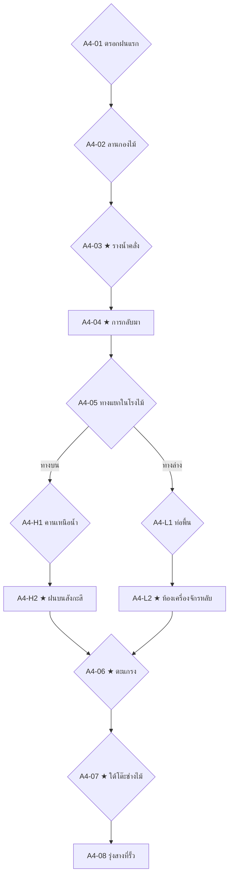

# Act 4 Blueprint — The Workshop Labyrinth
# พิมพ์เขียวองก์ 4: เขาวงกตหลังโรงช่างไม้

| Document control | Value |
|---|---|
| ID / version | `JKB-ND-A4-BLUEPRINT` / **1.0.0** (เขียนใหม่ทั้งฉบับตาม ADR-P0-030 D1 · ฉากสวนเดิมของ rev.0.1 ย้ายไป Act 5 แล้ว ดูได้จากประวัติ git) |
| Date | 2026-10-21, Asia/Bangkok |
| Authority | [ADR-P0-031](../../adr/ADR-P0-031-act1-4-narrative-rebuild-item-contract-and-balance-model.md) · ADR-P0-030 · ADR-P0-028 · ADR-P0-020 · [มหาพิมพ์เขียว 5 องก์](five-act-narrative-gameplay-master-plan-v1.1-archived.md) |
| Depends on | [Act 3 Blueprint 1.0.0](act3-living-keepsake-rewrite-blueprint-v1.0-archived.md) |
| Author | Claude (Supreme Narrative Architect) |
| Status | **พิมพ์เขียวฉบับสมบูรณ์ พร้อมบททุกโหนด** · รอ PO ตรวจภาษาไทย |
| Runtime | **8–10 นาทีต่อเส้นทาง** วัดจากตัวบทจริงด้วย [act1-4-runtime-ledger.mjs](../../design-system/evidence/act1-4-runtime-ledger.mjs) |
| Math | ตัวเลขทุกตัวตรงกับ [act1-4-balance-model.mjs](../../design-system/evidence/act1-4-balance-model.mjs) |

> **แท็กเพิ่มเติม:** `instant` / `late` / `self` (ระดับการช่วยชีวิตที่ A4-04) · `saw_follower` · `left_food` · `light` (มีหินใส ลูกแก้ว หรือเงาจิ๋วกลับใจ) · `sacrificed_stone` · `cloth` (เก็บผ้าเช็ดหน้า) · `lit_window` (ไปทางบน)

---

## 0. หน้าที่ขององก์นี้

**คำถามของฉาก:** เจ้ากบจะผ่านคืนฝนแรกหลังพายุได้ไหม ถ้าไม่มีใครอยู่ข้าง ๆ แล้วเรื่องตอบกลับว่าเขามีคนอยู่ข้าง ๆ มาตลอด

**ตัวเร่งความตึง:** ระดับน้ำ ซึ่งบอกผ่านบทเท่านั้น ถึงข้อเท้า (A4-02) → ถึงเข่า (A4-05) → ถึงอก (A4-06) → ลด (A4-08)

**รูปทรงขององก์**

```text
ตัวคนเดียว (A4-01 ถึง A4-03) → จุดกึ่งกลาง: เพื่อนกลับมา (A4-04)
→ ทางแยกกับเพื่อน (A4-05 ทางบน/ทางล่าง) → ไคลแมกซ์: ช่วยหนูจากตะแกรง (A4-06)
→ คลี่คลาย: นับครบสาม และผ้าเช็ดหน้า (A4-07) → รุ่งสางที่รั้ว (A4-08)
```

ของทุกชิ้นที่ผู้เล่นเลือกเก็บมาตั้งแต่ Act 1 มีจังหวะของตัวเองในองก์นี้ และการช่วยชีวิตที่ A4-04 เร็วหรือช้าขึ้นกับ Bond ที่สะสมมาทั้งหมด

---

## 1. ระบบในองก์นี้

| ระบบ | สิ่งที่เกิด |
|---|---|
| ประตูความกล้า | A4-01 (มุดช่องอิฐมืด) · ใจ ≥ 30 หรือใช้กุญแจ |
| สี่กุญแจ | A4-01 (4) · A4-02 (4) · A4-H1 (4) / A4-L1 (5) · A4-06 (6) |
| Bond Rescue | A4-04 ตามค่า Bond สูงสุด: ≥ 60 ทันที · 30–59 ช้าไปหนึ่งจังหวะ (STA −10) · < 30 เอาตัวรอดเอง (STA −15 · HP −10) · **เป่านกหวีดที่ A4-03 เลื่อนขึ้นหนึ่งระดับ** · หลังจากนั้น STA อย่างน้อย 40 |
| การตอบแทน | A4-03/04 เพื่อนช่วยเจ้ากบ · A4-06 เจ้ากบช่วยหนู |
| การเสียสละ | A4-06 สละหินใสหรือลูกแก้วขัดตะแกรงได้ (use → released, remembered) |
| กระเป๋าล้น | A4-07 ถ้ามีครบ 4 ชิ้น ต้องเลือก: ฝากของจากบ้านไว้ใต้โต๊ะแล้วเก็บผ้า (replace) หรือจำกลิ่นไว้ (refuse → memory) · ด้ายแดงสละไม่ได้ |
| พัก | A4-07 HP อย่างน้อย 60 · STA อย่างน้อย 55 · ใจ +10 (นับครบ) +20 (ผ้า) หรือ +10 (จำกลิ่น) |
| Grace Beat | เกิดได้เฉพาะที่ A4-06 บนทางบน และเฉพาะเส้นทางที่เคยเลือก "ฝืนเอา" ผู้ประคองคือเพื่อนทั้งสอง |

**ค่าปลายองก์ (จากแบบจำลอง)**

| เส้นทาง | HP | ใจ | STA | Bond นก | Bond หนู |
|---|---|---|---|---|---|
| ทางบน | 60 | 70–100 | 55 | 45–90 | 50–85 |
| ทางล่าง | 60–65 | 45–100 | 55 | 40–85 | 60–90 |

ระดับการช่วยชีวิตที่ A4-04: ทุกเส้นทางที่ไม่ไล่เงาจิ๋วไปใน Act 2 ได้ระดับ "ทันที" เส้นทางท่อที่ไล่เงาจิ๋วไปและไม่ได้เป่านกหวีดได้ "ช้าไปหนึ่งจังหวะ" ระดับ "เอาตัวรอดเอง" เป็นทางสำรองที่ตัวเลขปัจจุบันไปไม่ถึง

---

## 2. ผังโหนด



---

## 3. ภาพรวมโหนด

| ID | ชื่อ | ตัวเลือก | ระบบ | CG |
|---|---|---|---|---|
| A4-01 | ตรอกฝนแรก | สี่กุญแจ 4 | ประตูความกล้า · ใจ −10 · STA | `a4-lane-cat` |
| A4-02 | ลานกองไม้ | สี่กุญแจ 4 | HP −5 (น้ำเย็น) · STA | `a4-lumber-yard` |
| A4-03 | รางน้ำคลั่ง | 2 + Willpower 2 | HP −10 · ใจ −10 · STA −10 · ด้ายแดงด้วยปมของยาย | `a4-torrent-fall` |
| A4-04 | การกลับมา | 2 | Bond Rescue · ใจ +15 · Bond +5 ทั้งคู่ | `a4-return` |
| A4-05 | ทางแยกในโรงไม้ | 2 | Bond +5 กับคนที่เชื่อ | — |
| A4-H1 | คานเหนือน้ำ | สี่กุญแจ 4 | STA | `a4-beams` |
| A4-H2 | ฝนบนสังกะสี | — | ใจ +10 · HP −5 · `a4.saw_lit_window` | `a4-lit-window` |
| A4-L1 | ท่อพื้น | สี่กุญแจ 5 | STA · ใจ | — |
| A4-L2 | ห้องเครื่องจักรหลับ | — | ใจ +10 ถ้ามีแสง · `a4.chalk_drawing_seen` · กออ้อ: รักษาสัญญา | `a4-chalk-drawing` |
| A4-06 | ตะแกรง | สี่กุญแจ 6 | HP −10 · ใจ −10 · Bond หนู +10 · การเสียสละ | `a4-grate` |
| A4-07 | ใต้โต๊ะช่างไม้ | 2–3 | พัก · นับครบ · **`item_scented_cloth`** | `a4-under-bench` |
| A4-08 | รุ่งสางที่รั้ว | — | `story.act4_complete` | `a4-hydrangea-dawn` |

---

## 4. บท

### A4-01 · ตรอกฝนแรก
`pace: fast` `emotion: afraid` `CG: a4-lane-cat` `silence: 0s`

> ฝนเม็ดแรกตามมาด้วยเม็ดที่สอง แล้วก็ตามมาเป็นพัน
> ตรอกแคบจนฝนตกลงมาเป็นเส้นตรง ไหลรวมกันเป็นสายตามร่องกลางทาง
> บนกำแพงอิฐข้างหน้ามีตาสีเหลืองคู่หนึ่งมองลงมา
> แมวจรตัวหนึ่งหมอบอยู่บนกำแพงเตี้ย ตาของมันอยู่ระดับเดียวกับตาเขาพอดี
> หางของมันกระดิกปลายทีละนิด อย่างที่หางทุกหางกระดิกก่อนจะกระโจน
> ข้างโคนกำแพงมีช่องอิฐแตกช่องหนึ่ง มืดสนิท กลิ่นขี้เลื่อยลอยออกมาจากข้างใน

ก่อนตัวเลือก: **ประตูความกล้า** (ใจ ≥ 30 ผ่านเลย ถ้าไม่ถึงใช้ Calming Breath / Memory Willpower / ยืนหยัดเอง)

**ตัวเลือก** (สี่กุญแจ · ทุกทาง: ใจ −10)

1. **ก · เป่านกหวีดใส่** · แสดงเมื่อ {whistle} · ผล: STA −5
   > เสียงแหลมดังลั่นตรอก แมวสะดุ้งจนเกือบตกกำแพง เขามุดเข้าช่องอิฐได้ทันที
2. **ข · ส่องหินใสใส่ตาแมว** · แสดงเมื่อ {stone} · ผล: STA −5
   > แสงไฟถนนสะท้อนจากหินเข้าตาแมวพอดี มันหลับตาหนีหนึ่งจังหวะ พอให้เขามุดเข้าช่องอิฐ
3. **ค · รอจังหวะหางหยุด** · แสดงเมื่อ {siblings} · ผล: STA −10
   > เขารอจนหางแมวหยุดกระดิก ซึ่งแปลว่ามันกำลังจะกระโจน แล้วพุ่งเข้าช่องอิฐก่อนมันหนึ่งจังหวะ
4. **ง · วิ่งเข้าช่องอิฐสุดแรง** · ผล: STA −20
   > เขาพุ่งเข้าช่องมืดสุดตัว อุ้งเท้าแมวตะปบลงตรงที่เขาเพิ่งยืนอยู่

> ในช่องอิฐ ชายเสื้อเกี่ยวขอบอิฐแตกเข้า เหมือนเมื่อนานมาแล้วที่มันเคยเกี่ยวปลายกก
> ครั้งนี้ไม่มีใครให้เรียก เขาค่อย ๆ ปลดมันออกเอง ทีละนิด จนผ้าไม่ขาด
> ข้างหลังเขา น้ำฝนไหลเข้าช่องอิฐจนเต็ม ทางกลับปิดแล้ว

### A4-02 · ลานกองไม้
`pace: normal` `emotion: afraid` `CG: a4-lumber-yard` `silence: 0s`

> หลังกำแพงคือลานหลังโรงช่างไม้ กองไม้สูงกว่าตัวเขาสี่ห้าเท่าตั้งเรียงเป็นแถวเหมือนเขาวงกต
> ขี้เลื่อยบนพื้นกลายเป็นโคลนสีน้ำตาล น้ำฝนขังขึ้นมาถึงข้อเท้าแล้ว และเย็นจนเท้าชา
> ต้องข้ามลานไปให้ถึงโรงไม้ที่ยังมีหลังคา
> กองไม้กองหนึ่งส่งเสียงเอี๊ยดยาวเมื่อลมพัด

**ตัวเลือก** (สี่กุญแจ · ทุกทาง: HP −5)

1. **ก · ดูว่ากองไหนสั่น** · แสดงเมื่อ {siblings} · ผล: —
   > กองไหนสั่นทั้งที่ลมยังไม่มา กองนั้นจะล้ม เขาเลี่ยงไปทางที่นิ่งที่สุด
2. **ข · กลิ้งลูกแก้วทดสอบ** · แสดงเมื่อ {marble} · ผล: —
   > เขาวางลูกแก้วบนแผ่นไม้ทีละแผ่น แผ่นไหนลูกแก้วกลิ้ง แผ่นนั้นเอียง เขาเหยียบเฉพาะแผ่นที่ลูกแก้วนิ่ง
3. **ค · รอลมระลอกนี้ผ่านไปก่อน** · แสดงเมื่อ {father} · ผล: STA −5
   > "ช้า ๆ นะ ลมยังไม่มา" เขาพูดกับตัวเองเหมือนพ่อ แล้วรอจนลมระลอกใหญ่ผ่านไปค่อยเดิน
4. **ง · ปีนข้ามไปตรง ๆ** · ผล: HP −10 เพิ่ม · STA −10
   > แผ่นไม้ใต้เท้าพลิก เขาไถลลงมาครึ่งกอง แขนถลอก แต่ยังไปถึงชายคาโรงไม้

### A4-03 · ★ รางน้ำคลั่ง
`pace: fast` `emotion: urgent` `CG: a4-torrent-fall` `silence: 0s`

> ข้างโรงไม้มีรางน้ำปูนที่รับน้ำจากหลังคาทั้งหลัง น้ำในรางพุ่งแรงเหมือนแม่น้ำเล็ก ๆ
> ทางเดียวที่จะข้ามคือแผ่นไม้แผ่นหนึ่งที่พาดอยู่เหนือราง
> เขาก้าวขึ้นไป หนึ่งก้าว สองก้าว
> แผ่นไม้บิดตัว
> เขาร่วงลงไปครึ่งตัว มือข้างหนึ่งคว้าขอบไม้ไว้ได้ น้ำกระชากขาลงไปทางปลายราง ซึ่งเป็นตะแกรงท่อ
> มืออีกข้างดึงด้ายแดงออกมาจากใต้ชายเสื้อ คล้องรอบตะปูที่โผล่จากขอบไม้ แล้วผูกด้วยปมของยาย
> ด้ายตึงจนสั่น แต่ปมไม่หลุด

ผล: HP −10 · ใจ −10 · STA −10

**ตัวเลือก**

1. **ก · เป่านกหวีดของพ่อ** · แสดงเมื่อ {whistle} · ผล: ระดับการช่วยชีวิต +1 · `a4.whistle_blown`
   > เขาคาบนกหวีดไว้ แล้วเป่าด้วยแรงที่เหลือทั้งหมด เสียงต่ำ แล้วเสียงสูง
   > *หลงทางเมื่อไหร่ เป่ามัน พ่อจะได้ยิน*
   > พ่อไม่ได้ยิน
   > แต่มีคนได้ยิน
2. **ข · กอดด้ายไว้ให้แน่นที่สุด** · ผล: STA −10 เพิ่ม
   > เขากอดด้ายไว้ด้วยมือ ด้วยแขน ด้วยทุกอย่างที่มี น้ำดึงแรงขึ้นทุกวินาที
3. **ค · นึกถึงเสียงที่บ้าน** · แสดงเมื่อ ใจ ≤ 50 · ผล: ใจ +15 · `clinging_ache` +1
   > เสียงที่คุ้นที่สุดดังขึ้นในหัว ชัดจนเขานิ่งได้จริง ๆ ทั้งที่น้ำยังดึงอยู่
4. **ง · ยืนหยัดด้วยตัวเอง** · แสดงเมื่อ ใจ ≤ 50 · ผล: STA −10 · ใจ +10 · `inner_resilience` +1
   > เขาไม่นึกถึงใครเลย นึกถึงแค่มือของตัวเองที่ยังไม่ยอมปล่อย

### A4-04 · ★ การกลับมา
`pace: fast` `emotion: relieved` `CG: a4-return` `silence: 3s`

> {instant} เงาหนึ่งพุ่งลงมาจากหลังคาสังกะสี คาบปลายด้ายไว้แน่น อีกเงาหนึ่งดันแผ่นไม้ขึ้นมาจากข้างล่าง ตัวเปียกไปทั้งตัว
> {late} เขาเกาะอยู่อย่างนั้นนานจนแขนชา แล้วจึงมีเงาหนึ่งพุ่งลงมาจากหลังคาสังกะสี คาบปลายด้ายไว้ อีกเงาหนึ่งดันแผ่นไม้ตามมาติด ๆ
> {self} เขาดึงตัวเองขึ้นตามด้ายทีละคืบจนถึงแผ่นไม้ ตอนนั้นเองจึงเห็นเงาสองเงาวิ่งฝ่าฝนเข้ามาหา
> {!self} "บอกแล้วไงว่าข้างในนี้อันตราย" นกกระจอกพูดอู้อี้ เพราะปากยังคาบด้ายอยู่
> {self} "บอกแล้วไงว่าข้างในนี้อันตราย" นกกระจอกพูดทั้งที่ยังหอบ
> {saw_follower} "ข้ารู้ว่าเจ้าตามมา" เจ้ากบว่าทั้งที่ยังหอบ นกกระจอกทำหน้าเหมือนโดนจับได้ "ไม่ได้ตาม ๆ แค่บินผ่าน"
> {bus} "รถเมล์นั่นน่ะ" หนูท่อหอบแฮ่ก "ข้าวิ่งตามในท่อมาตลอดทาง"
> {whistle,route_a} นกกระจอกยังร้องเสียงต่ำแล้วสูงไม่หยุด เสียงเดียวกับที่มันสัญญาไว้ในกอกก
> {whistle,route_b} "ได้ยินแล้ว ได้ยินตั้งแต่ปลายตรอก" หนูท่อว่า "บอกแล้วว่าจะตามไปทุกท่อ"
> ทั้งสามนั่งกองกันอยู่ใต้ชายคาโรงไม้ ไม่มีใครพูดอะไรอยู่นาน
> "ข้าบินดูเจ้าจากหลังคาทุกหลังตั้งแต่ขอบเมือง ๆ" นกกระจอกสารภาพในที่สุด
> "ข้าตามกลิ่นเสื้อแกมาในท่อ" หนูท่อว่า "เสื้อแกกลิ่นแรงมากนะ บอกไว้ก่อน"
> แล้วเจ้ากบก็หัวเราะออกมาทั้งที่ยังตัวสั่น ไม่รู้ว่าหัวเราะทำไม เพื่อนทั้งสองก็หัวเราะตาม

**ตัวเลือก**

1. **ก · ดึงทั้งสองตัวเข้ามากอด**
   > นกกระจอกร้องว่าปีกจะหัก หนูท่อร้องว่าจะหายใจไม่ออก แต่ไม่มีตัวไหนดิ้นออกไปเลย
2. **ข · ทำเสียงดุว่าบอกแล้วว่าไม่ต้องตาม**
   > "ใครตาม ๆ" นกว่า "ข้าบินผ่านทุกหลังคาโดยบังเอิญต่างหาก" หนูท่อพยักหน้าแรงเกินไปหน่อย

ผล: ตามระดับ (ทันที —, ช้า STA −10, เอาตัวรอดเอง STA −15 · HP −10) · STA อย่างน้อย 40 · ใจ +15 · Bond +5 ทั้งคู่ · `a4.friends_back`

### A4-05 · ทางแยกในโรงไม้
`pace: normal` `emotion: urgent` `CG: —` `silence: 0s`

> ในโรงไม้ น้ำไหลเข้ามาถึงเข่าเขาแล้ว และยังขึ้นเรื่อย ๆ
> ประตูหลังที่จะออกไปอีกฝั่งอยู่สุดโรง ต้องผ่านเครื่องจักรที่หลับอยู่ทั้งโรง
> "ขึ้นข้างบน ๆ" นกกระจอกว่า "คานหลังคาแห้งที่สุด ข้าบินนำได้"
> "ลงข้างล่าง" หนูท่อเถียง "ท่อพื้นใต้เครื่องจักรไปถึงประตูหลัง ข้ารู้ทาง"
> ทั้งสองหันมามองเขาพร้อมกัน

**ตัวเลือก**

1. **ก · ขึ้นคานกับนก** · ผล: Bond นก +5 · ทางบน
   > "ข้าว่าแล้ว ๆ" นกกระจอกพองขนอย่างพอใจ หนูท่อถอนใจ แต่ก็ปีนตามมา
2. **ข · ลงท่อพื้นกับหนู** · ผล: Bond หนู +5 · ทางล่าง
   > หนูท่อยืดอกเป็นครั้งแรกตั้งแต่รู้จักกัน นกกระจอกบ่นว่าท่อมืด แต่ก็กระโดดตามมา

### A4-H1 · คานเหนือน้ำ
`pace: fast` `emotion: urgent` `CG: a4-beams` `silence: 0s`

> เขาปีนขึ้นกองไม้ แล้วข้ามไปเกาะคานหลังคาที่ทอดยาวไปทางประตูหลัง
> ข้างล่าง น้ำสีน้ำตาลไหลวนรอบขาเครื่องจักร
> ฝนกระหน่ำลงบนหลังคาเหมือนมีใครโยนกรวดลงมาทีละกำ หนูท่อเกาะหลังเขาไว้แน่นจนเล็บจิกเสื้อ
> คานช่วงหนึ่งขาดหายไป เหลือช่องว่างกว้างเท่าตัวเขาสองตัว

**ตัวเลือก** (สี่กุญแจ)

1. **ก · กลิ้งลูกแก้วหาคานที่ไม่เอียง** · แสดงเมื่อ {marble} · ผล: STA −10
   > ลูกแก้วกลิ้งไปตามคานแล้วหยุดนิ่งตรงคานเส้นหนึ่ง เส้นนั้นแข็งพอจะไต่อ้อมช่องว่างไปได้
2. **ข · ดูว่าคานไหนสั่น** · แสดงเมื่อ {siblings} · ผล: STA −10
   > คานที่สั่นทุกครั้งที่ฝนกระหน่ำคือคานที่ผุ เขาไต่อ้อมไปทางคานที่นิ่งเสมอ
3. **ค · ให้นกบินนำหาทาง** · แสดงเมื่อ Bond นก ≥ 30 · ผล: STA −5
   > นกกระจอกบินไปเกาะตรงที่ข้ามได้ทีละจุด "ตรงนี้ ๆ ตรงนี้อีก" เหมือนตอนชี้ตั๊กแตนในกอกก
   > {scraped} ปีกข้างที่เคยถลอกทำให้มันบินช้าลงหนึ่งจังหวะ แต่มันไม่ยอมหยุด
4. **ง · กระโดดข้ามช่องว่าง** · ผล: STA −25
   > เขาวิ่งสุดคานแล้วกระโดด มือคว้าคานฝั่งตรงข้ามได้ด้วยปลายนิ้ว ขาห้อยอยู่เหนือน้ำนานกว่าจะดึงตัวขึ้นได้

### A4-H2 · ★ ฝนบนสังกะสี
`pace: slow` `emotion: curious` `CG: a4-lit-window` `silence: 3s`

> ใต้หลังคาสังกะสี ฝนดังจนพูดกันไม่ได้ยิน
> ฝนตกอยู่ข้างบน ใกล้ ๆ แต่ไม่โดนตัว
> เจ้ากบชะงัก
> *เสียงนี้...*
> มันหายไปเร็วเท่ากับที่มันมา เขานึกไม่ออกว่าเคยได้ยินที่ไหน
> หนูท่อตัวเปียกสั่นอยู่ข้าง ๆ เขาอุ้มมันไว้ใต้วงแขนจนตัวหยุดสั่น
> ตรงช่องลมใต้หลังคา เขามองเห็นอีกฝั่งของรั้วหลังโรงไม้ บ้านทุกหลังมืดหมดแล้ว
> ยกเว้นหน้าต่างบานเดียว ที่ยังเปิดไฟอยู่ทั้งที่ดึกขนาดนี้
> เขาจำตำแหน่งของมันไว้ ไม่รู้ทำไม

ผล: ใจ +10 · HP −5 · `a4.saw_lit_window` (หน้าต่างของคนที่กลัวความมืด ซึ่ง Act 5 จะเฉลย)

### A4-L1 · ท่อพื้น
`pace: fast` `emotion: afraid` `CG: —` `silence: 0s`

> ท่อพื้นใต้เครื่องจักรแคบจนต้องคลาน น้ำไหลเลียบท้องไปตลอดทาง
> ข้างในมืดกว่าท่อไหนที่เคยผ่าน
> หนูท่อนำหน้าโดยไม่ลังเลเลยสักเลี้ยว แต่หางของมันสั่นอยู่ตลอด
> น้ำในท่อสูงขึ้นทีละนิด จากท้อง ถึงอก ถึงคาง จนเขาต้องเชิดหน้าขึ้นหายใจ
> นกกระจอกกระโดดตามหลังมาเป็นจังหวะ บ่นทุกครั้งที่ขนเปียก

**ตัวเลือก** (สี่กุญแจ)

1. **ก · ชูหินใสส่องทาง** · แสดงเมื่อ {stone} · ผล: STA −5
   > แสงจากหินพอให้เห็นผนังท่อสองข้าง หางหนูหยุดสั่น
2. **ข · ส่องลูกแก้วรับแสงจากรอยแตก** · แสดงเมื่อ {marble} · ผล: STA −5
   > แสงไฟถนนที่ลอดรอยแตกพื้นมากระทบลูกแก้ว แตกเป็นจุดสีรุ้งเล็ก ๆ เต็มผนังท่อ หนูท่อร้องว้าวทั้งที่ยังกลัว
3. **ค · เป่านกหวีดฟังเสียงสะท้อน** · แสดงเมื่อ {whistle} · ผล: STA −5 · ใจ −5
   > เสียงสะท้อนบอกว่าอีกไม่ไกลท่อจะกว้างขึ้น
4. **ง · เขย่าฝักบัวปลอบหนู** · แสดงเมื่อ {pod,seeds} · ผล: STA −5 · ใจ −5
   > เสียงกรุ๊งกริ๊งเบา ๆ ทำให้หนูท่อหายใจช้าลง "เหมือนเสียงฝนข้างนอก" มันว่า "แต่ไม่เปียก"
5. **จ · คลำทางไปในความมืด** · ผล: STA −5 · HP −5 · ใจ −15
   > เขาคลำทางตามหางหนูไปทีละคืบ หัวโขกท่อไปสองครั้ง

### A4-L2 · ★ ห้องเครื่องจักรหลับ
`pace: slow` `emotion: curious` `CG: a4-chalk-drawing` `silence: 3s`

> ปลายท่อเปิดออกในห้องเครื่องจักร เครื่องเลื่อยกับเครื่องกลึงนอนนิ่งอยู่ในความมืด เหมือนสัตว์ตัวใหญ่ที่หลับลึก
> แล้วบนผนังด้านหนึ่ง เงาหนึ่งก็ลุกขึ้น ปีกกาง หนวดยาวกวาดช้า ๆ
> หนูท่อร้องเสียงหลง
> {route_a} เจ้ากบก้าวออกไปยืนตรงหน้าหนูทันทีทั้งที่ขาสั่น อย่างที่เคยสัญญาไว้ใต้แผ่นสังกะสี
> {route_a} พอมองดี ๆ เงานั้นเกิดจากแมลงตัวจิ๋วที่เกาะอยู่ตรงรอยแตกที่แสงลอดเข้ามา ไม่มีอะไรมากกว่านั้นเลย
> {route_b,reformed} เงานั้นหดลงทีละนิด จนเหลือก้อนเงากลม ๆ ตาโตวาวคู่เดิม มันจำเขาได้
> {route_b,reformed} เงาจิ๋วกลิ้งไปดันฝากระป๋องที่ตกอยู่ให้เอียงรับแสง ลำแสงทอดไปถึงประตูหลังพอดี
> {route_b,!reformed} เงานั้นวูบหายไปเองเมื่อแสงจากข้างนอกเปลี่ยนมุม หนูท่อหัวเราะแห้ง ๆ อย่างอาย ๆ
> {light} ข้างประตูหลังมีเศษแผ่นไม้พิงอยู่หลายแผ่น บนแผ่นหนึ่งมีรูปวาดด้วยชอล์ก
> {light} ลายเส้นเด็ก ๆ รูปกบตัวหนึ่งใส่เสื้อสีฟ้า ยืนอยู่ใต้ร่ม มีดอกไม้ดอกเล็ก ๆ ห้ากลีบวาดล้อมรอบ
> {light} เจ้ากบมองรูปนั้นนานจนหนูต้องสะกิด
> {light} *มีใครเคยเห็นข้า*

ผล: มีแสง (หินใส ลูกแก้ว หรือเงาจิ๋วกลับใจ) → ใจ +10 · `a4.chalk_drawing_seen` · กออ้อ: Bond หนู +5 · `inner_resilience` +1 (รักษาสัญญา)

### A4-06 · ★ ตะแกรง
`pace: fast` `emotion: urgent` `CG: a4-grate` `silence: 2s`

> ทางนั้นพาทั้งสามมาถึงประตูหลังโรงไม้ ตรงนั้นน้ำลึกถึงอกเขาแล้ว
> กลางพื้นมีตะแกรงท่อระบายน้ำ น้ำทั้งโรงไหลวนลงไปตรงนั้นเป็นวงน้ำวน
> แล้วหนูท่อก็ลื่น
> ตัวกลม ๆ ของมันถูกน้ำหมุนพาเข้าหาตะแกรง ขาข้างหนึ่งติดอยู่ในซี่เหล็ก
> "ไม่เป็นไร ๆ" มันร้อง ทั้งที่เสียงสั่นจนจับคำไม่ได้
> น้ำสูงขึ้นอีกคืบ หัวกลม ๆ ของหนูจมหายไปหนึ่งครั้ง แล้วโผล่ขึ้นมาใหม่ช้ากว่าเดิม

**ตัวเลือก** (สี่กุญแจ · ทุกทาง: HP −10 · ใจ −10 · Bond หนู +10)

1. **ก · โยนฝักบัวที่ผูกด้ายแดงไปให้เกาะ** · แสดงเมื่อ {pod} · ผล: STA −10
   > ฝักบัวของพี่แหนลอยไปตามน้ำจนถึงหนู หนูกอดมันไว้ทั้งตัว แล้วเขาก็ดึงด้ายแดงกลับมาทีละคืบ
   > *ลอยเก่งที่สุดในบึง* พี่แหนพูดไม่ผิดเลย
2. **ข · สละหินใสขัดช่องตะแกรง** · แสดงเมื่อ {stone} · ผล: STA −5 · use → released `item_dewdrop_stone`
   > เขากดหินใสลงไปในช่องตะแกรงข้างขาหนู ช่องนั้นแคบลงพอให้หนูถอนขาออกมาได้
   > หินจมหายไปใต้น้ำขุ่น พร้อมแสงดวงสุดท้ายของมัน
   > *ให้ยืมนะ ไม่ได้ให้* เขาคืนมันให้พี่บัวไม่ได้แล้ว
3. **ค · สละลูกแก้วขัดช่องตะแกรง** · แสดงเมื่อ {marble} · ผล: STA −5 · use → released `item_glass_marble`
   > ลูกแก้วลูกที่ยิงแม่นที่สุดลงไปขัดในช่องตะแกรงพอดี ราวกับถูกเล็งไว้ หนูถอนขาออกมาได้
4. **ง · คล้องด้ายแดงด้วยปมของยาย** · ผล: STA −15
   > เขาเหวี่ยงด้ายแดงไปคล้องตัวหนู ผูกด้วยปมของยาย แล้วดึงสุดแรงจนหนูหลุดจากซี่เหล็ก
5. **จ · ให้นกช่วยดึง** · แสดงเมื่อ Bond นก ≥ 30 · ผล: STA −10
   > นกกระจอกคาบหางหนูไว้จากข้างบน เจ้ากบดึงจากข้างล่าง ทั้งสองดึงพร้อมกันจนหนูหลุดออกมา
6. **ฉ · กระโดดลงไปในน้ำวน** · ผล: HP −30 · STA −25
   > เขากระโดดลงไปกอดหนูไว้ทั้งตัว แล้วถีบซี่ตะแกรงจนขาหนูหลุด น้ำกระแทกเขาจนแทบหมดแรง

> หนูท่อสำลักน้ำ ตัวสั่นจนพูดแทบไม่เป็นคำ
> "แก... แกไม่ต้องเสี่ยงเพื่อข้าขนาดนี้ก็ได้"
> "ข้านับเจ้าแล้วนี่" เจ้ากบว่า
> {route_b} หนูท่อมองเขาอยู่นาน "ทีนี้เราเจ๊ากันนะ"

### A4-07 · ★ ใต้โต๊ะช่างไม้
`pace: slow` `emotion: tender` `CG: a4-under-bench` `silence: 4s`

> ทั้งสามปีนขึ้นไปหลบใต้โต๊ะช่างไม้ตัวใหญ่ที่ตั้งอยู่บนแท่นสูงพ้นน้ำ
> ตรงนั้นแห้งสนิท ฝนยังดังอยู่ข้างนอก แต่ไม่มีหยดไหนตกถึง
> เจ้ากบแตะหัวนกกระจอก "หนึ่ง" แตะหัวหนูท่อ "สอง" แล้วแตะหัวตัวเอง "สาม"
> ครบ
> {left_food} "ขนมปังที่ม้านั่งเมื่อวาน" นกกระจอกพูดขึ้นมาเฉย ๆ "อร่อยดี ๆ" เจ้ากบหันไปมอง นกทำเป็นไซ้ขนปีก
> {sacrificed_stone} ไม่มีหินของพี่บัวแล้ว ใต้โต๊ะมืดสนิท แต่เขาไม่ได้กลัวเลย อาจเพราะมีเพื่อนสองตัวนั่งอยู่ในความมืดนั้นด้วย
> แล้วเขาก็เห็นผ้าผืนเล็ก ๆ ติดอยู่กับเศษขี้เลื่อยตรงมุมโต๊ะ
> สีฟ้าซีด มุมหนึ่งปักดอกไม้ดอกจิ๋วห้ากลีบ กลางผืนมีคราบน้ำแห้งเป็นวง
> เขายกมันขึ้นมาใกล้หน้า
> กลิ่นแดดบนผ้าสะอาด
> กลิ่นเดียวกับคืนนั้นทุกอย่าง
> {!belief_father} *แม่... ผ่านมาทางนี้*
> {belief_father} *พ่อ... ผ่านมาทางนี้*

**ตัวเลือก** (ทุกทาง: HP อย่างน้อย 60 · STA อย่างน้อย 55 · ใจ +10 · Bond +5 ทั้งคู่)

1. **ก · เก็บผ้าไว้** · แสดงเมื่อกระเป๋ามีที่ว่าง · ผล: ใจ +20 · collect `item_scented_cloth`
   > เขาพับผ้าเก็บไว้ใต้ชายเสื้อ ตรงที่แม่เคยสอดด้ายไว้
2. **ข · ฝากของชิ้นหนึ่งไว้ใต้โต๊ะ แล้วเก็บผ้าแทน** · แสดงเมื่อกระเป๋าเต็ม · ผล: ใจ +20 · replace ของจากบ้านหรือลูกแก้ว → `item_scented_cloth` · `a4.left_under_bench`
   > ใต้ชายเสื้อมีที่ไม่พอแล้ว เขาวางของชิ้นหนึ่งไว้ใต้โต๊ะอย่างเป็นระเบียบ เหมือนที่เคยวางของไว้ที่มุมของตัวเองในรัง
3. **ค · จำกลิ่นไว้ แล้ววางผ้าคืนที่เดิม** · ผล: ใจ +10 · refuse → `refused_scented_cloth`
   > เขาดมมันอีกครั้งให้จำได้ แล้ววางคืนที่เดิม เผื่อเจ้าของจะกลับมาหา

> {cloth} เขาเอาผ้าห่มตัวนกกระจอกที่ยังสั่นอยู่ ผ้าผืนนั้นห่มนกได้ทั้งตัว
> คืนนั้นทั้งสามหลับไปใต้โต๊ะ ฟังเสียงฝนที่ค่อย ๆ เบาลง

### A4-08 · รุ่งสางที่รั้ว
`pace: slow` `emotion: hopeful` `CG: a4-hydrangea-dawn` `silence: 3s`

> รุ่งเช้า ฝนหยุดแล้ว น้ำในโรงไม้ลดลงเหลือแค่แอ่งเล็ก ๆ
> {cloth} กลิ่นแดดจากผ้าใต้ชายเสื้อพาเขาไปทางรั้วหลังโรงไม้
> {!cloth} กลิ่นที่จำไว้ยังติดอยู่ในจมูก พาเขาไปทางรั้วหลังโรงไม้
> {lit_window} ทางเดียวกับหน้าต่างบานที่เปิดไฟอยู่ทั้งคืน
> ตรงโคนรั้วมีช่องเล็ก ๆ พอให้กบหนึ่งตัวลอดผ่าน
> อีกฝั่งของรั้ว พุ่มไม้ดอกสีฟ้าพาสเทลบานเต็มไปทั้งพุ่ม ช่อดอกกลมใหญ่ยังมีหยดฝนเกาะอยู่
> ไฮเดรนเยีย เขาไม่รู้จักชื่อของมัน
> นกกระจอกบินขึ้นไปเกาะบนรั้ว หนูท่อนั่งลงตรงช่องรั้วแล้วไม่ยอมลอดไปก่อน
> "แกไปก่อน" หนูว่า "ข้ากับนกจะรอตรงนี้ ถ้ามีอะไรก็ร้องเรียก"
> เขาลอดช่องรั้วเข้าไปคนเดียว และรู้สึกเหมือนมาถึงที่ไหนสักแห่งแล้ว

ผล: `story.act4_complete`

---

## 5. ของทุกชิ้นมีจังหวะของตัวเอง

| ไอเทม | จังหวะในองก์นี้ | สิ่งที่ผู้เล่นได้เห็นเพราะเลือกเก็บมัน |
|---|---|---|
| นกหวีดของพ่อ | A4-01 ไล่แมว · **A4-03 เป่ากลางพายุ เลื่อนระดับการช่วยชีวิต** · A4-L1 ฟังเสียงสะท้อน | "พ่อไม่ได้ยิน แต่มีคนได้ยิน" · เสียงตอบกลับตามสัญญาของนกหรือหนู |
| หินใสของพี่บัว | A4-01 ส่องตาแมว · A4-L1 · A4-L2 เห็นภาพวาด · **A4-06 สละขัดตะแกรง** | ฉากเลิกกลัวความมืดใต้โต๊ะ (ถ้าสละ) · ฉาก "ข้ารู้ว่าเจ้าตามมา" (จาก Act 3) |
| ฝักบัวของพี่แหน | A4-L1 ปลอบหนู · **A4-06 เป็นทุ่นช่วยหนูโดยไม่ต้องสละอะไร** | "ลอยเก่งที่สุดในบึง พี่แหนพูดไม่ผิดเลย" |
| ด้ายแดงของแม่ | **A4-03 สายชีวิตด้วยปมของยาย** · A4-06 ผูกฝักหรือคล้องหนู | ปมของยายไม่หลุดตามที่ยายบอก · สละไม่ได้ |
| ลูกแก้ว | A4-02 ทดสอบความเอียง · A4-H1 หาคาน · A4-L1 จุดสีรุ้ง · A4-L2 เห็นภาพวาด · **A4-06 สละขัดตะแกรง** | ภาพวาดชอล์กในแสงสีรุ้ง |
| ผ้าเช็ดหน้า | **A4-07 ได้มา** · ห่มนก · A4-08 เข็มทิศ | กลิ่นเดียวกับคืนพายุ |

**การเสียสละ:** สละได้เฉพาะหินใสหรือลูกแก้วที่ A4-06 และเป็นทางที่ถูกที่สุดในเชิง STA เพื่อให้การสละเป็นการตัดสินใจทางใจ ไม่ใช่ทางที่แย่กว่า ของที่สละถูกบันทึกเป็น `remembered` ตาม ADR-020

---

## 6. ส่งต่อ Act 5

| ค่า / flag | ใช้ที่ |
|---|---|
| `item_scented_cloth` หรือ `refused_scented_cloth` | H05 คืนผ้าให้เธอ หรือเธอไม่รู้ว่าผ้าหายไปไหน |
| `a4.saw_lit_window` | H06 เธอเปิดไฟนอนทุกคืน |
| `a4.chalk_drawing_seen` | HN05 คืนนั้นของเธอ: เธอวาดเขาไว้เพราะกลัวจะลืมหน้า |
| `a4.sacrificed_item` · `a4.left_under_bench` | ตัวแปรเนื้อในของฉากจบ |
| `bond_sparrow` · `bond_rat` | เพื่อนอยู่ด้วยตลอด Act 5 |
| `a4.whistle_blown` | E-POND: เขาเป่ามันอีกครั้งที่ริมบึง และคราวนี้พ่อได้ยิน |

---

## 7. Runtime Ledger

วัดด้วย `node docs/design-system/evidence/act1-4-runtime-ledger.mjs 4` ผลอยู่ใน ADR-P0-031 §D9

---

## 8. Verification

- [ ] ระดับน้ำขึ้นตามลำดับ ข้อเท้า → เข่า → อก แล้วจึงลด
- [ ] เพื่อนกลับมาช่วยในทุกเส้นทาง (ต่างกันแค่ความเร็ว)
- [ ] ทุกอุปสรรคมีทาง "ฝืนเอา" และไม่มีทางตัน
- [ ] Grace เกิดเฉพาะเส้นทางที่เคยเลือกฝืน (แบบจำลองยืนยัน)
- [ ] ทุกเส้นทางพบร่องรอยของเธออย่างน้อยหนึ่งอย่าง: ผ้าหรือกลิ่น (ทุกทาง) · หน้าต่างที่เปิดไฟ (ทางบน) · ภาพวาดชอล์ก (ทางล่างที่มีแสง)
- [ ] เงาบนผนังใน A4-L2 ไม่มีรูปร่างแมลงจริง แมลงตัวจิ๋วไม่ระบุชนิด
- [ ] ด้ายแดงไม่มีทางถูกสละ
- [ ] เวลาเล่น 8–10 นาทีทั้งสองเส้นทาง

— End of Act 4 Blueprint 1.0.0 —
