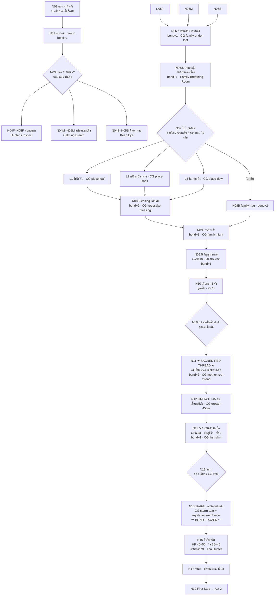

# Act 1 Rewrite Blueprint — The Family Hearth & The Sacred Red Thread
# พิมพ์เขียวยกเครื่ององก์ 1: รังบัว เสื้อกั๊กฟ้าแต่เยาว์วัย และด้ายแดงแห่งความรัก

| Document control | Value |
|---|---|
| ID / version | `JKB-ND-A1-BLUEPRINT` / **0.7.0** (ADR-P0-030 · Sacred Red Thread · Blue Vest from Birth) |
| Date | 2026-10-20, Asia/Bangkok |
| Authority | [ADR-P0-030](../adr/ADR-P0-030-tripartite-narrative-architecture-overhaul-five-act-expansion.md) D1/D2/D3 · Message #021 · [ADR-P0-029](../adr/ADR-P0-029-in-universe-living-narrative-sovereignty-and-doll-language-ban.md) · [ADR-P0-028](../adr/ADR-P0-028-organic-family-resonance-companion-reciprocity-and-maturation-tradeoff.md) |
| Author | Executive Narrative Director (mimo-v2.6-pro) |
| Status | **Director's draft rev.0.7 — รอสภาตรวจรับ 100%** |
| Target runtime | **10–12 นาทีจริง** (Family Breathing Room ขยาย) |
| Keepsakes | 1 ใน 3 สถานที่ · ≤2 ชิ้น · หรือมือเปล่า |
| Non-goals | Act 2–5 แก้ในไฟล์นี้ · Schema/Save · code |

---

## 0. Canon (ADR-P0-029 + ADR-P0-030 D1/D2)

### 0.1 ตัวตนในโลกเนื้อเรื่อง (ห้ามหลุด)

- เจ้ากบและครอบครัว = **กบนิทานที่มีชีวิตจริง** · ผิวนุ่มนิ่ม · เนื้ออบอุ่น · ลมหายใจ · หัวใจเต้น · สองมือสองเท้าเปล่า
- **ห้ามในบท:** กำมะหยี่ · ตุ๊กตา · ของเล่น · สำลี · ตะเข็บตามตัวกบ
- **สิ่งทอเดียวที่มีตะเข็บ = เสื้อกั๊กสีฟ้า**

### 0.2 เครื่องแต่งกายประจำตัว (PO Directive #4 / ADR-030 D1)

| สมาชิก | เอกลักษณ์ |
|---|---|
| พ่อกบ | **หนวด** · สุขุม แข็งแรง |
| แม่กบ | **โบว์ผูก** · อ่อนโยน |
| พี่น้อง | **เสื้อหลากสี / ผ้าห่มนุ่ม** · ซุกซน |
| **เจ้ากบ** | **เสื้อกั๊กสีฟ้า แต่แรกเริ่ม** (ตรง `poster.jpg`) |

### 0.3 สองช่วงวัย (คง PO-8 · ปรับเรื่องเสื้อ)

| ช่วง | สรีระ | เสื้อกั๊กฟ้า |
|---|---|---|
| **N01–N11** | **กบเด็กตัวเล็ก** (`renders/childhood/front.png`) · มือเปล่าบนตัก | **สวมตั้งแต่ต้น** · ชายเสื้อเกี่ยวขาดได้ · แม่เย็บด้วยด้ายแดง |
| **N12** | ยืดตัวเป็นวัยโต **~45 ซม.** (`renders/front.png`) | เสื้อพอดีตัวขึ้น · ครอบครัวช่วยจัด (N12.5) |

### 0.4 วัฏจักรด้ายแดง — ต้นทางในองก์นี้ (ADR-030 D2)

| องก์ | สถานะด้ายแดง |
|---|---|
| **Act 1 (องก์นี้)** | **แม่เย็บซ่อมชายเสื้อกั๊กที่ขาดด้วยด้ายสีแดง** |
| Act 2 | ปลายด้ายผูกรั้งปกเสื้อที่ปริจากพายุ |
| Act 3 | คุณยายคลายแล้วม้วนคืนลงกระเป๋า (`item_red_yarn` · held · ช่อง 2) |
| Act 4 | เชือกกู้ภัย / ลูบเรียกสติ |
| Act 5 | มอบให้เด็กหญิงถักเป็นหัวใจบนอกเสื้อ |

> **ด้ายแดงไม่ใช่เศษไหมพรมข้างทาง** — คือ **สายใยแห่งความรักของแม่** ที่ติดตัวเจ้ากบไปตลอดกาล

---

## 1. System Layer

### 1.1 Triad Family Skills (คง D2 / PO-1)

| เวลาด้วย | ทักษะ | ผล A2–5 |
|---|---|---|
| **พ่อกบ** | Hunter's Instinct | ลด STA ล่า · Aha N16 |
| **แม่กบ** | Mother's Calming Breath | เฉพาะกลัว/มืด · คุมใจไม่ตกฮวบ |
| **พี่น้อง** | Sibling's Keen Eye & Reflexes | อ่านเศษซาก · หลบ · จุดอ่อน |

### 1.2 Bond & Freeze

| Phase | พฤติกรรม |
|---|---|
| Act 1 | `family.bond_thread` สะสม **เต็มเปี่ยมทุกเส้นทาง** |
| N15→N16 | **FROZEN** · Fade เงียบ · ห้ามป๊อปอัป |
| A2–5 | Memory Willpower (`ใจ ≤ 50` เท่านั้น) · `clinging_ache` **ห้ามบวกใน Auto Cutscene** |

### 1.3 Status หลังพายุ (Realistic)

| จุด | HP | ใจ | STA |
|---|---|---|---|
| เริ่มเกม | 80 | 70 | 100 |
| **N16 ตื่นริมตลิ่ง** | **40–50** | **35–40** | **ต่ำ** |

### 1.4 Inventory (ADR-030 D3)

| Slot | องก์ | ของ |
|---|---|---|
| **1** | Act 1 | `item_leaf` / `item_lotus_shell` / `item_dew_stone` (≤1 จากที่เลือก รวม ≤2 ถ้ามีช่องที่สองใน N17) |
| 2 | Act 2 | `item_red_yarn` (ปลายด้ายจากเสื้อแม่เย็บ) |
| 3 | Act 3 | `item_glass_marble` / `item_spare_button` |
| 4 | Act 4 | `item_scented_cloth` / `item_white_pebble` |

---

## 2. Node/Edge Graph (Act 1 — Family Breathing Room ขยาย)

---

## 3. Node Specs

| NodeID | ชื่อ / Pace | Choices | Consequence | CG | วิ |
|---|---|---|---|---|---|
| **N01** | แสงแรกในรัง `intimate` | ลูบแก้ม / มองแสง / ฟังลม | เห็น **เสื้อกั๊กฟ้า** บนร่างเล็ก | nest-dawn | 55 |
| **N02** | เสียงแม่ · พ่อมอง `slow` | ขยับเข้าหา / ช้าอีกนิด | bond+1 · หนวดพ่อ · โบว์แม่ | — | 45 |
| **N03** | **เวลากับใคร?** `steady` | **พ่อ / แม่ / พี่น้อง** | **Triad Skill ถาวร** | portrait-triad | 75 |
| **N04F–N05F** | สอนล่า `slow` | ลองตวัด / ให้พ่อจับมือ | **Hunter's Instinct** · ใจ+5 | father-teach | 70 |
| **N04M–N05M** | สอนหายใจ `slow` | ลองเอง / ให้แม่จับมือ | **Calming Breath** · ใจ+5 | mother-breath | 70 |
| **N04S–N05S** | ซ่อนหา `quick` | กระโดดข้าม / แอบนิ่ง | **Keen Eye** · ใจ+5 | sibling-reflex | 70 |
| **N06** | ครอบครัวพร้อมหน้า `warm` | นั่งกลาง / ช่วยจัดของ / เงียบดู | bond+1 | **family-under-leaf** | 90 |
| **N06.5** | **บ่ายอบอุ่น** `slow` | **กินด้วยกัน / เล่นเล่าเรื่อง / ดูเมฆ** | bond+1 · **Family Breathing Room** | family-afternoon | 90 |
| **N07** | ไปไหนกัน? `curious` | **ขอบใบ / ซอกกลีบ / ซอกราก / ไม่เก็บ** | ≤2 ชิ้น | route-places | 80 |
| **L1–L3** | 3 สถานที่ `tender` | เก็บ / ให้ครอบครัวดูก่อน | leaf / shell / dew_stone | place-leaf/shell/dew | 85 |
| **N08** | **Blessing Ritual** `warm` | สัมผัสร่วม | bond+2 · Tactile Memory | **keepsake-blessing** | 95 |
| **N08B** | family-hug `warm` | กอดพ่อ/แม่/พี่ | bond+2 | family-hug | 85 |
| **N09** | เล่าเรื่องค่ำ `slow` | นอนข้างพ่อ/แม่/พี่ | bond+1 · ใจ+5 | **family-night** | 80 |
| **N09.5** | **สัญญาณพายุ** `steady` | เก็บของ / ฟังพ่อ / อยู่กับแม่ | bond+1 · เตรียมใจ | storm-foreboding | 75 |
| **N10** | เก็บของเข้ารัง `steady` | ผูกเสื้อ / นับหัว / มองฟ้า | เตรียมพายุ | nest-ready | 65 |
| **N10.5** | **ชายเสื้อเกี่ยวขาด** `quick` | หยุดดู / เรียกแม่ / ซ่อนไว้ | เปิด N11 | vest-snags | 55 |
| **N11** | **★ Sacred Red Thread ★** `tender` | ให้แม่เย็บ / ยื่นด้าย / นั่งนิ่งดู | bond+2 · **แม่เย็บด้ายแดง** | **mother-red-thread** | 100 |
| **N12** | **GROWTH** `breath` | สัมผัสเสื้อ / ยืดตัว / เรียกพ่อแม่ดู | ~45 ซม. · เสื้อพอดี | **growth-45cm** · silence 6s | 100 |
| **N12.5** | จัดเสื้อ `tender` | ให้แม่จัดปก / หันให้พ่อดู / ให้พี่แตะ | bond+1 | **first-shirt** | 80 |
| **N13** | ลมมา `urgent` | ยึด / เรียก / หาที่กำบัง | `coping.storm_*` | storm-choices | 70 |
| **N15** | **มหาพายุ + อ้อมกอด** `breath` | (auto) | **BOND FROZEN** · ไออุ่นอ้อมกอด (นึกว่าพ่อ/แม่) | **storm-tear** · **mysterious-embrace** · silence 8s | 110 |
| **N16** | ตื่นริมตลิ่ง `slow` | กินของลึกลับ / ล่าเอง / ทิ้งไว้ | HP 40–50 · ใจ 35–40 · Aha Hunter | **riverbank-wake** | 100 |
| **N17** | จัดตัว `steady` | ลูบปลายด้ายแดง / เช็ดโคลน / ตรวจปก | ปลายด้ายที่ปก → Act 2 | red-thread-end | 55 |
| **N19** | ก้าวต่อ `resolve` | ตามน้ำ / พักอีกครู่ | `story.act1_complete` | **first-step** | 60 |

**เวลา:** ≥24 beats · choice 12–14 · CG 9 · ≈ **10–12 นาที** (Family Breathing Room)

---

## 4. ★ Sacred Red Thread — Scene N10.5–N11 ★

### 4.1 N10.5 เกี่ยวขาด

**Cinematic:** Type in-scene · Framing close-up ชายเสื้อเกี่ยวกิ่ง/ของแหลม · Mood ซน → ชะงัก · Light ลมเปลี่ยน

**Sample (pace `quick`):**
> ขณะที่เจ้ากบกระโดดข้ามกิ่งไม้เล่น  
> ชายเสื้อกั๊กสีฟ้าเกี่ยวเข้ากับปลายกกแหลม  
> แควก! —  
> เขาหยุดกึก มองชายเสื้อที่ขาดเป็นรอยสั้น ๆ  
> แล้วหันไปมองทางแม่ด้วยสีหน้าเจื่อน ๆ

### 4.2 N11 แม่เย็บด้วยด้ายแดง

**Cinematic:** Type **full cutscene** · Framing close-up มือแม่กับเข็ม → ด้ายแดง → สองตัวนั่งเบียดกัน · Light ทองอุ่นก่อนพายุ · Mood อบอุ่นลึก · **Silence 4 วิ หลังฝีเข็มสุดท้าย**

**Sample (pace `tender`):**
> แม่ไม่ได้ดุ  
> เธอเพียงนั่งลงข้าง ๆ แล้วดึงชายเสื้อขึ้นมาดู  
> แล้วก็หยิบเข็มกับ **ด้ายสีแดง** เส้นเล็ก ๆ ออกมาจากกระเป๋าผ้าข้างเอว  
> ฝีเข็มสั้น ๆ บรรจงเลื่อนผ่านเนื้อผ้าทีละนิด  
> เจ้ากบนั่งนิ่งมาก จนได้ยินเสียงลมหายใจของแม่  
> "เสร็จแล้วลูก" เธอพูดเสียงแผ่ว  
> แล้วก็ลูบหัวเขาอีกครั้ง  
> บนชายเสื้อสีฟ้า มีรอยเย็บสีแดงสั้น ๆ ที่จะอยู่กับเขาไปตลอดทาง

**Sample (เจ้ากบมองรอยเย็บ · pace `slow`):**
> เจ้ากบค่อย ๆ แตะรอยเย็บสีแดงด้วยปลายนิ้ว  
> ด้ายเส้นนั้นนุ่มกว่าผ้า และอุ่นกว่าลม  
> เขาจำมือของแม่ที่ประคองชายเสื้อไว้ได้ดี  
> — และจะจำมันไปจนถึงวันที่ลมพัดพามาไกลจากที่นี่

> **กำกับ:** รอยเย็บนี้คือ **ต้นตระกูลของด้ายแดงทั้งเกม** · ห้ามทำเป็นเศษไหมพรมลอย ๆ ใน Act 2 · ปลายด้ายต้องต่อเนื่องจาก N11

---

## 5. Family Breathing Room (PO Directive #5)

| จุด | ขยายอย่างไร |
|---|---|
| **N06.5** | บ่ายอบอุ่น 90 วิ · เลือกกิน/เล่น/ดูเมฆ · bond+1 |
| **N09** | ค่ำเล่าเรื่อง · เสียงคนละแบบ |
| **N09.5** | **สัญญาณพายุ** — ลมเปลี่ยน · แม่เงยมองฟ้า · พ่อเก็บของ · ยังไม่พัง |
| **N11** | Sacred Red Thread 100 วิ — ความรักก่อนสูญเสีย |

---

## 6. Family Bond Arc & Keepsake Blessing (คง)

| Focus | Signature Memory | Flashback A2–5 |
|---|---|---|
| พ่อ | หนวดกระตุก · ลูบหัวหนึ่งที | เสียงลม · มือพ่อ |
| แม่ | โบว์ส่าย · **รอยเย็บด้ายแดง** | โบว์ · มือเย็บ |
| พี่ | ผ้าหลากสี · ยื่นของให้ | เสียงหัวเราะ · ผ้าสี |

**Blessing Ritual (N08):** พ่อดูความแข็ง · แม่ลูบทำความสะอาด · พี่เป่าลมผ่านรู · เจ้ากบรับแนบอก

---

## 7. N15–N16 (คง ADR-028 D4 · ยืนยัน Argon Fix)

- N15: อ้อมกอดลึกลับ — เจ้ากบเชื่อว่า **พ่อหรือแม่** · ความจริงคือ **เด็กหญิง** (เฉลย Act 5)
- N16: HP 40–50 · ใจ 35–40 · เสื้อเปียกหนัก · **ปลายด้ายแดงที่ปกยังอยู่**
- อาหารลึกลับ + Aha Hunter
- **FROZEN เงียบ** · ไม่มีป๊อปอัป · ห้าม `clinging_ache` ใน Auto Cutscene

---

## 8. State Callback → Act 2

| Act 1 | Act 2+ |
|---|---|
| Triad Skills | ล่า / สงบ / หลบ |
| **รอยเย็บด้ายแดงที่ชายเสื้อ** | ปลายด้ายผูกรั้งปกที่ปริ · ต่อด้วย item_red_yarn |
| held leaf/shell/dew | ช่วยตัดตาข่าย (Route A) · หลอกบอส (Route B) |
| N15 อ้อมกอด | นึกถึง "พ่อ/แม่" · เฉลย A5 |
| bond FROZEN | Memory Willpower (ใจ≤50) · clinging ต้องเลือกเอง |

---

## 9. Silence / Cinematic (Act 1)

| Node | Type | CG | Silence |
|---|---|---|---|
| N06–N06.5 | illustrated | family-under-leaf · family-afternoon | 2–3s |
| N08 | cutscene | keepsake-blessing | 3s |
| **N11** | **full cutscene** | **mother-red-thread** | **4s** |
| N12 | full cutscene | growth-45cm | **6s** |
| N12.5 | cutscene | first-shirt | 3s |
| N15 | full cutscene | storm-tear · mysterious-embrace | **8s · ห้าม UI** |
| N16 | setpiece | riverbank-wake | 5s |

---

## 10. Verification (rev.0.7)

- [ ] เจ้ากบวัยเด็ก **สวมเสื้อกั๊กฟ้าแต่แรกเริ่ม**
- [ ] **N11 Sacred Red Thread** — แม่เย็บด้วยด้ายแดง · CG · ตรึงใจ
- [ ] Family Breathing Room ขยาย (N06.5 / N09.5 / N11)
- [ ] สัญญาณพายุก่อน N13
- [ ] ด้ายแดง = สายใยแม่ ไม่ใช่เศษไหมพรมลอย
- [ ] Triad Skill · Blessing · ≤2 ชิ้น
- [ ] N15 อ้อมกอด (เชื่อพ่อ/แม่ · อย่าเฉลย) · N16 HP/ใจ สมจริง
- [ ] FROZEN เงียบ · ไม่มี `clinging_ache` อัตโนมัติ
- [ ] **ไม่มี** กำมะหยี่/ตุ๊กตา/ของเล่น/สำลี
- [ ] 10–12 นาที · ≥24 beats

— End of Act 1 Rewrite Blueprint rev.0.7 —
