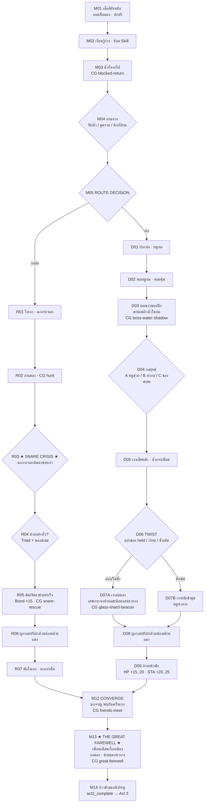

# Act 2 Rewrite Blueprint — The Dual Wilderness & The Great Farewell
# พิมพ์เขียวยกเครื่ององก์ 2: สองเส้นทางวิกฤต และฉากอำลาสู่แดนมนุษย์

| Document control | Value |
|---|---|
| ID / version | `JKB-ND-A2-BLUEPRINT` / **0.2.0** (ADR-P0-030 · Snare Crisis · Glass Shard Beacon · Great Farewell) |
| Date | 2026-10-20, Asia/Bangkok |
| Authority | [ADR-P0-030](../adr/ADR-P0-030-tripartite-narrative-architecture-overhaul-five-act-expansion.md) D1/D2/D3 · Message #021 · [ADR-P0-029](../adr/ADR-P0-029-in-universe-living-narrative-sovereignty-and-doll-language-ban.md) |
| Author | Executive Narrative Director (mimo-v2.6-pro) |
| Status | **Director's draft rev.0.2 — รอสภาตรวจรับ 100%** |
| Depends on | [act1-living-keepsake-rewrite-blueprint.md](act1-living-keepsake-rewrite-blueprint.md) **rev.0.7** |
| Target runtime | **10–12 นาทีจริง** |
| Non-goals | Act 3–5 แก้ในไฟล์นี้ · Schema/Save · code |

---

## 0. Canon (ย่อ)

- เจ้ากบ = **กบนิทานมีชีวิต** · เสื้อกั๊กฟ้า · **รอยเย็บด้ายแดงของแม่ที่ชายเสื้อ** · ปลายด้ายผูกรั้งปกหลังพายุ
- **ไม่มี** กำมะหยี่/ตุ๊กตา/ของเล่น/สำลี/ตะเข็บตามตัวกบ
- **กออ้อ = นกกระจอกเท่านั้น** · **ท่อ = หนูท่อเท่านั้น** · พบกันที่ M12
- ปลายองก์: **The Great Farewell** — เพื่อนเตือนเรื่องเมือง · เจ้ากบเดินหน้าด้วยด้ายแดง
- D09 ฟื้น **HP +15..20 · STA +20..25**
- `clinging_ache` **ห้ามบวกใน Auto Cutscene**

---

## 1. System Layer

### 1.1 Red Thread Continuity (ADR-030 D2)

| จุด | สถานะด้ายแดง |
|---|---|
| เข้าองก์ | รอยเย็บสีแดงของแม่ที่ชายเสื้อ (จาก N11) |
| หลังพายุ N15–A2 | เสื้อปริที่ปก · **ใช้ปลายด้ายผูกรั้งปก** |
| ทั้งองก์ | ยังไม่ใช่ inventory เต็มรูป · คือ **สายใยติดเสื้อ** |
| ออกจากองก์ | พร้อมให้คุณยายคลาย-ม้วนคืนลงกระเป๋า (Act 3 · `item_red_yarn` ช่อง 2) |

### 1.2 Path Balance (ออกจาก M12)

| Path | HP | ใจ | STA | Companion | วิกฤตเด่น |
|---|---|---|---|---|---|
| **A กออ้อ** | ฟื้นจากล่า + **กู้ภัย** | + | สูงกว่าเล็กน้อย | sparrow · **Bond +15** | **ตาข่ายดักสัตว์** |
| **B ท่อ** | ฟื้น D09 +15..20 HP | − แล้ว + | +20..25 STA | rat · Bond + | **บอสเงาสะท้อนน้ำ** |
| **เป้า** | ±5 | ±5 | ±10 | เท่าเทียม | แฟร์ |

### 1.3 Triad Skills & Keepsakes ในองก์นี้

| Skill / ของ | ใช้ |
|---|---|
| Hunter's Instinct | ล่า · หาจุดรวมแรงของเงื่อนเอ็น |
| Calming Breath | ปลอบนกตอนติดตาข่าย · คุมใจก่อนเข้าท่อ |
| Keen Eye | เห็นหอยกาบคม/จุดอ่อนเงา |
| leaf / shell / dew_stone | ตัด/งัดตาข่าย · หลอก/ปลอบบอส · **ยัง held** |

---

## 2. Node/Edge Graph (Act 2)

---

## 3. Node Specs

| NodeID | ชื่อ / Pace | Choices | Consequence | CG | วิ |
|---|---|---|---|---|---|
| **M01** | เสื้อหนัก `slow` | ลูบรอยเย็บแดง / บิดเสื้อ / ลุก | นึกถึงมือแม่ N11 | heavy-cloth | 60 |
| **M02** | เรียนรู้ร่าง `steady` | เดินช้า / เกาะช่วย / ลองก้าวยาว | STA − · ซ้อม Skill | learn-body | 60 |
| **M03** | น้ำที่จากไป `slow` | มองย้อน / ไม่มอง / แตะโคลน | เปิด Memory Willpower | **blocked-return** | 65 |
| **M04** | อ่านทาง `curious` | ฟังน้ำ / ดูคราบ / นึกที่บ้าน | Skill โบนัส | read-ground | 60 |
| **M05** | **ROUTE** `steady` | **กออ้อ / ท่อ** | `route.*` | **route-split** | 70 |
| **R01** | ใบกก `quick` | แหวกใบ / คลานต่ำ / หยุดฟัง | นกกระจอกเท่านั้น | reeds-enter | 55 |
| **R02** | ล่าแมลง `playful` | ล่าเลย / ซุ่ม / ใช้ของ | HP/STA ฟื้น · Hunter | **hunt** | 70 |
| **R03** | **★ SNARE CRISIS ★** `urgent` | (auto · นกติดตาข่าย) | วิกฤตชีวิต | **snare-trap** | 75 |
| **R04** | **ช่วยอย่างไร?** `quick` | **Hunter หาเงื่อน / Breath ปลอบ / Keen Eye หาของ** + shell/leaf/dew | ใช้ Triad + ของจริง | snare-solve | 85 |
| **R05** | **กู้ภัยสำเร็จ** `warm` | ปล่อยนก / ตรวจปีก / นั่งพัก | **Bond +15** · มิตรแท้ | **snare-rescue** | 90 |
| **R06** | ผูกรอยปริ `intimate` | ผูกรั้งปกด้วยปลายด้ายแดง | สายใยแม่ยังอยู่ | **red-thread-tie** · silence 4s | 70 |
| **R07** | พักในกก `slow` | กินเพิ่ม / นอนแผ่ / คุยกับนก | ฟื้น | reeds-rest | 60 |
| **D01** | ปากท่อ `slow` | เดินเข้า / ชะโงก / เรียก (เงียบ) | หนูเท่านั้น · Breath | drain-enter | 60 |
| **D02** | หนูท่อ `warm` | แนะนำตัว / แบ่งของ / ถอยก่อน | friend.rat + | rat-bond | 70 |
| **D03** | **บอสเงาพองปีก** `slow` | (auto) | เงาสะท้อนผิวน้ำ · ใบไม้แห้ง | **boss-water-shadow** | 80 |
| **D04** | กลยุทธ์ `quick` | A หนูช่วย / B ท่ากบ / C ของสะสม | Keen Eye จุดอ่อน | team/leap/trick | 75 |
| **D05** | เสียหลัก `playful` | หัวเราะเบา / ตกใจ / เงียบ | น้ำกระเพื่อม | boss-ripple | 55 |
| **D06** | **TWIST** `tender` | แบ่งของ held / เงียบ / ซ้ำเติม | ของ **ยัง held** | twist-choice | 80 |
| **D07A** | **กระจกฝาท่อ** `warm` | รับแสงนำทาง / ขอบคุณเงา | ไม่ใช่เวทมนตร์ · **เศษกระจกสะท้อนแสงจริง** | **glass-shard-beacon** | 95 |
| **D07B** | หนีเข้ามุม `slow` | ปล่อยไว้ / หนูนำทาง | ยังออกได้ | dark-exit | 60 |
| **D08** | ผูกรอยปริ `intimate` | ผูกรั้งปกด้วยปลายด้ายแดง | สายใยแม่ยังอยู่ | red-thread-tie | 65 |
| **D09** | **ล้างหน้าพัก** `slow` | ดื่ม / ล้างเสื้อ / พัก | **HP +15..20 · STA +20..25** | drain-wash | 70 |
| **M12** | **CONVERGE** `warm` | ให้เพื่อนแนะนำ / ยิ้มรับ | นก+หนู พบกันครั้งแรก | **friends-meet** | 85 |
| **M13** | **★ GREAT FAREWELL ★** `tender` | ฟังคำเตือน / กอดลา / ลูบด้ายแดง | เพื่อนห่วง · เจ้ากบเลือกเดินหน้า | **great-farewell** | 110 |
| **M14** | ก้าวข้ามประตู `resolve` | เดินหน้า / หันมองอีกครั้ง | `story.act2_complete` | **city-gate** · silence 5s | 70 |

---

## 4. Route A — ★ Snare Crisis (Bond +15)

### 4.1 เหตุการณ์ (R03–R05)

**Cinematic:** Type cutscene · Framing นกร่อนต่ำ → เอ็นรัดปีก → สองตัวช่วยกัน · Light รำไรผ่านกก · Mood ตื่น → โล่ง · **Silence 3 วิ หลังนกหลุด**

**Sample (R03 · pace `urgent`):**
> นกกระจอกถลาร่อนลงมาเตือนเสียงดัง  
> แล้วปีกข้างหนึ่งก็เกี่ยวเข้ากับ **เส้นเอ็นเก่าที่ขึงตึงอยู่ริมกก**  
> เส้นเอ็นบางจนแทบมองไม่เห็น บาดปีกลึกขึ้นทุกครั้งที่ดิ้น  
> "อยู่นิ่ง ๆ นะ!" — เจ้ากบไม่ได้พูด แต่สองมือยกขึ้นทันที

### 4.2 การแก้ (R04 — Triad + Keepsakes)

| ทักษะ/ของ | ใช้ทำอะไร |
|---|---|
| **Hunter's Instinct** | หา **จุดรวมแรงของเงื่อน** ที่ขึงตึง |
| **Calming Breath** | ส่งเสียง/จังหวะปลอบให้นก **หยุดดิ้น** |
| **Keen Eye** | เห็น **หอยกาบคม** ริมตลิ่ง / จุดตัด |
| `item_dew_stone` | **ขัดสายเอ็น** ให้ขาด |
| `item_lotus_shell` | **งัดปม** |
| `item_leaf` | คลี่บังไม่ให้เอ็นบาดลึก |
| *(ไม่มีของ)* | ใช้หอยกาบคมธรรมชาติ · ยังช่วยได้ |

**Sample (R05 · pace `warm`):**
> เส้นเอ็นขาดออกอย่างช้า ๆ  
> นกกระจอกกระพือปีกอีกข้างอย่างระมัดระวัง  
> แล้วก็ซบหัวลงกับมือเล็ก ๆ ของเจ้ากบ  
> ทั้งคู่นิ่งอยู่อย่างนั้น  
> จนลมในกกกลับมาส่ายเบา ๆ อีกครั้ง

**ผล:** `friend.sparrow` +2..3 · **Bond +15** · ผูกพันชีวิต · พร้อมช่วย Act 4

---

## 5. Route B — Boss: เงาสะท้อนผิวน้ำ (ไม่ใช่ลูกโป่ง/ไฟฉายเวทมนตร์)

### 5.1 โทนใหม่ (Argon Fix)

| เดิม (ห้าม) | **ใหม่ (ใช้)** |
|---|---|
| เงากลมพองลม · ฟี้... ฟี้... เหมือนลูกโป่ง | **พองปีกเงาขู่** · เงาสะท้อน **ผิวน้ำในท่อ** · ใบไม้แห้งสั่น |
| ไฟฉายเงาเรืองแสงเวทมนตร์ | **เศษกระจกเงาชิ้นเล็ก** สะท้อน **ลำแสงจากฝาท่อ** ส่องทาง |

**Sample (D03 · pace `slow`):**
> เงาดำแผ่กว้างขึ้นบนผนังท่อ  
> ปีกเงาสองข้างพองออก สะท้อนกับผิวน้ำขังจนกระเพื่อม  
> ใบไม้แห้งบนพื้นสั่นตามจังหวะนั้น  
> หนูท่อเบียดข้อเท้าเจ้ากบ

**Sample (D05 · pace `playful` — ไม่ลูกโป่ง):**
> เงานั่นเสียหลัก  
> ปีกพอง ๆ ปัดน้ำขังจนกระเด็น  
> ผิวน้ำในท่อกระเพื่อมแรงจนภาพสะท้อนแตกพร่า

### 5.2 Twist → Glass Shard Beacon (D06–D07A)

| ทางเลือก | ผล |
|---|---|
| แบ่งของ **held** (dew คลายร้อน / shell ฟังเสียง / leaf ปูที่นั่ง) | เงาอ่อนลง · **D07A เต็ม** |
| เงียบดู | D07A |
| ซ้ำเติม | D07B |

**Sample (D07A · เศษกระจก · pace `warm`):**
> เงาบางลงจนกลายเป็นเพียงความมืดธรรมดา  
> หนูท่อวิ่งไปคาบ **เศษกระจกเงาชิ้นเล็ก** ที่หล่นอยู่ข้างฝาท่อ  
> แสงบาง ๆ ลอดผ่านช่องฝาท่อด้านบนลงมากระทบกระจก  
> ลำแสงเล็ก ๆ สะท้อนออกไปข้างหน้า — สว่างพอให้เห็นทาง  
> เจ้ากบเดินตามแสงนั้น หนูท่อวิ่งเคียงข้าง

**ผล:** `boss.reformed_beacon` (กระจกนำทาง · ไม่ใช่เวทมนตร์) · ใจ +15

### 5.3 D09 Balance

| ค่า | ฟื้น |
|---|---|
| HP | **+15..20** |
| STA | **+20..25** |
| ใจ | +5..15 ตาม D07 |

---

## 6. Red Thread Tie (R06 / D08)

**Sample (pace `intimate` · silence 4s):**
> ปกเสื้อที่ปริจากพายุยังอ้าอยู่  
> เจ้ากบค่อย ๆ ดึง **ปลายด้ายแดง** ที่แม่เย็บไว้ที่ชายเสื้อ  
> ร้อยรั้งรอยปริของปกไว้ช้า ๆ  
> ทีละนิด จนผ้าหุบเข้าหากัน  
> เขายืดออกดูอยู่ครู่หนึ่ง  
> ด้ายเส้นนั้นยังอุ่นอยู่ในความจำ — เหมือนมือของแม่

---

## 7. ★ The Great Farewell (M13) ★

**Cinematic:** Type **full cutscene** · Framing สองตัว (หรือสามตัว) ที่ธรณีประตูเมือง · Light เย็น-ส้ม · Mood ห่วงหา · **Silence 5 วิ กลางฉาก** · **ห้ามเทศน์**

**Sample (pace `tender`):**
> ริมขอบเมือง นกกระจอกเกาะกิ่งต่ำ หนูท่อยืนสองขาข้างหิน  
> "ข้างในนั้น... เสียงดังมากนะ" หนูท่อพูดเสียงแผ่ว  
> "แล้วก็... ไม่มีที่หลบเหมือนกกหรือท่อของเรา" นกกระจอกเสริม  
> เจ้ากบมองไปข้างหน้า  
> แล้วค่อย ๆ แตะ **รอยเย็บสีแดง** ที่ชายเสื้อ  
> "ข้ารู้" เขาตอบเสียงเบา "แต่ข้าต้องไป"  
> *(silence 5 วิ)*  
> ทั้งสามไม่ได้พูดอะไรอีก  
> นกกระจอกบินลงมาเกาะไหล่เขานานหนึ่งอึดใจ  
> หนูท่อเอาหัวซบข้อเท้าเขานานเท่ากัน  
> แล้วเจ้ากบก็ก้าวข้ามธรณีประตูไป

**Sample (หันมองครั้งสุดท้าย · pace `slow`):**
> พอพ้นทางหักเลี้ยว เขาหันกลับไปอีกครั้ง  
> เงาเล็ก ๆ สองเงายังยืนอยู่ตรงนั้น  
> เจ้ากบยกมือขึ้นโบกสั้น ๆ  
> แล้วก็เดินต่อ — โดยมีปลายด้ายแดงเล็ก ๆ ที่ปกเสื้อสั่นตามจังหวะก้าว

**หมายเหตุ:** ไม่ต้องบังคับให้เพื่อนทั้งคู่เดินตามเข้าเมือง · M12 พวกเขาพบกันแล้ว · การลาคือ **จุดข้ามธรณี** ที่ทรงพลัง

---

## 8. Companion Isolation & Progression

| เส้น | พบ | ห้าม | Bond ปลายเส้น |
|---|---|---|---|
| กออ้อ | นกกระจอก | หนู | **≥80%** (กู้ชีวิต) |
| ท่อ | หนูท่อ | นก | **60–80%** |
| M12 | ทั้งคู่พบกัน | — | เท่าเทียมก่อนเข้าเมือง |

---

## 9. Memory Willpower & Trade-off

| กฎ | รายละเอียด |
|---|---|
| เปิดใช้ | **`ใจ ≤ 50`** หรือวิกฤตที่ระบุ |
| ใช้บ่อย (ผู้เล่นกดเอง) | `clinging_ache` + → **END-POND** |
| **ห้าม** | บวก `clinging_ache` ใน Auto Cutscene |
| ยืนหยัด | `inner_resilience` + → DAWN / HOME |

---

## 10. State Callback (Act 1 → Act 2)

| Act 1 | Act 2 |
|---|---|
| **รอยเย็บด้ายแดง (N11)** | M01 ลูบ · R06/D08 ผูกรั้งปก |
| Triad Skills | R02/R04/D04 ใช้จริง |
| leaf/shell/dew | R04 ช่วยตัด/งัด · D04/D06 หลอก/ปลอบ · **held** |
| N15 อ้อมกอด | นึกถึงพ่อ/แม่ · เฉลย A5 |
| bond FROZEN | Memory Willpower |
| N16 Aha Hunter | ล่าต่อเนื่อง R02 |

---

## 11. Silence / Cinematic (Act 2)

| Node | Type | CG | Silence |
|---|---|---|---|
| M03 | setpiece | blocked-return | 5s |
| R03–R05 | cutscene | snare-trap · **snare-rescue** | 3s หลังหลุด |
| R06/D08 | micro | red-thread-tie | **4s** |
| D03 | illustrated | boss-water-shadow | 2s |
| **D07A** | cutscene | **glass-shard-beacon** | 3s |
| **M13** | **full cutscene** | **great-farewell** | **5s กลางฉาก** |
| M14 | in-scene | city-gate | **5s** |

---

## 12. Handoff → Act 3

| สิ่งส่งต่อ | ใช้ |
|---|---|
| ปลายด้ายแดงผูกรอยปริ | คุณยายคลาย-ม้วนคืนเป็น `item_red_yarn` (ช่อง 2) |
| friend.sparrow + friend.rat (พบกันแล้ว) | Double-Take · เตื๊อก · เด็กซน |
| held leaf/shell/dew | Reciprocal Aid |
| glass shard (optional flag) | แสงในเมือง |
| ความทรงจำ Great Farewell | ใจ · clinging / resilience |
| Status สมดุล | เริ่ม Act 3 แฟร์ |

**หมุด Act 3 (รอขั้นถัดไป):** Double-Take 45 ซม. · คุณยายคืนด้ายแดงลงกระเป๋า · เตื๊อกป้ายรถเมล์

---

## 13. Verification (rev.0.2)

- [ ] **Route A Snare Crisis** · Triad + ของช่วยนก · **Bond +15**
- [ ] **Route B** เงาสะท้อนผิวน้ำ · **เศษกระจกฝาท่อ** (ไม่ใช่ไฟฉายเวทมนตร์)
- [ ] D09 **HP +15..20 · STA +20..25**
- [ ] ปลายด้ายแดงผูกรอยปริ · ต่อจาก N11
- [ ] **Great Farewell** · เพื่อนเตือนเรื่องเมือง · เจ้ากบเดินหน้าด้วยด้ายแดง
- [ ] กออ้อ = นกเท่านั้น · ท่อ = หนูเท่านั้น · M12 พบกัน
- [ ] ของ **held เสมอ** · ไม่มี `clinging_ache` อัตโนมัติ
- [ ] ไม่มี กำมะหยี่/ตุ๊กตา/ของเล่น/สำลี
- [ ] 10–12 นาที · CG ครบ

— End of Act 2 Rewrite Blueprint rev.0.2 —
