# Act 3 Rewrite Blueprint — The City That Never Saw a Frog Like This
# พิมพ์เขียวยกเครื่ององก์ 3: คุณยาย เด็กซน เจ้าเตื๊อก และรอยเย็บแห่งความเมตตา

| Document control | Value |
|---|---|
| ID / version | `JKB-ND-A3-BLUEPRINT` / **0.2.0** (ADR-P0-029 Language Ban · **C01–C23 Approved**) |
| Date | 2026-10-18, Asia/Bangkok |
| Authority | [ADR-P0-029](../adr/ADR-P0-029-in-universe-living-narrative-sovereignty-and-doll-language-ban.md) · Message #017 (PO Greenlight) · [ADR-P0-028](../adr/ADR-P0-028-organic-family-resonance-companion-reciprocity-and-maturation-tradeoff.md) · [ADR-P0-026](../adr/ADR-P0-026-cockroach-man-route-boss-jao-teuk-mandate-and-branching-narrative-graph.md) D2 · [ADR-P0-024](../adr/ADR-P0-024-living-keepsake-transmutation-narrative-sovereignty-and-origin-canon.md) D2/D3 · [ADR-P0-025](../adr/ADR-P0-025-childhood-keepsake-default-stance-and-heart-emote-decoupling.md) |
| Author | Executive Narrative Director (mimo-v2.6-pro) |
| Status | **โครงสร้าง C01–C23 Approved** · rev.0.2 = ล้างคำต้องห้าม ADR-029 |
| Depends on | [act1-living-keepsake-rewrite-blueprint.md](act1-living-keepsake-rewrite-blueprint.md) **rev.0.6.1** · [act2-living-keepsake-rewrite-blueprint.md](act2-living-keepsake-rewrite-blueprint.md) **rev.0.5** |
| Target runtime | **8–10 นาทีจริง** |
| Non-goals | Act 4–5 เต็ม · Schema/Save · code · art export |

---

## 0. Canon องก์ 3 (ย่อ — ADR-P0-029)

- เจ้ากบ = **กบนิทานที่มีชีวิตจริง** วัยโต ~45 ซม. · **ผิวนุ่มนิ่ม เนื้ออบอุ่น** มีลมหายใจ มีหัวใจเต้น · สองมือสองเท้าเปล่า
- สวม **เสื้อกั๊กสีฟ้า** ที่ **ผูกรอยปริของตะเข็บปกเสื้อ** ด้วยไหมพรมแดง (จาก A2)
- **คำต้องห้ามในบท (ADR-P0-029 D1):** กำมะหยี่ · ผ้ากำมะหยี่ · ผิวกำมะหยี่ · ตุ๊กตา · ของเล่น · สำลี · ตะเข็บตามตัวกบ · รอยเย็บที่ผิวหนัง
- **สิ่งทอเดียวที่มีตะเข็บ = เสื้อกั๊กสีฟ้า** · คุณยายซ่อม **รอยปริของเสื้อ** เท่านั้น ไม่ใช่ซ่อมตุ๊กตา
- bond **FROZEN** แล้ว · Memory Willpower (ใจ≤50) · clinging / resilience ปูฉากจบ
- **ของสะสมยัง `held`** (dew_stone / shell / leaf / มือเปล่า) — ใช้ช่วย **เจ้าเตื๊อก** ได้
- เพื่อน: **นกกระจอก + หนูท่อ** (พบกันแล้วที่ M12)
- **ห้ามเฉลยอ้อมกอดในพายุ** — เจ้ากบยังเชื่อว่าเป็นพ่อหรือแม่
- **ห้ามปักหัวใจด้ายแดง** ที่หน้าอก (ADR-P0-025)
- **ห้ามแมลงสาบสมจริง** · ไม่ติดป้ายศีลธรรมบนตัวละครมนุษย์

---

## 1. Dramaturgical Spine

> **One-sentence logline:**  
> ในเมืองที่ใหญ่เกินไปสำหรับกบตัวเท่าฝ่ามือเด็ก เจ้ากบได้รับรอยเย็บแห่งความเมตตาจากหญิงชรา มิตรภาพจากชายหนุ่มเหนื่อยล้าที่ป้ายรถเมล์ และบทเรียนว่าเด็กซนก็เป็นเพื่อนได้ — โดยยังเก็บอ้อมกอดอุ่น ๆ ในคืนพายุไว้ในใจ

**Emotional arc:**

```text
หวั่น → เหนื่อย → ได้รับความเมตตา (คุณยาย) → ป่วน (เด็กซน)
→ อบอุ่น (เจ้าเตื๊อก) → เข้าใจ → เปิดใจ → มองเมืองอีกแบบ
```

| Movement | อารมณ์ | Pace | Silence |
|---|---|---|---|
| M1 City Threshold | หวั่น / เล็ก | slow · steady | 1 ยาวเปิดองก์ |
| M2 First Kindness (คุณยาย) | อุ่น / ระแวง | slow · tender | 2 จุด |
| M3 Kids Storm | ป่วน / ตื่น | quick · playful | น้อย |
| M4 Jao Teuk | เหนื่อย → เข้าใจ | steady · breath | **ยาวกลางบทสนทนา** |
| M5 Reconciliation | โล่ง / เป็นเพื่อน | warm | 1 |
| M6 Night Ready | หวัง / พร้อม | slow · resolve | 1 ยาวท้ายองก์ |

**งบเวลา:** 8–10 นาที · ≥20 beats · choice 10–12 จุด · CG 5–7

---

## 2. System Layer

### 2.1 Status เริ่ม/จบองก์

| จุด | HP | ใจ | STA | หมายเหตุ |
|---|---|---|---|---|
| เข้าองก์ (จาก A2) | สมดุล ±5 | สมดุล ±5 | สมดุล ±10 | แฟร์ทุกเส้น |
| หลังเด็กซนวิ่งไล่ | −5..10 | −0..5 | −10..15 | ไม่โหด · ฟื้นได้ |
| **หลังคุณยายซ่อมเสื้อ** | +5 | **+15** | +5 | ความเมตตาแรกของมนุษย์ |
| หลังเตื๊อก / ขอโทษ | +10 | **+15** | +10 | มิตรภาพ |
| จบองก์ | พร้อม Act 4 | พร้อม | พร้อม | |

### 2.2 Flags ที่ตั้ง/อ่านในองก์ 3

| ID | ความหมาย | ส่งผล |
|---|---|---|
| `city.grandma_mended` | คุณยายเย็บซ่อมเสื้อ | A4–5 · callback ด้ายแดง |
| `city.kids_met` / `city.kids_apology` | เด็กซน → ขอโทษ → เพื่อน | A4–5 · ทางเลือกเมตตา |
| `city.jao_teuk_bond` 0–3 | ผูกพันกับเตื๊อก | บทสนทนา · ฉากจบ |
| `city.aid_given` = dew_stone / shell / leaf / bare_hands | ของที่ใช้ช่วยเตื๊อก | Reciprocal Aid · A4–5 |
| `story.embrace_memory` | ยังเชื่อว่าอ้อมกอด = พ่อ/แม่ | **อย่าเฉลย** · เฉลย A5 END-HOME |
| `family.bond_thread` FROZEN | Memory Willpower | clinging / resilience |
| held items | dew_stone / shell / leaf | **ยัง held** · ใช้ได้อีก |

### 2.3 Reciprocal Aid Matrix (ADR-P0-026 D2)

| ของที่ใช้ (held) | ช่วยเตื๊อกอย่างไร | บทสนทนา | ผล |
|---|---|---|---|
| **`item_dew_stone`** | แตะหน้าผาก **คลายร้อน** | "ของเย็น ๆ จากที่บ้าน" | ใจ +15 · `city.aid_given=dew_stone` |
| **`item_lotus_shell`** | ให้ **ฟังเสียง** คลายเครียด | "เสียงน้ำในเปลือก" | ใจ +15 · `=shell` |
| **`item_leaf`** | **พัดลม / บังแดด** | "ใบไม้ที่แม่เคยให้หลบแดด" | ใจ +15 · `=leaf` |
| **มือเปล่า** | **ยื่นมือแตะแบ่งไออุ่น** | "มือเล็กที่ยังว่างแต่ไม่ว่างเปล่า" | ใจ +15 · `=bare_hands` |

> ทุกทาง **เท่าเทียมกัน** · ของไม่หายจากกระเป๋า · ไม่มีใบไหนด้อยค่า

---

## 3. Node/Edge Graph (Act 3)

```mermaid
flowchart TD
  C01["C01 ขอบเมือง<br/>CG city-threshold · silence 5s"] --> C02{"C02 จะไปทางไหน<br/>ริมตึก / ใต้ร่มไม้ / ตามเพื่อน"}
  C02 --> C03["C03 เมืองในมุม 45 ซม.<br/>ขอบฟุตบาลเทียบหน้าอก"]
  C03 --> C04{"C04 เด็กซนวิ่งผ่าน<br/>หลบ / นิ่ง / ให้เพื่อนช่วย"}
  C04 --> C05["C05 เกือบถูกจับ · ตกใจ<br/>Calming Breath ใช้ได้"]
  C05 --> C06["C06 คุณยายเห็นเข้า<br/>CG grandma-sees"]
  C06 --> C07{"C07 คุณยายเรียก<br/>เข้าหา / ยังระแวง / ให้เพื่อนดูก่อน"}
  C07 --> C08["C08 ปัดฝุ่นบนเสื้อกั๊กฟ้า<br/>เห็นรอยปริที่ผูกด้วยไหมพรมแดง"]
  C08 --> C09["C09 เย็บซ่อมเสื้อ<br/>ห้ามปักหัวใจ<br/>bond-adjacent · ใจ+15<br/>CG grandma-mend"]
  C09 --> C10["C10 ขอบคุณแบบกบ<br/>โค้งตัว · แตะมือยาย"]

  C10 --> C11{"C11 เด็กซนกลับมาอีกรอบ<br/>วิ่งไล่ / ซ่อน / ให้เพื่อนส่งสัญญาณ"}
  C11 --> C12["C12 ป่วนกลางสวน/ป้ายรถเมล์"]
  C12 --> C13["C13 เจ้าเตื๊อกนั่งรอรถเมล์<br/>เหนื่อยล้า · CG teuk-bus-stop"]
  C13 --> C14{"C14 เตื๊อกเห็นเจ้ากบ<br/>มองนาน / ยิ้มอ่อน / เอ่ยทัก"}
  C14 --> C15{"C15 Reciprocal Aid<br/>dew_stone / shell / leaf / มือเปล่า"}
  C15 --> C16["C16 บทสนทนาปรัชญา<br/>silence กลางบท<br/>CG teuk-talk"]
  C16 --> C17["C17 เด็กซนรุมอีกครั้ง"]
  C17 --> C18["C18 เตื๊อกเจรจา<br/>เพื่อนสัตว์ช่วยไกล่เกลี่ย<br/>CG teuk-kids"]
  C18 --> C19{"C19 เด็กซนสำนึก<br/>ขอโทษ / เงียบ / ยื่นของให้"}
  C19 --> C20["C20 กลายเป็นเพื่อน<br/>ใจ+15 · CG kids-friends"]
  C20 --> C21["C21 คุณยายมองจากไกล ๆ<br/>ยิ้ม · ไม่ต้องพูด"]
  C21 --> C22["C22 ค่ำในเมือง<br/>นึกถึงอ้อมกอด (พ่อ/แม่)<br/>อย่าเฉลยเด็กหญิง"]
  C22 --> C23["C23 มองไปข้างหน้า<br/>act3_complete → Act 4<br/>CG city-ready"]
```



---

## 4. Node Specs

| NodeID | ชื่อ / Pace | Choices | Consequence | CG | วิ |
|---|---|---|---|---|---|
| **C01** | ขอบเมือง `slow` | ยืนมอง / หายใจเข้าลึก / แตะเสื้อ | เตรียมใจ · 45 ซม. | **city-threshold** · silence 5s | 70 |
| **C02** | จะไปทางไหน `steady` | ริมตึก / ใต้ร่มไม้ / ตามเพื่อน | เปิด C03 โทนต่าง | — | 55 |
| **C03** | เมืองในมุม 45 ซม. `slow` | สังเกตล้อ / รองเท้า / ขอบปูน | Keen Eye ช่วยอ่าน | city-scale | 65 |
| **C04** | เด็กซนวิ่งผ่าน `quick` | หลบ / นิ่ง / ให้เพื่อนช่วย | `city.kids_met` | kids-run | 55 |
| **C05** | เกือบถูกจับ `urgent` | หมอบ / ถอย / Calming Breath | ใจ −0..5 · Breath ใช้ได้ | near-catch | 50 |
| **C06** | คุณยายเห็น `slow` | (auto) | เปิดความเมตตา | **grandma-sees** | 55 |
| **C07** | คุณยายเรียก `tender` | เข้าหา / ระแวง / ให้เพื่อนดูก่อน | ใจ ± · ยังมีทางถอย | grandma-call | 65 |
| **C08** | ปัดฝุ่น + เห็นรอยปริ `tender` | ให้ดูรอยเย็บด้ายแดง / ซ่อนมือ | เห็น **ไหมพรมแดงผูกรอยปริ** | grandma-dust | 70 |
| **C09** | **เย็บซ่อมเสื้อ** `tender` | ยื่นเสื้อให้ / ยืนนิ่ง / ขอบคุณเบา | `city.grandma_mended` · ใจ +15 · **ห้ามปักหัวใจ** | **grandma-mend** | 90 |
| **C10** | ขอบคุณแบบกบ `warm` | โค้งตัว / แตะมือยาย / ยืนสบตา | ตรึงใจ | grandma-thanks | 55 |
| **C11** | เด็กซนกลับมา `quick` | วิ่งไล่ / ซ่อน / เพื่อนส่งสัญญาณ | Keen Eye ช่วย | kids-return | 55 |
| **C12** | ป่วนกลางทาง `playful` | แกล้งคืน / หนี / ยืนหยัด | สนุก · ไม่โหด | kids-chase | 60 |
| **C13** | **เจ้าเตื๊อกที่ป้าย** `slow` | (auto เห็น) | ชายเหนื่อยล้า | **teuk-bus-stop** | 75 |
| **C14** | เตื๊อกสังเกต `steady` | มองนาน / ยิ้มอ่อน / เอ่ยทัก | `city.jao_teuk_bond` +1 | teuk-notices | 60 |
| **C15** | **Reciprocal Aid** `tender` | **dew_stone / shell / leaf / มือเปล่า** | `city.aid_given` · ของ **ยัง held** | teuk-aid | 85 |
| **C16** | **บทสนทนาปรัชญา** `breath` | ฟัง / เงียบ / เล่าเรื่องบ้าน | ใจ +15 · silence กลาง · resilience/clinging | **teuk-talk** · silence 4s | 100 |
| **C17** | เด็กซนรุมอีก `quick` | ปกป้องเตื๊อก / ให้เพื่อนช่วย / ยืนนิ่ง | ตึงเล็กน้อย | kids-again | 55 |
| **C18** | **เตื๊อกเจรจา** `warm` | ให้เตื๊อกพูด / เพื่อนไกล่เกลี่ย / ทั้งสอง | `city.kids_apology` เริ่ม | **teuk-kids** | 85 |
| **C19** | เด็กซนสำนึก `tender` | ขอโทษ / เงียบ / ยื่นของให้ | ปลดล็อกเป็นเพื่อน | kids-sorry | 70 |
| **C20** | กลายเป็นเพื่อน `warm` | เล่นด้วย / โบกมือ / นั่งพักด้วย | ใจ +15 · เพื่อนใหม่ | **kids-friends** | 70 |
| **C21** | คุณยายมองจากไกล `slow` | ยิ้มตอบ / โค้งให้ / เงียบ | สายตาเมตตา | grandma-smile | 55 |
| **C22** | นึกถึงอ้อมกอด `breath` | (auto · ยังเชื่อพ่อ/แม่) | **อย่าเฉลยเด็กหญิง** | embrace-memory | 70 |
| **C23** | มองไปข้างหน้า `resolve` | ก้าวต่อ / พักอีกครู่ | `story.act3_complete` | **city-ready** | 60 |

**เวลา:** ≥20 beats · choice 10–12 · CG 7 · silence 3–4 จุด ≈ **8–10 นาที**

---

## 5. Scene Deep-Dive & Samples

### 5.1 คุณยายซ่อมเสื้อ (C08–C10) — หมุดก)

**Cinematic:** Type illustrated cutscene · Framing close-up รอยปริ+ไหมพรมแดง → มือเย็บ → medium สองตัวนั่ง · Light บ่ายอุ่นรำไร · Mood อุ่น · ระแวงน้อยลง · **Silence 3 วิ หลังเข็มสุดท้าย** · **ห้ามปักหัวใจด้ายแดง**

**Sample (C08 · pace `tender`):**
> คุณยายก้มมองเสื้อกั๊กสีฟ้าที่เปื้อนฝุ่น  
> นิ้วเหี่ยว ๆ แตะลงข้างรอยปริที่ถูกผูกไว้ด้วยเส้นด้ายแดงสั้น ๆ  
> เธอไม่ได้ถามอะไร  
> เพียงพยักหน้าเบา ๆ แล้วหยิบเข็มกับด้ายสีเดียวกับเสื้อออกมาจากกระเป๋าผ้า

**Sample (C09 · เย็บซ่อม · pace `slow`):**
> เข็มเล็ก ๆ เลื่อนผ่านเนื้อผ้าทีละฝีเข็ม  
> รอยที่เคยอ้าอยู่ค่อย ๆ หุบเข้าหากัน จนเกือบมองไม่เห็นว่าเคยขาด  
> เจ้ากบนั่งนิ่งมาก จนคุณยายต้องเหลือบมองอย่างเอ็นดู  
> "เสร็จแล้วจ้ะ" เธอพูดเสียงแผ่ว  
> แล้วก็ปัดฝุ่นที่ไหล่ให้อีกทีหนึ่ง

**Sample (C10 · ขอบคุณแบบกบ · pace `warm`):**
> เจ้ากบลุกขึ้นยืนเต็มตัว  
> โค้งลงช้า ๆ อย่างที่ไม่เคยทำให้ใครมาก่อน  
> คุณยายหัวเราะเบา ๆ ในลำคอ  
> แล้วทั้งสองก็สบตากันอยู่ครู่หนึ่ง โดยไม่มีใครต้องพูดอะไรอีก

---

### 5.2 เด็กซน → ขอโทษ → เพื่อน (C11–C20) — หมุดข)

**Cinematic:** Type comic-soft setpiece · Framing low angle วิ่งไล่ → reverse เตื๊อกยืนขึ้น · Mood ป่วน → อบอุ่น · **ห้ามตลกสกปรก · ห้ามลงโทษเด็กหนัก**

**Sample (C12 · ป่วน · pace `playful`):**
> รองเท้าผ้าใบคู่เล็กวิ่งตึง ๆ ๆ ผ่านหน้า  
> เจ้ากบกระโดดหลบข้างกระถางจนเสื้อกั๊กฟ้าสะบัด  
> หนูท่อวิ่งนำทางลัดใต้เก้าอี้ นกกระจอกโฉบขึ้นไปบนราวตากผ้า

**Sample (C18 · เตื๊อกเจรจา · pace `warm`):**
> เจ้าเตื๊อกยืนขึ้นช้า ๆ  
> เขาไม่ได้ตะคอก ไม่ได้ทำหน้าดุ  
> เพียงนั่งยองลงให้ต่ำเท่าเด็ก ๆ แล้วพูดเสียงราบว่า  
> "น้องตัวนี้... เขามาจากที่ไกลนะ"  
> หนูท่อเบียดข้อเท้าเด็กคนหนึ่งเบา ๆ  
> นกกระจอกผงกหัวห้าทีเร็วจี๋  
> เด็กชายคนที่วิ่งนำก้มหน้าลง แล้วก็พูดเสียงแผ่วว่า "ขอโทษนะ..."

**Sample (C20 · เป็นเพื่อน · pace `warm`):**
> เด็กหญิงตัวเล็กยื่นขนมปังชิ้นบางมาให้  
> เจ้ากบรับด้วยสองมือ แล้วแบ่งครึ่งหนึ่งวางไว้ข้างหน้าเด็กชาย  
> ทุกคนนั่งลงตรงนั้น — บนพื้นปูนอุ่น ๆ ข้างป้ายรถเมล์  
> แล้ววันนั้นก็กลายเป็นวันที่ไม่มีใครต้องวิ่งหนีอีก

---

### 5.3 เจ้าเตื๊อกที่ป้ายรถเมล์ (C13–C16) — หมุดค)

**Cinematic:** Type illustrated + dialogue focus · Framing medium เตื๊อกเหนื่อย → close-up ของที่ยื่น → two-shot สบตา · Light บ่ายส้ม · Mood เหนื่อย → อุ่น · **Silence 4 วิ กลางบทสนทนา**

**Sample (C13 · pace `slow`):**
> ชายหนุ่มคนหนึ่งนั่งอยู่บนม้าหินข้างป้ายรถเมล์  
> เนคไทหลวม ตาปรือ รองเท้าเต็มไปด้วยฝุ่น  
> เขาไม่ได้สนใจโลกเท่าไหร่  
> จนกระทั่งมีเงาเล็ก ๆ ทาบลงบนรองเท้าข้างซ้าย

**Sample (C15 · Reciprocal Aid — dew_stone · pace `tender`):**
> เจ้ากบหยิบหินหยดน้ำขึ้นมาด้วยสองมือ  
> ค่อย ๆ ยื่นออกไป แล้วแตะลงบนหน้าผากของชายหนุ่มเบา ๆ  
> ความเย็นวาบขึ้นมาในอากาศร้อน  
> เจ้าเตื๊อกหลับตาลงชั่วครู่  
> "...ขอบคุณนะ" เขาพูดเสียงแผ่ว "ไม่ค่อยมีใครยื่นอะไรให้แบบนี้เลย"

**Sample (C15 · ทางมือเปล่า · pace `tender`):**
> เจ้ากบไม่มีอะไรให้  
> เขาเพียงยื่นมือเล็ก ๆ ออกไปแตะหลังมือของชายหนุ่ม  
> ไออุ่นจาง ๆ แผ่ออกมาจากฝ่ามือนุ่มนิ่มของกบตัวน้อย  
> เจ้าเตื๊อกมองมือนั้นอยู่นาน แล้วก็ยิ้มออกมาเป็นครั้งแรกของวัน

**Sample (C16 · บทสนทนาปรัชญา · pace `breath`):**
> "เหนื่อยไหม" — เจ้ากบไม่ได้พูดออกมา แต่ท่าทางของเขาถามอย่างนั้น  
> เจ้าเตื๊อกถอนใจยาว  
> "เหนื่อยนะ... แต่ก็ยังต้องไปต่อ"  
> เขาหันมองท้องฟ้าสีส้ม  
> "บางที... การมีใครสักคนมารออยู่ที่ปลายทาง มันก็ทำให้ก้าวต่อได้"  
> *(silence 4 วิ)*  
> เจ้ากบนึกถึงอ้อมกอดในคืนพายุขึ้นมาจับใจ  
> *ใช่แล้ว... ต้องเป็นพ่อ หรือไม่ก็แม่แน่ ๆ ที่อุ้มเขาไว้*

> **กำกับ:** ประโยคเตื๊อกเรื่อง "ปลายทาง" = **resonance กับครอบครัวและเด็กหญิง** โดย **ไม่เฉลย** · ให้ subtext ทำงาน

---

### 5.4 ปมอ้อมกอด (C22) — ห้ามเฉลย

**Sample (pace `breath`):**
> คืนนั้น เจ้ากบซุกตัวใต้กอไม้ข้างกำแพง  
> เขายังจำความอุ่นนั้นได้ดี  
> กลิ่นที่คุ้นจมูก... แรงกอดที่นุ่มแต่แน่น...  
> *พ่อ... แม่...*  
> เขาหลับตาลงด้วยหัวใจที่ยังอุ่นอยู่  
> *(บันทึกผู้กำกับ: ห้ามมีภาพเด็กหญิง · ห้ามใบ้เกิน "ความอุ่น" · เฉลย A5 END-HOME เท่านั้น)*

---

## 6. Character Sheet (Act 3)

| ตัวละคร | ลักษณะ | บทบาท | ห้าม |
|---|---|---|---|
| **คุณยาย** | ผู้สูงวัย กระเป๋าผ้า เข็มกับด้าย | ปัดฝุ่น · **เย็บซ่อมเสื้อ** · มองอย่างเอ็นดู | ปักหัวใจ · บทเทศน์ · โอบกอดเกินระยะ |
| **เจ้าเตื๊อก** | ชายวัยทำงาน เหนื่อยล้า รอรถเมล์ | Reciprocal Aid · สนทนาปรัชญา · **เจรจาเด็กซน** | เป็นฮีโร่ตะคอก · เฉลยเรื่องเด็กหญิง |
| **เด็กซน 2–3 คน** | ซุกซน วิ่งเร็ว | ป่วน → สำนึก → ขอโทษ → เพื่อน | น่าขยะแขยง · ถูกลงโทษหนัก |
| **นกกระจอก** | คุ้นเคยแล้ว (จาก A2) | ส่งสัญญาณ · ไกล่เกลี่ย | โผล่ผิดสาย (ยังอยู่กับผู้เล่นสายกออ้อ/พบกันแล้ว) |
| **หนูท่อ** | คุ้นเคยแล้ว | ทางลัด · ไกล่เกลี่ย | — |
| **เจ้ากบ** | วัยโต 45 ซม. · เสื้อกั๊กฟ้าผูกรอยปริด้ายแดง | ผู้เรียนรู้ · ผู้ให้ | เฉลยอ้อมกอด |

---

## 7. Companion & Secret Rescue (ต่อจาก A2)

| เงื่อนไข | ใช้ในองก์ 3 |
|---|---|
| `friend.sparrow` / `friend.rat` Rank 2–3 | ช่วย C04/C11/C17 · ไกล่เกลี่ย C18 |
| `boss.reformed_beacon` | (optional) แสงทางลัดยามค่ำ C22 |
| Secret Bond Rescue | นกโฉบดึงเด็กซน · หนูพาหลบทางลัด |

---

## 8. State Callback (A1–A2 → A3)

| อดีต | Act 3 | ใช้ทำอะไร |
|---|---|---|
| Hunter's Instinct | ล่าระหว่างทางพัก C03 | ฟื้น HP/STA |
| Calming Breath | C05 เกือบถูกจับ | คุมใจไม่ตกฮวบ |
| Keen Eye | C03/C11 อ่านทาง/หลบ | หลบเด็กซน |
| N12.5 ปกเสื้อ | C08 คุณยายเห็นรอยปริ | เย็บซ่อม |
| R05/D08 ไหมพรมแดง | C08 ผูกรอยปริที่คุณยายเห็น | ปูด้ายแดง A5 |
| held dew/shell/leaf | C15 Reciprocal Aid | เตื๊อก |
| N15 อ้อมกอด | C16/C22 นึกถึง "พ่อ/แม่" | **อย่าเฉลย** |
| bond FROZEN | Memory Willpower ถ้าใจ≤50 | clinging / resilience |
| M12 เพื่อน | C04–C20 | ช่วย/ไกล่เกลี่ย |

---

## 9. Maturation Trade-off (ต่อเนื่อง)

| ทางเลือกในองก์ 3 | แปรสภาพ | ปูทาง |
|---|---|---|
| นึกถึงบ้าน/อ้อมกอดบ่อย (C16/C22) | `clinging_ache` + | **END-POND** |
| ยืนหยัด ให้ รับ สร้างมิตรภาพ (C09/C15/C20) | `inner_resilience` + | **END-DAWN / END-HOME** |

---

## 10. Silence / Cinematic Map (Act 3)

| Node | Type | CG | Silence |
|---|---|---|---|
| C01 | in-scene | city-threshold | **5s** |
| C06 | illustrated | grandma-sees | 2s |
| **C09** | cutscene | **grandma-mend** | **3s** หลังเข็มสุดท้าย |
| C13 | illustrated | teuk-bus-stop | 2s |
| **C16** | dialogue focus | **teuk-talk** | **4s** กลางบท |
| **C18–C20** | setpiece | **teuk-kids** · **kids-friends** | 2s |
| C22 | in-scene | embrace-memory | 3s |
| C23 | in-scene | city-ready | 3s |

---

## 11. Handoff → Act 4 (หมุด)

| สิ่งส่งต่อ | ใช้กับ |
|---|---|
| `city.grandma_mended` · เสื้อเรียบร้อย + ด้ายแดง | ภาพลักษณ์ · เด็กหญิงสังเกตเห็น |
| `city.kids_apology` · เพื่อนเด็ก | ทางเลือกเมตตา · scene อบอุ่น |
| `city.jao_teuk_bond` · `city.aid_given` | บทสนทนาต่อ · ฉากจบบางเส้น |
| `story.embrace_memory` | **ยังไม่เฉลย** · เฉลย A5 END-HOME |
| held items + companions | เด็กหญิง · ระยะห่าง · Bond |
| clinging / resilience | END-POND / DAWN / HOME |

**หมุด Act 4 (จากสัญญาเดิม):** เด็กหญิง · eyeline 45 ซม. · เธอกะระยะพลาดแล้วแก้ · ไม่มี Secret Rescue ที่เฉลยก่อนเวลา · Bond เริ่มได้ที่ A4-004

---

## 12. Verification (rev.0.1)

- [ ] เจ้ากบวัยโต 45 ซม. · เสื้อกั๊กฟ้า **ผูกรอยปริด้วยไหมพรมแดง**
- [ ] คุณยายปัดฝุ่น + **เย็บซ่อม** · **ห้ามปักหัวใจด้ายแดง**
- [ ] เด็กซน → เตื๊อกเจรจา → เพื่อนสัตว์ไกล่เกลี่ย → ขอโทษ → เพื่อน
- [ ] เจ้าเตื๊อกที่ป้ายรถเมล์ · **Reciprocal Aid ครบ 4 ทาง** · ของ **ยัง held**
- [ ] บทสนทนาปรัชญา · silence กลางบท · ไม่เฉลยเด็กหญิง
- [ ] C22 ยังเชื่ออ้อมกอด = พ่อ/แม่ · **ห้ามเฉลย**
- [ ] Triad Skill / companions / Memory Willpower ใช้ต่อเนื่อง
- [ ] Node ≥20 · choice 10–12 · CG 5–7 · 8–10 นาที
- [ ] ไม่มี หาง/ว่าย/ผ้าเย็บ/แมลงสาบสมจริง/ป้ายศีลธรรม
- [ ] **ADR-P0-029:** ไม่มีคำว่า กำมะหยี่/ตุ๊กตา/ของเล่น/สำลี/ตะเข็บตามตัวกบ ในบททั้งไฟล์
- [ ] C15 มือเปล่า = **ฝ่ามือนุ่มนิ่มของกบน้อย** (เนื้อเปล่า ไม่ใช่ผ้า)

— End of Act 3 Rewrite Blueprint rev.0.2 —
