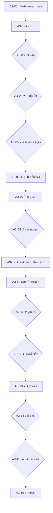

# Act 3 Blueprint — The City That Counts No One
# พิมพ์เขียวองก์ 3: เมืองที่ไม่มีใครนับเรา

| Document control | Value |
|---|---|
| ID / version | `JKB-ND-A3-BLUEPRINT` / **1.0.0** (รื้อสร้างทั้งฉบับ แทน rev.0.2 ซึ่งดูได้จากประวัติ git) |
| Date | 2026-10-21, Asia/Bangkok |
| Authority | [ADR-P0-031](../adr/ADR-P0-031-act1-4-narrative-rebuild-item-contract-and-balance-model.md) · ADR-P0-030 · ADR-P0-029 · ADR-P0-026 D2 · ADR-P0-024 D3 · [มหาพิมพ์เขียว 5 องก์](five-act-narrative-gameplay-master-plan.md) |
| Depends on | [Act 2 Blueprint 1.0.0](act2-living-keepsake-rewrite-blueprint.md) |
| Author | Claude (Supreme Narrative Architect) |
| Status | **พิมพ์เขียวฉบับสมบูรณ์ พร้อมบททุกโหนด** · รอ PO ตรวจภาษาไทย และตรวจเสียงของเตื๊อก |
| Runtime | **8–10 นาทีต่อเส้นทาง** วัดจากตัวบทจริงด้วย [act1-4-runtime-ledger.mjs](evidence/act1-4-runtime-ledger.mjs) |
| Math | ตัวเลขทุกตัวตรงกับ [act1-4-balance-model.mjs](evidence/act1-4-balance-model.mjs) |

> **แท็กเพิ่มเติม:** `bus` / `walk` (A3-15) · `marble` (รับลูกแก้วไว้)

---

## 0. หน้าที่ขององก์นี้

องก์นี้คือครั้งแรกในชีวิตที่เจ้ากบอยู่ตัวคนเดียวจริง ๆ (PO-D2) ไม่มีเพื่อนสัตว์ในฉากใดเลย มีแต่ร่องรอยที่ผู้เล่นเห็นได้ (ขนนก เงาบนหลังคา) ส่วนเจ้ากบเห็นหรือไม่ขึ้นกับสิ่งที่พกมา

1. **การตามหาพ่อแม่มีหน้าตาจริง:** กบปูนปั้นหน้าบ้านคุณยาย
2. **กฎสามสายตา:** ผู้ใหญ่ที่รีบมองไม่เห็น · ผู้ใหญ่ที่ใจเปิดจะชะงัก มองซ้ำ แล้วยอมรับ · เด็กเห็นทันที
3. **ฝีเข็มครั้งที่สอง:** คุณยายเย็บคอเสื้อด้วยด้ายฟ้า คลายด้ายแดงออกพันรอบกระดุม แล้วสอนปมที่ดึงยังไงก็ไม่หลุด ด้ายแดงกลายเป็นไอเทมตั้งแต่ตรงนี้
4. **เจ้าเตื๊อก:** ผู้ใหญ่ที่เหนื่อยที่สุดในเมือง แทนตัวว่า "ข้า" เหมือนเจ้ากบ และเรียกเขาว่า "เอ็ง" ของที่เจ้ากบยื่นให้จะเปิดความทรงจำของเตื๊อกคนละเรื่อง
5. **การให้อภัย:** เด็กชายหัวโจกขอโทษด้วยลูกแก้วที่ "ยิงแม่นที่สุด"

**กฎเรื่องเตื๊อก (ห้ามละเมิด):** ในโลกของเรื่อง เด็กหญิงเป็นเด็กและเตื๊อกเป็นผู้ใหญ่ การเชื่อมโยงกับโลกจริงต้องอยู่นอกเรื่องเท่านั้น "คนที่รออยู่" ของเตื๊อกต้องไม่ชี้ไปที่บ้านเด็กหญิง และเตื๊อกต้องเดินไปคนละทางกับตรอกช่างไม้เสมอ

---

## 1. ระบบในองก์นี้

| ระบบ | สิ่งที่เกิด |
|---|---|
| ใจ | ความเหงาของเมืองลดใจ (A3-01 ถึง A3-04 รวม −20 ถึง −35) แล้วความเมตตาของคนฟื้นใจ (A3-05 ถึง A3-13 รวม +45) |
| สี่กุญแจ | A3-03 (4 ทาง) · A3-08 (3 ทาง) |
| ด้ายแดง | A3-06 collect `item_red_yarn` (ด้ายของแม่ พันรอบกระดุมของยาย) · `a3.grandma_knot` |
| ลูกแก้ว | A3-11 collect / แลกเมล็ดบัว / ปฏิเสธ (refuse → memory) |
| Reciprocal Aid | A3-12 ของแต่ละชิ้นเปิดความทรงจำของเตื๊อกคนละเรื่อง (ADR-026 D2) |
| Bond ลับ | A3-14 วางขนมปังครึ่งหนึ่งไว้ "เผื่อ" ใครก็ไม่รู้ · Bond นก +5 · Bond หนู +5 โดยผู้เล่นไม่เห็นตัวเลข |
| เลือกเดินทาง | A3-15 นั่งรถเมล์กับเตื๊อก (STA อย่างน้อย 70) หรือเดินเอง (HP −5 · STA อย่างน้อย 55 · `inner_resilience` +1) |

**ค่าปลายองก์ (จากแบบจำลอง)**

| เส้นทาง | HP | ใจ | STA |
|---|---|---|---|
| นั่งรถเมล์ | 80–90 | 55–95 | 70–75 |
| เดินเอง | 75–85 | 55–95 | 55–75 |

---

## 2. ผังโหนด

---

## 3. ภาพรวมโหนด

| ID | ชื่อ | ตัวเลือก | ระบบ | CG |
|---|---|---|---|---|
| A3-01 | เมืองที่ความสูงเท่าเข่า | — | ใจ −5 | `a3-city-threshold` |
| A3-02 | คนที่รีบ | — | ใจ −5 · HP −5 · STA −5 (Keen Eye: 0) | — |
| A3-03 | กบวิเศษ | สี่กุญแจ 4 | STA · ใจ | `a3-kids-jar` |
| A3-04 | กบปูนปั้น | 2 + Willpower | ใจ −10 | `a3-stone-frog` |
| A3-05 | ขวัญเอ๊ย ขวัญมา | 2 | ใจ +5 · จุด Grace ของ Act 3 | `a3-grandma-sees` |
| A3-06 | ฝีเข็มครั้งที่สอง | — | ใจ +15 · STA +10 · HP อย่างน้อย 75 · **`item_red_yarn`** | `a3-grandma-mend` |
| A3-07 | ไปดี ๆ เน้อ | — | — | — |
| A3-08 | เด็กซนรอบสอง | สี่กุญแจ 3 | STA | — |
| A3-09 | สงสัยข้าจะเหนื่อยจริง ๆ | — | — | `a3-teuk-bench` |
| A3-10 | นั่งยองให้เท่าเด็ก | — | — | `a3-teuk-kids` |
| A3-11 | ลูกแก้ว | 3 | ใจ +10 · **`item_glass_marble`** | — |
| A3-12 | ของที่ยื่นให้ | 5 | ใจ +10 · Reciprocal Aid | `a3-teuk-aid` |
| A3-13 | ข้ากับเอ็ง | — | ใจ +5 | — |
| A3-14 | ค่ำที่ม้านั่ง | 2 | ใจ −5 · Bond ลับ | `a3-bench-night` |
| A3-15 | รถเมล์สายสุดท้าย | 2 | STA · `a3.bus_with_teuk` | `a3-night-bus` |
| A3-16 | ปากตรอก | — | `story.act3_complete` | — |

---

## 4. บท

### A3-01 · เมืองที่ความสูงเท่าเข่า
`pace: slow` `emotion: afraid` `CG: a3-city-threshold` `silence: 4s`

> เมืองไม่ได้เริ่มที่ประตู เมืองเริ่มที่เสียง
> เสียงเครื่องยนต์ เสียงรองเท้า เสียงประตูเหล็กเลื่อน ดังซ้อนกันจนไม่เหลือช่องให้ได้ยินอย่างอื่น
> ขอบฟุตบาทสูงถึงอกเขา ล้อรถที่จอดอยู่ใหญ่กว่าตัวเขาทั้งตัว
> ทุกอย่างในนี้สร้างไว้ให้คนที่สูงกว่าเขาสามเท่า
> {!belief_father} *แม่อยู่ในนี้* เขาบอกตัวเอง *ที่ไหนสักแห่ง*
> {belief_father} *พ่ออยู่ในนี้* เขาบอกตัวเอง *ที่ไหนสักแห่ง*

ผล: ใจ −5

### A3-02 · คนที่รีบ
`pace: normal` `emotion: afraid` `CG: —` `silence: 0s`

> ฟุตบาทร้อนจนฝ่าเท้าแสบ เขาเดินชิดกำแพงไว้
> รองเท้าคู่หนึ่งก้าวลงมาห่างจากเขาไม่ถึงคืบ แล้วก็ก้าวต่อไปโดยไม่ชะลอ ผู้ชายคนนั้นคุยโทรศัพท์อยู่ ไม่ได้มองลงมาเลย
> ผู้หญิงหิ้วถุงกับข้าวเดินผ่านไปอีกคน มองข้ามหัวเขาไปที่ป้ายราคาหน้าร้าน
> คนที่รีบมองไม่เห็นอะไรที่อยู่ต่ำกว่าเข่า
> {siblings} เขาอ่านจังหวะเท้าคนเหมือนอ่านก้านบัวที่สั่น แล้วหลบได้ทุกครั้งโดยไม่ต้องวิ่ง

ผล: ใจ −5 · HP −5 · STA −5 (Keen Eye: 0)

### A3-03 · กบวิเศษ
`pace: fast` `emotion: urgent` `CG: a3-kids-jar` `silence: 0s`

> "กบ! กบใส่เสื้อ!"
> เด็กชายสามคนหยุดกึกกลางฟุตบาท คนที่นำถือขวดโหลพลาสติกใบใหญ่อยู่ในมือ
> เด็กไม่ต้องมองซ้ำ เด็กเห็นทันที
> "กบวิเศษ! จับไปให้ทั้งห้องดู!"

**ตัวเลือก** (สี่กุญแจ)

1. **ก · หายใจสองจังหวะแล้วถอยช้า ๆ** · แสดงเมื่อ {mother} · ผล: STA −5
   > เขาไม่วิ่ง เขาหายใจ หนึ่ง สอง แล้วถอยเข้าซอกระหว่างกระถางทีละก้าว จนเด็ก ๆ คลาดสายตาไป
2. **ข · เป่านกหวีดเสียงแหลม** · แสดงเมื่อ {whistle} · ผล: STA −5 · ใจ −5
   > เด็กทั้งสามสะดุ้ง หันหาต้นเสียงไปคนละทาง เขาวิ่งลอดใต้มอเตอร์ไซค์ที่จอดอยู่ได้ทัน
3. **ค · หาช่องที่มือเด็กเข้าไม่ถึง** · แสดงเมื่อ {siblings} · ผล: STA −5 · ใจ −5
   > เขามองหาช่องที่แคบเกินกว่ามือเด็ก แล้วมุดเข้าใต้ตู้ไปรษณีย์ได้พอดีตัว
4. **ง · วิ่งสุดแรง** · ผล: STA −10 · ใจ −10 · HP −5
   > เขาวิ่งจนเข่าถลอกกับขอบฟุตบาท เสียงรองเท้าผ้าใบตามมาติด ๆ จนถึงหัวมุมถนน

### A3-04 · ★ กบปูนปั้น
`pace: slow` `emotion: lonely` `CG: a3-stone-frog` `silence: 4s`

> หลังหัวมุมถนนมีบ้านหลังเล็ก หน้าบ้านปลูกต้นไม้ในกระถางเต็มไปหมด
> และข้างกระถางโหระพา มีกบตัวหนึ่งนั่งอยู่ สีเขียว ตัวโต นั่งนิ่ง
> {!belief_father} *แม่?*
> {belief_father} *พ่อ?*
> เขาวิ่งเข้าไปด้วยแรงที่เหลือทั้งหมด แล้วหยุดห่างจากมันหนึ่งช่วงแขน
> กบตัวนั้นเป็นปูน ตาวาดด้วยสี มีตะไคร่ขึ้นที่ไหล่

**ตัวเลือก**

1. **ก · นั่งลงข้างมัน** · ผล: ใจ −10
   > เขานั่งลงข้างกบปูน เพราะไม่เหลือแรงจะไปไหนแล้ว
2. **ข · ลุกเดินต่อทันที** · ผล: ใจ −10 · STA −5 · `inner_resilience` +1
   > เขาหันหลังให้มันทันที ก่อนที่ใจจะทันได้หวังอะไรอีก
3. **ค · นึกถึงเสียงที่บ้าน** · แสดงเมื่อ ใจ ≤ 50 · ผล: ใจ −10 แล้ว +15 · `clinging_ache` +1
   > เขานั่งพิงกบปูน แล้วปล่อยให้เสียงที่คุ้นที่สุดดังอยู่ในใจจนหายเหนื่อย

### A3-05 · ★ ขวัญเอ๊ย ขวัญมา
`pace: slow` `emotion: tender` `CG: a3-grandma-sees` `silence: 2s`

> ประตูบ้านเปิดออก หญิงชราคนหนึ่งเดินออกมาพร้อมขันรดน้ำ
> เธอหยุดเดิน ถอดแว่นออกมาเช็ดกับชายเสื้อ แล้วสวมกลับไปมองใหม่
> กบสองตัวนั่งอยู่ข้างกระถางโหระพา ตัวหนึ่งเป็นปูน อีกตัวไหล่กำลังขยับขึ้นลงช้า ๆ
> แล้วเธอก็พูดคำเดียวกับที่เคยพูดกับหลานทุกครั้งที่หกล้ม
> "ขวัญเอ๊ย... ขวัญมา"
> เธอค่อย ๆ นั่งยองลง แล้ววางมือหงายไว้บนขั้นบันได ไม่ยื่นมาหาเขา

**ตัวเลือก** (ทุกทาง: ใจ +5)

1. **ก · เดินเข้าไปหา**
   > เขาเดินเข้าไปช้า ๆ จนถึงขั้นบันได คุณยายไม่ขยับมือเลย จนกว่าเขาจะหยุดเอง
2. **ข · ยังไม่กล้า อยู่ข้างกบปูนก่อน**
   > คุณยายไม่เร่ง เธอนั่งอยู่อย่างนั้น ฮัมเพลงเก่า ๆ ที่เขาไม่เคยได้ยิน จนเขาค่อย ๆ ขยับเข้ามาเอง

ถ้าค่าใดถึงศูนย์ก่อนโหนดนี้ Grace Beat ของ Act 3 คือคุณยายอุ้มเขาขึ้นวางบนตักโดยไม่ถามอะไร

### A3-06 · ★ ฝีเข็มครั้งที่สอง
`pace: slow` `emotion: tender` `CG: a3-grandma-mend` `silence: 3s`

> บนระเบียง คุณยายยกถ้วยข้าวต้มเล็ก ๆ มาวางให้ เป่าให้หายร้อนก่อนทุกคำ
> แล้วยายก็มองตะเข็บคอเสื้อที่ถูกรั้งไว้ด้วยด้ายสีแดง เธอไม่ถามอะไรเลย
> ยายเย็บคอเสื้อใหม่ด้วยด้ายสีฟ้า สีเดียวกับเสื้อ เข็มเล่มเล็กเลื่อนเข้าออกช้า ๆ
> เจ้ากบนั่งนิ่ง จนได้ยินเสียงลมหายใจของยาย
> ช้าเหมือนของแม่ แต่ไม่ใช่ของแม่
> พอเสร็จ ยายไม่ตัดด้ายแดงทิ้ง ยายคลายมันออกทีละรอบ แล้วพันเข้ากับกระดุมสำรองเม็ดหนึ่งจากกล่องเข็ม
> "ของดีเน้อ" ยายว่า แล้ววางมันลงในมือเขา
> จากนั้นยายจับปลายด้ายผูกให้ดูหนึ่งรอบ ช้า ๆ "ผูกแบบนี้นะ ดึงยังไงก็ไม่หลุด"
> {whistle} ยายเหลือบเห็นนกหวีดใต้ชายเสื้อ "นกหวีดปล้องกก สมัยยายเด็ก ๆ เด็กผู้ชายเป่ากันทั้งหมู่บ้าน"
> {stone} ยายยกหินใสขึ้นส่องแดด "สวยเหมือนน้ำค้างบนใบตองเลย"
> {pod} ยายเขย่าฝักบัวฟัง แล้วยิ้ม "ยายเคยต้มเมล็ดบัวให้หลานกิน ตอนนี้หลานอยู่ไกล ไม่มีใครให้ต้มแล้ว"
> ราวตากผ้าข้างระเบียงส่งกลิ่นมาตามลม กลิ่นแดดบนผ้าสะอาด
> เจ้ากบหันขวับ หัวใจเต้นแรงขึ้นมาเฉย ๆ
> *คงคิดไปเอง*

ผล: ใจ +15 · STA +10 · HP อย่างน้อย 75 · collect `item_red_yarn` · `a3.grandma_knot`

### A3-07 · ไปดี ๆ เน้อ
`pace: slow` `emotion: warm` `CG: —` `silence: 0s`

> ก่อนเขาจะไป ยายปัดฝุ่นที่ไหล่เสื้อให้อีกทีหนึ่ง
> "ไปดี ๆ เน้อ หนู"
> เขาโค้งตัวลงช้า ๆ อย่างที่ไม่เคยโค้งให้ใครมาก่อน
> ยายหัวเราะเบา ๆ แล้วโค้งตอบ

### A3-08 · เด็กซนรอบสอง
`pace: fast` `emotion: urgent` `CG: —` `silence: 0s`

> พอพ้นซอยบ้านยาย เสียงรองเท้าผ้าใบก็ดังมาอีก
> "เจอแล้ว!" เด็กชายคนเดิมชูขวดโหลขึ้นสูง คราวนี้มีเพื่อนวิ่งตามมาสองคน

**ตัวเลือก** (สี่กุญแจ)

1. **ก · วิ่งตามเงาคนเดินถนน** · แสดงเมื่อ {siblings} · ผล: STA −5
   > เขาไม่วิ่งเข้าที่โล่ง เขาวิ่งตามเงาของคนที่เดินอยู่ เด็ก ๆ มองตามไม่ทัน แต่ทางที่เหลือก็พาไปถึงป้ายรถเมล์อยู่ดี
2. **ข · เป่านกหวีดล่อไปอีกทาง** · แสดงเมื่อ {whistle} · ผล: STA −5
   > เขาเป่าแล้วโยนเสียงไปที่มุมตึก เด็ก ๆ หันไปทางนั้น เขาวิ่งไปอีกทาง ซึ่งเป็นทางไปป้ายรถเมล์
3. **ค · วิ่งไปทางป้ายรถเมล์** · ผล: STA −10
   > เขาวิ่งจนหอบ ตรงหน้ามีม้านั่งยาวกับป้ายรถเมล์ ใต้ม้านั่งคือที่เดียวที่ยังมืดพอให้ซ่อน

### A3-09 · ★ สงสัยข้าจะเหนื่อยจริง ๆ
`pace: slow` `emotion: curious` `CG: a3-teuk-bench` `silence: 2s`

> ใต้ม้านั่งมีรองเท้าหนังสีดำคู่หนึ่ง ฝุ่นจับจนเป็นสีเทา
> เจ้าของรองเท้านั่งอยู่ข้างบน เนคไทหลวม กระเป๋าเอกสารพิงขา กาแฟเย็นในแก้วพลาสติกละลายจนเหลือแต่น้ำ
> ชายหนุ่มก้มลงจะผูกเชือกรองเท้า แล้วก็สบตากับกบใต้ม้านั่ง
> เขาขยี้ตา มองใหม่ แล้วหัวเราะออกมาทางจมูก
> "สงสัยข้าจะเหนื่อยจริง ๆ แล้วว่ะ"
> แต่เขาก็ขยับกระเป๋าเอกสารออก ให้ม้านั่งมีที่ว่างพอสำหรับกบหนึ่งตัว

### A3-10 · นั่งยองให้เท่าเด็ก
`pace: normal` `emotion: warm` `CG: a3-teuk-kids` `silence: 0s`

> เด็ก ๆ วิ่งมาถึง แล้วชะงักเมื่อเห็นผู้ใหญ่คนหนึ่งนั่งอยู่ข้างกบของพวกเขา
> ชายหนุ่มไม่ลุกขึ้นยืน ไม่ตะคอก เขาลงจากม้านั่ง แล้วนั่งยองให้ต่ำเท่าเด็ก
> "ตัวนี้มาจากที่ไกลนะ" เขาบอก "ดูเท้าสิ เดินมาไกลแค่ไหน"
> เด็กชายที่ถือขวดโหลก้มมอง แล้วเห็นฝ่าเท้าที่แดงเพราะฟุตบาทร้อน
> ขวดโหลค่อย ๆ ลดต่ำลง

### A3-11 · ★ ลูกแก้ว
`pace: slow` `emotion: tender` `CG: —` `silence: 0s`

> เด็กชายล้วงกระเป๋ากางเกงอยู่นาน แล้วยื่นลูกแก้วลูกหนึ่งมา ข้างในมีเส้นสีฟ้าบิดเป็นเกลียว
> "ขอโทษนะ" เขาพูดเสียงแผ่ว "ลูกนี้ยิงแม่นที่สุดเลย"
> น้องสาวตัวเล็กของเด็กชายยื่นขนมปังชิ้นหนึ่งตามมาด้วย ทั้งที่ไม่มีใครบอก

**ตัวเลือก** (ทุกทาง: ใจ +10)

1. **ก · รับลูกแก้วไว้** · ผล: collect `item_glass_marble`
   > เขารับด้วยสองมือ ลูกแก้วหนักกว่าที่คิด และยังอุ่นจากกระเป๋ากางเกงของเด็ก
2. **ข · รับไว้ แล้วให้เมล็ดบัวตอบ** · แสดงเมื่อ {pod,seeds} · ผล: collect `item_glass_marble` · เมล็ด −1 · `a3.seed_to_kid`
   > เด็กชายมองเมล็ดบัวในมือตัวเองอยู่นาน "จะเอาไปปลูก ถ้าขึ้นจะเอามาให้ดู"
3. **ค · ส่ายหน้า แล้วยื่นคืนให้** · ผล: `refused_glass_marble`
   > เด็กชายกำลูกแก้วไว้อย่างงง ๆ แล้วก็ยิ้มออกมา "งั้นเป็นเพื่อนกันนะ"

### A3-12 · ★ ของที่ยื่นให้
`pace: slow` `emotion: tender` `CG: a3-teuk-aid` `silence: 0s`

> เด็ก ๆ กลับไปแล้ว ชายหนุ่มกลับขึ้นไปนั่งที่เดิม แล้วถอนใจยาวจนไหล่ตก
> เขาหลับตา เหงื่อไหลลงข้างแก้ม รถเมล์สายที่รอยังไม่มา

**ตัวเลือก** (Reciprocal Aid · ทุกทาง: ใจ +10 · ของยัง held)

1. **ก · ยื่นหินใสแตะหน้าผาก** · แสดงเมื่อ {stone}
   > ความเย็นวาบขึ้นมาในอากาศร้อน ชายหนุ่มลืมตา "เย็นดีแท้ เหมือนน้ำบ่อหลังบ้านข้าตอนเด็ก"
2. **ข · เป่านกหวีดเบา ๆ** · แสดงเมื่อ {whistle}
   > ชายหนุ่มหัวเราะ "พ่อข้าก็เคยทำให้ ทำจากใบมะพร้าว" แล้วเงียบไป "ไม่ได้กลับไปหาพ่อนานแล้วว่ะ"
3. **ค · เขย่าฝักบัวให้ฟัง** · แสดงเมื่อ {pod,seeds}
   > "เหมือนเสียงฝนตกบนหลังคาสังกะสีบ้านนอก" ชายหนุ่มว่า "สมัยก่อนข้าหลับง่ายที่สุดก็ตอนฝนตก"
4. **ง · ยื่นลูกแก้วให้ดู** · แสดงเมื่อ {marble}
   > ชายหนุ่มส่องลูกแก้วกับแดด "สมัยเด็กข้าเล่นลูกแก้วชนะทั้งซอยนะ" แล้วคืนให้ "เก็บไว้ ของดี"
5. **จ · แตะหลังมือเขาเบา ๆ**
   > ไออุ่นจาง ๆ แผ่ออกมาจากฝ่ามือเล็ก ๆ นั้น ชายหนุ่มมองมันอยู่นาน แล้วก็ยิ้มเป็นครั้งแรกของวัน

### A3-13 · ★ ข้ากับเอ็ง
`pace: slow` `emotion: tender` `CG: —` `silence: 4s`

> "เอ็งก็กำลังจะไปหาใครสักคนใช่ไหม"
> เจ้ากบพยักหน้า
> "ข้าก็เหมือนกัน" ชายหนุ่มว่า "เหนื่อยแทบตาย แต่พอนึกว่ามีคนรออยู่ ขามันก็เดินของมันเอง"
> เขาหันมองฟ้าสีส้มเหนือหลังคาตึก
> "บางวันก็ลืมไปว่าเดินมาทำไม แต่พอนึกออก ก็ไม่เคยอยากหยุดเดินอีกเลย"
> {!belief_father} เจ้ากบนึกถึงอ้อมกอดในคืนพายุ *แม่คงรออยู่ที่ไหนสักแห่งเหมือนกัน*
> {belief_father} เจ้ากบนึกถึงอ้อมกอดในคืนพายุ *พ่อคงรออยู่ที่ไหนสักแห่งเหมือนกัน*

ผล: ใจ +5 · เจ้ากบกับเตื๊อกแทนตัวว่า "ข้า" เหมือนกันโดยเจตนา

### A3-14 · ค่ำที่ม้านั่ง
`pace: slow` `emotion: lonely` `CG: a3-bench-night` `silence: 3s`

> ฟ้ามืดลง ไฟเมืองติดทีละดวง เมืองนี้ไม่เคยมืดสนิทเลย
> ชายหนุ่มยังรอรถเมล์ เจ้ากบนั่งข้างเขา ถือขนมปังที่น้องสาวของเด็กชายให้ไว้
> ก่อนกิน เขานับอย่างที่ทำทุกคืน
> "หนึ่ง"
> {stone} หินใสในมือรับแสงไฟถนนแล้วสะท้อนขึ้นไปบนหลังคาป้ายรถเมล์ แสงไปหยุดที่นกตัวหนึ่งที่เกาะนิ่งอยู่ตรงนั้น ทั้งสองสบตากัน นกรีบมุดหลบ เขายิ้มอยู่คนเดียว

**ตัวเลือก** (ทุกทาง: ใจ −5)

1. **ก · กินครึ่งหนึ่ง วางอีกครึ่งไว้ใต้ม้านั่ง** · ผล: HP +5 · Bond นก +5 · Bond หนู +5 · `a3.left_food_for_unseen`
   > เขาวางขนมปังครึ่งหนึ่งไว้ใต้ม้านั่ง ไม่รู้ว่าเผื่อใคร รู้แค่ว่าแม่คงทำแบบนี้
2. **ข · กินหมด** · ผล: HP +10
   > เขากินหมดทุกคำ ท้องที่อิ่มทำให้คืนนี้ไม่หนาวเท่าที่คิด

ถ้าพกหินใส ตั้ง `a3.saw_follower` (เจ้ากบรู้ว่ามีใครตามมา)

### A3-15 · รถเมล์สายสุดท้าย
`pace: normal` `emotion: hopeful` `CG: a3-night-bus` `silence: 0s`

> รถเมล์มาถึงพร้อมเสียงเบรกยาว ไฟในรถสว่างจ้า
> ชายหนุ่มลุกขึ้น แล้วหันมามองเขา
> "ข้าจะไปทางย่านบ้านคน เงียบกว่าแถวนี้" เขาว่า แล้วเปิดกระเป๋าเอกสารออกกว้าง ๆ "ไปด้วยกันไหม เอ็ง"
> เขาไม่ได้หยิบเจ้ากบใส่กระเป๋า เขาแค่เปิดไว้ แล้วรอ

**ตัวเลือก**

1. **ก · ปีนเข้ากระเป๋า** · ผล: STA อย่างน้อย 70 · `a3.bus_with_teuk`
   > รถเมล์โยกไปตามถนน เจ้ากบโผล่หัวออกจากกระเป๋า มองไฟเมืองไหลผ่านกระจก
   > ในกระจกมีกบตัวโตในเสื้อยืดสีฟ้ามองกลับมา นานแล้วที่เขาไม่ได้เห็นตัวเอง
   > ชายหนุ่มเผลอหลับไปพักหนึ่ง มือข้างหนึ่งยังวางกันกระเป๋าไว้ไม่ให้ล้ม
2. **ข · ส่ายหน้า เดินไปเอง** · ผล: HP −5 · STA อย่างน้อย 55 · `inner_resilience` +1
   > รถเมล์ออกไปแล้ว เขาเดินตามทางที่รถไปตลอดคืน ไฟถนนเรียงเป็นแถวให้เดินตาม
   > ขนนกเส้นหนึ่งร่วงลงมาตรงหน้า เขาเงยมอง ไม่เห็นอะไร

### A3-16 · ปากตรอก
`pace: slow` `emotion: hopeful` `CG: —` `silence: 3s`

> {bus} ชายหนุ่มลงรถที่ป้ายหนึ่งในย่านบ้านคน แล้ววางกระเป๋าลงบนฟุตบาทให้เขาปีนออกมาเอง
> {bus} "ข้าไปทางนี้" เขาชี้ซอยหนึ่ง แล้วชี้อีกทาง "เอ็งไปทางนั้น เงียบกว่า"
> {bus} "ไปหาเขาให้เจอนะ เอ็ง"
> {bus} แล้วเขาก็เดินเข้าซอยไปโดยไม่หันกลับ คนที่มีคนรออยู่มักเดินแบบนั้น
> {walk} ใกล้เที่ยงคืน เขาเดินมาถึงย่านบ้านคน ไฟหน้าบ้านดับไปทีละหลัง
> ตรงหน้าคือตรอกแคบ ๆ ระหว่างกำแพงอิฐสูงสองข้าง มีกลิ่นขี้เลื่อยลอยออกมา
> แล้วเม็ดฝนเม็ดแรกก็ตกลงบนหัวเขา

ผล: `story.act3_complete`

---

## 5. ไอเทม · Bond · Status ในองก์นี้

| ไอเทม | ใช้ในองก์นี้ | สิ่งที่ปลดล็อก |
|---|---|---|
| นกหวีดของพ่อ | A3-03 · A3-08 ล่อเด็ก · A3-12 | เตื๊อกเล่าเรื่องพ่อของเขาที่ไม่ได้กลับไปหานานแล้ว · คุณยายเล่าเรื่องหมู่บ้าน |
| หินใสของพี่บัว | A3-12 แตะหน้าผาก (ตัวอย่างใน ADR-026 D2) · A3-14 | เตื๊อกเล่าเรื่องบ่อหลังบ้าน · **ฉากลับ:** เห็นนกที่แอบตามมาบนหลังคาป้ายรถเมล์ (`a3.saw_follower`) |
| ฝักบัวของพี่แหน | A3-11 แลกเมล็ดกับลูกแก้ว · A3-12 | เตื๊อกเล่าเรื่องฝนบนหลังคาบ้านนอก · คุณยายเล่าเรื่องหลานที่อยู่ไกล · เด็กชายจะปลูกเมล็ดบัว (`a3.seed_to_kid`) |
| ลูกแก้ว | A3-12 | เตื๊อกเล่าเรื่องสมัยเด็ก |
| มือเปล่า | A3-12 | เตื๊อกยิ้มเป็นครั้งแรกของวัน |
| ด้ายแดง | **เข้ากระเป๋าที่ A3-06** | ปมของยายใช้ใน Act 4 (A4-03) |

ทุกทางของ A3-12 ได้ใจ +10 เท่ากัน ของไม่หายจากกระเป๋า และไม่มีทางไหนด้อยค่ากว่ากัน (ADR-026 D2)

---

## 6. ส่งต่อ Act 4

| ค่า / flag | ใช้ที่ |
|---|---|
| `item_red_yarn` · `a3.grandma_knot` | A4-03 สายชีวิตด้วยปมของยาย · A4-06 คล้องหนู |
| `item_glass_marble` | A4-02 ทดสอบความเอียง · A4-H1 · A4-L1/L2 |
| `a3.left_food_for_unseen` | A4-07 "ขนมปังที่ม้านั่งเมื่อวาน อร่อยดี" |
| `a3.saw_follower` | A4-04 เจ้ากบพูดก่อนว่า "ข้ารู้ว่าเจ้าตามมา" |
| `a3.bus_with_teuk` | A4-04 หนูบ่นว่าวิ่งตามรถเมล์ในท่อมาตลอดทาง · STA เริ่ม Act 4 |
| `a3.seed_to_kid` | Act 5 |

---

## 7. Runtime Ledger

วัดด้วย `node docs/design-system/evidence/act1-4-runtime-ledger.mjs 3` ผลอยู่ใน ADR-P0-031 §D9

---

## 8. Verification

- [ ] ไม่มีเพื่อนสัตว์ปรากฏตัวในฉากใด นอกจากร่องรอย (A3-14 หินใส · A3-15 ขนนก)
- [ ] มนุษย์ทุกคนทำตามกฎสามสายตา
- [ ] เตื๊อกใช้ "ข้า / เอ็ง" ตลอด และเดินไปคนละทางกับตรอกช่างไม้
- [ ] คุณยายไม่ใช่ญาติของเด็กหญิง (PO-D4) และไม่มีบทใดบอกเป็นนัย
- [ ] ฉากเย็บของคุณยายล้อฉากแม่ แต่ไม่ซ้ำคำต่อคำ
- [ ] ไม่มีตัวละครใดเรียกเขาว่า "เจ้ากบ" (ยายเรียก "หนู" · เตื๊อกเรียก "เอ็ง" · เด็กเรียก "กบวิเศษ")
- [ ] ค่าปลายองก์ตรงกับแบบจำลอง และเวลาเล่น 8–10 นาทีทั้งสองเส้นทาง

— End of Act 3 Blueprint 1.0.0 —
