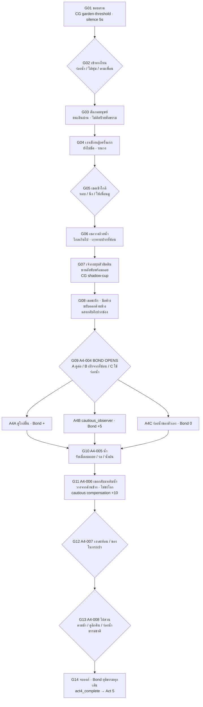

# Act 4 Rewrite Blueprint — The Girl Who Learned the Distance
# พิมพ์เขียวยกเครื่ององก์ 4: สายตา 45 ซม. ความระแวง และระยะห่างที่ค่อย ๆ แคบลง

| Document control | Value |
|---|---|
| ID / version | `JKB-ND-A4-BLUEPRINT` / **0.1.0** (Greenlight per PO · ADR-P0-029 · ADR-P0-021 D4) |
| Date | 2026-10-18, Asia/Bangkok |
| Authority | [ADR-P0-029](../adr/ADR-P0-029-in-universe-living-narrative-sovereignty-and-doll-language-ban.md) · [ADR-P0-028](../adr/ADR-P0-028-organic-family-resonance-companion-reciprocity-and-maturation-tradeoff.md) · [ADR-P0-021](../adr/ADR-P0-021-narrative-resonance-authentic-adventure-and-branching-integrity.md) D1/D4 · [ADR-P0-026](../adr/ADR-P0-026-cockroach-man-route-boss-jao-teuk-mandate-and-branching-narrative-graph.md) |
| Author | Executive Narrative Director (mimo-v2.6-pro) |
| Status | **Director's draft rev.0.1** · รอ PO approve |
| Depends on | Act 1 **rev.0.6.1** · Act 2 **rev.0.5** · Act 3 **rev.0.2** (approved structure) |
| Target runtime | **8–10 นาทีจริง** |
| Non-goals | Act 5 เต็ม · Schema/Save · code · art export |

---

## 0. Canon องก์ 4 (ADR-P0-029 + คำสั่ง PO)

### 0.1 สัจจะตัวละคร (ห้ามหลุด)

| ห้ามในบท Act 1–4 | ใช้แทน |
|---|---|
| กำมะหยี่ · ผิวกำมะหยี่ | **ผิวนุ่มนิ่ม เนื้ออบอุ่น** |
| ตุ๊กตา · ของเล่น · สำลี | **กบนิทานที่มีชีวิตจริง** มีลมหายใจ หัวใจเต้น |
| ตะเข็บตามตัวกบ · รอยเย็บผิวหนัง | ตะเข็บ **ปกเสื้อกั๊กสีฟ้า** เท่านั้น |
| เด็กหญิงมองเป็นของเล่นผ้า | **มองเป็นกบน้อยตัวจริง** แสนรู้ บาดเจ็บ ต้องระวัง |

### 0.2 ปมอ้อมกอด — **ยังไม่เฉลย**

- เจ้ากบยังเชื่อว่าอ้อมกอดในคืนพายุ = **พ่อหรือแม่**
- เด็กหญิง **ไม่รู้ตัว** (หรือไม่พูด) ว่าเธอคือคนอุ้มเขาในคืนนั้น
- **ห้ามใบ้เกินควร** จนกว่า Act 5 `END-HOME`
- Bond อย่างเป็นทางการเริ่มที่ **A4-004** เท่านั้น (ไม่มี Bond ก่อนหน้า)

### 0.3 เด็กหญิง (Character Sheet)

| หัวข้อ | สเปก |
|---|---|
| ชื่อ | ผู้บรรยาย **ไม่เรียกชื่อ** จนกว่าเธอจะบอกเอง / หรือไม่บอกเลย (ตามสัญญาเดิม) |
| สายตา | เห็นเจ้ากบเป็น **กบน้อยตัวจริง** ที่ดูเหนื่อย เปียก ระแวง |
| ท่าทาง | **กะระยะพลาด → สังเกต → แก้** · ไม่รุก · ไม่อุ้ม · ไม่กัก |
| คำพูด | น้อย · ทำมาก · เช่น *"ตรงนี้ได้ไหม"* |
| 45 ซม. | เธอนั่งยอง/คุกเข่า · เจ้ากบอยู่ในระดับอก/เข่า · eyeline เกือบเท่ากันเมื่อเธอนั่ง |

---

## 1. Dramaturgical Spine

> **One-sentence logline:**  
> ในสวนเล็ก ๆ ที่แสงบ่ายอุ่น เจ้ากบเรียนรู้ที่จะไม่วิ่งหนีผู้หญิงที่ค่อย ๆ เรียนรู้ที่จะไม่รุก — จนระยะห่างระหว่างสองชีวิตแคบลงทีละนิ้ว

**Emotional arc:**

```text
ระแวง → สังเกต → กลัว (เงาบดบัง) → เธอถอย → สงสัย
→ เธอแก้ไข → ไว้ใจเล็กน้อย → ลองรับน้ำ → ผูกพัน (A4-004 Bond)
→ เลือกทางของตน → เดินตาม / รอ / ไปทางน้ำฝน
```

| Movement | อารมณ์ | Pace | Silence |
|---|---|---|---|
| M1 Garden Threshold | ใหม่ / ระแวง | slow · steady | 1 ยาวเปิด |
| M2 First Glimpse | สงสัย | breath | 1 |
| M3 Shadow Fear | กลัว | quick | สั้น |
| M4 She Adjusts | โล่ง / ลังเล | slow · tender | **ยาวกลางฉาก** |
| M5 Water Choice | ตัดสินใจ | steady | 1 ก่อนเลือก |
| M6 Bond Opens | อุ่น / ผูกพัน | warm | 2 |
| M7 Paths | ไปต่อ / รอ / ตาม | steady · resolve | 1 ท้ายองก์ |

**งบเวลา:** 8–10 นาที · ≥20 beats · choice 10–12 · CG 5–7

---

## 2. System Layer

### 2.1 Bond (เริ่มที่ A4-004 เท่านั้น)

| กฎ | รายละเอียด |
|---|---|
| ก่อน A4-004 | **Bond = 0 ตลอด** · ไม่มีการแอบให้แต้ม |
| A4-004 | เปิด Bond · ทางเลือก A/B/C |
| A4-005–008 | สะสม Bond ตามเส้น · ยุติธรรมทุกสาย |
| ไม่ใช่ | รางวัลจากความทรมาน · item-exclusive |

### 2.2 Status / Flags (Act 4)

| ID | ความหมาย |
|---|---|
| `girl.met_at_a4004` | พบกันชัดเจนครั้งแรก |
| `girl.distance_taught` | เธอกะระยะพลาดแล้วแก้ |
| `humanity.cautious_observer` | เลือกเฝ้าดูจากที่ซ่อน (B) |
| `accepted.water` / `waited` / `used_runoff` | ทางเลือกน้ำ A4-005 |
| `city.grandma_mended` · `city.jao_teuk_bond` | จาก Act 3 · callback |
| `story.embrace_memory` | ยังเชื่อพ่อ/แม่ · **อย่าเฉลย** |
| held items · companions | ยังใช้ได้ · ไม่บังคับ |
| `family.bond_thread` FROZEN | Memory Willpower (ใจ≤50) |

### 2.3 Choice Fairness (ตาม ADR-P0-021 D1)

| เส้น | นิสัย | Bond ปลายองก์ (โดยประมาณ) | ฉากจบ |
|---|---|---|---|
| A รับความช่วยเหลือ | เปิดใจ | สูงขึ้นเรื่อย | ปู END-HOME |
| B เฝ้าดู / ระวัง | cautious | ต่ำ · แต่มี cautious compensation | ปู DAWN/HOME |
| C ทางของตัวเอง (น้ำฝน/ร่องน้ำ) | พึ่งตนเอง | **0 หรือต่ำมาก** | **ปู END-DAWN · ไม่ถูกลงโทษ** |

---

## 3. Node/Edge Graph (Act 4)



---

## 4. Node Specs

| NodeID | ชื่อ / Pace | Choices | Consequence | CG | วิ |
|---|---|---|---|---|---|
| **G01** | ขอบสวน `slow` | ยืนมอง / หายใจเข้าลึก / แตะเสื้อ | เตรียมใจ · 45 ซม. | **garden-threshold** · silence 5s | 70 |
| **G02** | เข้าทางไหน `steady` | ร่องน้ำ / ใต้พุ่ม / ตามเพื่อน | เปิดโทน | — | 55 |
| **G03** | สังเกตมนุษย์ `slow` | ดูคนเดิน / ดูนก / เงียบ | ไม่ติดป้ายศีลธรรม | human-vignette | 65 |
| **G04** | เงาเด็กหญิงครั้งแรก `breath` | มอง / ซ่อน / ให้เพื่อนสังเกต | ยังไม่ชัด · **Bond ยัง 0** | girl-shadow | 65 |
| **G05** | เธอเข้าใกล้ `steady` | หลบ / นิ่ง / เพื่อนดู | ระแวง | girl-near | 55 |
| **G06** | วางถ้วยไกลเกิน `tender` | สังเกตถ้วย / สังเกตเงา / ทั้งสอง | เห็นความผิดพลาดของเธอ | **shadow-cup** | 75 |
| **G07** | ยุบตัวชิดดิน `quick` | ขาหลังพับ / กำชายเสื้อ / กลั้นใจ | เธอเห็นว่าเขากลัว | frog-crouch | 60 |
| **G08** | เธอชะงักแล้วแก้ `tender` | (auto) · **silence ยาว** | เธอขยับออกข้าง · แสงกลับมา | **she-steps-aside** · silence 4s | 85 |
| **G09** | **A4-004 BOND** `warm` | **A ดูต่อ / B เฝ้าจากที่ซ่อน / C ใช้ร่องน้ำ** | **เปิด Bond** · flags แยก | **bond-opens** | 80 |
| **A4A** | ดูใกล้ขึ้น `slow` | ขยับออก / สบตา / เงียบ | Bond +10..15 | — | 55 |
| **A4B** | เฝ้าดู `slow` | เกาะกระถาง / ระวังทุกฝีก้าว | Bond +5 · `cautious_observer` | — | 55 |
| **A4C** | ร่องน้ำ `steady` | เลาะไป / ฟังน้ำ | **Bond 0** · ยุติธรรม | — | 55 |
| **G10** | **A4-005 น้ำ** `steady` | **รับเมื่อเธอถอย / รอจนเธอไป / น้ำฝนในร่องใบ** | HP+ · ใจ+ · แยก flags | water-choice | 75 |
| **G11** | **A4-006 เติมน้ำซ้ำ** `tender` | (auto · เธอแก้ไขอีก) | cautious **+10 ครั้งเดียว** · หลักฐานซ้ำ | **she-refills** | 80 |
| **G12** | A4-007 เงา/ของ `breath` | ดูของในกระเป๋า / ดูเงาสะท้อน / นึกถึงบ้าน | callback held · Flashback | keepsake-reflect | 70 |
| **G13** | **A4-008 ไปสวน** `steady` | **ตามช้า / ดูอีกคืน / ร่องน้ำธรรมชาติ** | `followed` / `waited` / `runoff` | path-choice | 75 |
| **G14** | จบองก์ `resolve` | พัก / มองเธอไกล ๆ | `story.act4_complete` | **garden-dusk** | 60 |

---

## 5. Scene Deep-Dive & Samples

### 5.1 เธอกะระยะพลาดแล้วแก้ (G06–G08) — หัวใจองก์ 4

**Cinematic:** Type illustrated cutscene · Framing close-up ถ้วยไกลเกิน → เงาทาบปากที่ซ่อน → เท้า/เข่าเธอขยับออกข้าง · Light บ่ายอุ่น · เงายาว · Mood กลัว → โล่ง · **Silence 4 วิ หลังแสงกลับมา** · **ห้ามอธิบายความคิดเธอ**

**Sample (G06 · pace `tender`):**
> ถ้วยใบเล็กถูกวางลงบนดิน  
> ไกลจากพุ่มไม้เกินกว่าที่ควร  
> แล้วเงาจากไหล่ของใครบางคนก็เลื่อนลงมาปิดช่องใต้กระถาง

**Sample (G07 · pace `quick`):**
> เจ้ากบยุบตัวชิดดิน  
> ขาหลังพับลงใต้ลำตัว ปลายเท้าจิกดินพร้อมถอย  
> ชายเสื้อกั๊กสีฟ้าแนบไปกับอกที่เต้นเร็ว

**Sample (G08 · เธอแก้ไข · pace `tender` · silence 4s):**
> มือที่กำลังยื่นมาค้างอยู่  
> แล้วขยับออกไปทางข้าง ๆ ช้า ๆ  
> แสงจากบ่ายกลับคืนมาถึงปากช่องใต้กระถางอีกครั้ง  
> เจ้ากบยังไม่ขยับ  
> เขายังมองตามเงานั้นอยู่

> **กำกับ:** ไม่มีคำว่า "เธอรู้ว่าเขาเจ็บ" · ให้ *การกระทำ* เล่า · เธอเป็นคนเรียนรู้ร่วมกับเขา ไม่ใช่ผู้ช่วยเหลือผู้รอบรู้

---

### 5.2 A4-004 Bond Opens (G09)

**Sample (A ดูต่อ · pace `warm`):**
> ถ้วยน้ำขยับเข้ามาใกล้อีกนิด  
> คราวนี้จากด้านข้าง  
> เจ้ากบยังไม่ออกทันที  
> เขายังดูอยู่ — ดูว่าเงาจะกลับมาปิดอีกไหม

**Sample (B เฝ้าจากที่ซ่อน · pace `slow`):**
> เจ้ากบเลือกอยู่ใต้กระถางต่อไป  
> มองจากช่องแคบ  
> ทุกการขยับของเธอถูกเฝ้าดูอย่างตั้งใจ

**Sample (C ร่องน้ำ · pace `steady`):**
> น้ำฝนค้างอยู่ในร่องใบไม้ใกล้ ๆ  
> เจ้ากบเลาะไปดื่มเอง  
> ไม่ต้องรอให้ใครขยับถ้วย

> ทุกเส้น **เท่าเทียม** · C ไม่ได้ Bond แต่ **ไม่ถูกลงโทษ** · ปู END-DAWN

---

### 5.3 A4-005 น้ำ (G10)

| ทาง | เงื่อนไข | ผล |
|---|---|---|
| **รับเมื่อเธอถอย** | เห็นเธอขยับออก | HP+10 · ใจ+5 · Bond+ · `accepted.water` |
| **รอจนเธอไป** | ระมัดระวัง | HP+10 · ใจ+5 · `waited` |
| **น้ำฝนในร่องใบ** | ไม่ต้องมีของ | HP+10 · ใจ+5 · Bond 0 · `used_runoff` |

---

### 5.4 A4-006 เธอกลับมาเติมน้ำ (G11) — หลักฐานซ้ำ

**Sample (pace `tender`):**
> เธอกลับมาอีกครั้ง  
> คราวนี้วางถ้วยจากด้านข้าง โดยไม่ชะโงกทับปากกระถาง  
> แล้วก็ถอยไปนั่งที่เดิม  
> เจ้ากบค่อย ๆ โผล่หัวออกมามองน้ำ  
> ไม่มีใครเลื่อนตามเขา

**cautious compensation:** +10 Bond **เฉพาะ** เมื่อ `humanity.cautious_observer` · **ครั้งเดียว** · ไม่ farm ได้

---

### 5.5 A4-008 ทางของตน (G13)

| ทาง | ผล | ปู |
|---|---|---|
| ตามไปช้า ๆ | Bond + | END-HOME / NEARBY-ish |
| ดูอีกคืนแล้วตาม | Bond + ช้ากว่า | สายรอบคอบ |
| **ร่องน้ำธรรมชาติ** | **Bond 0** · เข้าสวนตามทางของตัวเอง | **END-DAWN** |

---

## 6. Companion & Secret Rescue (Act 4)

| เงื่อนไข | ใช้ |
|---|---|
| friend.sparrow / rat Rank 2–3 | ส่งสัญญาณว่าเธอไม่ร้าย · ช่วยชี้ทางน้ำ |
| Secret Bond Rescue | นกโฉบดึงความสนใจตอนเธอเผลอเข้าใกล้เกิน · หนูพาหลบ |
| ห้าม | ให้เพื่อน "อธิบาย" เธอ · ให้เธอเห็นเพื่อนเป็นของวิเศษ |

---

## 7. State Callback (A1–A3 → A4)

| อดีต | Act 4 | ใช้ |
|---|---|---|
| Triad Skills | G05/G07/G10 · ล่า/สงบ/หลบ | ความอยู่รอด |
| held dew/shell/leaf | G12 แตะของนึกถึงบ้าน | Flashback · เตรียม A5 |
| N12.5 เสื้อ / คุณยายซ่อม | เธออาจสังเกตเสื้อที่เย็บแล้ว | subtext ด้ายแดง |
| N15 อ้อมกอด | G12/G14 นึกถึง "พ่อ/แม่" | **อย่าเฉลย** |
| เตื๊อก / เด็กซน | บทสั้น · คนที่เคยดีกับเขา | ใจ + |
| bond FROZEN | Memory Willpower ถ้าใจ≤50 | clinging / resilience |
| city.kids_apology | รู้ว่าเด็กไม่ได้ร้ายทุกคน | เปิดใจง่ายขึ้นเล็กน้อย |

---

## 8. Maturation Trade-off

| ทาง | แปรสภาพ | ปู |
|---|---|---|
| นึกถึงบ้าน/อ้อมกอดบ่อย | `clinging_ache` + | **END-POND** |
| รับความช่วยเหลือ + ให้กลับ | `inner_resilience` + | **END-HOME** |
| ทางของตน ไม่รับ ไม่รอ | `inner_resilience` + | **END-DAWN** |

---

## 9. Silence / Cinematic (Act 4)

| Node | Type | CG | Silence |
|---|---|---|---|
| G01 | in-scene | garden-threshold | **5s** |
| G04 | illustrated | girl-shadow | 2s |
| **G06–G08** | **cutscene** | **shadow-cup** · **she-steps-aside** | **4s** หลังแสงกลับ |
| **G09** | illustrated | **bond-opens** | 2s |
| G10 | in-scene | water-choice | 2s |
| G11 | illustrated | she-refills | 2s |
| G12 | in-scene | keepsake-reflect | 3s |
| G14 | in-scene | garden-dusk | 3s |

---

## 10. Handoff → Act 5 (หมุด)

| สิ่งส่งต่อ | ใช้กับ |
|---|---|
| Bond / flags A/B/C | สามฉากจบ |
| `accepted.water` / `waited` / `used_runoff` | น้ำ/ผ้า A5 |
| `story.embrace_memory` | **เฉลยเฉพาะ END-HOME** |
| held items | leaf-share · repair · ของขวัญ |
| companions | ช่วยยามวิกฤต |
| clinging / resilience | END-POND / DAWN / HOME |

**หมุด Act 5:** ฝนกลับมา · ผ้า/กระถาง/ทางถอย · repair ครั้งเดียว · สามฉากจบเท่าเทียม · Poetic Mirror หลังปิดเรื่อง · **เฉลยอ้อมกอดเฉพาะ END-HOME**

---

## 11. Verification (rev.0.1)

- [ ] **ไม่มี** กำมะหยี่/ตุ๊กตา/ของเล่น/สำลี/ตะเข็บตามตัวกบ (ADR-P0-029)
- [ ] เด็กหญิงมองเห็น **กบน้อยตัวจริง** ไม่ใช่ของเล่น
- [ ] Bond = 0 จนถึง **A4-004** เท่านั้น
- [ ] เธอกะระยะพลาด → สังเกต → แก้ · ไม่รุก · ไม่อุ้ม
- [ ] ทาง C น้ำฝน/ร่องน้ำ = Bond 0 · ไม่ถูกลงโทษ
- [ ] cautious compensation +10 · ครั้งเดียว
- [ ] **ยังไม่เฉลยอ้อมกอด** · ยังเชื่อว่าพ่อ/แม่
- [ ] 45 ซม. eyeline · scale sheet ครบ
- [ ] Node ≥20 · 8–10 นาที · CG 5–7

— End of Act 4 Rewrite Blueprint rev.0.1 —
