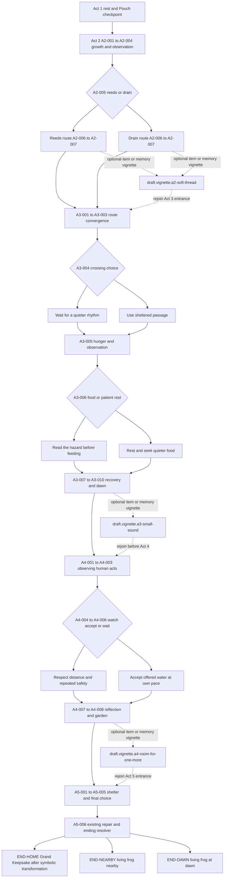
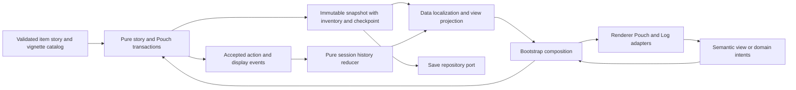

# Sprint 4 Proposal Plan: Visual, Narrative & Interactive Overhaul

| Document control | Value |
|---|---|
| Document / change | `JKB-PROP-S4-001` / [CR-0005](../../rfc/CR-0005-sprint-04-overhaul.md) |
| Version / date | **0.2.1** / 2026-10-14, Asia/Bangkok — Final PO Narrative & Pouch Impact Directive |
| Status | **PO APPROVED MAIN DIRECTIONS; Final Directive incorporated; documentation ready for review/merge; production code unstarted** |
| Author | Codex — Senior Technical Lead, Game Director, Principal UI/UX Architect |
| Review PR / branch | [#12](https://github.com/T3thr/JaoKob/pull/12) → develop; `feat/sprint-04-overhaul-plan` |
| Execution draft | [Sprint 4 SSOT](../../sprints/sprint-04-ssot.md) |
| Baseline inspected | `develop@e9803397587bb3ec8f2a61a87966d382277a96fc`; planning branch integrated develop at `9a08d0b` |
| 3D artifact status | [PR #11](https://github.com/T3thr/JaoKob/pull/11) MERGED at `e980339` on 2026-10-14; game integration deferred to Sprint 5 END-HOME |
| Proposed runtime change class | C2 narrative/branch/interaction; C3 durable Pouch/save/schema compatibility — RFC, versioned contracts, migration/rollback required |

## 1. PO Directive and revised scope

JaoKob จะเล่าการเดินทางผ่าน **สิ่งเล็ก ๆ ที่เจ้ากบเลือกพก และความทรงจำที่ยังอยู่เมื่อยอมวางบางสิ่งลง**. Inventory เปลี่ยนเป็น **Adventure Keepsake Pouch** สำหรับวัตถุในเรื่อง ไม่ใช่การหมุนตุ๊กตาระหว่างทาง. ช่องพกของจำกัด 3–4 ช่อง; ของแต่ละชิ้นสร้าง Secret Moments และ Ending Nuances โดยไม่เป็นคะแนนคุณธรรมหรือเงื่อนไขเพิ่มของ Canon Ending.

PO อนุมัติ **ทิศทางในการปรับแผนและมอบหมาย AI เขียน/ขัดเกลาเนื้อเรื่อง** ผ่านคำสั่งปัจจุบัน. รอบนี้แก้เอกสารและ commit เท่านั้น; ไม่เริ่ม production implementation. ขนาดช่องที่เลือกจริง, registry/effects, content/save versions, migration, exact prose และ final production assets ยังต้องตรวจรับใน CR-0005/WBS. การอนุมัติทิศทางไม่ถูกตีความว่า source, schema หรือ release ผ่าน DoR แล้ว.

| Phase | Deliverable |
|---|---|
| **Sprint 4** | Paper dialogue card, frosted HUD capsule, Intent Tags, Dialogue History, **Pouch UI + persistent Core State**, Act 1 rewrite/choices/items/Secret Moments, **draft Act 2–5 branching map** |
| **Sprint 5** | Implement Act 2–5 from reviewed map; item callbacks/extra vignettes/three existing endings; elegant **Grand Keepsake** presentation using childhood crochet + adult velour models **after END-HOME** |

Visual Gate เริ่ม Scene 1–2 และ Scene 3 handoff แล้วนำ style/interaction ไปใช้ทั้ง Act 1; narrative deliverable ครอบคลุมเจ็ดฉาก ไม่ใช่เพียง benchmark. จำนวน node/edge ใหม่ต้องมาจาก reviewed Act 1 graph; 14/21/12 เป็น legacy witnesses ไม่ใช่เพดานกราฟใหม่.

Non-goals Sprint 4: production Act 2–5/Ending code, 3D viewer/library/runtime model promotion, combat, XP/level/equipment/rarity/crafting/currency/weight optimization หรือสถิติใหม่ที่ซับซ้อน, fourth ending, forced collection/completion, voice/TTS, full animated typewriter/auto-advance, login/backend/telemetry/CDN/deploy. HP/พลังใจ/Bond เดิมคงเป็นสามสัญญาณเล่าเรื่องอ่านง่ายเพื่อรักษา resolver; ไม่เพิ่ม combat stats หรือ item bonuses. การยกเลิกสาม meter/เปลี่ยน ending thresholds เป็นอีก design decision ไม่ได้อนุมานจากคำว่า “ตัดสถิติยุ่งยาก”.

### 1.1 Final PO authority and narrative invariants

PO ได้ตรวจและอนุมัติ **ทิศทางหลักของ v0.2.0** พร้อม Final PO Directive รอบนี้: เพิ่ม emotional depth ใน Act 3–4, เชื่อม HP/พลังใจกับร่างกบที่เปราะบางแต่มี agency, ใช้ของสะสมทั้งห้าชิ้นในยามโดดเดี่ยว, ร้อยภาพวัยเด็กไหมพรมสู่วัยโตเสื้อน้ำเงินหัวใจแดง และคง persona เด็กสาว. บันทึกอำนาจใน [Final PO record](../../changelog/2026-10/2026-10-14-2233-sprint-04-final-po-narrative-impact.md). การรับรองนี้เป็นการรับรองแผน/หลักการจากมนุษย์ ไม่ใช่การประกาศว่า sample prose, schema/asset ใหม่, implementation DoR หรือ merge ผ่านเอง.

คง **5 องก์**, คำสอนแม่กบเรื่อง **รากบัวและกระแสน้ำ**, END-HOME / END-NEARBY / END-DAWN, Bond ที่ยุติธรรม, ไม่มี combat/สถิติซับซ้อน/achievement hunting. ไม่เพิ่มคะแนนความอดทน ความเจ็บ หรือจำนวนของ; การหยุดพัก/รักษาระยะ/ปล่อยวางมีศักดิ์ศรีเท่าการเดินต่อ. ระดับ HP/พลังใจและการเปิด Story Assist ไม่ใช้ตัดสินคุณค่าหรือเพิ่ม/ลดสิทธิ์ถึง Canon นอกกติกาเดิม.

Sprint 4 ทำ Act 1 และ **design handoff ที่ลึกขึ้นสำหรับ Act 3–4/END-HOME**; Sprint 5 ลงเนื้อหา/runtime/Grand Keepsake จริง. Source/GDD/Narrative baseline/GLB ไม่แก้ในรอบเอกสารนี้. รายละเอียด contract/prose/asset เฉพาะงานยังตรวจตาม T0/T3/T7/T8 โดยไม่ให้ PO ต้องอนุมัติทิศทางหลักซ้ำ.

### 1.2 Revision history

| Version | Change |
|---|---|
| 0.1.0 | Original benchmark + non-diegetic two-doll viewer proposal; historical evidence retained |
| 0.2.0 | Supersedes Act 1 3D-viewer approach with adventure items/state/limited slots, AI narrative assignment, optional vignettes and S4→S5 roadmap; revises D1–D7 and WBS |
| **0.2.1** | Records PO approval of main directions; adds Act 3–4 drama/recovery/item-use pacing, fair Bond/girl persona constraints, sample epilogue and childhood→adult red-heart art handoff; contracts/WBS/source scope retained |

## 2. Current facts and confidence

| Area | Verified fact | Consequence |
|---|---|---|
| Sprint 3 | [SSOT](../../sprints/sprint-03-ssot.md) has WBS 5/5 merged; UI/manual visual/device/AT gates remain open | Keep regression evidence; do not equate tests with artistic acceptance |
| Planning regression | Prior 0.1/0.2 regression retained; Final Directive rerun **691/691**, no fail/cancel/skip/todo, **26,196.327 ms** at d3e9f4d | Tests cover unchanged runtime, not proposed Pouch/migration/new story |
| Browser/performance | [Retained evidence](../../../tests/e2e/evidence/sprint-03/visual-novel/README.md): Chromium journeys/screenshots and headless samples | Historical; not rerun for this documentation revision |
| Existing leaf contract | `keepsake.lily_fragment` is irreversible historical “chose to keep” boolean; no held-item list in Save format 1 | Keep its meaning; new held inventory and memory ledger required for later release |
| Existing migration | `content-2-0-0-to-2-1-0.js` proves presentation-only equality and rejects gameplay/text changes | New branching/item rewrite needs a new explicit migration design; cannot reuse its allowlist to ignore narrative differences |
| Models | [Adult/childhood spike](../3d-keepsake-spike/README.md) merged into develop, GLBs 546,020 B / 598,144 B | Candidate Grand Keepsake assets for END-HOME; Art/rights/device and future runtime ADR remain separate |
| Checkout | Requested feature branch already includes latest develop; only local references untracked at intake | Continue branch, preserve references; no new worktree/branch/reset/merge needed |

## 3. Visual & architectural gap analysis

### 3.1 Comparison sources and method

ตรวจภาพจริงที่เก็บใน repository: [desktop reading](../../../tests/e2e/evidence/sprint-03/visual-novel/1440x900-reading.png), [desktop decision](../../../tests/e2e/evidence/sprint-03/visual-novel/1440x900-decision.png), [mobile decision](../../../tests/e2e/evidence/sprint-03/benchmark/ui/390-decision.png), [Title](../../../tests/e2e/evidence/sprint-03/visual-novel/1440x900-title.png) และ [320px / text 200%](../../../tests/e2e/evidence/sprint-03/visual-novel/320x568-text200.png). เทียบกับ [approved desktop reading](../phase-02-visual-novel-architecture/jaokob-visual-target-desktop-reading-state.png) และ [approved mobile decision](../phase-02-visual-novel-architecture/jaokob-visual-target-mobile-decision-state.png).

Target เป็นภาพ mockup ที่รวม device/browser chrome. เปรียบเทียบพื้นที่เกมภายในกรอบกับ runtime ที่ node/state เดียวกันโดยใช้ actual content; ไม่ใช้ pixel diff ข้ามรูปทั้งสองแบบเป็น quality score. ภาพเป้าหมายมีกบโต/บ้านและสอง choices; [CR-0003](../../rfc/CR-0003-interactive-light-novel-presentation.md) / [ADR-P0-015](../../adr/ADR-P0-015-interactive-light-novel-presentation.md) ยุติให้ Act 1 เป็น **ลูกอ๊อดลวดลาย/ผ้าผูกคอสีน้ำเงิน**, Scene 3 มี **สาม choices**, Bond locked/no numeric disclosure. ความต่างเหล่านี้เป็น approved deviations ไม่ใช่ข้อผิดพลาดที่ต้องแก้ให้เหมือนภาพ.

| Gap | Target intent | Current evidence and cause | Proposed correction / acceptance |
|---|---|---|---|
| G1: hierarchy | บทอ่านหนึ่งแผ่น, speaker บนขอบ, next cue เล็ก | Reading มี page label, speaker, prose, save notice และปุ่มนอก card; `buildGameShell()` รวมหลายหน้าที่ใน `narrative` | Card เก็บเฉพาะ speaker/context/prose/progress/advance; save และ feedback มีพื้นที่เฉพาะ; ไม่มี panel ขาวซ้อนใน normal reading |
| G2: operational noise | ฉากและบทอ่านเป็นตัวนำ | “บันทึกความคืบหน้าแล้ว” กลายเป็นกล่องขาวขอบทองทุกหน้า; `notice` ใช้ builder เดียวกับ first-run notice | Save status เป็นข้อความเล็กใน utility rail; error/memory-only คง visible/actionable; live announcement ครั้งเดียวต่อเหตุการณ์ |
| G3: decision anatomy | prompt สั้น + action + intent + icon + trailing cue | Mobile มี feedback box, prompt หลายบรรทัด, save box, heading box, choices ทึบไม่มี tag; desktop screenshot มีความสูงเกิน 900px | Separate prompt และ choice cards; label/tag/cue จาก projection; 3 choices จริงคง order/impact/confirmation |
| G4: materials | กระดาษมี grain/motif ที่ตั้งใจ; ขอบนุ่ม; UI ไม่ใช้เงาเท่ากันทุกชิ้น | repeating diagonal stripe + inset border ทำให้ card ดูเป็น CSS template; generic box styles reuse ทั่ว UI | กระดาษสา texture เดียว ≤50 KB, motif ตำแหน่งแน่นอนและพ้น text zone; tone/detail hierarchy ผ่าน Art review; contrast mode ตัด texture |
| G5: HUD | ค่าจริงอ่านง่ายในแถบ compact; HP กับพลังใจแยกกัน | solid dark slab, HP/Sanity สีเดียว; icons เป็น heart/วงกลม/emoji; mobile Bond ลงแถวใหม่; 200% text HUD สูงมาก | Original SVG icon set, HP moss / พลังใจ amber, localized names; flexible wrap ที่ตั้งใจ; ไม่มีการบังคับลดฟอนต์เพื่อยัด HUD |
| G6: character integration | subject มี scale, light และพื้นที่สัมพันธ์กับฉาก | sprite ลอยกลางแสง, drop-shadow แบบวัตถุอยู่บนพื้น, flex growth เปลี่ยน scale/ตำแหน่งตามความสูง UI | Authored focal anchors/crop และ water occlusion/light matching; ลูกอ๊อดอยู่ในน้ำ ไม่สร้าง contact shadow บนใบบัว; art edit อาจจำเป็น CSS อย่างเดียวไม่พอ |
| G7: Title identity | branding/epigraph อยู่ Title; menu สงบ | Title ปัจจุบัน neutral gradient, “ฉาก” + ชื่อใน HUD และ meters 80/70 ก่อนเริ่มเล่น, notice ซ้อน | Title hero ของตัวเอง, localized title/menu, no gameplay meters; notice/accessibility setup ยังเข้าถึงก่อน New Game; adult mascot ใช้ได้เฉพาะ branding ที่ approved |
| G8: responsiveness | visual focus คงอยู่เมื่อ crop; safe area และ controls ถึงได้ | `object-position: center 48%`, sprite size อิง viewport height; three-choice mobile มี scroll | แยก authored portrait/landscape crop, reserve subject zone; 320/zoom ใช้ flow; การเลื่อนเป็นสิ่งยอมรับได้ ไม่ตัด choice ที่สามเพื่อ fit mockup |
| G9: focus | action/focus มีหลักฐานให้มองเห็นโดยไม่กลายเป็นกล่องตกแต่ง | กรอบขาวรอบ reading region ใน screenshot มาจาก `tabindex=-1` / `:focus-visible` และ bootstrap focus directive | เก็บ focus semantics; ย้าย focus target ให้ใกล้บทอ่านและ style เฉพาะ region; keyboard focus ทุก control ยังเห็นชัด ห้ามลบ outline ทั้งแอป |
| G10: history | ย้อนอ่านสิ่งที่เห็นและเลือกแล้ว | `buildCutsceneControls()` มี legacy inline log แต่ production VM ไม่ส่ง full backlog; `viewedDialogueIds` เป็น unique recency/cursor | Session transcript แยกจาก saved progress; modal ไม่ dispatch advance/retry; ≥50 dialogues + accepted choices |
| G11: keepsake meaning | ของที่สัมผัสได้สัมพันธ์กับอารมณ์ | ไม่มี Drawer/production contract; spike viewer อยู่นอก runtime | Adventure Keepsake Pouch: วัตถุในเรื่อง, capacity 3–4, held-state/ความทรงจำแยกกัน; 3D doll เฉพาะ END-HOME ใน Sprint 5 |
| G12: semantic projection | ข้อความแต่ละชนิดมี role ของตัวเอง | VM รวม prompt กับ dialogue เป็น string; `outcomePreview` มีใน schema แต่ไม่แสดงใน normal choice cards; renderer rebuild content ทั้งก้อน | เพิ่ม explicit prompt/cue/status/overlay VM, persistent scaffold; patch เฉพาะ region; lifecycle ของ image/audio/modal ไม่ restart ตาม save status |

### 3.2 “No AI Slop / AAA Handcrafted Feel” acceptance rubric

Ghibli, Coffee Talk และ A Short Hike ใช้เป็นคำอธิบายคุณสมบัติที่ PO ต้องการ: warm light, material softness, deliberate pacing, quiet interaction และรายละเอียดที่รับใช้เรื่อง. ไม่สั่งคัดลอกตัวละคร/ฉาก/UI/asset ของงานอ้างอิง. คุณภาพไม่ตัดสินจากเครื่องมือที่สร้างภาพ แต่ตัดสินจากงานเกลาที่ผู้เล่นเห็น.

| Dimension | Reviewable criterion | Reject when |
|---|---|---|
| Composition | Reading มี prose หนึ่งจุดหลัก; Title/choices ไม่ปะปน; subject ไม่ถูกบังที่ normal text | อ่านหน้าจอเป็น dashboard หรือไม่รู้ action ถัดไป |
| Surface | ใช้ paper/river glass/fabric ตามหน้าที่; grain ไม่รบกวน glyph; border/shadow ไม่ซ้ำทุก element | nested rounded boxes, generic glass, glow ทุกปุ่ม, random ornament |
| Character/environment | lighting, edge treatment, size, water plane และ blue motif สอดคล้อง | cutout sticker, floating plush ในฉากลูกอ๊อด, ภาพมีรายละเอียดขัดกัน |
| Typography | Sarabun ที่มีสิทธิและ self-hosted; body 18–20px เป็น starting design target, line-height 1.75–1.9; Thai stress test ไม่ clip | ใช้ฟอนต์ตกแต่งกับ prose, ตัดสระ/วรรณยุกต์, shrink text เพื่อ fit |
| Choice honesty | intent อธิบายแรงจูงใจ; outcome cue เฉพาะข้อมูลที่ content อนุมัติ; น้ำหนักเท่ากัน | สีเขียว=ดี/น้ำเงิน=ผิด, “ปลอดภัย” ที่รับประกันสิ่งที่ engine ไม่รับประกัน, numeric/ending spoilers |
| Writing | หนึ่ง sensory anchor ต่อ beat, voice ตาม Bible, motif เปลี่ยนความหมาย, prompt ไม่อธิบาย theme ซ้ำ | “อบอุ่น/อ่อนโยน/ความหวัง” ซ้ำโดยไม่มี action, moral lecture, กล่อง feedback ทวน prose เดิม |
| Motion/sound | motion เฉพาะ transition/focal breathing ที่อ่านสบาย; full-text/manual advance เป็น default | blinking Next, perpetual card motion, motion ที่รบกวนบทอ่าน, action ต้องรอ media |
| Interaction | ทุกปุ่มทำงานจริง; keyboard/touch equivalent; normal save ไม่ดึง focus | ปุ่ม Log/Inventory ที่ไม่มีระบบ, restart scene จากการเปิด modal |
| Accessibility | visible focus, text/numeric status, 44×44 targets, 320 reflow/200% text/400% zoom; high contrast และ reduced motion | สวยเฉพาะ screenshot หรือใช้ icon/color/motion เป็นข้อมูลช่องทางเดียว |

เสนอ review score 0–2 ต่อ dimension: 0=ไม่ผ่าน, 1=ยังต้องเกลา, 2=ผ่านโดยมี evidence. เกณฑ์ visual exit ที่เสนอคือ **ทุก dimension = 2** โดย PO/Art/Narrative/Accessibility บันทึกข้อสังเกต; blocker ด้าน Canon, readability หรือ core journey veto score รวม. ไม่ใช่ automated score หรือ WCAG certification.

## 4. Dialogue Card & three-screen separation specification

### 4.1 State-to-screen contract

Three screens เป็น **presentation modes**; Pouch/Log เป็น overlay ส่วน held-item state เป็น Domain Data ไม่ใช่ state เครื่องที่เจ็ด. `Cutscene`, `Exploration`, `Decision`, `GameOver`, `Ending`, `Title` และ transitions เดิมคงเดิม. อ่าน preface ของ Exploration/Decision เป็น reading ก่อน; เมื่อ facts ready จึงแสดง controls ของ node จริง.

| Screen / mode | Visible content | Main action / exit |
|---|---|---|
| Title | Hero/logo/epigraph, Resume/New Game, Settings, save-scope/accessibility/notice access; no gameplay HUD | Existing New Game/Resume + sound gesture unlock; replacement consent retained |
| Reading Beat | Background + correct-life-stage character, compact HUD/utility rail, one paper card | Native advance button with localized “อ่านต่อ” name + ▽ icon; no decision cards until ready |
| Decision Crossroads | Current context/prompt once, compact HUD/utility rail, 2–3 authored choices | SELECT_CHOICE with revision guards; high/irreversible uses existing confirmation setting; no Next |
| Exploration | Context + semantic interactions in reading order; explicit leave action | Existing observations/revisit/exit guards; no visual hotspots-only interaction |
| Confirmation / Settings | Modal over preserved story; one active overlay | Cancel/confirm/close restore focus; no story command beneath modal |
| Completion / crisis / failure | Existing completion/return-to-title/recovery/error controls, safe text | No dead ends; no new unsupported ending/crisis functionality inferred |

### 4.2 Anatomy and responsive rules

Reading card: speaker badge anchored at upper start edge; narration labeled as narration, inner voice described semantically; prose in one text region; page progress in quiet footer; native advance control at inline-end. Text is safe DOM, never narrative `innerHTML`. Accessible name/description and icon label resolve from localization.

Desktop starting targets: card 40–44rem max, centered near lower stage; ~20–28% stage height for normal 2–3-line beat; enough space between subject and card. These are composition targets, not max-height rules. Long text/zoom grows naturally and scrolls. Mobile: 12–16px side margin, 20–24px text padding, safe-area bottom clearance; title/HUD/card proportions adapt to usable viewport, not device mockup.

Decision card: one native button wrapping original icon, action label, short Intent Tag and trailing arrow; outcome cue outside the button where lengthy, associated via description. Whole card is tap target; no nested clickable control. Distinguish selected, disabled, pressed and busy with text/state and contrast, not color alone. Mobile stack with 10–14px gaps; normal card target 76–104px with text allowed to expand. Desktop may use 2–3 columns only where all labels/cues fit, otherwise stack; maintain DOM order. No forced single-screen fit at 320/zoom.

Common utility rail: Settings, “ประวัติ”, “กระเป๋าความทรงจำ”, textual save status. At narrow width it wraps below HUD or into an accessible menu with implemented actions; never overlays prose/choices. Targets ≥44px. Pouch แสดงจำนวนช่องที่ใช้ เช่น 2/3 พร้อมข้อความอธิบาย; ไม่มี doll selector หรือปุ่มหมุน 3D ใน Act 1–4. Title ใช้ Resume/New Game/Settings และคำอธิบาย save scope; empty log/pouch states มีความหมายและไม่เผยของหรือฉากที่ยังไม่พบ.

### 4.3 Save, feedback and notice separation

| Information | Placement and behavior | Regression protection |
|---|---|---|
| Saving / saved | Small visible localized text in rail, updated in place; no recurring toast/paper sub-panel | All three save states remain textual under `GDD-UX-007`; status change cannot move focus or append history |
| Save failure / memory-only / protected record | Persistent visible status + accessible details/action; warn before leaving per existing policy | Do not hide error for aesthetics or destroy raw save without consent |
| Immediate narrative feedback / meter deltas | Dedicated narrow response strip adjacent to relevant beat, without white inset card; merge visual layout only after Narrative review | Preserve authored feedback and amount/direction; one live announcement under `FR-UI-003` |
| Content warning | Separate notice region/acknowledgement following existing flow, before intense scene | No automatic dismissal or mixing with save text; storm/separation notice retained |

Announcement dedupe uses event identity/revision + message kind, not every VM render. Save/media status patches leave the reading region and modal focus intact. Normal status stays visibly readable; do not “fix noise” by turning all save text into screen-reader-only content.

### 4.4 Intent Tags and narrative editing

Tags ด้านล่างเป็นจุดตั้งต้นจากเจ็ด choices เดิม; AI ได้รับมอบหมายให้ขัดเกลา label/prompt/feedback และเพิ่มทางเลือกของสะสม/ฉากเสริมตาม directive. Existing IDs ไม่ถูกใช้กับความหมายใหม่; exact effect/condition/edge changes ต้อง trace ใน CR-0005 และ reviewed content version. Tags สื่อเจตนา ไม่ใช่คะแนนคุณธรรมหรือรางวัล.

| Existing choice ID | Proposed intent text | Skin / original motif |
|---|---|---|
| `choice.act1.focus-mother` | ใกล้ชิด | Moss / shared ripple |
| `choice.act1.focus-roots` | รับฟัง | River / root |
| `choice.act1.focus-siblings` | เล่นด้วยกัน | Warm moss / small ripples |
| `choice.act1.call-family` | เรียกหา | River / expanding ripple |
| `choice.act1.seek-safety` | ตั้งหลัก | Moss / sheltering leaf |
| `choice.act1.keep-fragment` | เก็บไว้ | Moss / leaf fragment |
| `choice.act1.release-fragment` | ปล่อยไป | River / open water |

Recommend a **separate validated presentation catalog** bound to exact contentVersion + stable IDs. Frozen schema 1.2 remains unchanged; new gameplay item/vignette fields belong in the versioned package contract (§9), while visual tag/skin/icon metadata may use the separate validated presentation catalog. Do not infer tags from metric effects/Thai string matching. Project existing `outcomePreview` where present; no invented “safe” promise. Missing optional catalog entry yields normal labeled choice, while missing/invalid required locale/icon/reference fails the presentation feature safely and is reported.

PO อนุญาตและมอบหมาย AI ให้เขียน/ขัดเกลาบทบรรยาย บทสนทนา ทางเลือก และฉากเสริม **ตลอด Act 1 ทั้งเจ็ดฉาก** ไม่จำกัดการแก้เพียงคำซ้ำใน benchmark. ไม่ต้องขออนุญาตรายประโยคเพื่อร่างงาน; final Thai editorial และ contract/Canon review เกิดตาม T7 ก่อน merge. เกณฑ์ Tender & Heartcrafted Narrative และตัวอย่างร่างอยู่ใน §7. คง emotional progression, non-blaming storm, agency, decompression, inner-voice semantics และสาม ending categories. Content ที่เปลี่ยนต้องมีรุ่นใหม่/explicit migration; ไม่อ้างว่าเป็น presentation-only update.

## 5. Dialogue History / Backlog specification

### 5.1 Experience

Open “ประวัติ” from utility rail during reading/exploration/decision; native modal styled as an archive sheet. Header + title + close; scene separators, speaker/voice role, full displayed text, followed by distinctly labeled “คุณเลือก…” entries. Chronological oldest→newest, opening positioned near newest; user can scroll back without automatic jumps. No search/filter/voice playback or rewind button in this Sprint.

Modal entry is blocked while a story transaction/confirmation is unresolved. One modal at a time. Opening freezes advancement/input, not domain state; ambient audio can continue at saved levels, no restart/crossfade/SFX caused by opening. Close/Escape returns to invoker or equivalent safe action after rerender. Save/media events may update rail but do not close modal, steal focus or move scroll.

Use native `<dialog>`/`showModal()` where supported; fallback must make background inert and trap focus. Initial focus on a short heading with `tabindex=-1` for long structured history, not on the whole transcript via `aria-describedby`; Tab/Shift+Tab stay inside, close button always visible. Do not make every line tab-stop or live-announce 50 entries. Behavior follows [WAI modal dialog pattern](https://www.w3.org/WAI/ARIA/apg/patterns/dialog-modal/).

### 5.2 Data ownership and record contract

Current saved `payload.history` is ≤200 **committed Decision actions**, with node/action/time/metrics; Exploration actions are not recorded there. `progress.viewedDialogueIds` is a unique recency list whose last element determines current cursor. Neither is an ordered transcript including repeated dialogue occurrences. Reinterpreting either field would break Resume and existing validation.

Proposed pure application session reducer (`src/core/use-cases/session-history.js`) receives **explicit accepted presentation events**, stores no DOM/storage/clock, and returns immutable state. Bootstrap owns reducer state/lifecycle; Data resolves IDs/text/locale; UI renders a frozen history VM. Separate ephemeral history does not enter domain snapshot/save envelope.

| Record field | Purpose / constraint |
|---|---|
| `entryId`, `sessionId`, `sequence` | Application occurrence identity; injected monotonic sequence, no randomness/wall-clock dependency |
| `kind` | `dialogue`, `choice`, `interaction` หรือ `keepsake-action` ที่ commit แล้ว; เปิด/ปิด Pouch ไม่เป็น history event |
| `contentVersion`, `nodeId`, `sceneId` | Resolve to exact accepted package and scene context |
| `dialogueId` / `actionId` | Validated source identifier appropriate to kind |
| `speakerId`, `voiceRole`, `locale` | Narration/inner voice/speech distinguished; locale at display |
| `text`, `sceneLabel`, `speakerLabel` | Frozen resolved text as seen at that occurrence; choices retain accepted label/tag, no unchosen outcomes |

Policy proposed for D3: retain **50 latest dialogue records + 50 latest choice/interaction/keepsake-action records**, merge by sequence for UI (≤100 entries). Dialogue capacity remains 50 even after 60 mixed actions; this avoids treating “50 entries total” as meeting 50-dialogue requirement. เก็บข้อความที่เห็นครบตาม schema เดิม: localizedText อนุญาตถึง 12,000 ตัวอักษร และ localizedShortText ถึง 240 ตัวอักษร. เสนอ serialized transcript/state hard budget 8 MiB รวม text/labels/metadata และ target ≤128 KiB สำหรับ Act 1 ปัจจุบัน; ไม่ใช้ byte cap ลบรายการจนเหลือ dialogue ต่ำกว่า 50 และไม่ตัดข้อความ. ตรึงความยาว metadata ตาม schema และพิสูจน์ด้วย fixtures ที่ความยาวสูงสุดว่าบัฟเฟอร์รองรับ 50 dialogues + 50 actions ได้จริง; หากไม่พอให้ปรับ budget/representation ผ่าน review ก่อน implementation. Budget นี้เป็น ephemeral RAM data ไม่ใช่ save และต้องรายงาน heap ที่วัดจริงแยกจาก serialized bytes.

### 5.3 Append and lifecycle rules

1. New Game accepted: clear prior session, record first displayed dialogue once. Cancelled New Game leaves existing session untouched.
2. Accepted advance: append newly displayed dialogue after successful renderer presentation acknowledgement; failed render cannot append an unseen line. Re-render/settings/audio/save callbacks append nothing. Confirmation selection appends nothing until commit.
3. Accepted choice/observation/collect/release/replace: append the action **before** the newly displayed response dialogue (response only after successful presentation); validate selected stable ID from accepted result. Rejected/stale/duplicate/busy inputs append nothing.
4. Revisit/retry that actually displays an old line appends a new occurrence with new sequence; do not dedupe globally by dialogue ID. No speculative preload, graph traversal or unchosen variant may append.
5. Title→Resume within the same application/session retains log and does not duplicate the current line solely due to redisplay. Retry is labeled as a new passage in history, without changing checkpoint rules.
6. Hard reload/compatible Resume: initialize a **fresh session transcript from the current visible line**, with localized note that earlier dialogue belongs to the preceding reading session. Saved choice history may be shown separately as “saved choices” after validated projection; do not interleave it as a reconstructed exact transcript. Default recommendation: omit that extra section in Sprint 4.
7. New package/session disposes old reducer. No player data leaves device; Log alone adds no LocalStorage key/write (accepted Pouch transactions still use the domain save). Cross-reload transcript persistence is a deferred alternative requiring versioned save/storage and recovery design.

Acceptance: append 60 dialogue occurrences→exact latest 50 in order with speaker/scene/locale; repeated IDs survive as separate visits; cancelled confirmation absent; log shows only chosen path; New Game clears; reload limitation is explained; open/close/log-scroll leaves metrics/flags/RNG/cursor/revision/save bytes unchanged.

## 6. Adventure Keepsake Pouch: UI, state and emotional choices

### 6.1 Purpose and capacity

Pouch เก็บวัตถุที่เจ้ากบพบในโลกจริงของเรื่อง: ชิ้นส่วนบ้าน แสงที่ตกบนหิน หรือเส้นนุ่มที่ติดรากน้ำ. ภาพกระเป๋าเป็น **visual metaphor ของการประคองของเล็ก ๆ** ไม่ใช่ equipment กระเป๋าผ้าที่ลูกอ๊อดต้องสวม; งานศิลป์ต้องคง life stage และการรับรู้ตาม `NAR-WLD-005`. ไม่ให้เจ้ากบเข้าใจชื่อวัสดุมนุษย์ล่วงหน้าจากข้อความบนการ์ด.

PO กำหนดช่วง **3–4 slots**; แผนเสนอ **3 slots สำหรับ Sprint 4** เพื่อให้ tutorial เบาและเห็นความหมายของการเลือกภายใน Act 1. Exact capacity=3 เป็น design recommendation ที่รอรับรอง; หากเลือก 4 ต้องตรึงใน content/save contract ก่อนเริ่มงาน ไม่เป็น setting ที่ผู้เล่นสลับกลาง session. หนึ่งชิ้นต่อช่อง, ID ไม่ซ้ำ, ไม่มี stacking/rarity/weight/bonuses/ซื้อขาย/crafting หรือ slot expansion.

“กระเป๋าเต็ม” เปิดการตัดสินใจที่สงบ: **เก็บของเดิมและปล่อยชิ้นใหม่ / วางของเดิมหนึ่งชิ้นแล้วรับชิ้นใหม่ / กลับไปคิดก่อน**. UI ไม่เลือกทิ้งให้เอง ไม่ชี้ของที่ดีที่สุด และไม่ใช้ timer. การวางของไม่ลบความทรงจำที่ได้เกิดแล้ว; การคงไว้และการสละมีข้อความที่ให้คุณค่าเท่ากัน.

### 6.2 State and transaction contract — proposed for D4/D5

| Domain field | Meaning / invariant |
|---|---|
| `inventory.capacity` | Fixed 3 (or reviewed 4), validated against exact content contract |
| `inventory.heldItemIds` | Stable ordered unique item IDs, length ≤capacity; authoritative physical possession |
| `keepsakeMemory.encounteredItemIds` | Encountered through accepted story events only; bounded unique registry IDs |
| `keepsakeMemory.acquiredItemIds` | Historical collection, retained after release within current story path |
| `keepsakeMemory.releasedItemIds` | Accepted release of previously held object; preserves emotional callbacks, not a penalty score |
| `progress.completedVignetteIds` | Completed optional moments after final beat acknowledged; bounded IDs, not merely eligible/entered scenes |
| Checkpoint equivalents | Inventory, memory ledger and vignette completion captured/restored with flags/metrics/cursor |

Held IDs must be a subset of acquired/encountered IDs; under the no-reacquisition default, held and released sets are disjoint. Registry bounds limit every memory/progress list. Pouch actions enter the session Log without smuggling item IDs into legacy Decision-only payload.history; the new format explicitly defines any domain audit extension.

All field names are **draft contract names**, not installed schema or approved new FR IDs. Core owns pure collect/release/replace and eligibility. Data validates content/save/item records and projects localized view; bootstrap dispatches intents and persists accepted snapshots; UI never edits the list or storage.

Transaction order: validate command/view revision → check authored opportunity/item/held state from pre-snapshot → resolve chosen replacement and all effects atomically → validate capacity/IDs/target → commit one revision → save → feedback/log/render. Full capacity returns an explicit pending choice, not a partial acquisition. Confirm replace includes offered item, selected held item and expected revision; cancel/rejected/stale/double input returns original state. Successful replace removes exactly one held item and adds exactly one new one in one commit; no intermediate discarded-but-not-acquired state. Save failure follows existing recoverable memory-only policy with visible notice.

Acquisition is attached to authored Exploration/Decision opportunities; revisiting an observed hotspot cannot mint duplicate items. Propose single acquisition opportunity per unique story object, with release final for that occurrence; reacquisition would need an authored new event rather than infinite pick/drop farming. Pouch can be opened read-only during reading; **release/replace commits allowed only at an authored safe opportunity/rest context** with `canManageKeepsakes` projection. Reading/confirmation/busy/crisis does not permit background inventory mutation. Empty/full/unknown-item/corrupt/memory-only cases have localized outcomes.

`keepsake.lily_fragment` continues to mean its historical choice and is never cleared or redefined. Physical leaf depiction/share requires **held leaf membership** as well as relevant story guard; past acquisition/release can yield a memory-only variant. `coping.let_go_early` remains the original early decision, not a flag reused for any later discard. GDD/Narrative callback conditions (`GDD-DEC-A5-001-B`, `NAR-CON-002`, `NAR-MTX-END-001`) need a reviewed clarification distinguishing history from possession in T0/T7; implementation cannot silently keep showing a discarded physical leaf.

### 6.3 Pouch presentation and accessibility

Desktop modal drawer at inline-end (starting 24–30rem); mobile bottom sheet that may occupy near-full height at 320/zoom/landscape. Header, close, used/capacity text, **three tactile slots** and selected-item detail. Slot illustration uses original small 2D art with localized name/alt, material detail and a short “remembered where” line. Empty slot says “ยังมีที่ว่าง”; it is not a locked reward or silhouette of an undiscovered item. No 3D canvas/model selector/orbit controls.

Item selection is a native button; pointer/touch/keyboard share the same semantic selection. Detail displays “ยังพกอยู่” vs historical recollection when relevant. Discard flow explains irreversible physical release through existing confirmation preference and always provides cancel. Full-pouch chooser shows actual held items and offered item with parallel language; no drag-and-drop requirement. Item names/hints/details/accessible labels/save errors come from localization.

Native dialog, one overlay, inert background, visible focus, Tab/Escape/close restoration and stable scroll match Log. Opening/selecting/closing changes only UI state; **confirmed collect/release/replace changes domain/save and enters Log**. No hidden item deletion due to drawer closing, image error or settings. Blank state remains valid when every object is left behind; image failure preserves item name, meaning and commands.

### 6.4 Act 1 candidate objects and Secret Moments

Examples are **authoring candidates under PO's new assignment**, not installed canonical items. Use `draft.item.*` / `draft.vignette.*` identifiers only in proposal/map; final stable IDs/guards/effects/return edges are ratified in T7. Minimum proposed Act 1 scope: four candidate objects and **2–3 short vignettes** with explicit default paths; capacity 3 gives one optional replacement situation. หาก ratify 4 slots ต้องออกแบบ offering ชิ้นที่ห้าใน registry/graph ที่ review แล้วเพื่อให้ full-pouch decision เกิดจริงใน Act 1; fixture ที่สร้างกระเป๋าเต็มอย่างเดียวไม่ใช่หลักฐานว่า story journey สอนการสละของสำเร็จ. ห้ามเติม item ให้เองเพื่อบังคับ tutorial.

| Candidate | Proposed encounter | Emotional choice / extra moment | Later nuance brief |
|---|---|---|---|
| เศษใบบัวจากบ้านเก่า (`draft.item.lily-fragment`) | Existing Act 1 Scene 6, `node.act1.keepsake`; connects to existing keep/release choices | Retain a physical piece or let the water carry it; “สีที่ยังจำบ้าน” can use held/memory-only variants | END-HOME leaf seam/nearby leaf-placement only if physically held; released route recalls a ripple instead |
| หินประกายน้ำค้าง (`draft.item.dew-stone`) | Optional shallow-root observation in Scene 2, before three-way home focus | “ดาวใต้ใบบัว”: mother/siblings notice light on water; possession offers later noticing, never protection bonus | Light on wall/water in any ending, no extra Bond/HP requirement |
| เปลือกเมล็ดบัวเล็ก (`draft.item.lotus-shell`) | A second optional Scene 2 opportunity, only after reading its cue | “เสียงเล็กในน้ำ”: a soft click becomes a shared childhood rhythm | Repeated gentle rhythm rather than a collectible score |
| กลีบบัวที่ยังมีกลิ่นฝน (`draft.item.rain-petal`) | Optional Scene 6/7 rest-point offering | Full pouch can require release/refusal; “ที่ว่างข้างความคิดถึง” values space and remembered warmth equally | Retained scent or letting-go imagery; no superior epilogue |
| ด้ายไหมพรมสีแดง (`draft.item.red-yarn`) | **Act 2/3 map candidate**, not forced into Act 1 | First unfamiliar human material fits `NAR-SC-A2-006`; protagonist perceives softness/color before understanding yarn | Warm thread motif can meet Grand Keepsake at END-HOME; no new ending condition |

Red yarn remains part of the adventure vision; placing it in Act 2 preserves the current “first human material” beat. If PO later places it in Act 1 instead of one candidate, update that continuity brief explicitly before content integration, not via an unnoticed early reveal. No additional request is needed to draft both alternatives for review.

### 6.5 Secret Moments and Ending Nuances

Eligibility distinguishes **currently held**, **ever acquired**, **released** and **vignette completed**. Those predicates must be explicit approved schema/DSL constructs, not inferred from labels/HTML/free-form code. A moment unlocks a contextual opportunity; it never advances itself when a modal opens. Story actor/scene/locale and safe default text stay available when item absent. Fixed entry/convergence edges avoid an unbounded nested quest/return stack.

Optional vignette length target 2–4 full-text beats (~30–90 seconds at player pace), one sensory/action focus, no timer or meter reward. It rejoins the same act spine and does not require another collectible. Pouch-full choice is at most a meaningful rest interaction, not a repeated obstruction at every scene. Test skipping every object/vignette still completes Act 1 and preserves future Canon reachability.

Ending Nuances change authored image/prose/sound details in the **same three endings**. They do not add `END-TRUE`, override `END-HOME` resolver or make collecting all items mandatory. Physical props require held state; memories can survive release. Missing item/vignette has an equally complete warm default. If several nuances match a slot, use reviewed priority + stable-ID order/default, not combinatorial concatenation of every acquired object.

### 6.6 The Grand Keepsake — Sprint 5, END-HOME only

After the story's consent/safety gates and symbolic transformation in `NAR-SC-A5-007-HOME`, present childhood crochet and adult velour as the **Grand Keepsake**, where the adventure meets the real gift. Reserve a calm epilogue composition and a deliberate reveal; models are not carried in Pouch or exposed to rotate during Act 1–4. The two versions are representations/editions in one Canon ending, not two new endings or an extra Bond tier.

Sprint 4 produces the narrative/model handoff in §7.7 only, including the new red-heart embroidery requirement. Sprint 5 decides exact presentation (poster first, optional interactive inspection after END-HOME), timing, localized description, art/rights and browser/memory fallback. `model-viewer` 4.4.0 remains the spike candidate, requiring a future production RFC/ADR and measured same-origin opt-in lifecycle if adopted. Existing `.blend`, GLB and optional `Accessory_RedHeart` stay unchanged. No model/vendor fetch or import is added to Sprint 4 runtime/distributable by this plan. Reflective endings show living frog and coherent item/memory nuances, without premature doll transformation.

## 7. Tender & Heartcrafted Narrative assignment

### 7.1 Writing acceptance

AI is assigned to write fresh narration, dialogue, prompts, immediate feedback and extra vignettes across Act 1. Ghibli warmth, Coffee Talk intimacy and A Short Hike discovery translate into **concrete sensory acts, patient silence, small choices and unforced kindness**. Use the game's own world/voice, not copied characters or stock quotations. Final prose receives human Thai/Narrative review as one coherent scene diff.

| Principle | Observable writing criterion |
|---|---|
| Earn tenderness | Show warmth through someone slowing down, sharing shade or leaving space; avoid declaring that every object is “meaningful/heartwarming” |
| One beat, one intention | Usually 1–2 sentences per voiced dialogue unit; narration can breathe without repeating what image/feedback already says |
| Sensory before abstract | Light through water, cool root, soft red thread, pause in swimming before philosophical explanation |
| Character voice | Mother concise/water/root rhythm; inner thought first-person and age-appropriate; no human fluent speech from tadpole |
| Pouch agency | Retaining/releasing/refusing all receive compassionate wording; no guilt, “wrong choice” or max-collection checklist |
| Gentle branches | 2–3 intelligible choices at a crossroads; optional vignette returns to act spine; readable cause/consequence cues, no combat/stat menus |
| Emotional safety | Storm/separation is not caused by collecting/choosing wrong; no confirmed family death; decompression beat and a hopeful default |
| Motif discipline | Water/light/leaf/thread recur with changing meaning; no repetitive “อ่อนโยน/อบอุ่น/ความหวัง” or theme lecture |
| Canon/review | Keep three endings, late trust/transformation gates and existing character boundaries; new item/line/edge registered/versioned before source |

### 7.2 Sample prose — draft for review, not production Canon

| Context | Draft text / intent |
|---|---|
| Scene 2 / mother and shared light | “แสงเม็ดหนึ่งกลิ้งอยู่บนหินใต้รากบัว แม่ว่ายช้าลงจนเงาของเธออยู่ข้างเงาเล็ก ๆ ของเจ้ากบ” — affection through pacing, not a speech about love |
| Scene 6 / holding leaf | “ขอบใบบัวเย็นอยู่ใต้ตัว สีเขียวชิ้นเล็กไม่ส่งเสียง แต่เจ้ากบจำได้ว่าเคยมีใครว่ายช้าลงตรงนี้เพื่อรอเจ้ากบ” — concrete remembered action; physical leaf variant requires held leaf |
| Full pouch / release | “เจ้ากบวางเปลือกเมล็ดลงในวงน้ำ มันลอยออกไปทีละน้อย ส่วนจังหวะเบา ๆ ที่เคยฟังด้วยกันยังตามมาในความเงียบ” — release keeps memory, no guilt |
| Scene 7 / rest | “ฝนเบาลงจนได้ยินน้ำหยดจากราก เจ้ากบหยุดว่ายสักครู่ คืนนี้ยังหาทางกลับไม่พบ แต่ตรงนี้มีที่ให้หายใจ” — decompression without promising reunion |

### 7.3 Act 1 refinement coverage

| Existing scene | Revision purpose / Pouch placement |
|---|---|
| `NAR-SC-A1-001` opening | Sensory-first six-beat rhythm; life-stage correct; no early toy/ending reveal |
| `NAR-SC-A1-002` nursery | Mother/siblings attachment + optional stone/shell encounters; keep the root/current teaching in a short sensory action that later becomes a recovery callback; soft capacity tutorial, not mandatory full exploration |
| `NAR-SC-A1-003` home focus | Retain three meaningful mother/roots/siblings directions; refine labels/tags/callbacks; not substitute a bag-management form for this choice |
| `NAR-SC-A1-004` storm | Clear separation and no-blame line; holding more/fewer items cannot prevent storm or punish the player |
| `NAR-SC-A1-005` survival | Gentle cue/confirmation for existing high-impact coping choices; no combat or complex numeric planning |
| `NAR-SC-A1-006` leaf | Keep/let-go remains emotional centerpiece; reconcile legacy leaf history with new physical membership; optional rest offering/full-capacity choice |
| `NAR-SC-A1-007` rest | Vulnerability plus a deliberate breath/rest action, item-or-memory vignette and equal no-item default; explicit completion/checkpoint; preserve hope and seed later city/cloth motifs without revealing a toy or human persona |

Exact approved revision may add nodes/events and alter authored choices under CR-0005; do not label this optional cosmetic editing. Canon/life-stage/ending invariants remain; previous package is archived for legacy regression and migration. Item payload is not a hidden stat, and no vignette is sold as a mechanically optimal route.

### 7.4 Act 3–4 emotional depth, pacing and metric consequence

Act 3 ต้องให้ผู้เล่น **อยู่กับความเจ็บ ความกลัว และการตัดสินใจตั้งหลักของเจ้ากบ** ก่อนเข้าสู่ความเมตตาใน Act 4. ขยาย beat ภายใน/ระหว่าง canonical anchors เดิม; ไม่เพิ่มองก์ใหม่ ไม่รวมภัยหลายอย่างเป็น montage ที่ผ่านไปก่อนผู้อ่านรับรู้ และไม่ยืดด้วยคำบรรยายความเศร้าซ้ำ ๆ. ทุก threat sequence มี cue ที่เข้าใจได้ → choice → accepted consequence → bodily/inner response → agency/rest → small human/world observation. เป้าหมายแต่ละ sequence คือ 2–4 sensory beats และ 2–4 consequence/rest beats ตามความจำเป็น; เป็น authoring guide ไม่ใช่ timer/auto-advance หรือจำนวนบรรทัดบังคับ.

| Canonical anchor / draft beat | Concrete experience and consequence | Vulnerability + agency | Recovery / bridge to Act 4 |
|---|---|---|---|
| A3-002/004 / wheels and hurried shoes | Rubber wheel passes close, ground tremor and air pressure; footsteps erase a quiet gap. Forewarn by shadow/vibration/sound with textual equivalent; approved route effects can reduce HP/พลังใจ | Small body flattens, breath briefly breaks; then watches another interval and chooses wait/sheltered passage. Fear is visible; resting is courageous action | Cool edge/shade and root-current memory. No direct collision/open wound; no reward for crossing recklessly |
| A3-004/005 / hot concrete | Sun-heated paving stings a forefoot; dry heat and distance make progress costly. HP effect must match the authored safe route/cost, not a surprise loss for advancing text | Favoring a foot/shorter movement communicates physical strain; choose shade, pause or a signaled safer surface rather than silently enduring | Observable sheltered water/cool stone surface, accessible no-item rest. No collection-dependent healing |
| A3-005/007 / discarded corner | Crumpled cup, brittle wrapper and a soft discarded thread dwarf the frog; objects human hands left behind make loneliness concrete | Protagonist examines safely, draws back from a sharp/hot edge and decides what to carry or release. Do not infer a stranger's malicious intent | Yarn/leaf/memory callback plus a small useful shelter; waste is a world detail, not a blanket moral judgment of humans |
| A3-008/009 / exhaustion and near-collapse | Accepted low-HP/low-พลังใจ state gets readable posture, slowed breath/choice/rest cue, with original crisis/recovery policy | Trembling/hiding shows fragility; moving a little toward shelter or deliberately waiting shows determination. Do not label player/frog “weak” | A Pouch object can be looked at/held close or remembered; mother's root/current lesson becomes a way to attend to steady rhythm, not a ghost or cure |
| A4-001/003 / inattentive city and quiet human acts | Repeated hurried feet contrast with an observable shared shade/food or someone leaving a small space. Allow attention before interpreting it | Frog still checks the ground/distance; does not become instantly fearless because one human is kind | Each observed gesture gets a reaction/pause beat before A4-004. Keep warm and indifferent human facets concrete; do not invent hidden backstories |
| A4-004/006 / the girl’s repeated distance | Water placed at the same distance, warm cloth later, an open route back, then a step backward. Bond follows actual approved trust/consent actions | Approach now or wait both retain agency and a compensating safe path. Fear need not disappear for trust to grow | Girl acts, waits and remains discreet. One short situational line at most where needed; no biography, rescue speech or romantic exposition |

**Metrics are facts, prose is their expression.** HP/พลังใจ decline only through reviewed deterministic choice/event effects; narration, opening Pouch, viewing/holding an item or an optional drama beat never writes a meter. Do not add negative deltas to every near-miss merely to make the frog pitiable. Each authored effect has a cause/cue, exact feedback and body/voice variant derived from the accepted snapshot. High-HP/Story Assist/default variants cannot describe a wound that did not occur; low-HP variants show fatigue/pain without graphic injury. `sanity` remains player-facing **พลังใจ**, not a psychiatric diagnosis or morality score.

Keep `GDD-BAL-001..004/007/008`: safe onward path at each checkpoint, recovery within two main Decisions below30 unless a clearly warned crisis, unavoidable loss≤15 per meter between checkpoints, Bond recovery budget and Story Assist access unchanged. `GDD-SAFE-005`/`NAR-TONE-001` decompression follows intense content within five estimated play minutes; optional object scenes never hold all recovery hostage. Near wheels/hot surface/footsteps use existing animal-peril notice/reduced intensity/motion rules. Physical courage includes choosing rest and protecting a small body; it does not require taking more damage.

### 7.5 Pouch use during loneliness — five-item continuity matrix

Objects receive a **visible authored action**: lifting to look, holding close, testing a familiar texture or recalling its sound. No item is merely an icon shown once in a drawer. Variants use validated held/acquired/released/never-acquired state; if it is no longer held, neither prose nor illustration can place it in a hand. The physical object and remembered action can support equally complete emotional beats.

| Object / anchor | Still held: concrete action | Released after acquisition: valued memory | Never acquired / absent default |
|---|---|---|---|
| เศษใบบัว (Leaf fragment) / A3-009 and A4-007 | Rest with leaf edge against body, turn toward its green/light; mother's root-current rhythm returns | Watch a ripple pass and remember the chosen moment of setting leaf down; leaving the object creates room while home's rhythm remains | Recall mother's teaching or siblings' swimming, with no leaf prop. Original early-release flag has its own variant, never falsely claims past possession |
| หินประกายน้ำค้าง (Dew stone) / hot-concrete rest A3-005/008 | Turn cool stone in a forefoot and notice a small point of light; consented rest/shade remains the recovery source | Notice dew/light on a surface and remember the shared childhood observation; no stone drawn in Pouch/hand | Light in a puddle or a cool edge is enough to invite looking/rest. Same safe recovery opportunity; no magical HP restoration |
| เปลือกเมล็ดบัว (Lotus shell) / A3-009 | Touch hollow shell lightly, observe a quiet pulse/sound that recalls siblings; text/visual equivalent works muted | Count a soft drop/ripple with the remembered rhythm; no shell sound claimed as an actual held prop | The family's swimming rhythm has already been established in Act1 and can be remembered without collecting the shell |
| กลีบฝน (Rain petal) / A3-007 and A4-007 | Look at the small folded/dried petal, hold it close; rain becomes both difficult memory and a pause that can be chosen | Remember watching the petal move away, then allow the present rain to fall without following it. Release is deliberate care, not forgetting/failure | Rain against a sheltered edge provides a gentle present-tense grounding beat; no invented scent/item ownership |
| ด้ายไหมพรมแดง (Red yarn) / A3-007/009 and A4-005 | Lay soft red strand against the body/forefoot, observe softness among hard surfaces; later notice cloth offered without a reaching hand | Recall the warmth of the texture while watching cloth remain at a respectful distance; a missed object cannot block learning softness | First human-material encounter may be observed without pickup; water/cloth offer supplies the same trust opportunity. Grand Keepsake heart is not unlocked by carrying yarn |

Holding/looking is authored story presentation or a view-only interaction unless an approved story choice explicitly says otherwise; it adds no automatic HP/พลังใจ/Bond effect. Actual recovery uses the same approved rest/support action and a viable no-item path. Collect/release decisions retain their existing transaction meaning; no quest counter, trophy, “all five collected” screen or emotional quality ranking is added. A slot may be empty while the scene remains emotionally full.

### 7.6 Additional sample prose — drama and quiet care

**Draft for editorial review**, each row is a separate voiced/narrated unit under `NAR-DLG-001/004`; scene anchors are placement briefs, not new canonical IDs or effects. The words show an accepted body/inner state; they never authorize damage or imply an unchosen item.

| Anchor / semantic role | Sample prose | Guard / purpose |
|---|---|---|
| A3-004 / narrator, near wheel | “ล้อสีดำเฉียดผ่านเงาที่เจ้ากบเพิ่งหลบเข้าไป พื้นสั่นจนขาเล็ก ๆ แนบต่ำลง แต่เมื่อแรงสั่นคลาย มันยังเงยขึ้นมองหาจังหวะที่จะไปต่อ” | Signaled near-miss, no collision; fragility and continuing agency in one action |
| A3-004 / inner voice | “เรารอให้พื้นเงียบก่อนก็ได้ ยังไม่ต้องไปในจังหวะนี้” | First-person thought, not speech heard by humans; patience is not cowardice |
| A3-005 / narrator, accepted physical strain | “ขาหน้าแตะพื้นแล้วหดกลับ ความร้อนยังอยู่ตรงปลายเท้า เจ้ากบค่อย ๆ ย้ายตัวเข้าเงาบางข้างก้อนปูน ก่อนลองวางน้ำหนักใหม่” | Low-HP/physical-strain variant only; rest option visible, no open injury |
| A3-007 / narrator, discarded material | “ถ้วยกระดาษนอนตะแคงอยู่ตรงที่ไม่มีใครหยุดมอง เส้นสีแดงเส้นหนึ่งติดกับขอบมัน เจ้ากบแตะอย่างระวัง แล้วนิ่งฟังฝีเท้าคู่ถัดไปก่อนขยับ” | Safe material observation; no inference of a stranger's thoughts, no mandatory yarn pickup |
| A3-009 / narrator, held leaf | “เจ้ากบประคองสีเขียวชิ้นเล็กไว้ใต้คาง ลมหายใจยังสั่นอยู่ แต่ระหว่างเสียงที่ผ่านไป มันเริ่มได้ยินหยดน้ำตกในจังหวะเดิม” | Held leaf required; comfort does not erase accepted strain or replace actual recovery |
| A3-009 / narrator, released leaf memory | “วงน้ำพาเศษใบไปไกลตั้งแต่วันนั้น เจ้ากบยังจำจังหวะที่ยอมวางมันลงได้ และค่อย ๆ เว้นที่ให้ลมหายใจถัดไป” | Acquired then released, no physical leaf; letting go has equal care |
| A3-009 / narrator, no-item default | “ไม่มีชิ้นใบบัวอยู่ใต้ตัว แต่คำของแม่ยังกลับมาในเสียงน้ำ เจ้ากบหยุดฟังจังหวะที่ไม่รีบ แล้วค่อยขยับเข้าไปในเงา” | Requires no collectible; keeps root/current teaching and a complete hopeful beat |
| A4-003 / narrator, observed quiet kindness | “ข้างม้านั่งมีเศษอาหารวางพ้นทางเท้า มือคู่นั้นถอยกลับไปก่อน เจ้ากบมองอยู่พักหนึ่งแล้วจึงขยับ แม้ฝีเท้าที่ผ่านมาอีกคู่ยังทำให้มันสะดุ้ง” | Observe actual act, retain learned caution; no instant trust or invented biography |
| A4-004 / narrator, girl's persona | “เด็กสาววางน้ำลงในระยะเดิม แล้วขยับถอยจนเงาของเธอพ้นถ้วย เจ้ากบยังเลือกได้ว่าจะออกมาในตอนนี้ หรือรอให้น้ำอยู่อย่างเงียบ ๆ อีกสักพัก” | Existing reveal/trust gate; no forced touch, personal lore or claim of her inner feelings |
| A5-003/005 / narrator, open door | “ผ้าอุ่นอยู่ใกล้ชายประตู ทางกลับสวนยังเป็นช่องที่เจ้ากบมองเห็น เด็กสาวเว้นที่ไว้แล้วรอ โดยไม่เอื้อมมือเข้ามา” | Warm cloth/open exit and distance; safe-help consent remains a player choice |

### 7.7 Childhood Crochet → Adult Velour → the real Grand Keepsake

Preserve **two narrative layers**. Acts1–4 show the living tadpole→frog; fragile crochet/threads are sensory motifs and later retrospective representations of childhood. The frog is not literally a yarn doll during the adventure. **Only END-HOME after accepted safe help** permits symbolic transformation and the two-model memory-to-present reveal; no taxidermy/death/scientific mechanism or early model gallery. Recovered hurt belongs to remembered experience, not an unhealed graphic wound placed on a plush.

| Stage / setup → payoff | Authored bridge / model direction |
|---|---|
| Act1 family/root/current lesson | Shared rhythms, blue identity and small objects establish an emotional childhood the player actually experienced; no doll body shown |
| Act2–3 growth/alienation/red thread | Learning new limbs, hard surfaces and quiet softness gives meaning to perseverance; yarn may be seen, held or released without becoming a Canon key |
| Act4–5 water/cloth/open door | Girl's repeated practical acts let softness become safe; she remains unnamed/discreet, without a savior biography or explanatory romance |
| END-HOME retrospective | Childhood Crochet appears as a soft memory-form of the smallest days, with warm stitch language; optional childhood red-heart accessory stays an artistic motif, not a player's inventory or achievement |
| END-HOME present Grand Keepsake | Transition to **Adult Velour Plush wearing a blue T-shirt embroidered with a small red heart**; texture/heart seam holds learned care and healed experiences. Mother/home memory remains; new warmth does not erase old home |
| Real-life gift closure | One discreet epilogue link to the real frog plush held by the recipient; no account/name/photo/location input, no UI explanation that the girl represents the player's partner and no claim the game senses a real hug |

**Asset honesty / S5 Art acceptance:** current [adult front render](../3d-keepsake-spike/renders/front.png) and source shirt mesh show a plain blue shirt; they do **not** yet contain the requested red-heart embroidery. T8 must hand off that concrete refinement (placement/shape/thread/material/scale and original design/provenance), with S5 export/hash/validation/device checks before delivery. This document changes no GLB/Blender source and does not claim the detail is already implemented. The final heart motif must be present for all eligible END-HOME routes, including empty/released Pouch; no “higher Bond” exclusive edition or fourth ending. Reflective endings retain the living frog.

**Draft epilogue units, END-HOME only:**

| Beat / role | Sample prose / presentation |
|---|---|
| HOME-1 / narrator after consent | “ฝนยังตกอยู่ แต่ทางกลับสวนยังมองเห็นจากผ้าอุ่น เจ้ากบวางตัวลงในที่ที่เลือกเอง ขณะที่เด็กสาวถอยไปพ้นขอบผ้า” |
| HOME-2 / childhood memory-form | “แสงเหนือใบบัวค่อย ๆ กลับมาในเส้นไหมถักนุ่ม ๆ ความทรงจำของวันที่ตัวเล็กที่สุดยังมีจังหวะของแม่ว่ายอยู่ข้างกัน” |
| HOME-3 / hurt and perseverance remembered, only with authored strain history | “รอยเจ็บที่ผ่านพ้นและคืนที่เคยหยุดพักฟังน้ำ ถูกเก็บไว้ในรอยเย็บเล็ก ๆ มันยังมีที่อยู่ แม้ร่างนุ่มนี้ไม่ต้องทนพื้นร้อนอีกแล้ว” |
| HOME-3 default / no injury implied | “คืนที่เคยหยุดพักฟังน้ำและทางที่ค่อย ๆ เดินต่อ ถูกเก็บไว้ในรอยเย็บเล็ก ๆ ความเหนื่อยที่ผ่านพ้นยังมีที่อยู่ แม้ร่างนุ่มนี้จะได้พักแล้ว” |
| HOME-4 / adult Grand Keepsake | “กำมะหยี่สีเขียวรับแสงอุ่น เสื้อยืดน้ำเงินโอบร่างไว้ และหัวใจแดงดวงเล็กถูกปักตรงอก ในรอยเย็บนั้นมีทั้งบ้านเก่าและมือที่วางผ้าแล้วถอยให้พื้นที่” |
| HOME-5 / mother and girl, no added lore | “คำของแม่ยังอยู่กับจังหวะที่รอ ส่วนความเมตตาอีกคู่หนึ่งเว้นที่ให้เจ้ากบพัก โดยไม่ขอให้มันลืมสิ่งใด” |
| HOME-6 / discreet real gift link | “เมื่อเรื่องเล่าค่อย ๆ เงียบลง ความนุ่มของเจ้ากบยังอยู่ในอ้อมแขนที่มีอยู่จริง รอยหัวใจแดงแนบกับผ้าอุ่น และจังหวะจากรากบัวเก่ายังเดินทางมาถึงตรงนี้” |

The hurt-specific HOME-3 requires a reviewed authored strain/event history; otherwise use its default. Do not add a suffering statistic, infer a wound from an item count or give an undamaged/Story Assist route a worse epilogue. These are narration samples, not new girl's dialogue/backstory or final approved localization. Exact Thai edit, visual transitions and held-vs-memory nuances are reviewed in S5; warmth comes from the lived journey and consent rather than a paragraph explaining a symbolic transformation.

### 7.8 Fair Bond and the girl's persona — review constraints

Bond/resolver retains original thresholds/order/consent/compassion/repair and `GDD-BOND-006`, `GDD-BAL-004/006/007`. Item possession/count/secret completion, suffering amount, speed of choosing, cautious play, accessibility settings or a real person's identity cannot become a hidden moral score. For the same accepted metrics/trust flags, varying held/released/absent item presentation must produce the **same ending ID**; nuances only change the authored detail. Existing share-leaf choice must retain a viable equally respectful non-item expression/path and sufficient repair/recovery budget. Reflection endings are complete hopeful endings, not a judgment.

**Expected ending truth table for review (design evidence, not newly executed Pouch tests):** every row is evaluated with held/empty/released/never-acquired Pouch and matched presentation/accessibility variants; only approved metrics/trust flags determine result.

| Accepted snapshot | Expected resolver / equal item variants | Emotional/visual rule |
|---|---|---|
| HP80, พลังใจ70, Bond60, compassion=true, safe-help=true | END-HOME for every item variant | Complete gift/heart motif, no all-items gate |
| Same trusted snapshot, Bond80 | END-HOME, no fourth/superior ending | Existing authored epilogue nuance may vary, never ranks the earlier HOME as incomplete |
| HP1, พลังใจ1, Bond60, both trust flags=true | END-HOME under the same baseline HP/พลังใจ>0 rule | No suffering-based love score; appropriate body-history/default prose |
| HP/พลังใจ>0, Bond60, compassion=true, safe-help=false | Existing repair opportunity first; declining without HOME conditions yields END-NEARBY | Respect hesitation/consent; item absence cannot remove repair |
| HP/พลังใจ>0, Bond30, HOME conditions absent | END-NEARBY for every item variant | Living frog, safe hopeful closure, no bad-ending label |
| HP/พลังใจ>0, Bond29, HOME conditions absent | END-DAWN for every item variant | Living frog, independent safety/hope, no shame or completion prompt |

Girl persona remains `NAR-CHR-004/004-A`, `NAR-VOI-004`, `NAR-CON-004/006/007`: no name/bio/family/occupation/relationship exposition, speeches about love/rescuing or writing her thoughts as facts. She places water/cloth, leaves the doorway/path open, steps back and waits; any line is short, situational and describes what she will do. Before A4-004 no clear earlier reveal. The private gift's recipient understands her role without the story explaining it. No combat, complex new stats, trophies, rarity, achievement checklist or “collect all to deserve love”.

## 8. Phased roadmap and Act 2–5 narrative branching map

The map below is a **Sprint 4 design artifact for Sprint 5 implementation**, grounded in Narrative Bible scene IDs. `draft.vignette.*` are candidate branches; runtime Act 2–5 capability, full prose/media/ending UI are not claimed implemented. Fixed convergence prevents four acts from becoming an exponential set of routes.

| Act / canonical anchors | Branch design / secret moment | Carry to next act |
|---|---|---|
| Act 2, `NAR-SC-A2-001..007` | Learn new body; observe then choose reeds/drain at A2-005; red-thread material at A2-006 is a proposed optional item, with no human identity disclosure | `route.city_entry`; Pouch/memory; both routes converge by A3-003 under `NAR-CON-003` |
| Act 3, `NAR-SC-A3-001..010` | Wheels/heat/hurried feet/discarded corner take separate cue→choice→consequence→agency/rest sequences (§7.4), with HP/พลังใจ expression and all-five held/released/absent callbacks (§7.5); no fighting | Traffic/coping flags; safe recovery, mother/root-current memory, bounded optional moments and decompression before Act 4 |
| Act 4, `NAR-SC-A4-001..008` | Give each observed indifferent/kind human act a reaction/pause before A4-004; girl stays discreet and shows water/cloth/open route/step back; accept or wait with fair trust repair | Compassion/consent/trust flags, exact original Bond gate; held/remembered/default grounding supports learning, never forces gratitude |
| Act 5, `NAR-SC-A5-001..006` + three A5-007 endpoints | Shared leaf requires held leaf; otherwise voice/distance/default route. Preserve existing repair opportunity; nuance slots draw from held/remembered/released choices | Exactly END-HOME / END-NEARBY / END-DAWN, warm complete variants for empty Pouch |

Ending categories and resolver remain baseline: END-HOME when HP/Sanity>0, Bond≥60, compassion observed and safe help accepted; otherwise eligible Bond≥30 END-NEARBY, and Bond<30 END-DAWN. Existing repair rule (`GDD-END-006`) remains; item collection/completed-vignette count cannot substitute for trust or become an additional ending gate. Any later metric/resolver redesign is a separate explicit decision.

**S4 handoff DoD:** per-act spine/choices/convergence plus Act3–4 threat→metric consequence→body/inner response→agency→decompression matrix, five-item held/released/absent uses, root/current continuity, restrained girl persona, pacing/notice/checkpoint/defaults, fair three-ending nuance truth table and childhood→adult blue-shirt/red-heart model gap brief reviewed. No later-act runtime pass is inferred from this map. **S5 work:** turn map into validated content/media/runtime capabilities and test all actual branches/endings, then integrate Grand Keepsake through a separately approved runtime/art/device contract.

## 9. Architecture, versions, migration and rollback

Diagram is information flow, not import permission: Core parses no content/DOM/storage; Data imports no UI; UI imports no Data concrete adapter; bootstrap composes them. Viewing overlays stays outside six-state domain machine, while collect/release/replace are genuine pure domain transactions. Log remains ephemeral; **Pouch/its story memory/vignette progress are durable**.

### 9.1 Contract recommendation — requires D5 review

| Contract | Proposed version / change |
|---|---|
| Narrative package/shared/tree | New **v2.0.0** contracts for item registry, possession/memory predicates, authored collect/release effects, vignette entry/convergence and deterministic cursor; freeze published 1.0/1.1/1.2 bytes |
| Act 1 content | New **3.0.0** candidate for rewritten gameplay/branches; stable old IDs retain meaning or have explicit reviewed mapping to new IDs |
| Save envelope | **saveFormatVersion 2**, inventory/memory/vignette fields in payload and checkpoint; explicit cursor/variant record recommended where new branches exceed unique viewed-ID capability |
| Presentation catalog | Separate versioned tag/skin/icon/crop catalog bound to content version; no executable expressions/raw untrusted HTML |
| Runtime deps | Sprint 4 keeps Vanilla ES Modules; **no model-viewer/WebGL/3D package adoption**; Grand Keepsake dependency decision belongs to Sprint 5 |

These versions/field names are proposals, not schema edits in this revision. Existing root common/save schemas are frozen; publish versioned replacements and local runtime schema catalog with valid/invalid/reference/capability fixtures. New predicates/effects must be explicit constrained data. Merely declaring new item fields while executor ignores them is a failure.

### 9.2 Explicit legacy migration

1. Validate old format 1/content 2.0 using reviewed archive, then existing pure 2.0→2.1 mapping; validate before the next registered step. From format 1/content 2.1, use a **new explicit format 1→2/content 2.1→3.0 migration step**, not the old presentation equality exception.
2. Map **payload and each checkpoint separately** from their own validated flags: `keepsake.lily_fragment=true` maps to held/acquired leaf; false maps to no held leaf. Older runtime had no later discard, so this mapping is grounded in that version's contract. Derive encountered leaf only from validated discovery evidence; new stone/shell/petal/yarn are never granted retroactively.
3. Preserve legacy leaf/coping flags and metrics/RNG/revision/settings/history. Initialize new optional-vignette completion empty. Reviewed node/dialogue/page mapping must identify the same current semantic reading point; no guessing based on shortened string or array index.
4. If a rewritten/moved line has no agreed mapping, keep raw candidates protected and offer truthful compatible legacy continuation or explicitly confirmed new-session recovery; do not silently fast-forward, replay entry effects or fabricate played secret scenes. Before claiming legacy continuation, its adapter/archive path must be implemented and tested.
5. Validate strict target schema, item/capacity/held-memory constraints and exact cursor/variant after transformation. Migration is pure/idempotent and read-only until the normal guarded stage/commit write, preserving raw backups, quota/memory-only and cross-tab safeguards. Digest handling must follow reviewed policy, never an unsupported integrity claim.
6. Retry restores inventory, memory ledger and vignette completion with the checkpoint's story snapshot; user settings stay latest. Ephemeral Log can show prior passage, but does not confer future items/secret completion on the retried path.

### 9.3 Regression and rollback

Keep legacy content 2.1 fixtures/tests including **14 nodes / 21 edges / 12 outcomes**. Pure engine invariants and save safety assertions remain; approved new story can add graph witnesses and change exact authored content expectations. Before updating those expectations, trace the authorized change and retain the legacy fixture witness. Never promise the new graph has exactly 12 routes, remove assertions or reuse baseline numbers as proof of new Pouch coverage.

Documentation rollback: reviewed revert of this revision only. Future runtime rollback: retain format 2-compatible validation/migration/write guard or explicitly disable old-runtime writes; preserve latest/new raw candidates and legacy backups. Do not revert to format 1 writer over new saves, clear player keys, infer inventory from text or silently erase released-item memory. Pouch/load failure must recover with notice/compatible data, not an empty list that overwrites possession.

## 10. Execution and updated D1–D7

[Revised SSOT](../../sprints/sprint-04-ssot.md#4-execution-wbs) contains twelve tasks T0–T11. Sequence: **contracts/legacy proof → styles → renderer → Pouch Core/save/UI → Log → Act 1 refinement → Act 2–5 map → presentation wiring/integration → QA**. AI drafting can proceed at the planning/content-design stage; production integration waits for per-task DoR. Each task has owners/files/AC/evidence/rollback.

| Decision | PO direction / proposed detailed design | Status |
|---|---|---|
| D1 | S4 UI+Log+Pouch+Act 1+Act 2–5 map; S5 Act 2–5 implementation; 3–4 slots, proposed exact default 3 | Direction explicit; exact capacity/effort/acceptance pending final plan review |
| D2 | AI assigned Tender & Heartcrafted rewrites, simple branches, no combat/complex added stats, three endings | Assignment explicit; exact prose/graph/assets go through editorial/Canon review |
| D3 | Session Dialogue Log ≥50 dialogues plus50 committed actions, including Pouch decisions; truthful reload policy | Existing design recommendation retained for PO/Architecture review; Pouch itself must persist |
| D4 | Limited held objects plus remembered/released objects; contextual Secret Moments and ending nuances; no collection gate for Canon | Vision explicit; exact registry/guards/effects/callback clarification pending |
| D5 | Pure inventory transactions; versioned gameplay/save/checkpoint/cursor and explicit migration | Technical recommendation pending Architect/Game Design/QA review; no new runtime dependency in S4 |
| D6 | Both 3D editions as END-HOME Grand Keepsake in Act 5/S5; none in adventure Pouch | Placement explicit; presentation/library/rights/device contracts deferred to S5 |
| D7 | Phased visual/Pouch/narrative/graph/save/manual acceptance with legacy/new suites separated | Evidence/device/review schedule pending; no code/merge/deploy in current round |

PO approved v0.2.0 main directions and issued the Final Narrative & Pouch Impact Directive incorporated in v0.2.1. D2/D4/D6/D7 incorporate the emotional/pouch/gift/persona constraints in §§7.4–7.8. Documentation is ready for human review/merge; production contracts, authored assets/prose and source work still meet per-task DoR. No main-direction reconfirmation is requested.
