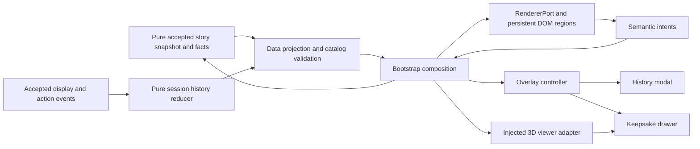

# Sprint 4 Proposal Plan: Visual, Narrative & Interactive Overhaul

| Document control | Value |
|---|---|
| Document / change | `JKB-PROP-S4-001` / [CR-0005](../../rfc/CR-0005-sprint-04-overhaul.md) |
| Version / date | 0.1.0 / 2026-10-14, Asia/Bangkok |
| Status | **PROPOSED — PO review; no production implementation authorized by this document** |
| Author | Codex — Senior Technical Lead, Game Director, Principal UI/UX Architect |
| Review PR | [#12](https://github.com/T3thr/JaoKob/pull/12) → develop, OPEN draft |
| Execution draft | [Sprint 4 SSOT and WBS](../../sprints/sprint-04-ssot.md) |
| Integrated runtime | `origin/develop@4c8d600820fcedcc9c14ec4b51df685f07099c7a`; Sprint 3 runtime integrated at `0d6c0ba` |
| Reference snapshot | 3D spike `d8a569e2472079789a02b9c363ae4378dc9d66ac`, [draft PR #11](https://github.com/T3thr/JaoKob/pull/11), OPEN / not merged when inspected |
| Change class | Plan: documentation; proposed runtime: C2 cross-layer presentation, with C3 dependency exception requiring RFC + new ADR |

## 1. Recommendation and authority

ปรับจากหน้าจอที่ประกอบด้วยกล่องหลายหน้าที่เป็นฉากอ่านที่มีลำดับสายตา: **ฉาก → เจ้ากบ → บทอ่าน → การกระทำ**. แยกข้อมูลการบันทึกออกจากภาษาเรื่องเล่า, สร้างการ์ดทางเลือกที่บอกเจตนา, เปิดประวัติการอ่านโดยไม่ย้อน domain state และนำตุ๊กตา 3D มาเป็นพื้นที่พักที่ผู้เล่นเลือกเปิดเอง.

คำสั่ง PO รอบนี้อนุญาต **analysis / proposal / planning เท่านั้น**. ภาพเป้าหมายได้รับการอนุมัติเป็น art/composition reference แล้ว แต่ Log policy, Intent Tags, production 3D dependency และความหมายของตุ๊กตาใน Act 1 ยังต้องผ่านมติ CR-0005. เอกสารนี้ไม่อนุมัติ Canon, mechanics, schema, release หรือ deployment ใหม่.

ผลส่งมอบที่เสนอสำหรับ Sprint 4:

- Benchmark Scene 1–2 + Scene 3 handoff เทียบ target อย่างมีคุณภาพ; UI/Log/Drawer ใช้ได้ตลอด Act 1 ทั้ง 7 ฉาก.
- Title, Reading Beat และ Decision Crossroads มีองค์ประกอบเฉพาะหน้าที่; Exploration, confirmation, completion และ failure flow เดิมยังทำงานครบ.
- Session backlog อย่างน้อย 50 dialogue entries พร้อมตัวเลือกที่ยืนยันแล้ว; safe read-only modal.
- Keepsake Drawer ใช้ childhood/adult GLB จาก spike ผ่านการเปิด 3D โดยเจตนาและ poster fallback.
- Baseline 691 tests และ 12 routes คง invariant; เพิ่ม behavioral tests สำหรับ contract ใหม่และ owner visual/manual evidence.

ไม่รวม media ใหม่ครบ 7 ฉาก, Act 2–5, ending integration, item economy/equipment/XP, emotion variants, ปุ่มถอดหัวใจ, animated typewriter/auto-advance, voice/TTS, login, telemetry, backend หรือ deploy. คุณภาพ “AAA Indie” ในที่นี้หมายถึงความประณีตของ slice ที่ตรวจรับได้ ไม่ใช่คำกล่าวอ้างว่าเกมเต็มผลิตเสร็จแล้ว. หาก PO ต้องการ art ครบ Act 1 ให้เปิด milestone ผลิตสื่อแยกหลัง benchmark ผ่าน.

## 2. Sprint status and evidence confidence

| Area | Observed fact | Implication for Sprint 4 |
|---|---|---|
| Sprint 3 | [SSOT](../../sprints/sprint-03-ssot.md): WBS 5/5 merged via PR #9/#10 | ฐาน functional integration เสร็จ; ห้ามเปิด WBS เดิมย้อนหลัง |
| Fresh regression | `node --test tests/unit/*.test.js`: **691 pass / 0 fail / 0 cancel / 0 skip / 0 todo**, 20,832.222 ms | รันใหม่ใน session นี้; runtime, schemas, assets และ unit tests ของ spike HEAD เท่ากับ develop ตาม diff |
| Browser coverage | [existing evidence](../../../tests/e2e/evidence/sprint-03/visual-novel/README.md): 12 canonical routes และ supplementary Chromium screenshots | หลักฐานประวัติ; ไม่ได้รัน browser ใหม่ใน planning นี้ |
| Visual approval | Sprint 3 SSOT §5.3 ยังเปิด PO aesthetics, listening, physical device, assistive technology | 691 tests ไม่ใช่หลักฐานว่าภาพหรือประสบการณ์ผ่าน PO |
| Performance | ประวัติ cold p75 2.16s, warm 0.20s, input→rAF p95 8.2ms ใน headless profile | rAF ก่อน paint; ไม่มี CPU throttle; ห้ามอ้างว่าเป็น FPS/latency บนมือถือจริง |
| 3D | Spike technically delivered; [adult metrics](https://github.com/T3thr/JaoKob/blob/d8a569e2472079789a02b9c363ae4378dc9d66ac/docs/proposals/3d-keepsake-spike/evidence/model-metrics.json): 546,020 B; [childhood metrics](https://github.com/T3thr/JaoKob/blob/d8a569e2472079789a02b9c363ae4378dc9d66ac/docs/proposals/3d-keepsake-spike/evidence/childhood-model-metrics.json): 598,144 B / 13,400 triangles | GLB พร้อมใช้เป็น candidate; final likeness/fabric/device review ยังเปิด; library bytes และ GPU memory ไม่รวมใน GLB |
| Governance navigation | AGENTS ยังชี้ Sprint 1; docs portal/Sprint 3 มี integrated closeout | ใช้คำสั่ง PO ปัจจุบันและ Sprint 3 เป็น baseline; ไม่แก้ประวัติ Sprint 1 |
| Workspace | Spike branch มี GDD edit และ local references เดิม | ใช้ worktree เอกสารจาก develop แยก; ไม่รวม reference photos หรือ GDD edit ใน diff นี้ |

หลักฐาน spike อยู่บน PR #11 จึงใช้ลิงก์ commit ที่ตรึงไว้สำหรับ review; branch เอกสารนี้ไม่คัดลอก spike ทั้งชุดมาเป็น production asset. Merge/approval ของ PR #11 หรือการนำ asset commit ที่ตรวจแล้วเข้าฐานเป็น dependency ของ T7.

## 3. Visual & architectural gap analysis

### 3.1 Comparison sources and method

ตรวจภาพจริงที่เก็บใน repository: [desktop reading](../../../tests/e2e/evidence/sprint-03/visual-novel/1440x900-reading.png), [desktop decision](../../../tests/e2e/evidence/sprint-03/visual-novel/1440x900-decision.png), [mobile decision](../../../tests/e2e/evidence/sprint-03/visual-novel/390x844-decision.png), [Title](../../../tests/e2e/evidence/sprint-03/visual-novel/1440x900-title.png) และ [320px / text 200%](../../../tests/e2e/evidence/sprint-03/visual-novel/320x568-text200.png). เทียบกับ [approved desktop reading](../phase-02-visual-novel-architecture/jaokob-visual-target-desktop-reading-state.png) และ [approved mobile decision](../phase-02-visual-novel-architecture/jaokob-visual-target-mobile-decision-state.png).

Target เป็นภาพ mockup ที่รวม device/browser chrome. เปรียบเทียบพื้นที่เกมภายในกรอบกับ runtime ที่ node/state เดียวกันโดยใช้ actual content; ไม่ใช้ pixel diff ข้ามรูปทั้งสองแบบเป็น quality score. ภาพเป้าหมายมีกบโต/บ้านและสอง choices; [CR-0003](../../rfc/CR-0003-interactive-light-novel-presentation.md) / [ADR-P0-015](../../adr/ADR-P0-015-interactive-light-novel-presentation.md) ยุติให้ Act 1 เป็น **ลูกอ๊อดลวดลาย/ผ้าผูกคอสีน้ำเงิน**, Scene 3 มี **สาม choices**, Bond locked/no numeric disclosure. ความต่างเหล่านี้เป็น approved deviations ไม่ใช่ข้อผิดพลาดที่ต้องแก้ให้เหมือนภาพ.

| Gap | Target intent | Current evidence and cause | Proposed correction / acceptance |
|---|---|---|---|
| G1: hierarchy | บทอ่านหนึ่งแผ่น, speaker บนขอบ, next cue เล็ก | Reading มี page label, speaker, prose, save notice และปุ่มนอก card; `buildGameShell()` รวมหลายหน้าที่ใน `narrative` | Card เก็บเฉพาะ speaker/context/prose/progress/advance; save และ feedback มีพื้นที่เฉพาะ; ไม่มี panel ขาวซ้อนใน normal reading |
| G2: operational noise | ฉากและบทอ่านเป็นตัวนำ | “บันทึกความคืบหน้าแล้ว” กลายเป็นกล่องขาวขอบทองทุกหน้า; `notice` ใช้ builder เดียวกับ first-run notice | Save status เป็นข้อความเล็กใน utility rail; error/memory-only คง visible/actionable; live announcement ครั้งเดียวต่อเหตุการณ์ |
| G3: decision anatomy | prompt สั้น + action + intent + icon + trailing cue | Mobile มี feedback box, prompt หลายบรรทัด, save box, heading box, choices ทึบไม่มี tag; desktop screenshot มีความสูงเกิน 900px | Separate prompt และ choice cards; label/tag/cue จาก projection; 3 choices จริงคง order/impact/confirmation |
| G4: materials | กระดาษมี grain/motif ที่ตั้งใจ; ขอบนุ่ม; UI ไม่ใช้เงาเท่ากันทุกชิ้น | repeating diagonal stripe + inset border ทำให้ card ดูเป็น CSS template; generic box styles reuse ทั่ว UI | กระดาษสา texture เดียว ≤50 KB, motif ตำแหน่งแน่นอนและพ้น text zone; tone/detail hierarchy ผ่าน Art review; contrast mode ตัด texture |
| G5: HUD | ค่าจริงอ่านง่ายในแถบ compact; HP กับพลังใจแยกกัน | solid dark slab, HP/Sanity สีเดียว; icons เป็น heart/วงกลม/emoji; mobile Bond ลงแถวใหม่; 200% text HUD สูงมาก | Original SVG icon set, HP moss / พลังใจ amber, localized names; flexible wrap ที่ตั้งใจ; ไม่มีการบังคับลดฟอนต์เพื่อยัด HUD |
| G6: character integration | subject มี scale, light และพื้นที่สัมพันธ์กับฉาก | sprite ลอยกลางแสง, drop-shadow แบบวัตถุอยู่บนพื้น, flex growth เปลี่ยน scale/ตำแหน่งตามความสูง UI | Authored focal anchors/crop และ water occlusion/light matching; ลูกอ๊อดอยู่ในน้ำ ไม่สร้าง contact shadow บนใบบัว; art edit อาจจำเป็น CSS อย่างเดียวไม่พอ |
| G7: Title identity | branding/epigraph อยู่ Title; menu สงบ | Title ปัจจุบัน neutral gradient, “ฉาก” + ชื่อใน HUD และ meters 80/70 ก่อนเริ่มเล่น, notice ซ้อน | Title hero ของตัวเอง, localized title/menu, no gameplay meters; notice/accessibility setup ยังเข้าถึงก่อน New Game; adult mascot ใช้ได้เฉพาะ branding ที่ approved |
| G8: responsiveness | visual focus คงอยู่เมื่อ crop; safe area และ controls ถึงได้ | `object-position: center 48%`, sprite size อิง viewport height; three-choice mobile มี scroll | แยก authored portrait/landscape crop, reserve subject zone; 320/zoom ใช้ flow; การเลื่อนเป็นสิ่งยอมรับได้ ไม่ตัด choice ที่สามเพื่อ fit mockup |
| G9: focus | action/focus มีหลักฐานให้มองเห็นโดยไม่กลายเป็นกล่องตกแต่ง | กรอบขาวรอบ reading region ใน screenshot มาจาก `tabindex=-1` / `:focus-visible` และ bootstrap focus directive | เก็บ focus semantics; ย้าย focus target ให้ใกล้บทอ่านและ style เฉพาะ region; keyboard focus ทุก control ยังเห็นชัด ห้ามลบ outline ทั้งแอป |
| G10: history | ย้อนอ่านสิ่งที่เห็นและเลือกแล้ว | `buildCutsceneControls()` มี legacy inline log แต่ production VM ไม่ส่ง full backlog; `viewedDialogueIds` เป็น unique recency/cursor | Session transcript แยกจาก saved progress; modal ไม่ dispatch advance/retry; ≥50 dialogues + accepted choices |
| G11: keepsake meaning | ของที่สัมผัสได้สัมพันธ์กับอารมณ์ | ไม่มี Drawer/production contract; spike viewer อยู่นอก runtime | Non-diegetic collection space ที่ PO/Narrative อนุมัติ; แยกจาก `keepsake.lily_fragment` flag และ ending |
| G12: semantic projection | ข้อความแต่ละชนิดมี role ของตัวเอง | VM รวม prompt กับ dialogue เป็น string; `outcomePreview` มีใน schema แต่ไม่แสดงใน normal choice cards; renderer rebuild content ทั้งก้อน | เพิ่ม explicit prompt/cue/status/overlay VM, persistent scaffold; patch เฉพาะ region; lifecycle ของ image/audio/modal ไม่ restart ตาม save status |

### 3.2 “No AI Slop / AAA Handcrafted Feel” acceptance rubric

Ghibli, Coffee Talk และ A Short Hike ใช้เป็นคำอธิบายคุณสมบัติที่ PO ต้องการ: warm light, material softness, deliberate pacing, quiet interaction และรายละเอียดที่รับใช้เรื่อง. ไม่สั่งคัดลอกตัวละคร/ฉาก/UI/asset ของงานอ้างอิง. คุณภาพไม่ตัดสินจากเครื่องมือที่สร้างภาพ แต่ตัดสินจากงานเกลาที่ผู้เล่นเห็น.

| Dimension | Reviewable criterion | Reject when |
|---|---|---|
| Composition | Reading มี prose หนึ่งจุดหลัก; Title/choices ไม่ปะปน; subject ไม่ถูกบังที่ normal text | อ่านหน้าจอเป็น dashboard หรือไม่รู้ action ถัดไป |
| Surface | ใช้ paper/river glass/fabric ตามหน้าที่; grain ไม่รบกวน glyph; border/shadow ไม่ซ้ำทุก element | nested rounded boxes, generic glass, glow ทุกปุ่ม, random ornament |
| Character/environment | lighting, edge treatment, size, water plane และ blue motif สอดคล้อง | cutout sticker, floating plush ในฉากลูกอ๊อด, ภาพมีรายละเอียดขัดกัน |
| Typography | Sarabun ที่มีสิทธิและ self-hosted; body 18–20px เป็น starting design target, line-height 1.75–1.9; Thai stress test ไม่ clip | ใช้ฟอนต์ตกแต่งกับ prose, ตัดสระ/วรรณยุกต์, shrink text เพื่อ fit |
| Choice honesty | intent อธิบายแรงจูงใจ; outcome cue เฉพาะข้อมูลที่ content อนุมัติ; น้ำหนักเท่ากัน | สีเขียว=ดี/น้ำเงิน=ผิด, “ปลอดภัย” ที่รับประกันสิ่งที่ engine ไม่รับประกัน, numeric/ending spoilers |
| Writing | หนึ่ง sensory anchor ต่อ beat, voice ตาม Bible, motif เปลี่ยนความหมาย, prompt ไม่อธิบาย theme ซ้ำ | “อบอุ่น/อ่อนโยน/ความหวัง” ซ้ำโดยไม่มี action, moral lecture, กล่อง feedback ทวน prose เดิม |
| Motion/sound | motion เฉพาะ transition/focal breathing ที่อ่านสบาย; full-text/manual advance เป็น default | blinking Next, perpetual card motion, auto-rotate 3D, action ต้องรอ media |
| Interaction | ทุกปุ่มทำงานจริง; keyboard/touch equivalent; normal save ไม่ดึง focus | ปุ่ม Log/Inventory ที่ไม่มีระบบ, restart scene จากการเปิด modal |
| Accessibility | visible focus, text/numeric status, 44×44 targets, 320 reflow/200% text/400% zoom; high contrast และ reduced motion | สวยเฉพาะ screenshot หรือใช้ icon/color/motion เป็นข้อมูลช่องทางเดียว |

เสนอ review score 0–2 ต่อ dimension: 0=ไม่ผ่าน, 1=ยังต้องเกลา, 2=ผ่านโดยมี evidence. เกณฑ์ visual exit ที่เสนอคือ **ทุก dimension = 2** โดย PO/Art/Narrative/Accessibility บันทึกข้อสังเกต; blocker ด้าน Canon, readability หรือ core journey veto score รวม. ไม่ใช่ automated score หรือ WCAG certification.

## 4. Dialogue Card & three-screen separation specification

### 4.1 State-to-screen contract

Three screens เป็น **presentation modes** ไม่ใช่การลด domain state หกค่าเหลือสามค่า. `Cutscene`, `Exploration`, `Decision`, `GameOver`, `Ending`, `Title` และ transitions เดิมคงเดิม. อ่าน preface ของ Exploration/Decision เป็น reading ก่อน; เมื่อ facts ready จึงแสดง controls ของ node จริง.

| Screen / mode | Visible content | Main action / exit |
|---|---|---|
| Title | Hero/logo/epigraph, Resume/New Game, Settings, save-scope/accessibility/notice access; no gameplay HUD | Existing New Game/Resume + sound gesture unlock; replacement consent retained |
| Reading Beat | Background + correct-life-stage character, compact HUD/utility rail, one paper card | Native advance button with localized “อ่านต่อ” name + ▽ icon; no decision cards until ready |
| Decision Crossroads | Current context/prompt once, compact HUD/utility rail, 2–3 authored choices | SELECT_CHOICE with revision guards; high/irreversible uses existing confirmation setting; no Next |
| Exploration | Context + semantic interactions in reading order; explicit leave action | Existing observations/revisit/exit guards; no visual hotspots-only interaction |
| Confirmation / Settings | Modal over preserved story; one active overlay | Cancel/confirm/close restore focus; no story command beneath modal |
| Completion / crisis / failure | Existing completion/return-to-title/recovery/error controls, safe text | No dead ends; no new unsupported ending/crisis functionality inferred |

### 4.2 Anatomy and responsive rules

Reading card: speaker badge anchored at upper start edge; narration labeled as narration, inner voice described semantically; prose in one text region; page progress in quiet footer; native advance control at inline-end. Text is safe DOM, never narrative `innerHTML`. Accessible name/description and icon label resolve from localization.

Desktop starting targets: card 40–44rem max, centered near lower stage; ~20–28% stage height for normal 2–3-line beat; enough space between subject and card. These are composition targets, not max-height rules. Long text/zoom grows naturally and scrolls. Mobile: 12–16px side margin, 20–24px text padding, safe-area bottom clearance; title/HUD/card proportions adapt to usable viewport, not device mockup.

Decision card: one native button wrapping original icon, action label, short Intent Tag and trailing arrow; outcome cue outside the button where lengthy, associated via description. Whole card is tap target; no nested clickable control. Distinguish selected, disabled, pressed and busy with text/state and contrast, not color alone. Mobile stack with 10–14px gaps; normal card target 76–104px with text allowed to expand. Desktop may use 2–3 columns only where all labels/cues fit, otherwise stack; maintain DOM order. No forced single-screen fit at 320/zoom.

Common utility rail: Settings, “ประวัติ”, “ของสะสม”, textual save status. At narrow width it wraps below HUD or into an accessible menu with actual implemented actions; it never overlays prose/choices. Touch targets ≥44px; desktop controls may look small while preserving hit area. Title has collection entry only if D4 permits early access; empty history action is omitted or opens a meaningful empty state, never an inert button.

### 4.3 Save, feedback and notice separation

| Information | Placement and behavior | Regression protection |
|---|---|---|
| Saving / saved | Small visible localized text in rail, updated in place; no recurring toast/paper sub-panel | All three save states remain textual under `GDD-UX-007`; status change cannot move focus or append history |
| Save failure / memory-only / protected record | Persistent visible status + accessible details/action; warn before leaving per existing policy | Do not hide error for aesthetics or destroy raw save without consent |
| Immediate narrative feedback / meter deltas | Dedicated narrow response strip adjacent to relevant beat, without white inset card; merge visual layout only after Narrative review | Preserve authored feedback and amount/direction; one live announcement under `FR-UI-003` |
| Content warning | Separate notice region/acknowledgement following existing flow, before intense scene | No automatic dismissal or mixing with save text; storm/separation notice retained |

Announcement dedupe uses event identity/revision + message kind, not every VM render. Save/media status patches leave the reading region and modal focus intact. Normal status stays visibly readable; do not “fix noise” by turning all save text into screen-reader-only content.

### 4.4 Intent Tags and narrative editing

Draft labels below require Narrative/Game Design review; choice IDs, effects, order, condition, impact and next-node stay unchanged. Tags express action intent, not predicted reward/morality.

| Existing choice ID | Proposed intent text | Skin / original motif |
|---|---|---|
| `choice.act1.focus-mother` | ใกล้ชิด | Moss / shared ripple |
| `choice.act1.focus-roots` | รับฟัง | River / root |
| `choice.act1.focus-siblings` | เล่นด้วยกัน | Warm moss / small ripples |
| `choice.act1.call-family` | เรียกหา | River / expanding ripple |
| `choice.act1.seek-safety` | ตั้งหลัก | Moss / sheltering leaf |
| `choice.act1.keep-fragment` | เก็บไว้ | Moss / leaf fragment |
| `choice.act1.release-fragment` | ปล่อยไป | River / open water |

Recommend a **separate validated presentation catalog** bound to exact contentVersion + stable IDs. Do not add `intentTag` to frozen schema 1.2 or infer tags from metric effects/Thai string matching. Project existing `outcomePreview` where present; no invented “safe” promise. Missing optional catalog entry yields normal labeled choice, while missing/invalid required locale/icon/reference fails the presentation feature safely and is reported.

Narrative overhaul in this Sprint starts with an editorial inventory of all Act 1 beats/prompt/feedback, not automatic rewriting. The benchmark may shorten duplicated exposition after Lead Narrative approval. Preserve emotional progression, non-blaming storm, agency, decompression, distinct inner-voice role and motif discipline (`NAR-DLG-001..005`, `NAR-CON-001/010`, `NAR-TONE-001`). Exact text edits are a later reviewed diff. If content bytes change, issue a new content version with proven 2.1→new compatibility and rollback; do not silently repurpose IDs or waive migration because prose “looks cosmetic”.

## 5. Dialogue History / Backlog specification

### 5.1 Experience

Open “ประวัติ” from utility rail during reading/exploration/decision; native modal styled as an archive sheet. Header + title + close; scene separators, speaker/voice role, full displayed text, followed by distinctly labeled “คุณเลือก…” entries. Chronological oldest→newest, opening positioned near newest; user can scroll back without automatic jumps. No search/filter/voice playback or rewind button in this Sprint.

Modal entry is blocked while a story transaction/confirmation is unresolved. One modal at a time. Opening freezes advancement/input, not domain state; ambient audio can continue at saved levels, no restart/crossfade/SFX caused by opening. Close/Escape returns to invoker or equivalent safe action after rerender. Save/media events may update rail but do not close modal, steal focus or move scroll.

Use native `<dialog>`/`showModal()` where supported; fallback must make background inert and trap focus. Initial focus on a short heading with `tabindex=-1` for long structured history, not on the whole transcript via `aria-describedby`; Tab/Shift+Tab stay inside, close button always visible. Do not make every line tab-stop or live-announce 50 entries. Behavior follows [WAI modal dialog pattern](https://www.w3.org/WAI/ARIA/apg/patterns/dialog-modal/).

### 5.2 Data ownership and record contract

Current saved `payload.history` is ≤200 **committed Decision actions**, with node/action/time/metrics; Exploration actions are not recorded there. `progress.viewedDialogueIds` is a unique recency list whose last element determines current cursor. Neither is an ordered transcript including repeated dialogue occurrences. Reinterpreting either field would break Resume and existing validation.

Proposed pure application session reducer (`src/core/use-cases/session-history.js`) receives **explicit accepted presentation events**, stores no DOM/storage/clock, and returns immutable state. Bootstrap owns reducer state/lifecycle; Data resolves IDs/text/locale; UI renders a frozen history VM. Separate ephemeral history does not enter domain snapshot/save envelope.

| Record field | Purpose / constraint |
|---|---|
| `entryId`, `sessionId`, `sequence` | Application occurrence identity; injected monotonic sequence, no randomness/wall-clock dependency |
| `kind` | `dialogue` or `choice`; `interaction` only if D3 approves the proposed observation entries |
| `contentVersion`, `nodeId`, `sceneId` | Resolve to exact accepted package and scene context |
| `dialogueId` / `actionId` | Validated source identifier appropriate to kind |
| `speakerId`, `voiceRole`, `locale` | Narration/inner voice/speech distinguished; locale at display |
| `text`, `sceneLabel`, `speakerLabel` | Frozen resolved text as seen at that occurrence; choices retain accepted label/tag, no unchosen outcomes |

Policy proposed for D3: retain **50 latest dialogue records + 50 latest choice/interaction records**, merge by sequence for UI (≤100 entries). Dialogue capacity remains 50 even after 60 mixed actions; this avoids treating “50 entries total” as meeting 50-dialogue requirement. เก็บข้อความที่เห็นครบตาม schema เดิม: localizedText อนุญาตถึง 12,000 ตัวอักษร และ localizedShortText ถึง 240 ตัวอักษร. เสนอ serialized transcript/state hard budget 8 MiB รวม text/labels/metadata และ target ≤128 KiB สำหรับ Act 1 ปัจจุบัน; ไม่ใช้ byte cap ลบรายการจนเหลือ dialogue ต่ำกว่า 50 และไม่ตัดข้อความ. ตรึงความยาว metadata ตาม schema และพิสูจน์ด้วย fixtures ที่ความยาวสูงสุดว่าบัฟเฟอร์รองรับ 50 dialogues + 50 actions ได้จริง; หากไม่พอให้ปรับ budget/representation ผ่าน review ก่อน implementation. Budget นี้เป็น ephemeral RAM data ไม่ใช่ save และต้องรายงาน heap ที่วัดจริงแยกจาก serialized bytes.

### 5.3 Append and lifecycle rules

1. New Game accepted: clear prior session, record first displayed dialogue once. Cancelled New Game leaves existing session untouched.
2. Accepted advance: append newly displayed dialogue after successful renderer presentation acknowledgement; failed render cannot append an unseen line. Re-render/settings/audio/save callbacks append nothing. Confirmation selection appends nothing until commit.
3. Accepted choice/observation: append the action **before** the newly displayed response dialogue (response only after successful presentation); validate selected stable ID from accepted result. Rejected/stale/duplicate/busy inputs append nothing.
4. Revisit/retry that actually displays an old line appends a new occurrence with new sequence; do not dedupe globally by dialogue ID. No speculative preload, graph traversal or unchosen variant may append.
5. Title→Resume within the same application/session retains log and does not duplicate the current line solely due to redisplay. Retry is labeled as a new passage in history, without changing checkpoint rules.
6. Hard reload/compatible Resume: initialize a **fresh session transcript from the current visible line**, with localized note that earlier dialogue belongs to the preceding reading session. Saved choice history may be shown separately as “saved choices” after validated projection; do not interleave it as a reconstructed exact transcript. Default recommendation: omit that extra section in Sprint 4.
7. New package/session disposes old reducer. No player data leaves device; no extra LocalStorage key/write. Cross-reload transcript persistence is a deferred alternative requiring versioned save/storage and recovery design.

Acceptance: append 60 dialogue occurrences→exact latest 50 in order with speaker/scene/locale; repeated IDs survive as separate visits; cancelled confirmation absent; log shows only chosen path; New Game clears; reload limitation is explained; open/close/log-scroll leaves metrics/flags/RNG/cursor/revision/save bytes unchanged.

## 6. Keepsake / Inventory Drawer specification

### 6.1 Meaning and Act 1 emotional connection

Recommend D4 **a non-diegetic “ของสะสม” space for the player**, available after first accepted opening beat, never as an item carried by the tadpole. Childhood crochet is the first/default view; adult velour is a selectable companion edition, without ending/transformation description. Both can be accessible early only if PO + Narrative accept the visual foreshadowing. If adult appearance is judged a spoiler, hide adult in gameplay and expose it in Title collection only; do not add a fake locked achievement or future-ending gate.

Offer one quiet optional invitation at an approved emotional rest point, preferably `node.act1.rest` after the player advances to its decompression beat; no automatic opening or mandatory interaction. Draft copy “พักดูเจ้ากบสักครู่” is proposed UI text, not new Canon dialogue. Drawer text speaks to the player, never claims the tadpole owns a toy or promises a reunion. Viewing gives no HP/พลังใจ/Bond/reward/flag effect. `keepsake.lily_fragment` remains the story item it already is; its conditional motif may appear in later authored UI only with its existing guard.

Model heart is optional in source (`Accessory_RedHeart`), default GLB includes it. Sprint 4 uses that approved default; no heart-toggle, emotional heart meter, ownership flag, transformation or Act 5 delivery is inferred.

### 6.2 Anatomy and interaction

Desktop: modal side drawer at inline-end, starting width 26–32rem with dimmed story still visible. Mobile: modal sheet with header/close, two model selectors, viewer/poster region, localized description and orbit/reset controls; use nearly full height at 320/landscape/zoom when necessary, allow internal scrolling. Keep close visible; do not squeeze controls into a tiny viewport to preserve a half-height sheet.

States: `closed → poster → loading → ready`, with `error → poster/retry`; model selection changes poster/details only before activation. **“เปิดดู 3 มิติ” is a second explicit action**: loading the Drawer alone requests only selected poster/catalog, no viewer JS or GLB. After 3D activation, selection loads only chosen model. Drag/touch orbit and pinch/wheel zoom have equivalent localized buttons: left/right/up/down, zoom in/out, reset. No pan, AR, animation autoplay or auto-rotate; reset includes both camera orbit and field of view. Poster and full text alternative remain usable without WebGL.

Opening/closing/selecting/rotating cannot dispatch SELECT_CHOICE, save, change flag, advance cursor or append story history. Asynchronous completion never steals focus if user has moved to a selector/close. Escape closes loading/ready and returns focus. Touch orbit must coexist with vertical sheet scrolling; explicit controls cover devices where gestures conflict.

### 6.3 Asset and runtime integration

`@google/model-viewer` **4.4.0** is pinned in the isolated spike. [ADR-P0-016](https://github.com/T3thr/JaoKob/blob/d8a569e2472079789a02b9c363ae4378dc9d66ac/docs/adr/ADR-P0-016-keepsake-model-viewer-spike.md) approves that spike only. Recommend the same candidate for production after D5, license/supply-chain review and a **new ADR** narrowing the Vanilla baseline exception to this opt-in UI adapter. Do not label it dependency-free or import its spike `node_modules` path from the game.

| Layer | Proposed responsibility |
|---|---|
| Core | Existing mechanics untouched; optional browser-free `KeepsakeViewerPort` contract if independently injected adapter is approved |
| Data | New strict presentation/keepsake catalogs; validate rights/hash/path/type/bounds and join IDs; same-origin resolver returns approved descriptor |
| UI | Drawer, poster, native controls and `model-viewer-adapter.js`; injected descriptor/loader, request generation, DOM/event/resource lifecycle; no Data concrete import |
| Bootstrap | Compose catalogs/resolver/viewer/overlay controller; handle semantic open/close/select/view intents; preserve audio trusted-activation path |
| Distribution | Vendor exact reviewed JS/license under `assets/vendor/model-viewer/`; GLBs/posters under `assets/models/keepsakes/` and `assets/images/keepsakes/`; never ship docs/BLEND/generators/photos/spike node_modules |

Current asset schema types are only image/audio/font. Recommend **independent versioned presentation catalog** for non-diegetic model descriptors rather than treating GLB as image or editing published v1.2. It includes edition ID, localized title/alt/detail, GLB path/hash/bytes, poster descriptor, rights record and supported format. Data validates against installed new schema; unknown/mismatched catalog fails collection feature safely while story remains usable. Alternative v1.3 content-package model type is in RFC and requires broader compatibility work.

Same-origin static vendor, model and poster only; reject traversal/credentials/external redirect, remote texture URI and unsupported model extensions. Existing self-contained uncompressed GLBs need no Draco/KTX2 decoders. [Official loading docs](https://modelviewer.dev/examples/loading/) describe CDN decoder loading for compressed formats: future compression must vendor its decoder and be reviewed; never assume the absence of a CDN import guarantees no external requests.

### 6.4 Lifecycle and budgets

- One active viewer/model at a time; memoized component import per app, not per reopen. Invalidate generation on selection/close/dispose; obsolete success/error cannot change current edition. A JS import cannot reliably be cancelled; discard late results and keep drawer closed.
- Timeout proposed 15s for interactive model load; error preserves poster/text and explicit retry/close. The domain transaction never awaits module/model/decode. Retry bounded to user action, with consistent hash/path validation.
- On close/hidden/dispose detach event listeners, invalidate callbacks and remove active viewer/reference; verify renderer/component caches and GPU resources on repeated cycles. **Removing the DOM element does not prove that internal caches or GPU memory were freed**; inspect supported API/configuration and measure. Imported JS remains resident. If stable bounded reuse is the safe lifecycle, document it rather than inventing a nonexistent dispose API.
- No GLB/vendor fetch before 3D activation; no two-model preload. Transfer for current GLBs is 546,020 / 598,144 B **plus library, poster and dependencies**; record compressed/uncompressed waterfall separately. No “<600 KB total 3D” claim.
- Preserve `NFR-PE-001..005`: cold ≤3.0s p75, warm ≤1.5s p75, commit feedback/general interaction ≤100ms p95, initial ≤2 MB compressed and shell+critical JSON ≤500 KB compressed, save ≤250 KB. Added code/catalog must still count toward shell budget even when GLBs are deferred.
- Existing image/audio caches stay 32/16 MiB. Propose separate 3D steady-state decoded/GPU target ≤32 MiB, one live context/model, no retained second model; method/device agreed in T0, reported as target until measurable. If third-party caches cannot meet this, narrow to one reusable viewer, reduce asset/texture cost or retain poster mode; do not infer memory from GLB bytes.
- Require representative iOS/Safari and Android/Chrome device checks for cold viewer activation, gestures, visibility, context loss and 20 close/open/switch cycles. Browser emulation alone cannot close this gate.

## 7. Architecture blueprint and compatibility

Diagram shows runtime information flow; **import permission differs**: only bootstrap imports concrete UI and Data. Core reducer/ports import no browser/UI/Data. Catalog joins and localization live in Data, not in renderer; UI owns browser rendering. Overlay guards are application interaction policy outside the story state machine. Log/collection events cannot touch story transaction functions.

Recommended contract changes: retain RendererPort operations; add optional immutable `prompt`, choice `intent/cue/icon/skin`, structured `saveStatus`, `feedback`, `history`, `overlay` and `keepsakes` VM fields with strict validation at relevant boundary. Migration of old VM fixtures uses defaults and preserves semantic expectations; no browser objects/paths/selectors in pure VM. Dedicated injected browser adapter receives resolved URLs through the composition boundary, not Core VM.

Persistence recommendation: save format 1, content 2.1.0 and published 1.0/1.1/1.2 schemas remain byte-identical for UI/Log/collection delivery. Session log/overlay/camera/model selection/loading state are not saved. If approved narrative/art binding edits change content, they become a separately versioned release with a reviewed compatibility map, old raw backup retention, validation and rollback write guard, following CR-0003 D3; no automatic downgrade.

Rollout: contracts and sample review → styles → renderer/notice separation → intent projection → log → collection assets → 3D adapter → integration evidence. Keep each PR independently testable; no temporary controls exposed before feature is functional. Rollback UI/overlays by reviewed revert to prior renderer, without clearing player storage. If content changes, retain compatible data/migration/write guard while reverting visuals; older executable must not overwrite newer save.

## 8. Execution, validation and decisions

Detailed owners, exclusive files, dependencies, per-task AC and estimates are in [Sprint 4 WBS](../../sprints/sprint-04-ssot.md#4-execution-wbs). Priority requested by PO is retained: **UI Styles → DOM Renderer → Log Modal → 3D Keepsake**; contract/asset/editorial approval is T0 prerequisite, Intent Tags are the renderer handoff, and QA is a gate after each task.

Existing 691 cases stay in regression; no reduction/skips/todo or expected-value change to make styling pass. DOM shape/screenshot assertions may change when approved markup changes, but equivalent focus/live-state/choice/guard/save assertions must remain. Unit count alone does not prove equivalence; compare exact route flags/metrics/checkpoints/RNG/current cursor and serialized save fields under all media states. New tests target behavior/races, not CSS values copied from implementation.

Manual artistic review and device/assistive-technology gates are delivery requirements, not optional finishing touches. A scene approved at desktop normal text does not pass mobile, zoom or reduced motion. [W3C Reflow guidance](https://www.w3.org/WAI/WCAG22/Understanding/reflow.html) informs 320 CSS-pixel/zoom review; do not use fixed overlay sizes or clipped narrative to imitate target proportions.

| Decision | Recommended outcome | Required owner |
|---|---|---|
| D1 | Scope: polished Scene 1–3 benchmark + Act 1-wide UI/Log/Drawer; rubric above; carry unfinished Sprint 3 manual gates | PO + Art + QA |
| D2 | Separate versioned presentation catalog for tags/crop/model descriptors; immutable published contracts | Architect + UI/Data + PO |
| D3 | Session-only backlog, 50 dialogues + 50 actions, new passage on revisit, truthful reload limitation | PO + Narrative + Architect |
| D4 | Non-diegetic collection in Act 1; childhood default; adult early availability only with explicit spoiler/art approval | PO + Narrative/Game Design |
| D5 | Opt-in same-origin pinned model-viewer adapter; new narrow runtime ADR, not production permission inherited from spike | Architect + PO + QA |
| D6 | Seven draft Intent Tags, contextual cues and benchmark editorial brief; approve exact text/assets in task reviews | Narrative + Game Design + PO/Art |
| D7 | Real device/browser/manual reviewer profile and 3D budget method; branch/PR staging and acceptance sequence | QA + Accessibility + PO |

**Implementation DoR is intentionally open.** PO can approve D1–D7 with amendments; record actual authority in a new change record, update SSOT status and accepted ADR before source work. No automatic merge, approval or deployment follows from this proposal.
