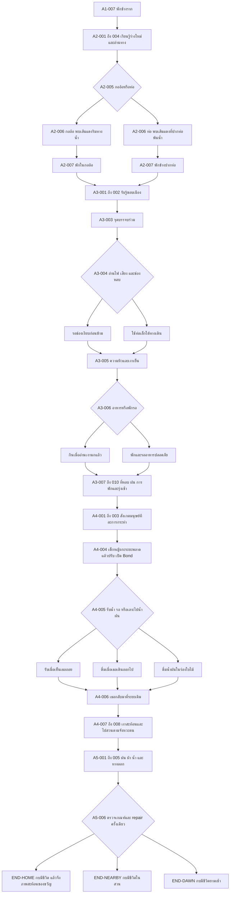
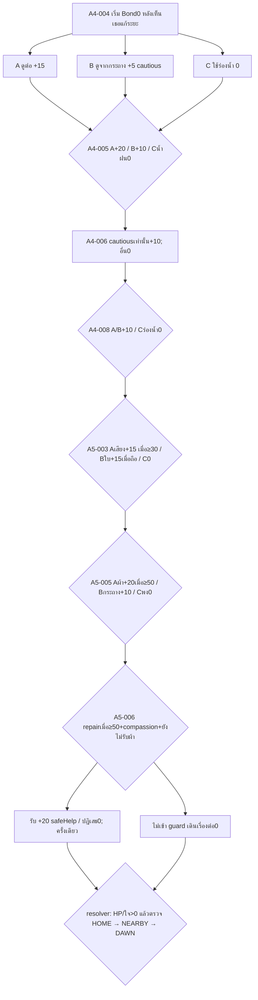

# แผนองก์ 2–5 และของขวัญที่รออยู่ปลายทาง

| Document control | Value |
|---|---|
| ID / version | JKB-S4-NARRATIVE-MAP / 1.1.0 |
| Date / task | 2026-10-16, Asia/Bangkok / Sprint 4 T8, Slice 4, intended PR #16 |
| Authority | คำสั่ง PO รอบแก้ PR #16, CR-0005 D2/D4/D5/D6 และ ADR-P0-021 D1–D6; แก้จาก3164601 บน branch/PR เดิม |
| Status | S5 implementation handoff; บทตัวอย่างและผลใหม่ที่ติด `draft` รอ human editorial/Game Design review ไม่ใช่ประกาศ Canon ใหม่ |
| Baseline | [Narrative Bible](../../archive/phase-0/02-narrative-bible.md), [GDD](../../archive/phase-0/01-game-design-document.md), [SSOT T8-AC-01..08](../../sprints/sprint-04-ssot.md#42-task-details-and-specifications), [Act 1 contract](../../design-system/act1-narrative-contract.md) |

Trace: ADR-P0-021 D1–D6; NAR-ACT-001..011, NAR-THM-001..005, NAR-MOT-001..006, NAR-CON-001..010, NAR-CHR-001/005, NAR-VOI-001..004, NAR-DLG-001..005, NAR-TONE-001; GDD-DEC-A2/A3/A4/A5, GDD-BOND-001..006, GDD-CHO-007, GDD-BAL-001..009, GDD-END-001..006, GDD-SAFE-005; FR-CNT-001/002, FR-SAV-001/005/006/007; TC-S4-MAP-001/EMOTION-001/CALLBACK-001/FAIR-001/GIFT-001.

## 1. แกนเรื่องห้าองก์

ใต้เปลือกหอยที่บึงเดิม พี่น้องเบียดกันจนหางปัดจมูก แม่เรียกสองครั้งแล้วทุกตัวก็ถอยกรูออกมา พายุทำให้เสียงนั้นขาดหาย กิ่งไม้กับตะกอนปิดทางที่เจ้ากบถูกพัดมา เหลือน้ำให้ตามไปอีกด้าน ความคิดถึงจึงติดไปกับร่างที่ต้องหาน้ำและที่หลบ จนถึงวันที่เจ้ากบกับเด็กหญิงต่างค่อย ๆ อ่านท่าทีของกันและกันได้

| Act / canonical anchors | สิ่งที่เกิด / สิ่งที่เปลี่ยน | จุดบรรจบและ checkpoint brief |
|---|---|---|
| 1 / A1-001..007 | แม่ดุนใบที่ติดหางลูก พี่น้องแย่งดุนเปลือกบัว; พายุพาพลัดพราก ทางกลับถูกกิ่ง/ดินปิด ร่องน้ำที่เหลือทำให้ต้องไปต่อ; เปลือกหอยชวนจำเงาที่เคยเบียดกัน | content 3 มี 28 โหนดในเจ็ดฉากเดิม; quiet-bank → rest-memory → rest; final acknowledgement จึง capture checkpoint |
| 2 / A2-001..007 | ร่างกายเปลี่ยน หางสั้น ขารับน้ำหนักทีละนิด; A2-004 อ่านทาง ก่อนเลือกกออ้อ/ท่อที่ A2-005 | checkpoint ก่อน route Decision; A2-006 พบวัสดุมนุษย์ครั้งแรกบนทั้งสองทาง; A2-007 พักก่อนเข้าเมือง |
| 3 / A3-001..010 | อ่านแรงสั่น ล้อรถ ฝีเท้า ความร้อน ความหิวและสิ่งที่ถูกทิ้ง; ตั้งหลักด้วยข้อมูลและการพัก | ความต่างของกออ้อ/ท่อจบหลัง A3-002 **ก่อนเริ่ม A3-003**; checkpoint ก่อน A3-004, หลังพัก A3-007 และก่อน recovery A3-009 |
| 4 / A4-001..008 | เห็นคนแบ่งพื้นที่ คนรีบ คนลำพัง; เด็กหญิงกะระยะพลาด สังเกตกบแล้วปรับ; เจ้ากบอาจรับน้ำ รอดู หรือใช้ทางน้ำธรรมชาติ | checkpoint ก่อน A4-004 และก่อน A4-008; เส้นรับทันที/รอ/พึ่งตนเอง converge ที่ A4-006 แล้วเข้าสวนที่ A4-008; cautious compensation ยัง+10เฉพาะ flag เดิม |
| 5 / A5-001..006 และ A5-007 endpoints | เสียงฝนเดิมกลับมา มีทั้งผ้าอุ่น กระถางและพงข้างแอ่งน้ำ; เลือกสื่อสาร รับที่พัก หรืออาศัยราก/น้ำด้วยตนเอง | checkpoint ก่อน A5-003 และ A5-005; A5-006 เสนอ repair ตามเกณฑ์เดิมครั้งเดียว แล้ว resolve สาม ending IDs เดิม |

กราฟแสดงเส้นเรื่อง ไม่ใช่ import permission หรือ runtime ที่ส่งมอบแล้ว เส้นเลือกต่างกันเรียก callback ได้ แต่ห้ามสะสม return stack หรือแตกเส้นเรื่องถาวรหลัง A3-003; §8 พิสูจน์ reachability ของแบบออกแบบจากตัวเลือกจริง; S5 ยังต้องตรวจ graph/runtime ที่ materialize แล้ว

## 2. องก์ 2: ขาใหม่และเส้นสีแดง

A2-001 ให้เวลาร่างกายเปลี่ยนโดยไม่เร่งเป็นบทเรียนชีววิทยา A2-002 เจ้ากบทดลองยกตัว วางขาลง แล้วพักเมื่อพื้นยังรับน้ำหนักไม่ถนัด ความจำของแม่กลับมาตอนสีข้างแตะรากเหมือนเดิม ไม่มีเสียงแม่มาจากภายนอก A2-003 น้ำลดและกลิ่นโลหะเป็นเหตุให้ต้องหาที่ใหม่ A2-004 ผู้เล่นดูคราบน้ำและรอยนกก่อนตัดสินใจ

A2-006 บนทางกออ้อ เส้นแดงติดอยู่ที่กิ่งพ้นน้ำ; บนทางท่อ เส้นเดียวกันในบททางเลือกติดขอบวัสดุแห้งที่ปากท่อ เจ้ากบเข้าไปดูเฉพาะจุดที่มีทางถอย แสดงวัสดุมนุษย์ครั้งแรก ณ anchor นี้ทั้งสองเส้น จึงไม่มีเงื่อนไขว่าต้องเลือกท่อถึงจะพบ `draft.opportunity.a2.red-yarn` ให้ใช้ stable item ID **`item_red_yarn`** ใน S5; ห้ามนำไปแทนความหมายของ item_river_shell

บทตัวอย่าง: “เส้นแดงพาดอยู่เหนือคราบน้ำ เจ้ากบแตะด้วยปลายเท้า มันยุบลงแล้วคืนตัว ต่างจากราก ต่างจากหิน มันเอียงหัวมองอยู่นานก่อนลองแตะอีกครั้ง” เจ้ากบยังไม่รู้ชื่อไหมพรม ผู้บรรยายไม่เล่าว่าใครทำหล่นหรือมีเจตนาอะไร

มีทางเก็บ/ปฏิเสธ และเมื่อเต็มให้เลือกสละหนึ่งชิ้นหรือปล่อยเส้นแดงไว้ ยกเลิกการยืนยันได้ ไม่ได้รับ HP/พลังใจ/Bond จากธุรกรรมนี้ ไม่บังคับเก็บเพื่อรับผ้าหรือหัวใจในตอนจบ A2-007 มีที่หลบพักเหมือนกันทั้งสองทาง

## 3. เมือง: ให้เวลาร่างเล็กตั้งหลักระหว่างภัย

แต่ละแถวมีอย่างน้อยช่วงรับรู้ 2 จังหวะ และช่วงผล/พัก 2 จังหวะตามที่บทต้องการ ผู้เล่นอ่านเอง ไม่มี timer; ไม่วางล้อ ความร้อนและฝีเท้าติดเป็นภาพความเจ็บรัว ๆ ข้อความยังให้ข้อมูลเมื่อปิดเสียง/ลดภาพเคลื่อนไหว

| Anchor / cue | Choice → accepted cause | ร่างกาย/ใจและการลงมือของเจ้ากบ | พัก/โลกที่สังเกตได้ |
|---|---|---|---|
| A3-002 ก่อนถนน | เงากว้าง แรงสั่นและฝุ่นมาก่อนล้อ; ดูช่องหลบ/รอบสัญญาณ ไม่มี damage จากการมอง | เจ้ากบแนบตัวต่ำ รอให้พื้นนิ่งแล้วลองขยับเพียงนิด | อยู่หลังขอบปูนจนหายใจสม่ำเสมอ ก่อน A3-003 |
| A3-004 ล้อและฝีเท้า | ข้ามหลังอ่านจังหวะ: HP−5/พลังใจ−5 จากระยะที่ต้องใช้แรงและลมใกล้ล้อ; หรือท่อ HP−10/พลังใจ+5 จากทางขรุขระที่ยาวกว่าและพ้นเสียงรถ | เมื่อผลผ่าน transaction จึงเล่าอาการล้า/สะดุ้ง; ไม่มีชนหรือแผลเปิด เจ้ากบหยุดตรวจช่องว่างครั้งถัดไปได้ | A3-005 เงาริมทางก่อนชวนมองแสงอาหาร; คนคนหนึ่งเบี่ยงล้อรถเข็นพ้นสิ่งกีดขวาง เป็นสิ่งที่เห็น ไม่ยืนยันว่าตั้งใจช่วยกบ |
| A3-005 พื้นร้อน | ขาหน้าแตะแล้วชักกลับเป็น cue ให้ตรวจเงา; **ไม่มีค่าลบเพิ่ม** จากการอ่านข้อความ ความล้าที่มีมาจากทางเลือกข้าม | ถ้า HP ต่ำ วางน้ำหนักสั้นลง; ถ้าสูง ขยับได้มั่นคงแล้วเลือกหลบแดด; ไม่บรรยายแผลที่ไม่เคยเกิด | ซอกเย็น/หยดน้ำที่เข้าถึงได้ทุกกระเป๋า; ให้พักก่อน A3-006 |
| A3-006 ความหิวและแสง | ตรวจเงานกแล้วกิน HP+15/พลังใจ−5; พักรอเมื่อ HP>20 ให้ HP+5/พลังใจ+10 ตาม baseline | ความหิวคลายแต่ยังเหลียวดูเงา หรือหยุดใช้แรงจนหาง/ขาคลาย; ไม่ชมการเสี่ยงว่าเก่งกว่า | ทาง low-HP ที่เลือกพักรอเดิมไม่ได้ต้องมี recovery เข้าซอกที่ A3-005 ก่อน ห้ามลบ guard HP>20 เงียบ ๆ |
| A3-007 กองสิ่งที่ถูกทิ้ง | ถ้วยตะแคง ซองสะท้อนแสงและขอบคม; สำรวจจากด้านเรียบ/ถอยเข้าที่หลบ ไม่มี damage-on-view | เจ้ากบไม่ต้องพิสูจน์ความกล้าโดยเข้าไปในขยะ; สิ่งของเป็นสเกลเมือง ไม่สรุปว่ามนุษย์ทุกคนใจร้าย | ใต้ถ้วยที่มั่นคงเป็นเงาแห้งพอพัก; ได้ shelter flag ตามเส้นที่อ่านข้อมูลแล้ว ก่อน checkpoint |
| A3-008 ถึง 009 ฝนและแรงเครื่องจักร | เกิดภายในที่กำบัง ไม่เพิ่มค่าลบเพื่อเรียกน้ำตา; หยุดฟังจังหวะ/มองช่องสว่าง เปิด recovery ปกติ | ใจต่ำ: รับรู้เสียงถี่ ต้องค่อยแยกหนึ่งเสียง; ใจสูง: ยังจำพายุแต่รู้ว่าราก/ผนังข้างนี้นิ่งอยู่; เจ้ากบเลือกหายใจ/พักเอง | A3-009 พักจริงแล้วจึงฟื้น; ของใช้เป็นสิ่งช่วยมอง/จำ ไม่ใช่ยาหรือกุญแจ recovery |
| A3-010 และ A4-001 ถึง 003 | เช้าเผยคนแบ่งร่ม เว้นปลายม้านั่ง อีกคนรีบผ่าน คนลำพังวางเศษขนมพ้นทางเท้า; สังเกต ไม่บังคับเข้าใกล้ | หลังแต่ละภาพให้เจ้ากบชะงัก มองซ้ำ แล้วเลือกขยับ; คนกินคนเดียวไม่ได้ถูกตีตราว่าไม่มีใครรัก | พักในเงาที่ไม่ถูกฝีเท้าตัดก่อน A4-004; ความเมตตาของคนประกอบฉากไม่แอบเปิด Bond หรือเผยเด็กหญิง |

## 4. ตารางผลและการฟื้นตัวสำหรับ S5

ค่าทั้งหมดเป็นจำนวนเต็มใน transaction ที่ยอมรับแล้ว การอ่าน เปิดกระเป๋า หยิบดู/ระลึกถึง และเปลี่ยน accessibility ไม่เพิ่ม/ลด meter ข้อความ HUD แสดงผลจริงที่ clamp แล้ว; prose อ่านจาก snapshot และเหตุที่เกิดจริง ห้ามอ้างอาการบาดเจ็บจาก HP ต่ำเพียงค่าเดียว

| Source / guard | HP / พลังใจ / Bond | ความจริงที่ใช้เขียนบท |
|---|---|---|
| GDD-DEC-A2-001-A, สังเกตคราบน้ำ | −5 / +5 / 0 | ทางกออ้อต้องใช้แรง แต่เสียงคุ้นเคยช่วยตั้งหลัก |
| GDD-DEC-A2-001-B, ตรวจระดับน้ำ | −10 / −5 / 0 | ท่อใช้แรงและเสียงสะท้อน ไม่ใช่โทษฐานเลือกผิด |
| GDD-DEC-A3-001-A/B | −5/−5/0 หรือ −10/+5/0 | cue/พักตาม §3; ไม่เพิ่มค่าลบเมื่อเล่าฝีเท้า/ความร้อน |
| GDD-DEC-A3-002-A/B | +15/−5/0 หรือ +5/+10/0 | รักษา guard ตรวจเงานก / HP>20; ไม่เปิดทางพักเดิมด้วยการข้าม guard |
| `draft.recovery.a3.cool-edge`, ก่อน A3-006 เมื่อ HP<30 หรือใจ<30 และยัง>0 | +10 / +10 / 0, ครั้งเดียว | เสนอพัก/น้ำในซอกที่เห็นได้โดยไม่ต้องมีของ; เก็บผลครั้งเดียวด้วย registered event ใน S5 ไม่มี farming |
| `draft.recovery.a3.listen-rest`, A3-009 เมื่ออยู่ใน shelter และ meter>0 | +10 / +10 / 0, ครั้งเดียว | ช่วงพักจริง ไม่ใช่การกดดูวัตถุ; เวอร์ชันค่าสูงใช้ผล clamp และไม่แสร้งมีแผล |
| GDD-DEC-A4-001-A/B | 0/+10/+15 หรือ 0/+5/+5 | สังเกตน้ำแล้วถอย / ระวังจากที่ซ่อน |
| GDD-DEC-A4-002-A/B | +10/+5/+20 หรือ +10/0/+10 | ดื่มตอนนี้ / ดื่มเมื่อเธอออกไป ได้ดูแลร่างกายเท่ากัน |
| GDD-CHO-007, cautious ที่ A4-006 | 0/0/+10 และ compassion=true | ความสม่ำเสมอที่สังเกตแล้ว ไม่ใช่รางวัลจากความทรมาน |
| GDD-DEC-A4-003-A/B | +5/0/+10 หรือ 0/+5/+10 | ตามไปช้า ๆ / ดูอีกคืนแล้วตาม |
| GDD-DEC-A5-001-A/B | 0/+5/+15 หรือ 0/+10/+15 | เสียงตอบ / physical leaf-sharing; shared leaf ต้อง held ด้วย ไม่ใช่อาศัย historical flag ลำพัง |
| GDD-DEC-A5-002-A/B | +10/+10/+20 หรือ +5/+10/+10 | ยอมรับผ้าเมื่อ Bond≥50 / พักใต้กระถาง; repair เสนอ safe-help เดิมครั้งเดียว |
| ADR-P0-021 `draft.choice.a4.watch-from-runoff` / A4-004 C | 0/0/0 | สังเกตการปรับระยะจากร่องน้ำแล้วเลือกวิถีตน; compassion=true จากสิ่งที่เห็น แต่ไม่ตั้ง cautious flag เดิม |
| `draft.choice.a4.drink-rainwater` / A4-005 C | +10/+5/0 | น้ำฝนสะอาดในร่องใบไม้/ดินเย็นที่แสดงก่อนเลือก; เข้าถึงได้ทุกเส้น ไม่ต้องมีของหรือรับน้ำจากคน |
| `draft.choice.a4.follow-watercourse` / A4-008 C | 0/0/0 | เข้าสวนตามร่องน้ำธรรมชาติที่มีทางหลบ ไม่ตั้ง human-follow/wait flags |
| `draft.choice.a5.keep-natural-cover` / A5-003 C | 0/0/0 | อยู่ใต้ใบไม้ดูทางน้ำ; ไม่มีเงื่อนไข Bond/ใบ และไม่แอบตอบเสียงหรือแบ่งของ |
| `draft.choice.a5.choose-wild-shelter` / A5-005 C | +10/+10/0 | โคลนชื้น รากที่กันฝนและแอ่งน้ำให้พักจริง; ไม่ตั้ง safe-help/nearby flag ไม่ถูกส่งเข้าผ้าโดยอัตโนมัติ |

ทางเลือก C เป็นการแก้แบบออกแบบตามมติ ADR-P0-021 D1 โดยเก็บผล A/B เดิมทุกข้อ; ค่าฟื้นตัว `draft` ยังต้องรับรองกับ pacing/runtime ใน S5 ไม่แก้ GDD baseline ย้อนหลัง S5 ต้องลงทะเบียน event/guard/checkpoint และพิสูจน์ด้วย graph search: จาก checkpoint ทุกจุดมีทาง HP/ใจ>0; ต่ำกว่า30 ได้โอกาสฟื้นไม่เกินสอง main Decisions รวม route เดิมที่พักรอ HP>20 ไม่ผ่าน; unavoidable loss≤15 ต่อ meter ระหว่าง checkpoint; มีพักหลังฉากแรงภายในประมาณห้านาทีและ checkpoint อย่างน้อยทุก8–15นาทีของเนื้อหา

หากผลถึง0: ปกติใช้ GameOver ที่ไม่ยืนยันความตายและ Retry; Story Assist clamp ที่1 แล้วเข้าพักฟื้นตาม GDD-BAL-008 โดยใช้ Bond/flags เดิม ไม่คิดว่าการเปิดโหมดคือ story event และไม่ลดคุณค่าบทจบ

| Expression | หลักฐาน / ตัวอย่างภาษาที่เหมาะ |
|---|---|
| HP70–100 | “เจ้ากบลองวางขาลงอีกครั้ง คราวนี้รับน้ำหนักได้มั่นคงพอจะขยับเข้าเงา” ไม่ใช้ภาษาร่อแร่ |
| HP30–69 | “ขาเล็กหยุดพักบ่อยขึ้น เจ้ากบเลือกซอกเย็นก่อนดูทางต่อ” ไม่สมมุติแผล |
| HP1–29 | “เจ้ากบวางตัวต่ำลง พื้นเย็นอยู่ข้างหน้าอีกนิด มันค่อย ๆ ขยับเข้าไปแล้วหยุด” พร้อม recovery ที่เห็นได้ |
| พลังใจ70–100 / 30–69 | รับรู้เสียงแล้วรอ / สะดุ้งแต่ค่อยแยกจังหวะ ไม่เล่าว่าหายกลัวตลอดไป |
| พลังใจ1–29 | “เสียงมาถึงพร้อมกัน เจ้ากบหยุดเลือกเสียงหนึ่งที่อยู่ใกล้ แล้วฟังจนหยดถัดไปตามมา” ไม่ใช้ diagnosis/คำว่าอ่อนแอ |
| default / Story Assist | เมื่อไม่มี strain event ใช้ความล้าหรือการสังเกตพื้นปัจจุบัน; โหมดช่วยไม่ทำให้มีแผลย้อนหลัง และเข้าถึง recovery/Canon/หัวใจได้เหมือนกัน |

## 5. ของห้าชิ้นเดิม และของธรรมชาติชิ้นที่หกในทะเบียนรวม

Act 1 มีห้าชิ้นตาม contract; T8 ต้องส่งต่อ **leaf/dew/lotus/rain/red yarn** ครบด้วย และไม่ลืม river shell ที่ชวนจำเงาเปลือกหอยของครอบครัว ดังนั้น S5 registry รวม **หก item IDs** แต่ held ได้เพียงสี่เสมอ ไม่ใช่หกช่อง

| Object / anchor | Held: การกระทำที่เห็น | Acquired แล้ว released: ความทรงจำ | Refused / never acquired: default ที่สมบูรณ์ |
|---|---|---|---|
| item_leaf / A3-009, A4-007 | ประคองขอบใบใกล้ตัวแล้วมองแสงทะลุเส้นใบ | มองวงน้ำแล้วนึกถึงตอนค่อยวางใบลง แม่ที่รออยู่ยังจำได้ | ถ้าเคยเห็นแต่ไม่เก็บ นึกถึงสีที่ปล่อยผ่าน; ถ้าไม่เคยพบ ใช้แม่รอลูก/รากที่น้ำนิ่ง ไม่มีใบในภาพ |
| item_dew_stone / A3-005, 008 | ใช้ปลายเท้าพลิกหินในเงา ดูจุดแสง; ไม่มีฤทธิ์รักษา | จุดแสงบนหยดน้ำพาให้นึกถึงการหยุดรอดูด้วยกัน | แสงบนพื้นเปียกที่มีจริงพอให้หยุดมอง ไม่แต่งว่าเคยสัมผัสหิน |
| item_lotus_shell / A3-009 | แตะเปลือกให้เกิดระลอกเล็ก ๆ แล้วหยุดรอจังหวะถัดไป มีข้อความแทนเสียง | ฟังหยดน้ำในจังหวะที่เคยผลัดกันเล่น ไม่เกิดเสียงเปลือกจากกระเป๋าว่าง | นึกถึงหางพี่น้องที่ว่ายกลับมารับหรือหยดน้ำปัจจุบัน โดยไม่อ้างประสบการณ์เล่นเปลือกที่ไม่เกิด |
| item_rain_petal / A3-007, A4-007 | มองกลีบที่พับแห้งลงแล้วอย่างสมจริง หยุดแตะกลิ่นที่จาง | จำหยดฝนข้างรากกับตอนวางกลีบลง ไม่อ้างว่ากลิ่นยังลอยจากตัว | ฝนที่กระทบชายคาปัจจุบันมีช่วงเงียบให้พักได้ ไม่ต้องเคยได้กลีบ |
| item_red_yarn / A3-007, 009, A4-005 | วางเส้นนุ่มข้างขาแล้วแตะดู ก่อนสังเกตผ้าที่ถูกวางไว้ห่าง ๆ | ถ้าเคยเก็บ จำผิวที่คืนตัว; ถ้าเคยเพียงมอง อ้างเพียงสิ่งที่มองเห็น | ผ้าที่วางใหม่ให้ข้อมูลเรื่องความนุ่มเหมือนกัน การไม่เคยพบเส้นแดงไม่ปิด trust/Grand Keepsake |
| item_river_shell / A3-007, A4-007 | เอียงปากเปลือกข้างตัว มองช่องเงาที่คล้ายบ้าน; ของชิ้นนี้เล็กกว่าเปลือกขอบบิ่นเดิม | จำท่าดุนปากเปลือกพ้นโคลนและหางพี่น้องใต้เงาที่บ้าน; ไม่วางเปลือกจากกระเป๋าที่ว่าง | refused จำช่องเล็กที่จัดไว้ในน้ำตื้น; never acquired ใช้ความจำเปลือกใหญ่ใน opening ที่ทุกเส้นได้เห็น ไม่แต่งว่าเคยแตะชิ้นใหม่นี้ |

เลือกเพียงหนึ่ง nuance ต่อช่องด้วย priority ที่ review แล้วและ stable ID เป็นตัวตัดสินเสมอ ไม่ต่อบทรายการทุกชิ้นจนกลายเป็นรางวัลสะสม Held/released/refused/unseen เป็นข้อเท็จจริงแยกกัน การไม่อยู่ใน held อย่างเดียวไม่ได้แปลว่าเคยสละ

## 6. Optional Moments ในแผน S5

ชื่อ `draft.moment.*` เป็น design identifiers ไม่ใช่ production IDs ที่ปลดล็อกแล้ว ทุกช่วง2–4จังหวะ ตั้งเป้า30–90วินาทีตามจังหวะอ่าน ไม่มีเวลา/คะแนน/HP/Bond reward และปิดท้ายด้วยปุ่มเดินเรื่องตามปกติ

| Brief | Eligibility / content | Fixed return / checkpoint / default |
|---|---|---|
| draft.moment.a2.soft-thread | หลังพบเส้นแดงที่ A2-006; held แตะเส้นจริง, refused/absent มองพื้นผิวที่พบเท่านั้น; ไม่มีการรับผ้าใหม่ก่อนเวลา | เข้า A2-007 ของ route ปัจจุบัน จากนั้น A3-001..002 → จุดร่วม A3-003; ไม่ย้อนข้าม route Decision |
| draft.moment.a3.small-rhythm | อยู่ใน shelter A3-009 หลัง offered recovery; shell/remembered/family rhythm variants | กลับ A3-010; skip ได้ตรงไปเช้า ไม่ซ่อน recovery ในฉากลับ |
| draft.moment.a4.room-to-wait | หลัง safe repeated gesture A4-007; วัตถุ/ความจำ/ช่องประตูให้สังเกต | กลับ A4-008 ก่อน checkpoint/Decision; ไม่แอบรับ safe help แทนผู้เล่น |

S5 ใช้ explicit fixed cursor และ acknowledged completion เช่น Act1 เมื่อ capability รองรับ; checkpoint ต้องบันทึก pouch/memory/completion แยกจากข้อมูล UI; Retry คืนข้อเท็จจริงของ checkpoint และ settings ล่าสุด Log เก่าที่อ่านได้ไม่ปลดล็อกฉาก/ของหลัง Retry Notice animal peril อยู่ที่ cue ของ A3-004/006/008 ผ่าน advisory/settings เดิม ไม่มี warning แทรกกลางบทหรือ blocking modal ทุกครั้ง

## 7. เด็กหญิง: สองฝ่ายค่อย ๆ อ่านกันออก

การปรากฏชัดครั้งแรกคือ **A4-004** A4-001..003 เป็นคนประกอบฉากอื่น เธอไม่มีชื่อ/ประวัติที่ผู้บรรยายรู้ล่วงหน้า เจ้ากบรับรู้น้ำเสียง เงาและการเคลื่อนไหว เรื่องไม่แอบเข้าไปอธิบายความคิดของเธอ

| Anchor / beat | การลองผิดและสิ่งที่สังเกตได้ | เจ้ากบตอบ → เธอปรับ |
|---|---|---|
| A4-004.1 | เด็กหญิงวางถ้วยพ้นรอยชื้นไปไกล ทางระหว่างถ้วยกับกระถางยังร้อน เธอโน้มตัวดูจนเงาทาบปากที่ซ่อน | เจ้ากบยุบตัวชิดดิน ขาหลังพับพร้อมถอย เธอชะงัก มือค้างข้างถ้วย แล้วขยับออกด้านข้างจนช่องใต้กระถางสว่างอีกครั้ง |
| A4-004.2 | เธอเลื่อนถ้วยมาถึงขอบชื้นจากด้านข้าง แล้วถอยไปนั่งที่เดิม; ร่องน้ำฝนใต้ใบไม้ก็อยู่ในภาพก่อน Decision | เจ้ากบแหงนมองช่องหนีแล้วมองน้ำ ยังไม่ออกทันที เธอไม่เลื่อนตามหรือเอื้อมแตะตัวมัน; เปิด A/B/C หลังการปรับที่เห็นนี้ |
| A4-005 | ตอนเจ้ากบยื่นขาหน้า เธอขยับเข่าเข้ามานิดหนึ่งโดยเผลอ | ขาหดกลับ เธอจึงวางมือลงกับพื้นแล้วเลื่อนเข่าออก เงาพ้นถ้วย กบค่อยแตะน้ำได้ หรือรอจนเธอไป หรือเลาะไปน้ำฝนเอง |
| A4-006 | เธอกลับมาเติมน้ำที่ขอบเดิม คราวนี้วางจากด้านข้างโดยไม่ชะโงกทับปากกระถาง | เจ้ากบอาจโผล่หัวได้ไกลกว่าครั้งก่อนหรือมองจากร่องน้ำ การกระทำซ้ำให้หลักฐานใหม่แก่ทุกเส้น; +10 เฉพาะ cautious flag เดิมตาม GDD-CHO-007 |
| A5-003/005 | เธอลองวางผ้าด้านที่แห้ง เมื่อกบเลี่ยงขอบสูง เธอจึงคลี่มุมลงราบแล้วถอย | เจ้ากบลองวางขาทีละข้าง หรือกลับเข้าพง ไม่มีมือยกตัว ปิดประตูหรือล้อมทาง การขยับของกบเป็นข้อมูลที่ทำให้เธอแก้สิ่งที่ทำ |

บทตัวอย่าง: “เงาจากไหล่เด็กหญิงเลื่อนปิดช่องใต้กระถาง เจ้ากบหดขาหลังแนบตัว มือที่กำลังยื่นมาค้างอยู่ เธอขยับไปทางข้าง ๆ แสงจึงกลับถึงปากช่อง เจ้ากบยังมองตามเงานั้นอยู่” อีกช่วงหนึ่งใช้ “ถ้วยอยู่ใกล้ขอบชื้นแล้ว เจ้ากบยื่นขาหน้าออกมา เด็กหญิงขยับเข่า มันหดขากลับ เธอเลื่อนตัวออกไปอีกนิด คราวนี้ขอบน้ำอยู่นิ่ง”

คำพูดถ้ามีเพียง “ตรงนี้ได้ไหม” แล้วให้การกระทำตอบ แทนบทสรุปว่าเธอรู้วิธีช่วยอยู่แล้ว การรอดูและการไปทางน้ำฝนมีบทเต็มพอ ๆ กัน น้ำและผ้าไม่ถูกถอนเพื่อแลกการเข้าใกล้ ความระแวงที่ลดลงเกิดจากหลักฐานซ้ำ และยังกลับมาได้เมื่อมีเงาหรือเสียงใหม่

## 8. Ending resolver, ทางสันโดษ และหลักฐานคณิตศาสตร์

Reflective/Solitary/Home หมายถึง **END-NEARBY / END-DAWN / END-HOME** เดิมเท่านั้น กบมีชีวิต มีที่หลบและโอกาสไปต่อในทุกบทจบ ไม่ใช้ถ้อยคำตัดเกรดคนที่เลือกอยู่ตามธรรมชาติ ความเป็น non-canon ของ reflective endings ตาม baseline เป็นข้อมูลผู้ผลิต ไม่ใช่ป้ายด้อยค่าหน้าผู้เล่น

### 8.1 เงื่อนไขและลำดับตรวจเดิม

ตรวจ HP=0 หรือพลังใจ=0 เป็น crisis ก่อน: ปกติ GameOver/Retry ที่ไม่ยืนยันความตาย; Assist clamp1 แล้ว recovery ไม่กระโดดเข้า ending ที่ A5-006 ถ้า HP/ใจ>0, compassion=true, Bond≥50 และ safeHelp=false เสนอ repair ครั้งเดียวตาม GDD-END-006 การรับใช้ธุรกรรม safe help เดิม (+10HP/+10ใจ/+20Bond และ safeHelp=true); ปฏิเสธไม่มีค่าลบ จากนั้นเรียง HOME → NEARBY → DAWN

| HP / ใจ | Bond | compassion | safe help | repair | Expected result |
|---|---:|---|---|---|---|
| >0 / >0 | 60,79,80,100 | true | true | ไม่เสนอซ้ำ | END-HOME ไม่มี tier ของของขวัญ |
| >0 / >0 | 59 | true | true | ไม่เสนอ | END-NEARBY |
| >0 / >0 | 50 | true | false | รับ +20Bond | END-HOME ที่70 |
| >0 / >0 | 50 หรือ60 | true | false | ปฏิเสธ | END-NEARBY มีที่พักในสวน |
| >0 / >0 | 49 | true | false | ยังไม่เข้า guard | END-NEARBY |
| >0 / >0 | ≥60 | false | true | ไม่เข้า guard | END-NEARBY |
| >0 / >0 | 30 | true/false | false | ไม่เข้า guard | END-NEARBY |
| >0 / >0 | 0..29 | true/false | false | ไม่เข้า guard | END-DAWN |
| 0 / ค่าใด หรือ ค่าใด / 0 | ค่าใด | ค่าใด | ค่าใด | crisis ก่อน | GameOver หรือ Assist recovery |

ตัวเลข29/30เป็น boundary ของ resolver ไม่ใช่คำอ้างว่า29เกิดจากกราฟปัจจุบัน ผลบวกทีละ5ทำให้ trajectory จริงเป็นขั้นละ5 หลักฐาน8.3จึงเริ่มจากตัวเลือกและBond0 ไม่เริ่มจากแต้มปลายทางที่แต่งให้ผ่านเกณฑ์

### 8.2 ทางเลือกที่ไปถึงเกณฑ์ได้จริง

คง GDD A/B และทุกผลใน§4 เพิ่ม C ในห้า Decision ตาม ADR-P0-021 D1 ทุก C เปิดเมื่อ HP/ใจ>0 โดยไม่มี guard ของ/secret/Bond และไม่หัก Bond ที่เคยได้รับ แต่ละทางมี cue ก่อนเลือกและกลับเข้าจุดร่วมเดิม:

| Anchor / A / B เดิม | C: บทและเหตุทางกายภาพ | Effect / onward |
|---|---|---|
| A4-004 ดูน้ำแล้วถอย / ระวังจากกระถาง | มองจากร่องน้ำใต้ใบไม้แล้วตรวจทางของตัวเอง เห็นว่าเธอแก้เงาที่ปิดช่อง แต่ยังเลือกใช้ที่กำบังธรรมชาติ | Bond0; compassion=true จากการสังเกต; **ไม่ตั้ง** humanity.cautious_observer → A4-005 |
| A4-005 ดื่มตอนนี้ / รอเธอไป | น้ำฝนค้างในร่องใบไม้ใกล้ตัว เห็นความชื้นและทางหลบก่อนกบเลาะไปดื่ม | HP+10/ใจ+5/Bond0; ไม่ตั้ง accepted-water flags → A4-006 |
| A4-006 automatic | เด็กหญิงเติมน้ำจากด้านข้างแล้วถอยซ้ำ; ทุกเส้นเห็นระยะที่เปิดอยู่ | ถ้า cautious=true: Bond+10/compassion=true ตามเดิม; อื่น ๆ Bond0; บันทึก repeat_seen → A4-007/008 |
| A4-008 ตามหยดน้ำ / ดูอีกคืนแล้วตาม | ตามร่องน้ำธรรมชาติเข้าพงในสวนเดียวกัน มีโคลนเย็นต่อเนื่อง ไม่ต้องเดินตามเธอ | Bond0; ไม่ตั้ง followed/waited flags → A5-001/002/003 |
| A5-003 เสียงตอบ Bond≥30 / ใบที่ถืออยู่ | แนบใต้ใบไม้มองทางน้ำที่ยังเปิด ไม่ส่งเสียงหรือแบ่งของแทนผู้เล่น | Bond0 → A5-004/005 |
| A5-005 รับผ้า Bond≥50 / กระถางใกล้เธอ | รากในพงกันฝนอยู่ข้างแอ่งน้ำ เจ้ากบลงพักในโคลนชื้นที่ตรวจไว้แล้ว | HP+10/ใจ+10/Bond0; ไม่ตั้ง safeHelp/nearby → A5-006 |

B ที่ A4-004 คือการเฝ้าดูมนุษย์จากที่ซ่อน จึงได้ cautious compensation ตามเดิม C คือใช้ทางน้ำของตัวเองหลังเห็นเหตุการณ์เดียวกัน การเข้าใจความเมตตา (compassion) แยกจากความคุ้นเคยกับคน (Bond) ได้ หากเริ่ม B แล้วเปลี่ยนมา C ห้ามล้าง cautious flag: ยังได้รับ+10ที่ A4-006 และไป DAWN ได้ที่15

### 8.3 Trajectory truth table (เริ่ม Bond0, HP80/ใจ70)

คอลัมน์เรียง **A4-004 → A4-005 → A4-006 auto → A4-008 → A5-003 → A5-005 → A5-006** ค่าในวงเล็บคือ Bond สะสมหลังทุก transaction ทุกเส้นต่อไปนี้ไม่มีใบก็เล่นได้ และได้ HP/ใจ>0 โดยไม่มีการรับความเสียหายเพิ่มเพื่อแลก Bond

| Witness / choices ที่ผู้เล่นเลือก | Bond trajectory | ท้ายทาง HP/ใจ; compassion/safeHelp | Ending |
|---|---|---|---|
| self-reliant: C,C,C,C,C | **0→0→0→0→0→0→0** | 100/85; true/false | **END-DAWN** |
| cautious-then-self-reliant: B,C,C,C,C | **5→5→15→15→15→15→15** | 100/90; true/false | **END-DAWN** |
| water-then-self-reliant: C,A,C,C,C | **0→20→20→20→20→20→20** | 100/85; true/false | **END-DAWN** แม้เคยรับน้ำ |
| nearby-at-threshold: C,A,A,C,C | **0→20→20→30→30→30→30** | 100/85; true/false | **END-NEARBY** |
| cautious-voice-home: B,B,B,A,A | 5→15→25→35→50→70→70 | 100/95; true/true | **END-HOME** |
| accept-now-home: A,A,A,A,A | 15→35→35→45→60→80→80 | 100/100; true/true | **END-HOME** |
| nearby-repair-home: B,B,B,A,B,รับ repair | 5→15→25→35→50→60→80 | 100/100; true/true | **END-HOME** |
| nearby-decline: B,B,B,A,B,ปฏิเสธ repair | 5→15→25→35→50→60→60 | 95/95; true/false | **END-NEARBY** |

ตัวเลือกและเงื่อนไขที่ทดสอบได้อยู่ใน [design graph fixture](../../../tests/fixtures/narrative/act-04-05-design-graph.json) [harness](../../../tests/helpers/ending-design-graph.js) ใช้ predicate/atomic metric+flag transaction จาก Core จริง แล้วพับเฉพาะ cutscene ที่ไม่มีผลเข้าขอบกราฟ ไม่ใช่ S5 runtime หรือการอ้างทดสอบ UI ที่ยังไม่มี [tests](../../../tests/unit/narrative-adr-021.test.js) ตรวจทุก eligible branch จนจบ ขอบทุกทาง ครบสาม ending ทั้งกระเป๋าว่าง/held/released/refused และเริ่มHP/ใจ1 รวมถึง guardใบ/เสียง/ผ้า, repairครั้งเดียว, boundaryและcrisis แยกจากตาราง16กรณีเดิมที่ยังคงอยู่

Physical leaf-sharing คง `keepsake.lily_fragment=true AND held(item_leaf)` +15Bond/+10ใจ; ไม่บังคับใช้แม้ถืออยู่ released/refused/empty มี C สมบูรณ์ เสียงตอบยังต้องBond≥30 แต่ไม่มีของก็ไปHOMEด้วย A ได้ ของ/secret/strain/Assist/muted/reduced motionไม่เข้าตัว resolver เมื่อ metrics/trust flags เท่ากัน ending ID จึงเท่ากัน S5 ยังต้องลงทะเบียน event/guard/once-only repair ใน content จริงและพิสูจน์ทุกเส้นซ้ำก่อนส่งมอบ

END-DAWN บทตัวอย่าง: “หยดน้ำค้างรวมตัวตรงปลายใบ เจ้ากบขยับออกจากรากไปยังแอ่งตื้น ขาหลังดีดเพียงครั้งก็ถึงเงาอีกฝั่ง มันค้างตัวฟังพื้นอยู่ครู่หนึ่ง ก่อนแหวกใบอ่อนเข้าไป น้ำในสวนยังต่อกันอีกหลายแอ่ง” ให้ทั้งความคล่องตัว อาหาร/น้ำ/ที่หลบและทางเลือกวันต่อไป ไม่ทิ้งไว้บนพื้นแห้งเพื่อลงโทษความสันโดษ

## 9. END-HOME: กบที่มีชีวิต และภาพสะท้อนของขวัญ

ผ่าน safe-help consent และ resolver เดิมแล้ว **เจ้ากบยังเป็นสัตว์มีชีวิตที่ปลอดภัยและมีความสุขในสวน** ความไว้ใจเห็นได้จากการออกสำรวจ กลับมาหาน้ำและส่งเสียงตอบเอง ผ้าอยู่ริมทางเข้าที่เปิดตลอด ภาพ Childhood Crochet และ Adult Velour Plush เป็นภาพแทนความทรงจำตัดสลับกับชีวิตนั้น แล้วจึงเชื่อมถึงของขวัญจริงสำหรับคนที่รัก ตาม ADR-P0-021 D6 คำว่า transformation ในบันทึกก่อนหน้าให้หมายถึงการเปลี่ยนสื่อภาพนี้เท่านั้น

| Beat / staging | บทตัวอย่างสำหรับ editorial review / หลักฐานที่ภาพแสดง |
|---|---|
| HOME-1 ยินยอมและยังเคลื่อนไหว | “เจ้ากบลองวางขาหน้าบนผ้า ผิวนุ่มยุบลงนิดหนึ่ง มันลงน้ำหนักอีกข้างแล้วหมอบข้างถ้วย เด็กหญิงเลื่อนตัวไปพ้นทาง เมื่อแมลงผ่านขอบใบ เจ้ากบก็กระโดดตามออกไปในสวน” ขาหลังออกแรง ตาเคลื่อนตามแมลง ช่องกลับสวนเปิดและถูกใช้จริง |
| HOME-2 ชีวิตที่เลือกกลับมา | “ครู่ต่อมา เสียงเล็ก ๆ ดังจากใต้กระถาง เจ้ากบกลับมาที่ขอบน้ำ เด็กหญิงหันตามเสียง มันแตะน้ำแล้วเกาะพักริมถ้วย คางขยับเบา ๆ อยู่ในแสงเช้า” ให้เวลาสำรวจ/กิน/พัก เห็นความอิ่มสบายที่เกิดขึ้นจริง เธอไม่อุ้มหรือไล่ตาม |
| HOME-3 childhood mirror | **ตัดภาพแยก** ไป Childhood Crochet ใต้แสงสีเดียวกับบึง “ใต้เงาใบบัวในความจำ ยังมีหัวเล็ก ๆ เบียดกันอยู่ แสงบนผิวน้ำทอดเป็นรอยถักสีเขียว ตัวนุ่มขนาดพอดีมือวางอยู่ข้างลายใบบัว” รอยถักเป็นสื่อของความจำ ไม่มีการเปลี่ยนผิว/เย็บบนตัวกบหรือร่างที่นิ่งหมดแรงก่อนตัด |
| HOME-4 กลับสู่กบ | “ใบอ่อนในสวนไหว เจ้ากบโผล่พ้นขอบกระถาง ดีดตัวข้ามร่องน้ำไปอีกฝั่ง แล้วส่งเสียงสั้น ๆ จากใต้พุ่ม” ตัดกลับการเคลื่อนไหว/เสียงของสัตว์จริงในเวลาเรื่องต่อเนื่อง แสดงชัดว่ามันยังเลือกไปไหนได้ |
| HOME-5 adult mirror | **ตัดภาพแยก** จากรอยถักสู่ Adult Velour Plush ของขวัญจริง “รอยถักเล็ก ๆ อยู่ข้างตัวกำมะหยี่สีเขียว เสื้อสีฟ้ามีหัวใจด้ายแดงปักตรงอก แสงอุ่นตกบนขนสั้นและเส้นด้ายทีละนิด” วางสองชิ้นเป็นวัตถุคนละชิ้นในภาพของขวัญ ไม่เอาตัวกบเข้าแทนที่ |
| HOME-6 จบชีวิตในเรื่องให้ครบ | “เจ้ากบกลับลงแอ่งใต้ใบใหญ่ น้ำเย็นแตะท้อง ขาหลังเหยียดออกสบาย ๆ พอเงาของเด็กหญิงผ่าน มันเพียงหันมอง ก่อนก้มลงแตะน้ำต่อ ทางไปพงยังเปิดรับแสงอยู่” เป็นภาพสุดท้ายของโลกเรื่องก่อนการ์ดของขวัญ มีการกินน้ำและการตอบสนองที่มีชีวิต |
| HOME-7 invitation ของขวัญ | การ์ดหลังเรื่อง แยกจากเสียงผู้บรรยาย: “ความทรงจำจากการเดินทาง อยู่ในเจ้ากบตัวนุ่มที่กอดได้ หัวใจด้ายแดงบนเสื้อสีฟ้า ปักไว้ให้คนที่รักกอด” ผู้เล่นเลือกดูภาพ/3DในS5หรือกลับเมนูได้ ไม่มีชื่อบุคคล/ภาพส่วนตัว/การตรวจจับกอด |

ถ้ามี authored strain event ให้แทรกเพียงท่าทางระวังขาขณะก้าวลงผ้า ก่อนตัวมันคลายและออกสำรวจ ไม่แต่งบาดแผลจาก HPลำพัง ไม่เอาความเจ็บมาเป็นเงื่อนไขของตุ๊กตาหรือคุณภาพหัวใจ ทุก held/released/refused/empty และAssistได้ HOME-1..7 เต็มเท่ากัน ของที่ถืออาจปรากฏข้างผ้าเฉพาะมีจริง; releasedใช้วงน้ำ/ความจำ; emptyใช้เสียงแม่กับพี่น้องใต้เปลือกหอยที่ทุกคนเห็นในopening

เกณฑ์ Art/QA: ภาพกบจริงต้องยังแยกจากตุ๊กตาได้ตลอด ตัดสลับกลับตัวที่ขยับและมีเสียงก่อนเชิญชมของขวัญ ไม่มี dissolve ที่ทำให้ผิวสัตว์แข็งเป็นผ้า ไม่มีมือปิดทางออก ไม่มีภาพเอาร่างกบเข้าไปในของขวัญ เสียงแม่เป็นความจำของวัยเด็ก ไม่ใช่เสียงวิญญาณหรือการเปิดเผยชะตาครอบครัว

END-NEARBY: กบมีชีวิตอยู่ในสวน แยกที่หลบของตนออกจากผ้า เงาของเด็กหญิงผ่านโดยไม่เข้ามารบกวน มี replayจากAct5 END-DAWNตาม§8อยู่ได้ด้วยน้ำและพงตามธรรมชาติ มีreplayจากAct4 ทั้งสองบทสมบูรณ์ในโลกเรื่องและไม่มีตุ๊กตา/3Dเพิ่มเป็น ending ที่4

## 10. Art-gap manifest และ acceptance ของ Sprint 5

ตรวจภาพ [adult front render](../3d-keepsake-spike/renders/front.png) จริงในรอบนี้: **เสื้อผู้ใหญ่ปัจจุบันเป็นสีฟ้าเรียบ ยังไม่มีลายปักหัวใจสีแดง** หัวใจ accessory ของ childhood เป็นคนละชิ้น ไม่ใช่หลักฐานว่าเสื้อ adult ปักแล้ว ไฟล์ spike เดิมทั้งหมดคงเดิมใน S4

| Gap / owner | S5 deliverable และหลักฐานที่ต้องมี |
|---|---|
| adult red heart / Art | ลายหัวใจ original ขนาดเล็กบนอกเสื้อสีฟ้า เส้นด้ายสีแดงอ่านได้ทั้ง poster และ fallback; ทดลองตำแหน่ง/scaleตามทรงเสื้อ เลี่ยงลอยเหนือผ้า/ทะลุ/เป็นแผล; PO/Art ยืนยันก่อน export |
| mesh/material/thread / Art + Architect | แยกแก้ได้ใน source เดิม ใช้ geometry/material หรือ bake ที่เหมาะกับงบจริง รักษาความนุ่มของกำมะหยี่และลำดับสี; ไม่แทน childhood accessory ด้วยการ rename |
| export/integrity / QA | GLB self-contained, ชื่อส่วน stable, ตรวจ normals/UV/tangents/bounds/triangles/textures; export ใหม่พร้อม SHA-256/bytes/provenance/เครื่องมือและ config ที่ทำซ้ำได้ |
| rights / PO + Art | ยืนยันสิทธิ์ original model/texture/heart และ likeness ตามกระบวนการ; ภาพส่วนตัวใน docs/references ห้ามเข้า artifact |
| reveal/runtime / Architect + UI | poster-first, deliberate opt-in หลัง HOME เท่านั้น; ข้อความไทยและรูป2Dแทนเมื่อ3D/อุปกรณ์ไม่พร้อม; ไม่มี auto-spin/flash และลด motion ได้ |
| dependency/device / Architect + QA | production RFC/ADR ก่อนเลือก viewer; ทดสอบ same-origin request, disposal/GPU/memory/root+subpath/touch/keyboard/AT จริง และตั้ง budgets จากตัวที่ export แล้ว; ไม่อ้าง spike เป็นใบรับรอง production |

ไม่เพิ่ม GLB/vendor/import/preload ให้ S4 และไม่อ้างว่าของขวัญ3Dพร้อมแล้ว

## 11. ขอบเขตส่งต่อและเกณฑ์ตรวจรับ

Slice4 ส่งบท Act1 ที่รันได้ กราฟ/สัญญา schema2/Save2, archive2.1 และแผนนี้ Slice5 T9 ส่ง art/Intent catalog, T10 รวม candidate และนโยบาย cursor ที่ review แล้ว, T11 ปิด gate/Thai/PO/device/AT โดยคง exactly five PRs Sprint5 จึงสร้าง Act2–5/endings และของขวัญตามแผนที่ยอมรับ

| Gate | หลักฐานใน S4 / งานที่ยังต้องทำใน S5 |
|---|---|
| TC-S4-MAP-001 | ห้าองก์และจุดร่วมก่อน A3-003, anchors/secret/default/checkpoint ตาม §§1–6; S5 ยังต้อง materialize graph/media/cursors |
| TC-S4-EMOTION-001 | cue→ผลจริง→กาย/ใจ→พัก และ high/low/default/Assist ใน §§3–5; S5 ยังต้องเล่นทุกผลจริงและจับเวลา pacing |
| TC-S4-CALLBACK-001 | หกชิ้นรวม fifth offering, held/released/refused/unseen แยกจริง; physical leaf guard ใน §§5/8; S5 schema/runtime/art ต้องใช้ guard เดียวกัน |
| TC-S4-FAIR-001 | ตาราง/แปด trajectory รวมสันโดษ0/15/20Bond, exhaustive choice graph และ reference cases เทียบ resolver ใน §8; ไม่ใช่ E2E later acts |
| TC-S4-GIFT-001 | consent→กบออกสำรวจและกลับมา→ภาพสะท้อนcrochet/adult blue/red-heart→กลับสู่กบที่มีชีวิต→การ์ดของขวัญ และ art gap ที่ตรวจจริงใน §§9–10; final prose/art/device ยังรอเจ้าของตรวจ |

Rollback เอกสารเป็น reviewed revert ของแผนเท่านั้น ไม่เปลี่ยนเซฟ/asset เก่า S5 ต้องรักษา Save2/backup/downgrade guards และอธิบาย compatible continuation เมื่อ cursor ไม่เทียบเท่า ห้ามกู้ด้วยการล้างกระเป๋าหรือข้ามเหตุการณ์ที่ยังไม่ได้เล่น
