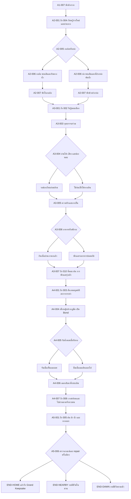

# แผนองก์ 2–5 และของขวัญที่รออยู่ปลายทาง

| Document control | Value |
|---|---|
| ID / version | JKB-S4-NARRATIVE-MAP / 1.0.0 |
| Date / task | 2026-10-16, Asia/Bangkok / Sprint 4 T8, Slice 4, intended PR #16 |
| Authority | คำสั่ง PO รอบ Slice 4 และ CR-0005 D2/D4/D5/D6; มอบหมาย Architect/Narrative Director ให้เขียนและเสนอรายละเอียดได้ทันที |
| Status | S5 implementation handoff; บทตัวอย่างและผลใหม่ที่ติด `draft` รอ human editorial/Game Design review ไม่ใช่ประกาศ Canon ใหม่ |
| Baseline | [Narrative Bible](../../phase-0/02-narrative-bible.md), [GDD](../../phase-0/01-game-design-document.md), [SSOT T8-AC-01..08](../../sprints/sprint-04-ssot.md#42-task-details-and-specifications), [Act 1 contract](../../design-system/act1-narrative-contract.md) |

Trace: NAR-ACT-001..011, NAR-THM-001..005, NAR-MOT-001..006, NAR-CON-001..010, NAR-CHR-001/005, NAR-VOI-001..004, NAR-DLG-001..005, NAR-TONE-001; GDD-DEC-A2/A3/A4/A5, GDD-BOND-001..006, GDD-CHO-007, GDD-BAL-001..009, GDD-END-001..006, GDD-SAFE-005; FR-CNT-001/002, FR-SAV-001/005/006/007; TC-S4-MAP-001/EMOTION-001/CALLBACK-001/FAIR-001/GIFT-001.

## 1. แกนเรื่องห้าองก์

บ้านเริ่มจากใครบางคนที่หยุดรอ เจ้ากบจำการรอนั้นด้วยร่างกาย ก่อนจะมีคำอธิบายให้มัน เมื่อผ่านน้ำแรงและพื้นแข็ง การหยุดจึงกลับมาเป็นวิธีดูแลตัวเอง กระทั่งพบคนอีกคนที่ยอมรอโดยไม่ปิดทางถอย

| Act / canonical anchors | สิ่งที่เกิด / สิ่งที่เปลี่ยน | จุดบรรจบและ checkpoint brief |
|---|---|---|
| 1 / A1-001..007 | แม่รอลูก พี่น้องผลัดกันเล่น พายุพาพลัดพราก เจ้ากบเลือกตั้งหลัก; ของที่พกหรือวางลงเก็บความทรงจำได้ | content 3 มี 28 โหนดในเจ็ดฉากเดิม; quiet-bank → rest-memory → rest; final acknowledgement จึง capture checkpoint |
| 2 / A2-001..007 | ร่างกายเปลี่ยน หางสั้น ขารับน้ำหนักทีละนิด; A2-004 อ่านทาง ก่อนเลือกกออ้อ/ท่อที่ A2-005 | checkpoint ก่อน route Decision; A2-006 พบวัสดุมนุษย์ครั้งแรกบนทั้งสองทาง; A2-007 พักก่อนเข้าเมือง |
| 3 / A3-001..010 | อ่านแรงสั่น ล้อรถ ฝีเท้า ความร้อน ความหิวและสิ่งที่ถูกทิ้ง; ตั้งหลักด้วยข้อมูลและการพัก | ความต่างของกออ้อ/ท่อจบหลัง A3-002 **ก่อนเริ่ม A3-003**; checkpoint ก่อน A3-004, หลังพัก A3-007 และก่อน recovery A3-009 |
| 4 / A4-001..008 | เห็นคนแบ่งพื้นที่ คนรีบ คนลำพัง ก่อนพบเด็กหญิงที่วางน้ำแล้วถอย; ระวังได้พร้อมเรียนรู้ความไว้ใจ | checkpoint ก่อน A4-004 และก่อน A4-008; เส้นรับทันที/รอ converge ที่ A4-006 แล้วเข้าสวนตามเวลาของตน |
| 5 / A5-001..006 และ A5-007 endpoints | เสียงฝนเดิมกลับมา แต่ครั้งนี้มีน้ำ ผ้าอุ่นและทางออกที่ตรวจได้; ยอมรับที่พักหรือพักใกล้ ๆ | checkpoint ก่อน A5-003 และ A5-005; A5-006 เสนอ repair ตามเกณฑ์เดิมครั้งเดียว แล้ว resolve สาม ending IDs เดิม |

กราฟแสดงเส้นเรื่อง ไม่ใช่ import permission หรือ runtime ที่ส่งมอบแล้ว เส้นเลือกต่างกันเรียก callback ได้ แต่ห้ามสะสม return stack หรือแตกเส้นเรื่องถาวรหลัง A3-003; S5 ตรวจทุก route จริงก่อนรับรอง reachability

## 2. องก์ 2: ขาใหม่และเส้นสีแดง

A2-001 ให้เวลาร่างกายเปลี่ยนโดยไม่เร่งเป็นบทเรียนชีววิทยา A2-002 เจ้ากบทดลองยกตัว วางขาลง แล้วพักเมื่อพื้นยังรับน้ำหนักไม่ถนัด ความจำของแม่กลับมาในจังหวะหยุด ไม่ใช่เสียงจากภายนอก A2-003 น้ำลดและกลิ่นโลหะเป็นเหตุให้ต้องหาที่ใหม่ A2-004 ผู้เล่นดูคราบน้ำและรอยนกก่อนตัดสินใจ

A2-006 บนทางกออ้อ เส้นแดงติดอยู่ที่กิ่งพ้นน้ำ; บนทางท่อ เส้นเดียวกันในบททางเลือกติดขอบวัสดุแห้งที่ปากท่อ เจ้ากบเข้าไปดูเฉพาะจุดที่มีทางถอย แสดงวัสดุมนุษย์ครั้งแรก ณ anchor นี้ทั้งสองเส้น จึงไม่มีเงื่อนไขว่าต้องเลือกท่อถึงจะพบ `draft.opportunity.a2.red-yarn` ให้ใช้ stable item ID **`item_red_yarn`** ใน S5; ห้ามนำไปแทนความหมายของ item_river_shell

บทตัวอย่าง: “เส้นแดงพาดอยู่เหนือคราบน้ำ เจ้ากบแตะด้วยปลายเท้า มันยุบลงแล้วคืนตัว ต่างจากราก ต่างจากหิน มันหยุดดูอยู่นานก่อนลองแตะอีกครั้ง” เจ้ากบยังไม่รู้ชื่อไหมพรม ผู้บรรยายไม่เล่าว่าใครทำหล่นหรือมีเจตนาอะไร

มีทางเก็บ/ปฏิเสธ และเมื่อเต็มให้เลือกสละหนึ่งชิ้นหรือปล่อยเส้นแดงไว้ ยกเลิกการยืนยันได้ ไม่ได้รับ HP/พลังใจ/Bond จากธุรกรรมนี้ ไม่บังคับเก็บเพื่อรับผ้าหรือหัวใจในตอนจบ A2-007 มีที่หลบพักเหมือนกันทั้งสองทาง

## 3. เมือง: ให้เวลาร่างเล็กตั้งหลักระหว่างภัย

แต่ละแถวมีอย่างน้อยช่วงรับรู้ 2 จังหวะ และช่วงผล/พัก 2 จังหวะตามที่บทต้องการ ผู้เล่นอ่านเอง ไม่มี timer; ไม่วางล้อ ความร้อนและฝีเท้าติดเป็นภาพความเจ็บรัว ๆ ข้อความยังให้ข้อมูลเมื่อปิดเสียง/ลดภาพเคลื่อนไหว

| Anchor / cue | Choice → accepted cause | ร่างกาย/ใจและการลงมือของเจ้ากบ | พัก/โลกที่สังเกตได้ |
|---|---|---|---|
| A3-002 ก่อนถนน | เงากว้าง แรงสั่นและฝุ่นมาก่อนล้อ; ดูช่องหลบ/รอบสัญญาณ ไม่มี damage จากการมอง | เจ้ากบแนบตัวต่ำ รอให้พื้นนิ่งแล้วลองขยับเพียงนิด | อยู่หลังขอบปูนจนหายใจสม่ำเสมอ ก่อน A3-003 |
| A3-004 ล้อและฝีเท้า | ข้ามหลังอ่านจังหวะ: HP−5/พลังใจ−5 จากระยะที่ต้องใช้แรงและลมใกล้ล้อ; หรือท่อ HP−10/พลังใจ+5 จากทางขรุขระที่ยาวกว่าและพ้นเสียงรถ | เมื่อผลผ่าน transaction จึงเล่าอาการล้า/สะดุ้ง; ไม่มีชนหรือแผลเปิด เจ้ากบหยุดตรวจช่องว่างครั้งถัดไปได้ | A3-005 เงาริมทางก่อนชวนมองแสงอาหาร; คนคนหนึ่งเบี่ยงล้อรถเข็นพ้นสิ่งกีดขวาง เป็นสิ่งที่เห็น ไม่ยืนยันว่าตั้งใจช่วยกบ |
| A3-005 พื้นร้อน | ขาหน้าแตะแล้วชักกลับเป็น cue ให้ตรวจเงา; **ไม่มีค่าลบเพิ่ม** จากการอ่านข้อความ ความล้าที่มีมาจากทางเลือกข้าม | ถ้า HP ต่ำ วางน้ำหนักสั้นลง; ถ้าสูง ขยับได้มั่นคงแล้วเลือกหลบแดด; ไม่บรรยายแผลที่ไม่เคยเกิด | ซอกเย็น/หยดน้ำที่เข้าถึงได้ทุกกระเป๋า; ให้พักก่อน A3-006 |
| A3-006 ความหิวและแสง | ตรวจเงานกแล้วกิน HP+15/พลังใจ−5; พักรอเมื่อ HP>20 ให้ HP+5/พลังใจ+10 ตาม baseline | ความหิวคลายแต่ยังเหลียวดูเงา หรือหยุดใช้แรงจนหาง/ขาคลาย; ไม่ชมการเสี่ยงว่าเก่งกว่า | ทาง low-HP ที่เลือกพักรอเดิมไม่ได้ต้องมี recovery เข้าซอกที่ A3-005 ก่อน ห้ามลบ guard HP>20 เงียบ ๆ |
| A3-007 กองสิ่งที่ถูกทิ้ง | ถ้วยตะแคง ซองสะท้อนแสงและขอบคม; สำรวจจากด้านเรียบ/ถอยเข้าที่หลบ ไม่มี damage-on-view | เจ้ากบไม่ต้องพิสูจน์ความกล้าโดยเข้าไปในขยะ; สิ่งของเป็นสเกลเมือง ไม่สรุปว่ามนุษย์ทุกคนใจร้าย | ใต้ถ้วยที่มั่นคงเป็นเงาแห้งพอพัก; ได้ shelter flag ตามเส้นที่อ่านข้อมูลแล้ว ก่อน checkpoint |
| A3-008 ถึง 009 ฝนและแรงเครื่องจักร | เกิดภายในที่กำบัง ไม่เพิ่มค่าลบเพื่อเรียกน้ำตา; หยุดฟังจังหวะ/มองช่องสว่าง เปิด recovery ปกติ | ใจต่ำ: รับรู้เสียงถี่ ต้องค่อยแยกหนึ่งเสียง; ใจสูง: ยังจำพายุแต่รู้ว่าราก/ผนังข้างนี้นิ่งอยู่; เจ้ากบเลือกหายใจ/พักเอง | A3-009 พักจริงแล้วจึงฟื้น; ของใช้เป็นสิ่งช่วยมอง/จำ ไม่ใช่ยาหรือกุญแจ recovery |
| A3-010 และ A4-001 ถึง 003 | เช้าเผยคนแบ่งร่ม เว้นปลายม้านั่ง อีกคนรีบผ่าน คนลำพังวางเศษขนมพ้นทางเท้า; สังเกต ไม่บังคับเข้าใกล้ | หลังแต่ละภาพให้เจ้ากบชะงัก มองซ้ำ แล้วเลือกขยับ; คนกินคนเดียวไม่ได้ถูกตีตราว่าไม่มีใครรัก | พักในเงาที่ไม่ถูกฝีเท้าตัดก่อน A4-004; ความเมตตาของคนประกอบฉากไม่แอบเปิด Bond หรือเผยเด็กหญิง |

## 4. ตารางผลและการฟื้นตัวสำหรับ S5

ค่าทั้งหมดเป็นจำนวนเต็มใน transaction ที่ยอมรับแล้ว การอ่าน เปิดกระเป๋า หยิบดู/ระลึกถึง และเปลี่ยน accessibility ไม่เพิ่ม/ลด meter ข้อความ HUD แสดงผลจริงที่ clamp แล้ว; prose อ่านจาก snapshot และเหตุที่เกิดจริง ห้ามอ้างอาการบาดเจ็บจาก HP ต่ำเพียงค่าเดียว

| Source / guard | HP / พลังใจ / Bond | ความจริงที่ใช้เขียนบท |
|---|---|---|
| GDD-DEC-A2-001-A, สังเกตคราบน้ำ | −5 / +5 / 0 | ทางกออ้อต้องใช้แรง แต่เสียงคุ้นเคยช่วยตั้งหลัก |
| GDD-DEC-A2-001-B, ตรวจระดับน้ำ | −10 / −5 / 0 | ท่อใช้แรงและเสียงสะท้อน ไม่ใช่โทษฐานเลือกผิด |
| GDD-DEC-A3-001-A/B | −5/−5/0 หรือ −10/+5/0 | cue/พักตาม §3; ไม่เพิ่มค่าลบเมื่อเล่าฝีเท้า/ความร้อน |
| GDD-DEC-A3-002-A/B | +15/−5/0 หรือ +5/+10/0 | รักษา guard ตรวจเงานก / HP>20; ไม่เปิดทางพักเดิมด้วยการข้าม guard |
| `draft.recovery.a3.cool-edge`, ก่อน A3-006 เมื่อ HP<30 หรือใจ<30 และยัง>0 | +10 / +10 / 0, ครั้งเดียว | เสนอพัก/น้ำในซอกที่เห็นได้โดยไม่ต้องมีของ; เก็บผลครั้งเดียวด้วย registered event ใน S5 ไม่มี farming |
| `draft.recovery.a3.listen-rest`, A3-009 เมื่ออยู่ใน shelter และ meter>0 | +10 / +10 / 0, ครั้งเดียว | ช่วงพักจริง ไม่ใช่การกดดูวัตถุ; เวอร์ชันค่าสูงใช้ผล clamp และไม่แสร้งมีแผล |
| GDD-DEC-A4-001-A/B | 0/+10/+15 หรือ 0/+5/+5 | สังเกตน้ำแล้วถอย / ระวังจากที่ซ่อน |
| GDD-DEC-A4-002-A/B | +10/+5/+20 หรือ +10/0/+10 | ดื่มตอนนี้ / ดื่มเมื่อเธอออกไป ได้ดูแลร่างกายเท่ากัน |
| GDD-CHO-007, cautious ที่ A4-006 | 0/0/+10 และ compassion=true | ความสม่ำเสมอที่สังเกตแล้ว ไม่ใช่รางวัลจากความทรมาน |
| GDD-DEC-A4-003-A/B | +5/0/+10 หรือ 0/+5/+10 | ตามไปช้า ๆ / ดูอีกคืนแล้วตาม |
| GDD-DEC-A5-001-A/B | 0/+5/+15 หรือ 0/+10/+15 | เสียงตอบ / physical leaf-sharing; shared leaf ต้อง held ด้วย ไม่ใช่อาศัย historical flag ลำพัง |
| GDD-DEC-A5-002-A/B | +10/+10/+20 หรือ +5/+10/+10 | ยอมรับผ้าเมื่อ Bond≥50 / พักใต้กระถาง; repair เสนอ safe-help เดิมครั้งเดียว |

ผล `draft` เป็นข้อเสนอที่ใช้ตรวจ balance ก่อน S5 content acceptance ไม่ใช่แก้ GDD อย่างเงียบ ๆ S5 ต้องลงทะเบียน event/guard/checkpoint และพิสูจน์ด้วย graph search: จาก checkpoint ทุกจุดมีทาง HP/ใจ>0; ต่ำกว่า30 ได้โอกาสฟื้นไม่เกินสอง main Decisions รวม route เดิมที่พักรอ HP>20 ไม่ผ่าน; unavoidable loss≤15 ต่อ meter ระหว่าง checkpoint; มีพักหลังฉากแรงภายในประมาณห้านาทีและ checkpoint อย่างน้อยทุก8–15นาทีของเนื้อหา

หากผลถึง0: ปกติใช้ GameOver ที่ไม่ยืนยันความตายและ Retry; Story Assist clamp ที่1 แล้วเข้าพักฟื้นตาม GDD-BAL-008 โดยใช้ Bond/flags เดิม ไม่คิดว่าการเปิดโหมดคือ story event และไม่ลดคุณค่าบทจบ

| Expression | หลักฐาน / ตัวอย่างภาษาที่เหมาะ |
|---|---|
| HP70–100 | “เจ้ากบลองวางขาลงอีกครั้ง คราวนี้รับน้ำหนักได้มั่นคงพอจะขยับเข้าเงา” ไม่ใช้ภาษาร่อแร่ |
| HP30–69 | “ขาเล็กหยุดพักบ่อยขึ้น เจ้ากบเลือกซอกเย็นก่อนดูทางต่อ” ไม่สมมุติแผล |
| HP1–29 | “เจ้ากบวางตัวต่ำลง พื้นเย็นอยู่ข้างหน้าอีกนิด มันค่อย ๆ ขยับเข้าไปแล้วหยุด” พร้อม recovery ที่เห็นได้ |
| พลังใจ70–100 / 30–69 | รับรู้เสียงแล้วรอ / สะดุ้งแต่ค่อยแยกจังหวะ ไม่เล่าว่าหายกลัวตลอดไป |
| พลังใจ1–29 | “เสียงมาถึงพร้อมกัน เจ้ากบหยุดเลือกเสียงหนึ่งที่อยู่ใกล้ แล้วฟังจนหยดถัดไปตามมา” ไม่ใช้ diagnosis/คำว่าอ่อนแอ |
| default / Story Assist | เมื่อไม่มี strain event ใช้ความล้าหรือการสังเกตพื้นปัจจุบัน; โหมดช่วยไม่ทำให้มีแผลย้อนหลัง และเข้าถึง recovery/Canon/หัวใจได้เหมือนกัน |

## 5. ของห้าชิ้นเดิม และของธรรมชาติชิ้นที่หกในทะเบียนรวม

Act 1 มีห้าชิ้นตาม contract; T8 ต้องส่งต่อ **leaf/dew/lotus/rain/red yarn** ครบด้วย และไม่ลืม river shell ที่เพิ่มเพื่อสอนความจุ ดังนั้น S5 registry รวม **หก item IDs** แต่ held ได้เพียงสี่เสมอ ไม่ใช่หกช่อง

| Object / anchor | Held: การกระทำที่เห็น | Acquired แล้ว released: ความทรงจำ | Refused / never acquired: default ที่สมบูรณ์ |
|---|---|---|---|
| item_leaf / A3-009, A4-007 | ประคองขอบใบใกล้ตัวแล้วมองแสงทะลุเส้นใบ | มองวงน้ำแล้วนึกถึงตอนค่อยวางใบลง แม่ที่รออยู่ยังจำได้ | ถ้าเคยเห็นแต่ไม่เก็บ นึกถึงสีที่ปล่อยผ่าน; ถ้าไม่เคยพบ ใช้แม่รอลูก/รากที่น้ำนิ่ง ไม่มีใบในภาพ |
| item_dew_stone / A3-005, 008 | ใช้ปลายเท้าพลิกหินในเงา ดูจุดแสง; ไม่มีฤทธิ์รักษา | จุดแสงบนหยดน้ำพาให้นึกถึงการหยุดรอดูด้วยกัน | แสงบนพื้นเปียกที่มีจริงพอให้หยุดมอง ไม่แต่งว่าเคยสัมผัสหิน |
| item_lotus_shell / A3-009 | แตะเปลือกให้เกิดระลอกเล็ก ๆ แล้วหยุดรอจังหวะถัดไป มีข้อความแทนเสียง | ฟังหยดน้ำในจังหวะที่เคยผลัดกันเล่น ไม่เกิดเสียงเปลือกจากกระเป๋าว่าง | นึกถึงหางพี่น้องที่ว่ายกลับมารับหรือหยดน้ำปัจจุบัน โดยไม่อ้างประสบการณ์เล่นเปลือกที่ไม่เกิด |
| item_rain_petal / A3-007, A4-007 | มองกลีบที่พับแห้งลงแล้วอย่างสมจริง หยุดแตะกลิ่นที่จาง | จำหยดฝนข้างรากกับตอนวางกลีบลง ไม่อ้างว่ากลิ่นยังลอยจากตัว | ฝนที่กระทบชายคาปัจจุบันมีช่วงเงียบให้พักได้ ไม่ต้องเคยได้กลีบ |
| item_red_yarn / A3-007, 009, A4-005 | วางเส้นนุ่มข้างขาแล้วแตะดู ก่อนสังเกตผ้าที่ถูกวางไว้ห่าง ๆ | ถ้าเคยเก็บ จำผิวที่คืนตัว; ถ้าเคยเพียงมอง อ้างเพียงสิ่งที่มองเห็น | ผ้าที่วางใหม่ให้ข้อมูลเรื่องความนุ่มเหมือนกัน การไม่เคยพบเส้นแดงไม่ปิด trust/Grand Keepsake |
| item_river_shell / A3-007, A4-007 | พลิกรอยโค้งช้า ๆ ข้างที่กำบัง | จำโคลนนุ่มที่วางเปลือกลงใน Act1 ไม่สร้าง prop จากความจำ | รอยวงฝนบนพื้นเป็นสิ่งให้มองได้เท่ากัน ไม่อ้างว่าเคยส่งต่อสิ่งที่ไม่เคยเก็บ |

เลือกเพียงหนึ่ง nuance ต่อช่องด้วย priority ที่ review แล้วและ stable ID เป็นตัวตัดสินเสมอ ไม่ต่อบทรายการทุกชิ้นจนกลายเป็นรางวัลสะสม Held/released/refused/unseen เป็นข้อเท็จจริงแยกกัน การไม่อยู่ใน held อย่างเดียวไม่ได้แปลว่าเคยสละ

## 6. Optional Moments ในแผน S5

ชื่อ `draft.moment.*` เป็น design identifiers ไม่ใช่ production IDs ที่ปลดล็อกแล้ว ทุกช่วง2–4จังหวะ ตั้งเป้า30–90วินาทีตามจังหวะอ่าน ไม่มีเวลา/คะแนน/HP/Bond reward และปิดท้ายด้วยปุ่มเดินเรื่องตามปกติ

| Brief | Eligibility / content | Fixed return / checkpoint / default |
|---|---|---|
| draft.moment.a2.soft-thread | หลังพบเส้นแดงที่ A2-006; held แตะเส้นจริง, refused/absent มองพื้นผิวที่พบเท่านั้น; ไม่มีการรับผ้าใหม่ก่อนเวลา | เข้า A2-007 ของ route ปัจจุบัน จากนั้น A3-001..002 → จุดร่วม A3-003; ไม่ย้อนข้าม route Decision |
| draft.moment.a3.small-rhythm | อยู่ใน shelter A3-009 หลัง offered recovery; shell/remembered/family rhythm variants | กลับ A3-010; skip ได้ตรงไปเช้า ไม่ซ่อน recovery ในฉากลับ |
| draft.moment.a4.room-to-wait | หลัง safe repeated gesture A4-007; วัตถุ/ความจำ/ช่องประตูให้สังเกต | กลับ A4-008 ก่อน checkpoint/Decision; ไม่แอบรับ safe help แทนผู้เล่น |

S5 ใช้ explicit fixed cursor และ acknowledged completion เช่น Act1 เมื่อ capability รองรับ; checkpoint ต้องบันทึก pouch/memory/completion แยกจากข้อมูล UI; Retry คืนข้อเท็จจริงของ checkpoint และ settings ล่าสุด Log เก่าที่อ่านได้ไม่ปลดล็อกฉาก/ของหลัง Retry Notice animal peril อยู่ที่ cue ของ A3-004/006/008 ผ่าน advisory/settings เดิม ไม่มี warning แทรกกลางบทหรือ blocking modal ทุกครั้ง

## 7. เด็กหญิง: ความช่วยเหลือที่มีทางถอย

การปรากฏชัดครั้งแรกคือ **A4-004** ไม่มีชื่อ อายุประวัติ ความสัมพันธ์กับผู้สร้าง คำอธิบายว่าเป็นผู้รับของขวัญ หรือความคิดส่วนตัวที่ผู้บรรยายรู้เอง A4-001..003 เป็นคนประกอบฉากที่ไม่ได้บอกว่าเธออยู่ในภาพ

A4-004 เธอวางน้ำในที่มองเห็น ถอยจนเงาพ้นภาชนะ แล้วรอ A4-005 กลับมาระยะเดิม ปากทางไปที่ซ่อนยังเปิด A4-006 ให้หลักฐานซ้ำแก่คนที่รอ A5-003/005 วางผ้าอุ่นบนพื้นที่ปลอดภัยแล้วถอย ไม่ปิดประตู/ล้อม/ยกตัวเจ้ากบ ไม่คาดคั้นคำตอบ ไม่เอาน้ำแลกการเข้าใกล้

บทตัวอย่าง: “เด็กหญิงวางถ้วยตื้นลง เธอขยับถอยจนแสงแตะน้ำ ทางกลับใต้กระถางยังว่าง เจ้ากบมองถ้วย แล้วมองช่องเดิมอีกครั้ง” หากต้องใช้คำพูด ให้เพียง “วางไว้ตรงนี้นะ” หรือ “รอได้” ในจังหวะที่การกระทำรองรับ ห้ามบทพูดช่วยชีวิตยาว ๆ เจ้ากบเข้าใจน้ำเสียง/การกระทำ ไม่เข้าใจภาษาอย่างฉับพลัน

## 8. Ending resolver และตารางความเป็นธรรม

ชื่อเชิงอารมณ์ Reflective/Solitary/Home ของคำสั่งนี้อ้างถึง **END-NEARBY / END-DAWN / END-HOME** เดิม ไม่สร้าง ending ที่4 END-NEARBY และ END-DAWN ยังเป็น reflective non-canon ตาม baseline และได้รับบทที่มีที่พัก/ความหวังครบถ้วน

ขั้นแรกตรวจ crisis: HP=0 หรือพลังใจ=0 ไป GameOver/Story Assist recovery ก่อน ending ต่อมาที่ A5-006 ถ้า compassion=true, HP/ใจ>0, Bond≥50 และยังไม่ accepted_safe_help ให้ repair หนึ่งครั้งตาม GDD-END-006 ใช้ safe-help transaction เดิม (+20 Bond; HP/ใจ+10) เมื่อยอมรับ แล้วตรวจเรียง HOME → NEARBY → DAWN ไม่มี item/secret/strain/accessibility predicate

| HP / ใจ | Bond | compassion | safe help | repair action | Expected result |
|---|---:|---|---|---|---|
| >0 / >0 | 60, 79, 80, 100 | true | true | ไม่ต้อง | END-HOME ทุกค่า ไม่มี tier ของของขวัญ |
| >0 / >0 | 59 | true | true | ไม่ต้อง | END-NEARBY |
| >0 / >0 | 50 | true | false | รับผ้า +20 Bond | END-HOME ที่70 |
| >0 / >0 | 50 หรือ60 | true | false | ปฏิเสธ repair | END-NEARBY; ยังมีที่พักในสวน |
| >0 / >0 | 49 | true | false | ยังไม่เข้า guard | END-NEARBY |
| >0 / >0 | 60 | false | true | ไม่เข้า guard | END-NEARBY; ไม่เดา compassion |
| >0 / >0 | 30 | false | false | ไม่เข้า guard | END-NEARBY |
| >0 / >0 | 29 หรือ0 | false | false | ไม่เข้า guard | END-DAWN |
| 0 / >0 หรือ >0 / 0 | ค่าใด | ค่าใด | ค่าใด | crisis ก่อน | GameOver; Assist clamp1 → recovery ไม่ข้ามไป ending ทันที |

ขยายทุกแถวที่เป็น ending เป็น held/released/refused/never-acquired/empty ทั้งหกวัตถุ และ secret none/all, strain none/accepted, Assist on/off, muted/reduced motion: **ending ID ต้องเหมือนเดิมเมื่อ accepted metrics/trust flags เท่ากัน** fixture และ design-reference tests ของ Slice4 ตรวจตารางนี้ ไม่อ้างว่า S5 production resolver ถูกสร้างแล้ว

เส้น cautious+wait: A4-004 B +5 → A4-005 B +10 → A4-006 cautious compensation +10 → A4-008 B +10 =35; เสียงตอบ A5-003 A +15 =50; รับผ้า A5-005 A +20 =70 HOME โดยไม่ต้องถือใบ ไม่ต้องทุกตัวเลือก Bond สูง และไม่เสี่ยง HP เพิ่ม เส้น accept-now:15+20+10=45 → เสียงตอบ15=60 → รับผ้า20=80 HOME ส่วนพักใกล้ก่อน: cautious35+เสียง15+nearby10=60 แล้ว repairรับผ้า20=80 HOME มี budget เพิ่ม≥20หลังปฏิเสธ ไม่สัญญาว่าปฏิเสธความช่วยเหลือทุกครั้งแล้วจะได้ HOME โดยข้าม consent

Physical leaf-sharing A5-003 ต้อง `keepsake.lily_fragment=true AND held(item_leaf)` และผลเดิมเท่านั้น; released/refused/empty ใช้เสียงตอบเมื่อBond≥30 และ route ตรวจระยะเดิม ไม่ล้าง flag เก่า ไม่แสดงใบที่หายไป S5 ต้องทดสอบอีกครั้งว่าบทให้ข้อมูล guard และ repair ชัดโดยไม่บอกตัวเลขตอนจบ

## 9. END-HOME: จากวันที่ตัวเล็กที่สุดสู่ของขวัญที่กอดได้

HOME เท่านั้น หลังยอมรับความช่วยเหลืออย่างปลอดภัยและผ่าน resolver จึงเปลี่ยนภาพเชิงสัญลักษณ์ เจ้ากบใน Act1–4 เป็นสัตว์มีชีวิต ช่วง Childhood Crochet เป็นรูปความทรงจำย้อนหลัง ไม่ใช่เฉลยว่าเดินทางด้วยร่างตุ๊กตามาตลอด ไม่มีภาพตาย หมดสติ กักขัง ผ่าตัด หรือเย็บบาดแผลจริง

| Beat | บทตัวอย่างสำหรับ editorial review / สิ่งที่ภาพทำ |
|---|---|
| HOME-1 consent | “เจ้ากบวางตัวลงบนผ้าที่เลือกเอง ทางกลับสวนยังอยู่ตรงนั้น เด็กหญิงถอยไปพ้นขอบผ้าแล้วนั่งรอ” กล้องไม่ปิดทางออกก่อนตัดภาพ |
| HOME-2 childhood | “แสงใต้ใบบัวกลับมาเป็นรอยถักเล็ก ๆ ตัวที่เล็กที่สุดยังมีที่อยู่ข้างเงาของแม่ และยังมีพี่น้องที่วกมารับ” เผย Childhood Crochet เป็นรูปแทนความจำทีละส่วน |
| HOME-3 safe default | “วันที่เคยหยุดฟังน้ำอยู่ข้างรากค่อย ๆ อยู่ในเส้นเย็บ ความเหนื่อยมีที่พักแล้ว โดยไม่ต้องลืมทางที่ผ่าน” ใช้ได้กับทุกกระเป๋าและ Assist ไม่มีแผลที่เดาขึ้น |
| HOME-3 strain variant | เฉพาะมี authored strain event ที่ review แล้ว: “ขาที่เคยต้องหยุดบนพื้นร้อนได้พัก ความกลัวในคืนนั้นอยู่ในเรื่องที่เล่าจบแล้ว ไม่ต้องเริ่มเจ็บใหม่เพื่อจำมัน” ไม่มี suffering score หรือของขวัญพิเศษ |
| HOME-4 adult | “สีเขียวนุ่มรับแสงบนกำมะหยี่ เสื้อสีฟ้ามีหัวใจแดงดวงเล็กปักอยู่ตรงอก เจ้ากบพักอยู่ใกล้ลมหายใจที่ไม่เร่งให้มันไปไหน” Adult Velour Plush สืบต่อ childhood โดยยังคงรากเดิม |
| HOME-5 mother and care | “แม่ที่เคยรอข้างก้านบัวยังอยู่ในความจำ ส่วนตรงนี้มีผ้าอุ่นและคนที่ยอมรอให้เจ้ากบเลือกเอง” ไม่แทนที่แม่ ไม่เปิดเผยชะตาครอบครัว |
| HOME-6 real gift | “เมื่อหน้าสุดท้ายเงียบลง เจ้ากบตัวนุ่มยังมีที่ให้กอด หัวใจแดงดวงเล็กอยู่ใกล้มือ และเช้าของบึงเก่ายังอยู่ด้วยกันตรงนี้” เป็นถ้อยคำเชื่อมของขวัญจริง ไม่อ้างตรวจจับกอด ไม่ขอชื่อ/ภาพ/ข้อมูล |

Held ใบอาจวางข้างผ้าเฉพาะมีจริง; released ใช้วงน้ำ/ความจำ; empty ใช้จังหวะครอบครัว บทหลัก ความยาวโดยประมาณ หัวใจแดง และระดับการเข้าถึงของขวัญเท่ากัน เงื่อนไขย่อหน้าแต่ละแบบไม่แตะ resolver หรือสร้าง HOME ที่ดีกว่าอีก HOME

END-NEARBY: เจ้ากบมีชีวิตพักในสวน เด็กหญิงวางน้ำในระยะเดิม และมี replay จาก Act5 END-DAWN: เจ้ากบมีชีวิตในซอกปลอดภัย แสงเช้าพอให้มองทาง และมี replay จาก Act4 ไม่มีตุ๊กตา/3Dในสองฉากนี้ ไม่มีคำตำหนิผู้เล่น

## 10. Art-gap manifest และ acceptance ของ Sprint 5

ตรวจภาพ [adult front render](../3d-keepsake-spike/renders/front.png) จริงในรอบนี้: **เสื้อผู้ใหญ่ปัจจุบันเป็นสีฟ้าเรียบ ยังไม่มีลายปักหัวใจสีแดง** หัวใจ accessory ของ childhood เป็นคนละชิ้น ไม่ใช่หลักฐานว่าเสื้อ adult ปักแล้ว ไฟล์ spike เดิมทั้งหมดคงเดิมใน S4

| Gap / owner | S5 deliverable และหลักฐานที่ต้องมี |
|---|---|
| adult red heart / Art | ลายหัวใจ original ขนาดเล็กบนอกเสื้อสีฟ้า เส้นด้ายสีแดงอ่านได้ทั้ง poster และ fallback; ทดลองตำแหน่ง/scaleตามทรงเสื้อ เลี่ยงลอยเหนือผ้า/ทะลุ/เป็นแผล; PO/Art ยืนยันก่อน export |
| mesh/material/thread / Art + Architect | แยกแก้ได้ใน source เดิม ใช้ geometry/material หรือ bake ที่เหมาะกับงบจริง รักษาความนุ่มของกำมะหยี่และลำดับสี; ไม่แทน childhood accessory ด้วยการ rename |
| export/integrity / QA | GLB self-contained, ชื่อส่วน stable, ตรวจ normals/UV/tangents/bounds/triangles/textures; export ใหม่พร้อม SHA-256/bytes/provenance/เครื่องมือและ config ที่ทำซ้ำได้ |
| rights / PO + Art | ยืนยันสิทธิ์ original model/texture/heart และ likeness ตามกระบวนการ; ภาพส่วนตัวใน docs/references ห้ามเข้า artifact |
| reveal/runtime / Architect + UI | poster-first, deliberate opt-in หลัง HOME เท่านั้น; ข้อความไทยและรูป2Dแทนเมื่อ3D/อุปกรณ์ไม่พร้อม; ไม่มี auto-spin/flash และลด motion ได้ |
| dependency/device / Architect + QA | production RFC/ADR ก่อนเลือก viewer; ทดสอบ same-origin request, disposal/GPU/memory/root+subpath/touch/keyboard/AT จริง และตั้ง budgets จากตัวที่ export แล้ว; ไม่อ้าง spike เป็นใบรับรอง production |

ไม่เพิ่ม GLB/vendor/import/preload ให้ S4 และไม่อ้างว่าของขวัญ3Dพร้อมแล้ว

## 11. ขอบเขตส่งต่อและเกณฑ์ตรวจรับ

Slice4 ส่งบท Act1 ที่รันได้ กราฟ/สัญญา schema2/Save2, archive2.1 และแผนนี้ Slice5 T9 ส่ง art/Intent catalog, T10 รวม candidate และนโยบาย cursor ที่ review แล้ว, T11 ปิด gate/Thai/PO/device/AT โดยคง exactly five PRs Sprint5 จึงสร้าง Act2–5/endings และของขวัญตามแผนที่ยอมรับ

| Gate | หลักฐานใน S4 / งานที่ยังต้องทำใน S5 |
|---|---|
| TC-S4-MAP-001 | ห้าองก์และจุดร่วมก่อน A3-003, anchors/secret/default/checkpoint ตาม §§1–6; S5 ยังต้อง materialize graph/media/cursors |
| TC-S4-EMOTION-001 | cue→ผลจริง→กาย/ใจ→พัก และ high/low/default/Assist ใน §§3–5; S5 ยังต้องเล่นทุกผลจริงและจับเวลา pacing |
| TC-S4-CALLBACK-001 | หกชิ้นรวม fifth offering, held/released/refused/unseen แยกจริง; physical leaf guard ใน §§5/8; S5 schema/runtime/art ต้องใช้ guard เดียวกัน |
| TC-S4-FAIR-001 | ตาราง/เส้น cautious และ reference cases เทียบ item-independent resolver ใน §8; ไม่ใช่ E2E later acts |
| TC-S4-GIFT-001 | consent→memory crochet→adult blue/red-heart/default และ art gap ที่ตรวจจริงใน §§9–10; final prose/art/device ยังรอเจ้าของตรวจ |

Rollback เอกสารเป็น reviewed revert ของแผนเท่านั้น ไม่เปลี่ยนเซฟ/asset เก่า S5 ต้องรักษา Save2/backup/downgrade guards และอธิบาย compatible continuation เมื่อ cursor ไม่เทียบเท่า ห้ามกู้ด้วยการล้างกระเป๋าหรือข้ามเหตุการณ์ที่ยังไม่ได้เล่น
