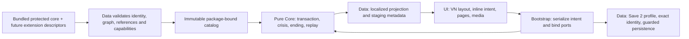

# Sprint 5 Execution SSOT: เจ้ากบมีชีวิตและการเดินทางกลับสู่ความอบอุ่น

| Document control | Value |
|---|---|
| Sprint / ID | `SPRINT-05` / `JKB-SPRINT-05-SSOT` |
| Version / date | **0.2.0 / 2026-10-18, Asia/Bangkok** |
| Status | **ADR-P0-022 direction adopted; ready to begin Slice 1 contracts/design work; implementation 0/20 tasks, 0/4 execution PRs** |
| Authority | Current PO directive and [Accepted ADR-P0-022](../adr/ADR-P0-022-visual-novel-ergonomics-living-keepsake-lore-and-sprint-streamlining.md), D1–D6 and Save Format 2 consequence |
| Baseline | Runtime `develop@d1af293`; planning revision starts at `c99e745`; Sprint 4 PR #17 integrated at `4c0bd28` |
| Branch / planning PR | `feat/sprint-05-planning-ssot`; [Draft PR #18](https://github.com/T3thr/JaoKob/pull/18) → `develop`; contributor `T3thr <t.theerapat33@gmail.com>` |
| Related documents | [Assessment](../proposals/sprint-05-planning/01-readiness-assessment.md), [remediation contract](../proposals/sprint-05-planning/02-adr022-remediation-contract.md), [CR-0006](../rfc/CR-0006-sprint-05-complete-story-and-package-boundaries.md), [trace matrix](../traceability/sprint-05-execution-matrix.md) |
| Evidence | [Original baseline](../proposals/sprint-05-planning/evidence/planning-verification.json), [ADR22 revision checks](../proposals/sprint-05-planning/evidence/adr022-replanning-verification.json) |

ADR22 supersedes the conflicting biological-body, UI confirmation/save-dot and ten-PR/Save-3 directions of the earlier plan. Its decisions are already authorized; no renewed approval of them is a prerequisite to begin Slice 1. The detailed technical contracts, authored scripts and evidence are work products and merge gates inside the four slices. This session revises the blueprint only.

## 1. Outcome, scope and authority

ส่งมอบ Visual Novel ภาษาไทยที่เจ้ากบเป็นตุ๊กตามีชีวิตตั้งแต่ต้น ผู้เล่นรู้จักร่างถักวัยเด็ก ผูกพันกับครอบครัว เห็นเขาเติบโตเป็นร่างกำมะหยี่สวมเสื้อฟ้าสูงประมาณ 45 ซม. **ก่อนพายุ** แล้วเดินทางผ่านโลกมนุษย์จนถึงสามฉากจบที่มีคุณค่าเท่าเทียมกัน อินเทอร์เฟซต้องอ่านสบายและแสดงเจตนาการกระทำชัดเจน ผ่านการอ่านและใช้งานจริงโดยมนุษย์

| มิติ | Deliverable | Acceptance |
|---|---|---|
| Lore / narrative | Act 1 ใหม่และ Act 2–5 ตามตุ๊กตามีชีวิต, ภาษาไทยเป็นธรรมชาติ, physical scale และ closure | ไม่มีบท/ภาพลูกอ๊อดใน default ใหม่; ร่างโตปรากฏก่อนพายุ; human continuity/Thai review |
| VN design | New tokens/layout/components, ambient meters แยก tools, spacious utilities, silent success, inline choices | ทุก control ใช้ได้จริง; targets ≥44×44 px; ไม่มี choice scrollbar/save success artifact/narrative-choice popup |
| Cinematic media | Growth/storm/city/girl/ending boards, full-screen illustrated beats และ complete text fallback | ปิดเสียง ลด motion หรือภาพเสียยังอ่านและเลือกได้; media ไม่ขยับ state เอง |
| Runtime / Save | Five-act capability, crisis/Assist/ending/replay, **Save Format 2** และ exact legacy continuation | strict profile/identity admission, actual chapter snapshots, raw-record protection and rollback |
| Keepsake / devices | Adult embroidered heart, childhood/adult 3D after HOME, safe fallback | art approval, bounded lifecycle, physical iOS/Android and AT acceptance |
| Sprint 6 seam | Reserved immutable default core package, namespace/session/media identity | future extensions cannot overwrite/delete/shadow core; no Editor implemented in S5 |

Non-goals: Web Story Editor, Story Slots UI/import/storage, new endings, Save Format 3, backend/login/monetization/telemetry, invented personal biography or new magical powers. Deployment remains a separately authorized operation. The full-release requirement audit, including remaining cutscene/settings controls and duration, stays in T0/T5/T18; no silent waiver.

### 1.1 Precedence and current facts

[Remediation contract §1](../proposals/sprint-05-planning/02-adr022-remediation-contract.md#1-authority-evidence-and-precedence) maps each override. ADR19/20/21 still govern unaffected boundaries, four-slot pouch, safe prose, respectful relationship and ending fairness. ADR22 replaces biological morphology and the requirement to depict a natural frog as a different being from the keepsake. Historical ADRs, released content and evidence keep their original bytes; T0 updates forward-facing baseline text.

- The existing game is still the S4 Act 1: content 3.0.0, package/tree schema 2, Save 2; 28 nodes / 47 edges / 70 dialogue records / 5 items / 3 moments. No revised visual/lore acceptance is claimed.
- `prepareRuntimeContent` admits one tree, ≤256 nodes, `act === 1` and three node types. Orchestration rejects crisis, requires saved Bond 0 and no unlocked endings. Bootstrap has no full-game Retry/Ending/Replay flow; Story Assist is not exposed in Settings.
- Session/media identity is contentVersion-based. Pouch policy has Act 1 bindings. Later-life art cannot depend only on the speaking character. The presentation catalog has a 64,000-byte bound; final graph/media costs need measurement.
- Existing Save 2 schema and runtime validator reject unknown fields. [Three-case probe](../proposals/sprint-05-planning/evidence/save2-current-validator-probe.json) verifies the current limitation, not a future extension implementation.
- The 2026-10-17 baseline of 1,060 passing tests and 1,096 design trajectories remains historical evidence. It does not refute the PO's critical visual/Thai review or certify a full-game journey.

## 2. Living keepsake, closure and sensory direction

### 2.1 Revised story spine

Scene labels below are design anchors. New runtime IDs are registered where the rewrite changes a published meaning; archived IDs are not recycled. The [S4 Act 2–5 map](../proposals/sprint-04-overhaul/05-act-2-5-map-and-endings.md) remains a mechanics/topology source only where compatible with ADR22. Its biological growth, tiny-scale shelter and natural-frog wording are superseded.

| Stage / anchors | Purpose and agency | Scale / sensory / acceptance |
|---|---|---|
| A1 opening / family | Crochet child is already alive; distinct mother/sibling gestures establish warmth, humor and trust | Yarn/cloth/voice and comfortable shared space; no tail/gill/tadpole behavior; family-body details are authored explicitly |
| A1 growth before storm | Show childhood → adult velour body with blue shirt; retain recognizable identity and family bond | Readable illustrated transition; adult about 45 cm before separation; no unexplained growth moved to Act 2 |
| A1 storm / A1-007 rest | The storm separates a capable but vulnerable being; show force, footing and blocked return | Nest/environment fit the body; movement uses arms/legs; no tiny shell shelter or copied tail imagery |
| A2-001..007 | Learn current footing and route cues; choose reeds/drain; encounter yarn at A2-006 on both routes | Drain clearance fits the adult body; yarn/cloth links material memory; one fixed-return optional moment |
| A3-001..010 | Route-specific city approach, converge **before A3-003**, then traffic/curb/shelter/recovery | World reference, pose, clearance and safe route on every key board; no insect-sized tunnels, palm-sized hiding or repeated pain montage |
| A4-001..008 | Observe varied human actions; first clear girl at A4-004; mutual learning through approach/retreat | Eyeline/hand/container at 45 cm scale; girl notices a mistaken distance and adjusts; exit remains open |
| A5-001..006 | Return of rain with learned cues; shelter, compassion, safe help and once-only repair | Cloth/shelter fit the body; body warmth and agency remain; crisis is resolved before an ending |
| A5-007 / three endpoints | DAWN: choose an independent place; NEARBY: choose a workable distance; HOME: choose closeness with freedom | Same living keepsake identity in all three; no implied death, capture, inferior self-reliance or compulsory gift view |

The convergence combines story location, not state: route flags, pouch history and metric consequences survive. Enumerate every continuing reeds/drain path, including moment read/skip/refuse/full replacement, through A3-003. Fixed-return moments do not add a hidden return stack or meter reward.

### 2.2 Setup-to-payoff ledger

| Thread | New Act 1 setup and later payoff | Closure / gate |
|---|---|---|
| Mother and water | Re-author guidance through an action a limbed child can experience; later use observation of current, footing and safe edges | Every ending shows an independent decision informed by care; do not quote a line that exists only in the old tadpole story |
| Family and humor | Distinct gestures, habits and timing; preserve individuality while replacing tails/tiny-shell staging | A remembered rhythm or shared space helps in A3/A4; no invented death or reunion to force closure |
| Separation and home | Storm has visible physical causes and a blocked return; reaching a new shelter does not erase the old bond | Three complete epilogues carry memory without ranking how much love each route deserves |
| Objects and absence | Five objects are handled at a plausible hand/body scale; collect/refuse/release remain valid | No collect-all or item-exclusive HOME/recovery; absence never creates shame or a thinner ending |
| Red yarn | A2-006 material encounter links to cloth and the human world | Never assert the girl owned it; holding it does not gate the embroidered heart or HOME |

| Item | Payoff anchors retained for re-authoring | Truthful variant requirement |
|---|---|---|
| `item_dew_stone` | A3-005/008 | Held: present touch/light; released: actual memory; unseen: current environmental light |
| `item_leaf` | A3-009, A4-007, A5-003 | Physical sharing requires historical flag **and held**; specify any release atomically; no leaf from an empty pouch |
| `item_lotus_shell` | A3-009 | Hand-held rhythm/curve, not a shelter for 45 cm bodies; memory/default must match new setup |
| `item_rain_petal` | A3-007, A4-007 | Texture/scent only when supported by actual history; current rain supplies an unseen default |
| `item_river_shell` | A3-007, A4-007 | Distinct from lotus shell; family-memory setup is rewritten, not copied from tails inside a giant shell |
| `item_red_yarn` | A2-006; A3-007/009, A4-005 | Held/released/refused/unseen separately authored; six registered items still use four held slots |

Every callback has a default. Not-held is not equivalent to released. Variant priority/tie-breaks are registered and tested before authors depend on them; do not remove the current ambiguity guard without a replacement. Only one prose block per voiced slot is selected. Exact duplicate authored prose/results and Thai emoji/em/en dashes are rejected; human review evaluates repetition and naturalness beyond exact matches.

### 2.3 Ending and balance invariants

Keep the same resolver: HP/พลังใจ must be positive; HOME requires Bond ≥60, compassion and accepted safe help; NEARBY requires Bond ≥30 when HOME is not eligible; DAWN is Bond <30. Crisis takes priority. No pouch, secret, suffering, audio or accessibility-setting bonus changes ending identity at the same eligible metrics/flags.

| Existing design witness | Bond after A4-004/005/006/008/A5-003/005/006 | Ending |
|---|---|---|
| Self-reliant | 0 → 0 → 0 → 0 → 0 → 0 → 0 | DAWN |
| Cautious then independent | 5 → 5 → 15 → 15 → 15 → 15 → 15 | DAWN |
| Water then distance | 0 → 20 → 20 → 20 → 20 → 20 → 20 | DAWN |
| Nearby threshold | 0 → 20 → 20 → 30 → 30 → 30 → 30 | NEARBY |
| Cautious / voice / cloth | 5 → 15 → 25 → 35 → 50 → 70 → 70 | HOME |
| Early acceptance / voice / cloth | 15 → 35 → 35 → 45 → 60 → 80 → 80 | HOME |
| Repair accepted | 5 → 15 → 25 → 35 → 50 → 60 → 80 | HOME |
| Repair declined | 5 → 15 → 25 → 35 → 50 → 60 → 60 | NEARBY |

These witnesses begin at Act 4, HP80/พลังใจ70/Bond0. The 1,096 design trajectories cover eight contexts; one empty-pouch context has HOME36/NEARBY57/DAWN21 paths. Those are reachability counts, not player probabilities or proof of the GDD first-play HOME target. Slice 3 must replay their intent through the actual revised Act 1–5 and record resulting earlier-state differences.

Preserve no Bond before A4-004, cautious compensation +10 once at A4-006, and repair +20 once under its admitted conditions. Check 0/1, 29/30, 49/50, 59/60, 79/80/100 boundaries, flags and accepted/declined repair through Resume/Retry/replay. No repair farming. Recovery must be available without an item/Bond: low meters below30 recover within two main Decisions, unavoidable loss ≤15 per meter between checkpoints. Draft A3 +10/+10 recovery and the HP>20 food-wait guard need T0/T8 balance/scale alignment before authoring; do not delete guards to make a route pass.

Damage needs a visible cue, an accepted action, a coherent physical/mental consequence and an available response. Reading, inspecting and media arrival do not damage the character. Measure the GDD checkpoint 8–15 minute and full-story 2.5–4 hour targets with real reading; do not pad prose to meet a timer or certify duration from automated clicks.

### 2.4 Cinematic beats and HOME

Required cinematic boards cover warmth/growth, storm separation, city threshold, girl encounter and each ending decision. Record camera, body stage/scale, light/material, Thai text, player control, semantic resume point, one-time effects and still/text fallback. No timed reading or mandatory motion/audio. See [remediation contract §3.4](../proposals/sprint-05-planning/02-adr022-remediation-contract.md#34-thai-and-cinematic-beats).

HOME: accepted safe help → living keepsake chooses a place and can leave → childhood memory image → return to present adult action → adult blue-shirt/red-heart gift image → present life/relationship closure → localized gift invitation → optional 2D/3D. It has been a living keepsake throughout; no natural animal is turned into fabric. Childhood heart accessory and adult embroidery are different art details. DAWN/NEARBY retain equally complete living epilogues without requiring the gift viewer.

Poster and text remain complete when 3D is unavailable. Load approved same-origin vendor/GLB only after deliberate HOME opt-in. No auto-spin, early download, decoder CDN or state/save side effect. Test import/hash/decode/network failure, no WebGL/context loss, close/switch during load, stale callbacks, repeated open/close and resource plateau. Source art, runtime lifecycle and physical-device acceptance are separate checks inside Slice 4.

## 3. Architecture and compatibility

### 3.1 Protected default story and clean presentation boundary



This is data flow, not permission for Core to import Data/UI. Bootstrap remains the only concrete composition root. UI changes typography, spacing, crop, focus and page layout without writing Domain state, parsing content or touching LocalStorage. Story results must match under equivalent semantic commands with alternative presentation.

Use one logical canonical package, proposed ID `story.jaokob.core`, with explicit package identity, contentVersion, schema/profile identity, component digests and capabilities. Separate act files are parts of one story, not Story Slots. Validate the bounded story catalog before activation; media is demand-loaded. Two fixture packages at the same version must not collide in registry/session/media/cache or save admission.

Bundled default identity is host-owned and read-only to future Editor APIs. Extensions cannot patch, delete, shadow or replace it. Publish the revised lore as a new reviewed package version with new IDs where meanings changed; keep exact historical archives. Final canonical freeze is a manifest/digest release boundary, not a promise that a device owner cannot delete files. No Editor/import UI, dynamic code, remote schema or arbitrary path/dependency is introduced now.

### 3.2 Save Format 2, profiles and real replay

**Keep `saveFormatVersion: 2`; the Save 3 proposal is retired.** The recommended design adds a bounded optional extension via a new separately versioned Save-2 schema profile while preserving published schema2 bytes. New readers accept unextended legacy records through the original validator. The extension binds package identity and at most the registered pre-Act4/pre-Act5 snapshots; exact keys/$id/limits are fixed in T0/T1 before writer implementation. Absence never invents snapshots.

[Remediation contract §4](../proposals/sprint-05-planning/02-adr022-remediation-contract.md#4-save-format-2-and-package-compatibility-design) defines profile selection, integrity, size, field bounds, lifecycle and rollback proof. A same format number does not imply old readers accept new fields. Do not edit old schemas in place, widen unknown-field acceptance, hide data in flags/history or introduce a sidecar/slot system as a shortcut.

| Saved input | Admission / continuation |
|---|---|
| Save1/content2.0 | Existing proved2.0→2.1 then Save1→2 chain, exact archive |
| Save1/2 content2.1 or Save2 content3 | Exact archived story and independent checkpoint; Resume is read-only; old valid saves need no forced reset/profile conversion |
| Biological Act1 complete | **No automatic bridge into rewritten lore.** Explicit New Game with protected replacement consent starts the living-keepsake story; no invented family/item history |
| New core Save2 profile | Validate package/version/profile, active state, checkpoint, replay snapshots and historical completion separately; staged commit and raw/race guards remain |
| Interim new-lore version → later version | Exact archive or independently proved unchanged boundary; map every stored cursor and snapshot, not just current node |
| Future/unknown/corrupt/missing package or mixed generation | Preserve raw canonical/staging/backup; typed recovery or memory-only play; no silent downgrade/replacement |

Replay restores actual captured causal state and RNG, preserves latest settings and separately retained completion history, and never turns historical viewed IDs into current items/flags. The session-only Log remains 50 dialogue + 50 actions; it is not a replay journal. Entire Save2 including extensions stays ≤250KB UTF-8. Full-profile reading/writing activates only after new-reader and old-application refusal/write-protection proofs. Failure blocks that writer, not unrelated UI work, and is fixed within PR #19.

### 3.3 Required UI behavior

| Contract | Observable acceptance |
|---|---|
| Tokens/layout/components overhaul | Annotated responsive design, Thai diacritic clearance, coherent spacing/type/layers; longest prose/choices fit without crowding |
| Ambient meters / tools | Separate regions; tools ≥44×44 CSS px with comfortable spacing; no overlap or hidden Bond disclosure |
| Affordance | Enabled controls pointer + hover/focus-visible/active; prose/background default cursor and inert; contextual keyboard and explicit advance |
| Choice layout | Natural height or explicit presentation pagination; no inner-card scrollbar or missing eligible choice; reflow does not change cursor/eligibility |
| Silent success | No saved dot/pseudo-element/animation/label/space or recurring success announcement; saving/reload still works; failures stay accessible |
| Inline confirmation | First activation arms exact high-impact action/revision when preference enabled; later deliberate activation commits once; cancel/disarm/stale and rapid input tested; no narrative-choice modal |
| Utilities / cinematics | Spacious Log/Pouch/Settings with focus/escape/return; intentional Log scrolling allowed; still/text cutscene fallback and no media-triggered effects |

[Detailed interaction state table](../proposals/sprint-05-planning/02-adr022-remediation-contract.md#33-inline-choice-confirmation) covers focus versus activation, double input, overlay/session changes and the existing confirmation preference. Destructive save replacement remains separately consented. Snapshot cursor is semantic, not a CSS page number; History receives only actually displayed text. Real VN feedback is now authoritative through ADR22; record resolution on actual builds rather than waiting for another generic feedback ADR.

## 4. Master Delivery Matrix and WBS

### 4.1 Four Value Slices

**Exactly four execution PRs under ADR22 D6, plus planning Draft PR #18.** PR #19–22 below are the PO-designated delivery sequence; none is opened or counted complete by this plan. Link their actual GitHub URLs when created.

| Slice / planned PR / branch | Tasks | Visible value and merge gate | Dependency |
|---|---|---|---|
| **S1 / PR #19** `feat/sprint-05-slice-01-foundations` | **T0–T5** | **Design System Overhaul & Runtime Foundations:** modern VN, separate HUD/tools, silent success, inline choices, five-act capability and Save2 compatibility/replay foundation | ADR22 accepted; first internal checkpoint is T0 contracts/design specification |
| **S2 / PR #20** `feat/sprint-05-slice-02-living-origin` | **T6–T7** | **Act 1 Living Keepsake Origin & Act 2 Launch:** childhood → adult45cm → storm, warm Thai, revised art, reeds/drain/yarn and playable handoff | S1 contracts/runtime/design and human comfort review |
| **S3 / PR #21** `feat/sprint-05-slice-03-full-journey` | **T8–T13** | **Acts 3–5 Full Journey, Cinematic Beats & 3 Endings:** city convergence, girl, rain/repair, all endings and actual replay | S2 accepted new-lore starting state and scale sheet |
| **S4 / PR #22** `feat/sprint-05-slice-04-grand-keepsake` | **T14–T19** | **Grand Keepsake 3D Integration & Device Acceptance:** embroidered adult heart, safe HOME viewer, physical iOS/Android, final acceptance/rollback/core freeze | S3 full story; source-art preparation can begin after S1 identity/staging contract |

Within-PR review checkpoints are in the remediation contract §5. They are ordered commits/evidence sections, not extra execution PRs. S1 defaults to exact existing content while capabilities are tested with fixtures; this temporary baseline is not certified as new lore. S2 promotes the reviewed new-lore Act1/2 package with an acknowledged rest boundary. S3 promotes the full story. S4 adds optional gift media and final acceptance. No slice-rest becomes a fourth ending; every promotion names exact archives and rollback behavior.

### 4.2 Task-level DoR, DoD and trace

Files below are current modules or planned artifact locations, not promises that new runners already exist. Every task has an owner and uses the common gates in §5. The task IDs remain T0–T19; their allocation is now 6/2/6/6 across four slices.

- [ ] **T0 / S1: Binding design and compatibility specification.** Owner Architect/UI/Narrative. DoR: ADR22 and inspected references/source available, as recorded here. DoD: forward GDD/Narrative/SRS/architecture/design alignment; Save2 profile/legacy/new-lore matrix, node/variant/recovery policy, new control/cinematic behavior and explicit remaining release controls fixed before affected code. Files: `docs/phase-0/`, `docs/design-system/`, CR-0006, schema design. Trace: ADR-P0-022 D1–D6, FR-CNT-004, NFR-MA-006; `TC-S5-REQ-001`.
- [ ] **T1 / S1: Versioned contracts and fixture admission.** Owner Data/Architect. DoR: T0 field/identity bounds. DoD: package/content/presentation and new Save2-profile schemas with discriminator, bounded snapshots and independent positive/negative fixtures; published schema bytes unchanged; two-package collision/reserved-default proof. Files: `specs/schemas/`, catalog, `tests/fixtures/`. Trace: ADR22 Consequences, FR-CNT-001..005, FR-SAV-001/005/008; `TC-S5-PACKAGE-001`, `TC-S5-SCHEMA-001`.
- [ ] **T2 / S1: Five-act deterministic runtime.** Owner Core. DoR: T0/T1 approved invariants and capability fixtures. DoD: later acts/node types, HP-first crisis, Assist/recovery, actual Bond gate, once-only repair, ending/replay operations and exact rejection semantics; no DOM/Browser imports. Files: content orchestration, choice transaction, state machine/ports and tests. Trace: FR-STA-002/003/006, FR-ENG-001..008, TR-001..020; `TC-S5-STATE-001`, `TC-S5-ENDING-001`.
- [ ] **T3 / S1: Save2, sessions and canonical package protection.** Owner Data/Application. DoR: T1/T2, legacy fixtures and new-profile acceptance policy. DoD: composite identity across session/media/cache/save, actual bounded replay snapshots, same-format profile guards, no Resume writes, quota/race/unknown/rollback proof; exact old lore archive and no guessed bridge. Files: content-runtime, content-sessions, pouch policy, persistence/validation/bootstrap. Trace: ADR22 Consequences, FR-SAV-001..009, ADR-P0-014/020; `TC-S5-SAVE-001`, `TC-S5-SAVE-002`, `TC-S5-REPLAY-001`, `TC-S5-PACKAGE-001`.
- [ ] **T4 / S1: Modern VN design system and HUD.** Owner UI/Accessibility. DoR: T0 responsive/staging design; existing renderer/History contracts. DoD: tokens/layout/components and dependent modal styles redesigned; ambient meters separate from tools, correct cursors/states, targets≥44×44, comfortable typography/padding, no choice scrollbar, silent successful saving with real reload proof. Files: UI styles/components/renderer, localization and browser evidence. Trace: ADR22 D2/D3, FR-UI-001/003/005/007, FR-ACC-001..004; `TC-S5-VN-001`, `TC-S5-HUD-001`, `TC-S5-SILENT-001`, `TC-S5-A11Y-001`.
- [ ] **T5 / S1: Inline choices and full player flows.** Owner UI/Application/QA. DoR: T0 interaction table and T2 operations. DoD: no narrative-choice popup, revision-bound arm/confirm/cancel and rapid-input tests, exact saved preference semantics, crisis/Retry/Assist/ending/replay controls and approved cutscene controls; real comfort review and feedback-resolution baseline. Files: bootstrap, projection, renderer, utility dialogs, messages, E2E. Trace: ADR22 D5, FR-UI-004/006, FR-SET-001/002; `TC-S5-INLINE-001`, `TC-S5-UX-001`, `TC-S5-PRESENTATION-001`.
- [ ] **T6 / S2: Living origin and Act 2 narrative.** Owner Narrative/Game Design. DoR: T0 lore/scale sheet, new runtime ID registry and per-scene scripts. DoD: new Act1 living-keepsake childhood→adult45cm blue shirt→storm; distinctive family and warm Thai; Act2 seven anchors, both routes/yarn, coherent six-item callbacks and fixed-return moments; no old-story memories imported. Files: new versioned Act1/Act2 data, registry/localization/witnesses. Trace: ADR22 D1/D4, NAR-CAN-002, NAR-CON-001..010, ADR-P0-020/021; `TC-S5-LORE-001`, `TC-S5-SCALE-001`, `TC-S5-THAI-001`, `TC-S5-ACT2-001`.
- [ ] **T7 / S2: Origin/Act2 media and actual read-through.** Owner Art/Audio/QA. DoR: T6 boards and asset rights. DoD: both body stages, growth/storm illustrated beats, reeds/drain/yarn art and measured scale; muted/reduced-motion/fault/reload/root/subpath paths; full Act1→2 human Thai/comfort acceptance. Files: assets/provenance, staging catalog, browser/review evidence. Trace: ADR22 D1/D4, GDD-AV-001..004, FR-CNT-006; `TC-S5-CINEMATIC-001`, `TC-S5-MEDIA-001`, `TC-S5-ACT2-001`.
- [ ] **T8 / S3: Act3 graph, survival and convergence.** Owner Narrative/Game Design/Core integration. DoR: T6 reachable starting states and approved recovery/scale rules. DoD: ten anchors, every continuing route before A3-003, route consequences retained, safe low-meter continuation without item/Bond, no repeated recovery farming. Files: Act3 data/registry/graph witnesses. Trace: NAR-BRN-001..004, NAR-CON-003, GDD-BAL-001..009; `TC-S5-CONVERGENCE-001`, `TC-S5-BALANCE-001`.
- [ ] **T9 / S3: City staging and crisis acceptance.** Owner Art/Audio/Accessibility/QA. DoR: T8 cue/pose/clearance/recovery sheet. DoD: curbs, wheels, shoes, drains and shelter fit45cm; readable cinematic city beats, coherent effects/body/rest, actual Assist/Retry paths and accessible muted fallback. Files: city media/catalog/E2E. Trace: ADR22 D1/D4, NAR-SAFE-002/004/005/006, FR-ENG-005; `TC-S5-SCALE-001`, `TC-S5-CINEMATIC-001`, `TC-S5-STATE-001`.
- [ ] **T10 / S3: Act4 mutual relationship.** Owner Narrative/Game Design. DoR: authored self-reliant/C routes and compensation policy. DoD: eight anchors, first clear girl at004, observable mistake and adjustment, compassion/caution/self-reliance all respected, truthful item/memory/default prose and open exit. Files: Act4 data/registry/localization. Trace: ADR22 D1/D4, ADR21 D1/D4, NAR-ACT-007/008; `TC-S5-ACT4-001`, `TC-S5-CALLBACK-001`, `TC-S5-THAI-001`.
- [ ] **T11 / S3: Girl encounter cinematic and Bond visibility.** Owner Art/UI/Accessibility/QA. DoR: T10 storyboard/pose/eyeline. DoD: human hand/container/distance fit body; illustrated encounter has complete text fallback; numeric Bond only after gate in DOM/AX/toasts/Log; cautious-independent witness remains viable; human comfort review. Files: media/catalog/browser evidence. Trace: ADR22 D3/D4, FR-UI-005, FR-ACC-001..004; `TC-S5-ACT4-001`, `TC-S5-CINEMATIC-001`, `TC-S5-UX-001`.
- [ ] **T12 / S3: Act5 and equal ending closure.** Owner Narrative/Game Design. DoR: final scripts, T2/T3 resolver/replay contracts. DoD: six anchors plus three endpoints, once-only repair, rain/shelter scale, valid physical leaf use, complete living-keepsake closure in each ending; no natural-animal transformation at HOME. Files: Act5/ending data/registry/trace. Trace: ADR22 D1/D4, GDD-END-001..006, NAR-END-001/002; `TC-S5-ENDING-001`, `TC-S5-CLOSURE-001`, `TC-S5-LORE-001`.
- [ ] **T13 / S3: Full journey, ending beats and replay.** Owner Art/Audio/Application/QA. DoR: T12 and actual chapter snapshots. DoD: revised New Game→each ending in the real app, empty/full/released/refused histories, complete three-ending art/Thai, actual A4/A5 replay with current settings, reload/repair/completion idempotence and no saved-profile drift. Files: ending media/integration/E2E/review evidence. Trace: FR-ENG-006, FR-SAV-008, GDD-END-005, TR-019/020; `TC-S5-E2E-001`, `TC-S5-REPLAY-001`, `TC-S5-CINEMATIC-001`.
- [ ] **T14 / S4: Embroidered adult and childhood source art.** Owner Art/PO. DoR: accepted body references and HOME boards. DoD: adult velour source with red embroidery on blue shirt, distinct childhood material/identity; front/side/back/detail approval, no clipping/floating or wound-like stitching. Files: versioned editable sources outside release artifact. Trace: ADR22 D1/D6, ADR21 D6 as revised; `TC-S5-GIFT-ART-001`.
- [ ] **T15 / S4: Production exports, posters and rights.** Owner Art/QA. DoR: T14 art review. DoD: reproducible self-contained bounded GLBs, dimensions/normals/UV/material checks, validator results, SHA/provenance/Thai alt and complete2D posters; adult heart visible. Files: production assets/export records/provenance. Trace: FR-CNT-006, NFR-PE-004; `TC-S5-ASSET-001`, `TC-S5-GIFT-ART-001`.
- [ ] **T16 / S4: Safe HOME viewer.** Owner UI/Architect. DoR: reviewed production dependency/version/license and T15. DoD: isolated deliberate opt-in, pinned same-origin loads, poster-first keyboard/touch/reset/close, no Core/Save coupling, late-result isolation, no pre-opt-in downloads/CDN. Files: viewer adapter/bootstrap/local vendor allowlist/localization. Trace: ADR22 D6, FR-ACC-001/003/004, NFR-MA-001; `TC-S5-GIFT-001`.
- [ ] **T17 / S4: Viewer failures and physical devices.** Owner QA/Accessibility/Art. DoR: actual T16 adapter and available physical iOS/Android devices. DoD: failure/context-loss/close-switch/race/disposal/resource plateau; real mobile controls/focus/performance with OS/browser/device records; complete2D fallback and no story/save side effects. Files: device/AT/browser/performance evidence. Trace: ADR22 D6, NFR-RL-002/003, NFR-PE-001..005; `TC-S5-GIFT-001`, `TC-S5-DEVICE-001`, `TC-S5-PERF-001`.
- [ ] **T18 / S4: Integrated technical and human acceptance.** Owner QA with Narrative/UI/PO. DoR: earlier slice evidence and resolved critical review findings. DoD: full §6 gates, all valid regression invariants and ADR22 replacement assertions, every-ending Thai/comfort review, real device/AT sign-off and explicit release capability/duration disposition. Files: regression/evidence/trace and approved fixes. Trace: ADR22 D2–D6, NFR-US-005/006, GDD-GOAL-001..006; `TC-S5-ACCEPT-001`, `TC-S5-E2E-001`.
- [ ] **T19 / S4: Static candidate, rollback and S6 handoff.** Owner Architect/QA/DevOps. DoR: T18 plus release inventory. DoD: root/subpath allowlisted artifact, exact Save2 profile rollback, final canonical manifest/digest freeze and extension protection fixture, complete documentation/PR trace; deployment requires separate authorization. Files: release manifest/runner, runbook/SSOT/audit/S6 handoff. Trace: FR-SAV-006, NFR-PO-002, NFR-SE-005, ADR22 D6; `TC-S5-RELEASE-001`, `TC-S5-PACKAGE-001`.

The earlier 49–79 person-day estimate was for a different scope and is retired. Four PRs are not a four-step calendar promise. Re-estimate after the Slice1 design and Slice2 scripted reading sample, including human/art/device review time. Do not reduce acceptance to fit a smaller PR count.

## 5. Definition of Ready and Done

### 5.1 Planning revision / Slice 1 entry

- [x] PO/ADR22 authority, existing branch/PR and strict identity verified; supplied ADR preserved unchanged.
- [x] Four-slice matrix, WBS, trace, living-keepsake continuity, UI interaction and Save2 compatibility direction documented.
- [x] Source findings and three model renders inspected; existing Save2 unknown-field limitation demonstrated.
- [x] New audit/evidence and CR-0006 revision distinguish accepted direction, implementation design and unperformed acceptance.
- [ ] Slice1 T0–T5 implemented and reviewed. This checkbox remains open in a documentation delivery.

Slice1 can begin with T0 and the T4 design specification. No generic “wait for another PO decision/feedback ADR” blocks the accepted overhaul. Each dependent source change begins after its own contract is concrete and testable.

### 5.2 Common DoR

- [ ] Approved requirement/ADR section, observable success/failure AC and owner are identified; T0 may author the detailed contract under ADR22 before it exists.
- [ ] Per-scene purpose, body stage/scale, IDs, effects/guards/targets/callback defaults and media/localization sheet are ready before that scene is implemented.
- [ ] Changed profile/package versions, old/new reader acceptance, exact archives and rollback fixtures are specified before persistence writes or promotion.
- [ ] UI interaction states, responsive design, accessible names/focus, overflow and screenshot/review matrix are concrete before component changes.
- [ ] Asset provenance and reviewer/device availability are scheduled; production dependency is reviewed before importing it.

### 5.3 Common DoD

- [ ] Required AC and fault cases pass; source/schema/normative text and trace agree; no unresolved critical finding for this slice.
- [ ] Valid old invariants remain tested; every superseded assertion names ADR22 authority and a new replacement check; no unrelated skips or weakened guards.
- [ ] Actual changed screens and Thai paths receive human comfort/editorial acceptance; screenshots/CLS/lint alone are insufficient.
- [ ] Save2/identity/rollback and media fallbacks pass where affected; explicit “not run” record for checks deferred to the named later slice.
- [ ] Change Record, CHANGELOG, §7 and Requirement→Artifact→Test→Evidence→PR links complete; reviewer acceptance is separate from authorship.
- [ ] Sprint Done requires 20 tasks, **four merged execution PRs**, full device/AT/human/release-candidate gates. No automatic merge or deployment.

## 6. Quality gates and traceability

The [execution trace matrix](../traceability/sprint-05-execution-matrix.md) maps all eight critical findings and inherited requirements to tasks and planned PRs. Feedback status is “planned remediation” until a real revised build supplies evidence.

| Gate / verification ID | Required proof | Slice |
|---|---|---|
| REQ / `TC-S5-REQ-001` | ADR22 overrides, current terminology/links/IDs, four-PR coverage, updated normative text | S1 and every PR |
| PACKAGE / `TC-S5-PACKAGE-001` | Pure Core boundaries, reserved default, no shadow/delete/override, same-version two-package separation, reference/capability failures | S1, S4 |
| SCHEMA / `TC-S5-SCHEMA-001` | Independent Draft2020-12 parity; immutable published schemas; old/new Save2 profile positive/negative/unknown/oversize fixtures | S1 |
| STATE / `TC-S5-STATE-001` | TR-001..020 allowed/guarded/forbidden, atomicity, HP-first/Assist/Bond/once-only policies; core line≥90%/branch≥85% when measured | S1, S3 |
| SAVE / `TC-S5-SAVE-001`, `TC-S5-SAVE-002` | Legacy/current/profile admission, no Resume writes, quota/race/raw slots, new→old rejection without overwrite, no biological→keepsake guessed bridge | S1, S4 |
| REPLAY / `TC-S5-REPLAY-001` | Actual independent chapter snapshots, current settings, historic completion separation, no synthesized items/repair farming, ≤250KB total | S1 fixtures, S3 actual |
| VN / `TC-S5-VN-001`, `TC-S5-HUD-001` | New type/spacing/states, pointer/default accuracy, separate meters/tools≥44×44, utility comfort, no choice inner-scroll/clipping | S1 and later screens |
| SILENT / `TC-S5-SILENT-001` | No visual/audible success artifact on choice/advance/settings/reload; real saved state survives; failure notice remains | S1 |
| INLINE / `TC-S5-INLINE-001` | No narrative popup; arm/confirm/cancel, no effects before commit, preference semantics, revision and double/rapid/repeated-key guards | S1 |
| PRESENTATION / `TC-S5-PRESENTATION-001`, `TC-S5-UX-001` | Equivalent story under presentation changes, accurate text receipts, no media/state coupling, real controls and feedback resolution | S1–S4 |
| A11Y / `TC-S5-A11Y-001` | Keyboard/focus/escape, semantic inline state, 200%text/400%zoom/reflow, Thai spacing, AA contrast, forced colors, reduced motion/no auditory-only cue | Every slice; AT S4 |
| LORE / `TC-S5-LORE-001`, `TC-S5-SCALE-001` | Childhood→adult45cm before storm, limbs/blue shirt, correct world clearance/eyeline, no biological callback leakage | S2, S3, S4 art |
| THAI/CLOSURE / `TC-S5-THAI-001`, `TC-S5-CALLBACK-001`, `TC-S5-CLOSURE-001` | Natural Thai, distinct motivation/family voices, six truthful item histories/defaults, no duplicate prose/results/dashes/emoji, equal endings; human rubric≥4/5 each axis | S2/S3; final S4 |
| CINEMATIC / `TC-S5-CINEMATIC-001` | Required boards/illustrated beats, still/text/audio-off parity, semantic reload/skip, exactly-once effects | S2/S3 |
| GRAPH/BALANCE / `TC-S5-CONVERGENCE-001`, `TC-S5-BALANCE-001` | State-aware reachable paths through A3-003, no orphan/deadlock/false ending, safe recovery/checkpoints and counterexample traces | S2/S3 |
| ENDING / `TC-S5-ENDING-001` | Resolver truth table, eight retained design witnesses and actual new-lore journeys; no item/settings bias | S1 fixtures, S3 actual |
| MEDIA/IP / `TC-S5-MEDIA-001`, `TC-S5-ASSET-001`, `TC-S5-GIFT-ART-001` | Licensed/original assets, hashes/alt/paths, staging/scale, failure fallback, visible adult embroidery and model export QA | S2–S4 |
| GIFT/DEVICE / `TC-S5-GIFT-001`, `TC-S5-DEVICE-001` | Deliberate HOME-only opt-in, no early vendor/GLB traffic, failure/race/disposal/resource plateau, physical iOS/Android and AT | S4 |
| PERF / `TC-S5-PERF-001` | Initial≤2MB compressed, shell+criticalJSON≤500KB, cold≤3s/warm≤1.5s p75, input≤100ms p95, Save≤250KB, images32MiB/audio16MiB, History50+50≤8MiB | Each affected PR + S4 |
| E2E / `TC-S5-ACT2-001`, `TC-S5-ACT4-001`, `TC-S5-E2E-001` | Exact archived paths retained, new-lore full journeys all endings/item histories/Assist/Retry/replay/reload/root+subpath; no fixture-only completion claim | S2/S3/S4 |
| ACCEPT/RELEASE / `TC-S5-ACCEPT-001`, `TC-S5-RELEASE-001` | Human comfort/Thai and resolved critical feedback, physical devices/AT, static allowlist/secret/network checks, Save2 rollback, core freeze | Every slice sign-off + S4 final |

Viewport matrix: 320×568, 390×844, 768×1024, 844×390, 1440×900, 2560×1440, plus longest Thai, text expansion, keyboard and safe areas. Test Chromium/Firefox/WebKit and physical iOS/Android; record actual devices/OS/browser versions. Device emulation is not physical-device acceptance. Record reference hardware/network/CPU with 20 cold +20 warm, ≥100 actions across ≥5 runs and 3×30s frame samples; rAF alone does not prove painted frames or GPU health.

The 1,060 baseline cases include obsolete UI/lore expectations. Zero regression retains valid requirements and replaces superseded expectations with traced tests; it does not require reproducing rejected behavior. Keep the original reports and document every changed assertion. Machine checks cannot certify reading comfort, natural Thai or universal absence of defects.

### 6.1 Existing commands and evidence status

Existing commands, **run on 2026-10-17 and not rerun for this documentation-only revision**:

```sh
node --test tests/unit/*.test.js
node tests/design/ending-trajectories.mjs
```

The original evidence contains 1,060/1,060 passes and 1,096 design trajectories. This revision verifies unchanged runtime/test/schema/asset bytes, document consistency and the current Save2 validator probe. No new UI, lore, extended Save2 or 3D implementation is certified.

Independent schema runners exist at `tests/schema/closeout-reference.mjs` and `tests/schema/narrative-reference.mjs` and require `JKB_AJV_PATH`. Browser runners `act1-playthrough.mjs`, `narrative-slice.mjs`, `keepsake-pouch.mjs`, `session-history.mjs` under `tests/e2e/` accept `JKB_PLAYWRIGHT_PATH` and `JKB_EVIDENCE_DIR`; choose a fresh directory. `vn-runtime-ergonomics.mjs` hardcodes S4 output and needs version/output refactoring before reuse. None was rerun here. New TC IDs are planned checks until their actual runners are delivered; do not invent `npm test`.

The current static checker pins S4 manifest/rollback `bc167d3` and excludes GLB/vendor. T16/T19 must add version-specific allowlists/checks without exposing spike/docs/tests or weakening the old evidence. Runtime dependencies and optional3D budgets require production review, not automatic adoption of the spike.

## 7. Audit, readiness and remaining gates

| Record | Status |
|---|---|
| [CR-20261031-0545](../changelog/2026-10/2026-10-31-0545-core-architect-onboarding-and-slice-1-plan.md) | Core Architect onboarding under the PO Sprint 5 Genesis Mandate: baseline re-verified (1,060 unit tests, all doc links, five evidence tools), [core architect notebook](../dialogue/sprint-05/core-architect-notebook.md) with technical delta, draft Slice 1 plan C0–C5 and risk register, board message S5-002, agent registry roles updated. Documentation only; this SSOT 0.2.0 conflicts with ADR-P0-032 v2.0/033 and needs the 0.3.0 rebaseline in T0. Production WBS remains 0/20. |
| [CR-20261031-0420](../changelog/2026-10/2026-10-31-0420-grand-repository-reconstruction-and-zero-debt-ssot.md) | Zero-debt repository after PR #18: no byte-identical duplicates, Tier 4 under [docs/archive/](../archive/README.md), README in every main folder, [documentation portal](../README.md) rewritten, [Sprint 5 Board](../dialogue/sprint-05/BOARD.md) opened, production `.gitignore` blueprint commented out, zero broken links (`node tests/docs/check-doc-links.mjs`). 1,060 unit tests and all evidence tools pass; production WBS remains 0/20. |
| [CR-20261031-0252](../changelog/2026-10/2026-10-31-0252-five-act-v2-ux-closeout.md) | Planning closeout by Claude Opus 5.5: [five-act master plan 2.0.0](../design-system/five-act-narrative-gameplay-master-plan.md) and Act 1–5 blueprints, [physics & visual v2 spec](../design-system/physics-scale-and-visual-v2-specification.md), [UX/UI spec 2.0.0](../design-system/interactive-gameplay-ux-ui-specification.md) with v2 mockup audit and v3 brief. Clash simulator, balance model, runtime ledger, physics and v3 screen-state proofs pass; 1,060 unit tests pass. PO canon review (master plan §10), Atomic 05 update and v3 art pending; production WBS remains 0/20. |
| [CR-20261030-1529](../changelog/2026-10/2026-10-30-1529-atomic-ux-mockups-v2.md) | Atomic UX mockups v2: ten PNG/WebP device screens, shared CSS/SVG and Sarabun, [offline v1 → v2 review](../design-system/evidence/ux-mockups-v2-review.html). Six prototype gates, exact Thai copy, shared HUD pixels and preservation checks pass; PO art/PR review pending. Production WBS remains 0/20. |
| [CR-20261030-0149](../changelog/2026-10/2026-10-30-0149-adr032-visual-assets-v2.md) | Visual prototypes updated for ADR-P0-032 v2.0 / canon `291e077`: 53 new images, 17 carried forward, 70-entry catalog with per-image v1→v2 notes and [stage/review gallery](../design-system/evidence/visual-assets-v2-review.html). All 106 new files validate; 107 v1 files unchanged; 1,060 regression tests pass. PO art/PR review and runtime integration pending; production WBS remains 0/20. |
| [CR-20261029-1742](../changelog/2026-10/2026-10-29-1742-adr032-v2-and-adr033-interactive-gameplay.md) | Upgraded [ADR-P0-032 (v2.0)](../adr/ADR-P0-032-living-fantasy-canon-peuak-miracle-doll-and-vn-stage-blocking.md) & [Master 5-Act Proposal (v2.1)](../design-system/new-five-act-story-and-mechanics-proposal.md), archived pre-ADR-032 blueprints, and ratified [ADR-P0-033 (v1.0)](../adr/ADR-P0-033-interactive-tactical-adventure-gameplay-and-dynamic-stage-revolution.md) (Light vs. Shadow Tactical Clash, Choice Energy & Shelter Camp, Dynamic Optical Shadow Stage, Tactile Micro-Actions, Physics/Math/UX-UI mandate); documentation only, 1,060 unit tests pass; production WBS remains 0/20. |
| [CR-20261029-1008](../changelog/2026-10/2026-10-29-1008-adr032-visual-assets-v1.md) | ADR-P0-032 v1 prototype art: 24 sprites, 15 backgrounds, 7 CGs and 6 keepsakes; 104 PNG/WebP files and provenance verified, 1,060 unit tests pass; [review gallery](../design-system/evidence/visual-assets-v1-review.html). PO art/PR review and runtime integration pending; production WBS remains 0/20. |
| [CR-20261021-1405](../changelog/2026-10/2026-10-21-1405-act1-4-rebuild-adr031.md) | Supreme Narrative Architect rebuilt the Act 1–4 blueprints to 1.0.0 and established [ADR-P0-031](../adr/ADR-P0-031-act1-4-narrative-rebuild-item-contract-and-balance-model.md): new keepsake item contract, per-friend Bond, Grace only on grit paths; runtime ledger 8.2–9.9 min on every measured path and balance model pass; master plan 1.1.0; documentation only, 1,060 tests pass; PO review, SSOT v0.3 and D7 schema work pending; production WBS remains 0/20. |
| [CR-20261020-1605](../changelog/2026-10/2026-10-20-1605-five-act-master-plan.md) | Supreme Narrative Architect delivered [five-act master plan](../design-system/five-act-narrative-gameplay-master-plan.md) `JKB-ND-MASTER` 1.0.0 under ADR-P0-030 and PO decisions of 2026-10-20; documentation only, 1,060 tests pass; PO acceptance, ADR-P0-031 and SSOT v0.3 pending; production WBS remains 0/20. |
| [CR-20261019-1036](https://github.com/T3thr/JaoKob/blob/feat/sprint-05-childhood-stance-material/docs/changelog/2026-10/2026-10-19-1036-adult-keepsake-variants-eyelid.md) | CR-0004 M1D follow-up in [Draft PR #19](https://github.com/T3thr/JaoKob/pull/19), commit `71b6d71`: adult heart/Crochet parity, independent per-doll selections and closed upper-eyelid coverage; adult GLB 1,038,744 bytes / 24,201 total triangles, validator 0/0, all 8 browser combinations and 1,060 game tests pass. Childhood authored assets preserved. PO art review/device gates/merge pending; production WBS remains 0/20. |
| [CR-20261018-0508](https://github.com/T3thr/JaoKob/blob/feat/sprint-05-childhood-stance-material/docs/changelog/2026-10/2026-10-18-0508-childhood-stance-material-decoupling.md) | ADR-P0-025 asset correction delivered in isolated [Draft PR #19](https://github.com/T3thr/JaoKob/pull/19): empty-handed/velour default, independent heart/crochet controls; GLB 704,780 bytes / 15,728 triangles, validator 0 errors/0 warnings, 1,060 regression passes. PO visual review/merge pending. This actual PR #19 is the exceptional asset correction, **not** the planned Slice1 PR number above; production WBS remains 0/20. |
| [ADR-P0-023](../adr/ADR-P0-023-documentation-hygiene-and-ssot-hierarchy.md) | Accepted; Four-Tier Authority Hierarchy & Historical Archive tagging (commit `53b5bcd`) |
| [CR-20261018-0145](../changelog/2026-10/2026-10-18-0145-documentation-governance-and-ssot-hierarchy.md) | Documentation governance, deprecation banners, SSOT hierarchy (commit `53b5bcd`) |
| [ADR-P0-022](../adr/ADR-P0-022-visual-novel-ergonomics-living-keepsake-lore-and-sprint-streamlining.md) | Accepted PO direction; supplied file preserved unchanged |
| [CR-20261018-0023](../changelog/2026-10/2026-10-18-0023-sprint-05-adr022-replanning.md) | This four-slice/lore/UI/Save2 planning revision; Draft PR #18 |
| [CR-0006](../rfc/CR-0006-sprint-05-complete-story-and-package-boundaries.md) | Revised execution design under ADR22; old ten-PR/Save3/automatic lore bridge proposals retired |
| [CR-20261017-1808](../changelog/2026-10/2026-10-17-1808-sprint-05-planning-ssot.md) | Historical v0.1 planning/evidence; superseded where this revision says so |
| [CR-20261017-1400](../changelog/2026-10/2026-10-17-1400-sprint-04-slice-05-closeout.md) | Sprint4 integration history; no new visual/lore acceptance inferred |

| Item | Disposition / owner / gate |
|---|---|
| ADR22 D1–D6, Save2 and four slices | **Decided**; implementation follows these directions; no reapproval request |
| Save2 profile exact schema/limits and old-reader protection | T0/T1/T3 contract and executable compatibility proof before new writer activation; Architect/Data/QA |
| Revised world and callback registry | T0/T6/T8 scripts and scale boards replace old biological assumptions; Narrative/Game Design/Art review before content promotion |
| Critical VN/Thai review | Accepted input with remediation planned; actual revised screens/prose require human acceptance each slice, not a future generic ADR |
| Large PR #21 | Ordered Act3→Act4→Act5→full-path checkpoints and evidence; four-PR constraint remains; no silent fifth QA PR |
| Grand Keepsake production dependency | Version/license/lifecycle/export budgets reviewed in T14–T17; current spike is reference, not production proof |
| Full-release controls/duration | T0/T5 enumerate requirements; T18 records implemented controls and measured reading duration or an explicit owner-approved scope amendment |
| Physical devices/AT/release | Schedule early; T17/T18/T19 require actual evidence. If unavailable, that acceptance remains open; no emulation substitution |

Planning migration: none. Rollback this revision through a reviewed documentation revert; runtime/save data are untouched. S1 begins with contracts/design under ADR22, then the dependent runtime/UI work. The current task updates and pushes PR #18 only; it does not start an execution PR, merge or deploy.
