# Sprint 5 Execution SSOT: เรื่องราวครบห้าองก์และบ้านที่ยังมีทางออก

| Document control | Value |
|---|---|
| Sprint / ID | `SPRINT-05` / `JKB-SPRINT-05-SSOT` |
| Version / date | **0.1.0 / 2026-10-17, Asia/Bangkok** |
| Status | **Planning draft delivered for PO discussion; implementation 0/20 tasks, 0/10 execution PRs** |
| Authority | คำสั่ง PO ในเซสชันนี้ให้ศึกษา วิจัย และจัดทำแผนก่อนเริ่มพัฒนาจริง; ADR-P0-019/020/021 เป็นข้อผูกพันเดิม |
| Baseline | `develop@d1af293`; Sprint 4 implementation merge `4c0bd28` / PR #17; ตรวจ remote แล้วตรงกัน |
| Planning branch | `feat/sprint-05-planning-ssot`; contributor `T3thr <t.theerapat33@gmail.com>` |
| Assessment / RFC | [Readiness assessment](../proposals/sprint-05-planning/01-readiness-assessment.md), [CR-0006](../rfc/CR-0006-sprint-05-complete-story-and-package-boundaries.md) |
| Verified now | 1,060/1,060 existing unit tests; 1,096 **design** trajectories across 8 contexts; [evidence](../proposals/sprint-05-planning/evidence/planning-verification.json) |
| Owners | PO, Senior Software Architect, Principal Game Designer, Lead Narrative Director, UI/Accessibility, Art/Audio, QA/DevOps |

เอกสารนี้เป็นพิมพ์เขียวสำหรับตรวจและตัดสินใจ ไม่ประกาศให้ข้อเสนอ Schema, Save, บทใหม่ หรือ dependency เป็น Approved โดยอัตโนมัติ การอนุมัติทิศทางของ PO เรื่องห้าองก์ กระเป๋าสี่ช่อง ฉากจบสามแบบ และการปกป้องเนื้อเรื่องหลักมีอยู่แล้ว ไม่ต้องขอซ้ำ ส่วนรายละเอียดที่ยังเป็นทางเลือกอยู่ใน §7 และ CR-0006 ต้องปิดก่อน Task ที่พึ่งพานั้นเริ่มเขียน source

## 1. Outcome, scope และเส้นแบ่งการส่งมอบ

ผู้เล่นเดินจากบึงบัวใน Act 1 ผ่านร่างกายที่เปลี่ยนไป เมือง และการเรียนรู้ระยะห่างกับเด็กหญิง จนจบได้ครบ `END-DAWN`, `END-NEARBY`, `END-HOME` แต่ละบทจบต้องมีชีวิต น้ำ ที่พัก และการตัดสินใจของเจ้ากบเป็นของตนเอง เรื่องไม่ตัดเกรดการเลือกอยู่ห่างหรืออยู่ใกล้ ความทรงจำเดิมยังมีที่อยู่ในทุกเส้น

| มิติ | Sprint 5 ต้องส่งมอบ | เงื่อนไขรับมอบ |
|---|---|---|
| Narrative closure | Act 2–5 ฉบับไทยครบ canonical anchors, callback ของ Act 1, recovery และสาม epilogues | บทและเส้นทางเล่นจริงตรงกัน; human editorial rubric ทุกแกน ≥4/5 |
| Sensory/media | ฉาก/ชีวิตแต่ละวัย ภาพแสง ผิวสัมผัส เสียงและความเงียบ; HOME poetic mirrors + Grand Keepsake | ปิดเสียง/ลด motion/ภาพเสียยังอ่านและเล่นจบ; ภาพกบจริงแยกจากของขวัญเสมอ |
| Ergonomic staging | Presentation contract, tokens และ component boundaries ที่ปรับจาก playtest ได้ | เปลี่ยนการจัดหน้าแล้วผล gameplay/cursor/ending คงเดิม; บทไม่ถูกตัดหรือแทรกข้อความระบบ |
| Sprint 6 readiness | Default Core Package แบบ versioned immutable, explicit package identity, isolated loader/session contract | ทดสอบว่าตอนเสริมทับ/ลบ/ปลอมเป็น core ไม่ได้ผ่าน API; package ไม่พร้อมไม่ทำลายเซฟหลัก |
| Qualification | full-game regression, migration/rollback, real device/AT/playtest และ static release candidate | แยก engineering delivery, owner acceptance และ deployment approval ชัดเจน |

**Non-goals:** Web Story Editor, Node/Edge editing UI, Story Slots UI, user import/export หรือจัดเก็บแพ็กเกจที่ผู้เล่นสร้างใน Sprint 5; multiplayer/login/monetization/backend/telemetry/CDN; combat/XP/rarity/ending ที่สี่; การเปิดเผยชะตาครอบครัวหรือข้อมูลบุคคลจริง; animated typewriter/auto-advance/voice ตามใจผู้พัฒนาเอง การตัดสินส่วนที่ยังค้างใน `FR-UI-004`/`FR-SET-001` ต้องผ่าน D6 ไม่ใช่หายไปจากเกณฑ์ Full Release

การจบ Sprint 5 หมายถึง full-game candidate และหลักฐานพร้อมตรวจรับ การ deploy หรือ merge สู่ `main` ต้องมีคำสั่งมนุษย์แยกต่างหาก ไม่ถือว่าการรับแผนเป็นคำสั่ง deploy

### 1.1 ข้อเท็จจริงที่มีผลต่อการประมาณงาน

- Sprint 4 มี Act 1 จริง 28 nodes / 47 edges / 70 dialogue records / 5 items / 3 optional moments; content 3.0.0, package/tree schema 2.0.0, Save 2 และ exact archived 2.1 continuation
- `prepareRuntimeContent` ยังรับหนึ่ง tree, ≤256 nodes, `act === 1` และสาม node types เท่านั้น; schema ที่บอกว่า Ending มีได้ ไม่ได้แปลว่า executor ทำงานได้แล้ว
- Orchestrator ยังปฏิเสธ crisis, บังคับ Bond=0 ใน saved facts และไม่รับ unlocked endings; bootstrap ยังไม่มี Retry/Ending/Replay intents สำหรับ full game และ Settings ยังไม่เปิด Story Assist
- Session map ใช้เพียง content version; pouch policy มี Act 1 bindings; presentation ใช้ protagonist default portrait และล็อก Bond ทุก snapshot ต้องขยายโดยคง legacy validation ไม่ใช่ลบ guards ทั้งหมด
- ยอด 1,060 tests และผล 1,096 design trajectories ไม่พิสูจน์ Act 1→5, replay หรือ Grand Keepsake production ยังต้อง materialize หลักฐานเหล่านี้
- Sprint 4 รวมครบห้า PR แล้วตามคำสั่ง PO/ประวัติ Git แต่ §5–6 ของ SSOT เดิมยังมีรายการ human/device/AT ที่เปิดอยู่ นำเข้าทะเบียน S5 โดยไม่แต่งย้อนหลังว่าเคยตรวจแล้ว

## 2. Narrative, balance และ sensory contract

อ้างอิง [Act 2–5 map 1.1](../proposals/sprint-04-overhaul/05-act-2-5-map-and-endings.md), [Act 1 contract](../design-system/act1-narrative-contract.md), [Narrative Bible](../phase-0/02-narrative-bible.md), [GDD](../phase-0/01-game-design-document.md) และ ADR-P0-021 คำย่อ A2-001 หมายถึง canonical anchor `NAR-SC-A2-001`; production node IDs ต้องลงทะเบียนจริง ไม่ใช้เลขฉากเป็นตำแหน่ง array

### 2.1 Spine และจุดส่งต่อที่ต้องเห็นบนหน้าจอ

| Act / anchors | เหตุที่ผลักให้ไปต่อและ agency | Sensory direction | Checkpoint / acceptance |
|---|---|---|---|
| A1-007 → A2-001..004 | ทางกลับเดิมตันตามบทที่เล่นมา; ให้เวลาหางสั้นและขารับน้ำหนัก ก่อนเรียนรู้รอยน้ำ/ลม | เงารากเย็นสลับแดดอุ่น ผิวดินต่างจากน้ำ; portrait ค่อยเปลี่ยนวัยตามบท | ต่อหลัง acknowledgement ของ Act 1 เท่านั้น; ไม่ replay พายุ/แจกของใหม่ |
| A2-005..007 | เลือกกออ้อหรือท่อหลังเห็นข้อมูล; พบเส้นแดงที่ A2-006 **ทั้งสองทาง** | กออ้อมีลม/เสียดสี; ท่อมีเสียงสะท้อน/ผิวเย็น ทั้งสองมีที่พัก | checkpoint ก่อน route; fixed optional return กลับ A2-007 ของ route เดิม |
| A3-001..003 | เห็นรอยต่อเมืองจากทางที่เลือก แล้วมาริมทางเดียวกัน | เงาล้อ แรงสั่น ฝุ่น และแนวร่มชัดจากสเกลกบ | **ทุกเส้นที่เดินเรื่องต่อบรรจบก่อนเข้า A3-003**; route flag ยังอยู่สำหรับ callback |
| A3-004..010 | อ่าน cue ก่อนข้าม/หาอาหาร/หาที่หลบ; ให้พักระหว่างภัย ไม่สร้าง pain montage | ร้อนเมื่อแตะพื้น เงาเย็นหลังขอบปูน ฝนบนที่กำบัง; ไม่มีภาพชน/บาดแผล | ก่อน A3-004, หลังพัก A3-007, ก่อน recovery A3-009; ใจต่ำ/กายต่ำมีทางออก |
| A4-001..003 | คนแบ่งของ คนรีบ คนกินลำพังเป็นคนละการกระทำ; ไม่ตีตราทั้งคน | ระยะฝีเท้า พื้นที่ว่างใต้ที่นั่ง แสงสะท้อน | ยังไม่มีเด็กหญิง/Bond unlock; ไม่อ้างความคิดส่วนตัวของคน |
| A4-004..008 | เด็กหญิงกะระยะน้ำ/เงาพลาด เห็นขากบหดแล้วถอย; กบรับน้ำ รอ หรือไปน้ำฝน | เสียงเบา ระยะมือที่คาดเดาได้ ทางหนีที่มองเห็น | checkpoint ก่อน encounter และ A4-008; cautious +10 ที่ A4-006 ครั้งเดียว |
| A5-001..006 | ฝนเดิมกลับมา แต่มีผ้า น้ำ พง และทางออก; รับความช่วยเหลือได้โดยไม่ต้องยอมถูกจับ | หยดชายคา ผ้านุ่ม ดินชื้น; บ้านมนุษย์รับรู้จากขอบสวน/ชายคา | ก่อน A5-003/005; repair ครั้งเดียวก่อน resolver; crisis มาก่อน Ending |
| A5-007 endpoints | บทจบสมบูรณ์ทั้งสาม เกิดจากชีวิตและขอบเขตที่เจ้ากบเลือก | DAWN มีน้ำค้าง/พง; NEARBY มีที่หลบของตน; HOME มีผ้าและทางกลับสวน | completion บันทึกครั้งเดียว; NEARBY replay Act 5, DAWN replay Act 4 |

Convergence เป็นการรวม **ตำแหน่งเรื่อง** ไม่ใช่ทำ state ให้เหมือนกัน ห้ามล้าง route, meter, pouch หรือประวัติการเลือกเพื่อให้กราฟรวมง่าย การทดสอบต้องหาพยานจาก reeds/drain รวม optional skip/read/refuse/full replacement ไปถึง A3-003 โดยไม่มีเส้นลัดข้าม และยืนยัน callback ก่อน/หลังจุดร่วมโดยไม่แตก campaign ถาวร ไม่มี return stack ที่เกิดจาก optional moments

### 2.2 Closure ledger: สิ่งที่ Act 1 ฝากไว้

รายการต่อไปนี้เป็นข้อเสนอการจัดวางภายใต้ Canon เดิม ต้องยืนยันบทจริงในแต่ละ slice ไม่ใช่บท Canon ใหม่ที่อนุมัติแล้ว

| Setup ที่เล่นมา | Payoff ระหว่างทาง | Closure ในสาม endings | สิ่งที่ห้ามสรุป |
|---|---|---|---|
| แม่ดุนใบที่ติดหาง ให้ลองว่ายเอง และสอนชิดรากเมื่อน้ำแรง | A2 อ่านกระแสและร่างใหม่; A3 ใช้การสังเกตเลือกทาง; A5 แยกการตามน้ำจากการยอมให้ใครพาไป | DAWN เลือกแอ่ง/ร่มเอง; NEARBY เลือกระยะสวน; HOME ก้าวเข้าและออกเอง ทุกเส้นนำสิ่งที่แม่เคยทำมาใช้ | ไม่เพิ่มคำสอนยาวที่อ้างว่าแม่เคยพูด; ไม่ให้เสียงแม่จากภายนอก/ยืนยันชะตา |
| ตัวหางไว ตัวชอบดุนเปลือก และทุกหางเบียดใต้เปลือกใหญ่ | A3-009 จำจังหวะผลัดกัน; A4-007 เงาช่องเล็กเรียกภาพครอบครัว | ความจำอาจกลับผ่านน้ำ/จังหวะ/ช่องเงา ไม่ต้องยกบทรำลึกทุกชิ้นมาเรียง | ไม่แทนพี่น้องด้วยเสียงตัวละครเดียว; ไม่บังคับ reunion หรือยืนยันเสียชีวิต |
| ทางกลับถูกกิ่ง/ตะกอนและร่องน้ำขาดช่วงปิด | A2 จำทิศเดิมไม่ได้และต้องใช้ทางน้ำที่เหลือ; A3 หาที่พักจริง | บ้านใหม่เพิ่มพื้นที่ให้ความคิดถึง ไม่ลบบึงเดิม | ไม่เปิดทางกลับง่าย ๆ โดยไม่มี CR; ไม่บอกว่าเลิกคิดถึงแล้ว |
| วางของลงแล้วความจำยังอยู่ | ของเป็น sensory callback; ความช่วยเหลือและ recovery เปิดแม้กระเป๋าว่าง | ทุก ending มีรายละเอียดเต็ม ไม่ลดความอบอุ่น/หัวใจ/ความยาวเพราะไม่สะสม | ไม่มี collect-all gate, score, shame หรือ badge คุณภาพ ending |

### 2.3 Item/memory matrix: หก IDs แต่พกได้สี่

| Stable item | Anchor ที่รับ payoff | พกอยู่ | เคยได้แล้วสละ | ปฏิเสธ / ไม่เคยพบ |
|---|---|---|---|---|
| `item_dew_stone` | A3-005/008 | พลิกจุดแสงบนหินในเงา | หยดน้ำพาให้จำตอนรอประกาย | ใช้แสงบนพื้นเปียก ไม่แต่งว่าเคยจับหิน |
| `item_leaf` | A3-009, A4-007, A5-003 | มองเส้นใบ; แบ่งได้เมื่อมี historical flag **และ held** | จำตอนวางใบ ไม่วางใบจากกระเป๋าว่าง | แม่/รากใน opening เป็น default; ทางเสียง/รักษาระยะยังสมบูรณ์ |
| `item_lotus_shell` | A3-009 | แตะให้เกิดระลอกพร้อม text cue | จำจังหวะผลัดกับพี่น้องเมื่อมีประวัติจริง | ใช้จังหวะหยดน้ำหรือพี่น้องจาก opening |
| `item_rain_petal` | A3-007, A4-007 | กลีบแห้ง/กลิ่นจางตามเวลาที่ผ่าน | จำฝนข้างรากและการวางลง | ฝนปัจจุบันมีช่วงเงียบ ไม่อ้างกลิ่นจากกระเป๋า |
| `item_river_shell` | A3-007, A4-007 | ช่องเงาเปลือกเล็กเรียกภาพเปลือกใหญ่ | จำการดุนและการคืนสู่น้ำที่เกิดจริง | refused จำช่องที่เคยมอง; unseen ใช้เปลือกใหญ่จาก opening |
| `item_red_yarn` | พบ A2-006; A3-007/009, A4-005 | แตะผิวที่ยุบแล้วคืนตัว เชื่อมการสังเกตผ้า | จำสัมผัสเมื่อเคยถือจริง | เคยเห็นอ้างได้เพียงภาพ; ไม่เคยพบเรียนรู้จากผ้าที่เห็นใหม่ |

แยก held/acquired/released/remembered/refused/unseen ตามสัญญาเดิม ไม่มีการอนุมานว่า not-held เท่ากับ released การเก็บเส้นแดงใช้ collect/refuse/replace/cancel เดิม ไม่เพิ่ม slot หรือ stat reward ไม่เฉลยว่าเป็นด้ายของเด็กหญิง และไม่ใช้เป็นกุญแจเข้าถึง HOME/หัวใจสีแดง

เลือกหนึ่ง nuance ต่อช่องตาม priority ที่ลงทะเบียน: crisis safety → required exposition → irreversible callback → meter tier → route/item flavor → default เมื่อ priority เท่ากันต้อง mutually exclusive หรือมี tie-break ที่อนุมัติ ปัจจุบัน executor ปฏิเสธ voiced tie จึงห้ามอาศัยลำดับ JSON โดยเงียบ ๆ การเพิ่ม use-item ที่ consume ต้องระบุผล physical state จริง; physical leaf-sharing ต้องตัดสิน consume/non-consume ใน D3 ก่อนผลิต

### 2.4 Ending proof และการฟื้นตัว

ลำดับ: crisis ก่อน → eligible repair ครั้งเดียว → HOME → NEARBY → DAWN โดย HOME ต้อง HP>0, พลังใจ>0, Bond≥60, compassion และ accepted_safe_help; NEARBY ต้องยังมีชีวิตและ Bond≥30 เมื่อไม่เข้า HOME; DAWN ต้องยังมีชีวิตและ Bond<30 การเพิ่ม Bond จากความเจ็บปวดไม่อยู่ในแบบ

| Witness ในแบบที่ทดสอบซ้ำแล้ว | Bond สะสมหลังจุด A4-004/005/006/008/A5-003/005/006 | Ending |
|---|---|---|
| พึ่งตนเองทั้งหมด | 0 → 0 → 0 → 0 → 0 → 0 → 0 | DAWN |
| cautious แล้วพึ่งตนเอง | 5 → 5 → 15 → 15 → 15 → 15 → 15 | DAWN |
| รับน้ำแล้วรักษาวิถีตน | 0 → 20 → 20 → 20 → 20 → 20 → 20 | DAWN |
| ถึงเกณฑ์อยู่ใกล้ | 0 → 20 → 20 → 30 → 30 → 30 → 30 | NEARBY |
| cautious → เสียง → ผ้า | 5 → 15 → 25 → 35 → 50 → 70 → 70 | HOME |
| เปิดใจเร็ว → เสียง → ผ้า | 15 → 35 → 35 → 45 → 60 → 80 → 80 | HOME |
| กระถาง → รับ repair | 5 → 15 → 25 → 35 → 50 → 60 → 80 | HOME |
| กระถาง → ปฏิเสธ repair | 5 → 15 → 25 → 35 → 50 → 60 → 60 | NEARBY |

ตารางนี้เริ่มที่ A4 ด้วย HP80/พลังใจ70/Bond0 จาก design fixture ไม่ใช่พยานเดินจาก New Game ปัจจุบันได้ 7 anchors/20 edges, 1,096 trajectories ใน 8 contexts; empty-pouch default มี 114 เส้น (HOME36/NEARBY57/DAWN21) **จำนวนเส้นไม่ใช่ความน่าจะเป็นที่คนจะเลือก** และไม่พิสูจน์เป้าหมาย first-play HOME ≥75% (`GDD-GOAL-003`)

S5 ต้องเดินจาก actual Act 1 defaults 80/70/0 ผ่านผลจริงทุกองก์จนจบ พร้อมเงื่อนไข 29/30/49/50/59/60/79/80/100, HP/พลังใจ 0/1, flag combinations, repair accept/decline/Resume/Retry และ double input เพิ่ม property ว่าเมื่อ metrics/trust flags เท่ากัน การเปลี่ยน pouch/secret/strain/mute/reduced motion ไม่เปลี่ยน ending ID; การใช้ Assist ที่หลบ crisis อาจเปลี่ยนเส้นทางกายได้ แต่ไม่ลดคุณค่าหรือเปลี่ยนสูตร Bond

Balance gate ตาม `GDD-BAL-001..009`: ทุก reachable checkpoint มี safe continuation, ต่ำกว่า30 มี recovery ภายในสอง main Decisions (เว้น crisis ที่บอกไว้), unavoidable loss ≤15 ต่อ meter ระหว่าง checkpoint, recovery ไม่ซ่อนหลัง item/Bond, cautious compensation และ safe-help repair ≥20 Bond คงเดิม ค่าพัก A3 +10/+10 ใน map ยังเป็น **draft** ต้องรับรองใน D3; รักษา guard พักรออาหาร HP>20 และมีทางพักก่อนเมื่อไม่ผ่าน guard ห้ามลบ guard เพื่อให้ tests ผ่าน

ทุก damage มี cue → accepted effect → ร่างกาย/ใจที่สอดคล้อง → ทางพัก ไม่มี damage-on-read, inspection หรือคำบรรยายเพิ่มแผลจาก HP เพียงค่าเดียว แยก narrative tiers ใน map ออกจากชื่อ HUD tiers ของ GDD ก่อนใช้จริง พักหลังฉากเข้มข้นภายในประมาณ5นาที และ checkpoint ทุก8–15นาทีต้องวัดจากการอ่านจริง ไม่มี timer บังคับผู้เล่น

### 2.5 HOME staging และ Grand Keepsake

ลำดับรับมอบตาม ADR-P0-021 D6: **ยินยอมรับผ้า → กบออกสำรวจ/กลับมาดื่มน้ำ → ภาพแยก childhood crochet → กลับกบที่ขยับและเลือกทาง → ภาพแยก adult velour เสื้อฟ้าปักหัวใจแดง → กลับกบมีชีวิตในสวน → การ์ดของขวัญนอกเสียงผู้บรรยาย → เลือกดู 2D/3D หรือกลับเมนู**

ห้าม dissolve ผิวกบเป็นผ้า ภาพหมดแรงก่อนตัดไปตุ๊กตา การเย็บบนร่างกบ มือปิดทางออก หรือภาพที่ทำให้เข้าใจว่าเป็นการตาย/จับขัง ไม่มีข้อมูลบุคคลจริงใน invitation หัวใจ adult ต้องปักบนเสื้อจริง; heart accessory ของ childhood เป็นคนละชิ้นและไม่ทดแทนกัน

Poster และข้อความที่มีอารมณ์ครบเป็น baseline ของทุกอุปกรณ์ เรียก vendor/GLB หลัง HOME และ deliberate opt-in เท่านั้น; 3D failure ไม่ย้อน story/save/ending ฟังก์ชัน fallback ครอบคลุม no WebGL, import/network/hash/decode error, context loss, เปลี่ยนโมเดล/ปิดระหว่างโหลด, keyboard/touch/AT, reduced motion และเปิดซ้ำ ไม่มี auto-spin; dispose scene/listeners/cache leases และตรวจ memory plateau จริง การเลือก viewer/เวอร์ชัน/งบเป็น D4 ไม่ถือว่า spike อนุมัติ production แล้ว

## 3. Architecture blueprint สำหรับการดำเนินงาน

รายละเอียดทางเลือกและ compatibility อยู่ใน [CR-0006](../rfc/CR-0006-sprint-05-complete-story-and-package-boundaries.md) และ [assessment](../proposals/sprint-05-planning/01-readiness-assessment.md) §2–4 นี่เป็น proposed implementation direction ภายใต้ Boundary ที่อนุมัติเดิม

```mermaid
flowchart LR
  Registry["Bundled core descriptor + future extension descriptors"] --> Data["Data: validate package identity, graph, references, capabilities"]
  Data --> Catalog["Immutable catalog bound to one package version"]
  Catalog --> Core["Pure Core: transaction, crisis, recovery, ending, replay"]
  Core --> Projection["Data projection: localized story facts and presentation metadata"]
  Projection --> UI["UI: layout, pages, focus, media, optional gift viewer"]
  UI --> Intent["Semantic intent with revision"]
  Intent --> Root["Bootstrap: serialize and compose ports"]
  Root --> Core
  Root --> Save["Data persistence: admit exact identity and protect raw records"]
```



แผนภาพแสดง data flow ไม่ใช่อนุญาตให้ Core import Data/UI ทุก concrete adapter ประกอบที่ bootstrap เท่านั้น

### 3.1 Default Core Package และ S6 seam

1. เสนอ logical package ID `story.jaokob.core` ประกอบ Act 1–5 เป็นหนึ่งเรื่อง แยกไฟล์รายองก์ได้โดยไม่เรียกทุกองก์ว่า Story Slot; registry/schema/save ต้องแยก **package identity, contentVersion, schemaVersion และ capabilities** ห้ามใช้ version เป็นเอกลักษณ์ข้ามเรื่อง
2. Canonical descriptor อยู่ใน static artifact ที่ review แล้ว เป็น reserved default และ read-only ต่อ authoring/extension API เสมอ; extension ใช้ namespace ของตน ไม่มี override precedence, patch, delete หรือ shadow core IDs ผู้สร้างตอนเสริมอาจ clone ไป ID ใหม่ใน S6 แต่ไม่เขียนกลับ canonical package
3. Published version, schema, stable IDs และ hashes คงเดิม การขยาย S5 ออก version ใหม่ผ่าน PR; ไม่เขียนไฟล์ content3 เดิมแล้วอ้างว่าเป็นเซฟเดิม final canonical release ถูก freeze พร้อม manifest การแก้ในอนาคตเป็น reviewed version ใหม่และเก็บ archive ไม่ใช่ Editor overwrite
4. Data validate ทุก dependency/reference ของ logical package ก่อน activate; unresolved edge/collision/unsupported capability fail safely ไม่เล่นครึ่ง catalog ระหว่าง transaction จัดการโหลด media แยกจาก readiness ของ story graph และไม่ fetch ทุก asset ทุกองก์ล่วงหน้า
5. Registry/cache/session/media identity ต้องตาม package + version; save/checkpoint ต้องอ้าง identity เดียวกัน ผล async จาก package เก่าไม่มีสิทธิ์ paint/commit ใน package ใหม่
6. ไม่มี runtime import จาก path ที่ content สั่ง ไม่มี executable DSL/user HTML, remote schema, external URI หรือ arbitrary dependency สำหรับ S6; read-only interface fixture สอง packages ก็เพียงพอพิสูจน์ seam ใน S5 ยังไม่สร้าง Editor/slot storage
7. “ถาวร” หมายถึงสำเนา canonical ที่ bundled/versioned และไม่มีคำสั่งแก้ผ่าน Editor ไม่ใช่รับประกันว่าบราวเซอร์หรือเจ้าของเครื่องลบไฟล์/site data ไม่ได้ ห้ามเก็บต้นฉบับ canonical เพียงสำเนาเดียวใน LocalStorage

### 3.2 Save, continuation, checkpoint และ replay

เสนอ Save format ใหม่ **3** สำหรับ package identity และ bounded chapter replay snapshots หาก contract review ยืนยันว่าจำเป็น; schema version จัดสรรต่างหากใน S1 ไม่แก้ schema2 ที่ published เพิ่ม field โดยแอบอ้าง compatible

| Input | Required disposition |
|---|---|
| Save1/content2.0 | คงลำดับ proved content2.0→2.1 แล้ว Save1→2; เล่น exact archived2.1 |
| Save1/2 content2.1 | รักษา exact continuation; ไม่ข้ามไป rewritten3 หรือ full-game |
| Save2/content3 ระหว่างอ่าน/เลือก/optional moment | รักษา current payload และ independent checkpoint บน exact3 archive; Resume read-only |
| Save2/content3 หลังจบ A1-007 | เสนอ continuation bridge ที่พิสูจน์ semantic equivalence ก่อนข้าม Act2; map active/checkpoint แยก, defaults ใหม่เฉพาะยังไม่เกิด, ไม่แจกของ/ความสำเร็จ; ถ้ายังพิสูจน์ไม่ได้ให้เล่น archive ต่อและแจ้งทางเลือก |
| Candidate/full-game format ใหม่ | exact package/version admission; sequential migration; active checkpoint + replay snapshots + completed-content index validate แยกกัน |
| Unknown/future/corrupt/missing package/mixed generations | เก็บ raw canonical/staging/backup; fallback compatible candidate หรือ memory-only notice; ไม่ downgrade/ล้างกระเป๋า/เปลี่ยน default เงียบ ๆ |

ห้ามใช้การย้าย schema envelope เป็นหลักฐานว่าบทที่อ่านเปลี่ยนแล้ว compatible แยก `format2→3` ออกจาก `content3→full-game` อย่างชัดเจน ก่อนเปิด continuation bridge ต้องมี source/target digest และทุก saved cursor/flags/events/pouch/checkpoint witness; การรักษา archive อย่างเดียวไม่ถือว่าทำ T3 เรื่องต่อ Act2 สำเร็จ

Replay ใช้ snapshot ที่ capture จริงก่อน Act4/Act5 พร้อม causal state, pouch, events, RNG และ package identity ไม่สร้างจาก final meters หรือ reset flags แบบเดา คง completed-content/unlocked-ending index ตามนโยบายที่ review แล้ว แต่ไม่ให้ index ประวัติปลดล็อกของหรือเหตุการณ์ใน timeline ที่ย้อนกลับ Latest settings คงอยู่; Session History ยัง50 dialogue+50 actionsในหน่วยความจำ ไม่ย้อน state จาก Log บันทึก Ending/replay admission แบบ idempotent และทดสอบ retry/repair ไม่ farm Bond

### 3.3 Presentation ที่พร้อมรับ feedback

| Owner | Contract | Verification seam |
|---|---|---|
| Pure Core | eligibility, meters, consent, crisis/ending, causal progress | DOM-free path tests; renderer substitution ให้ accepted snapshots เท่ากัน |
| Data | validate/localize; versioned intent/crop/life-stage/staging metadata; safe default | ไม่ตีความ label เป็น game rule; catalog invalid ตัด decoration แต่เรื่องยังเล่นได้ |
| UI | tokens, Thai measurement/pagination, placement/focus, temporary media readiness | เปลี่ยน font/spacing/viewport ไม่ขยับ semantic cursor; full text ไม่หาย; no inner-scroll choices |
| Bootstrap | command serialization, active session binding, persistence/media composition | stale/double/reentrant intent rejected; late asset callback ไม่ advance/save |

คงหกเสา ADR-P0-019: reading card มีเฉพาะผู้พูด/บท/อ่านต่อ, bottom baseline, centered intrinsic choices, HUD-only consequences, advisory แยก, direct mute/native modal/desktop controls ปรับ typography, card width, spacing, crop และ motion ผ่าน tokens/catalog/components ไม่แทรกเงื่อนไขฉากใน renderer

Life stage เป็น authored presentation metadata ที่ validate แล้ว ไม่ผูกกบโตกับตัวละครที่กำลังพูดเท่านั้น ภาพ narration ต้องโตตามจริง; poster/ตุ๊กตาไม่ใช้แทนสัตว์ใน main story UI pagination ต้องไม่เก็บ CSS page number ใน save และ receipt ของ History ต้องยืนยันเฉพาะ prefix ที่แสดงจริงหลัง reflow

**Feedback intake:** บันทึก build SHA, package/version, anchor/beat, viewport/browser/input, font/motion settings, expected/observed และความเห็นผู้เล่นแบบไม่ระบุตัว แยก defect ที่ขัด ADR19 (แก้ใน slice เจ้าของได้) จาก preference/behavior ใหม่ (รอ ADR รอบ playtest) ผู้ตรวจรับเลือกตัวอย่างแม่/พายุ/ทางแยก/ย่อหน้ายาว/HOME; เปรียบเทียบก่อนหลังด้วยบทและ state เดียวกัน ไม่รับ “CLS=0” เป็นหลักฐานว่าอ่านสบาย

## 4. Master Delivery Matrix และ WBS

### 4.1 PR / Slice mapping ที่เสนอ

**10 execution PRs + planning PR นี้แยกหนึ่งรายการ** ไม่สืบทอดข้อจำกัดห้า PR ของ Sprint 4 แต่ละ PR รับผิดชอบ outcome เดียว; สอง Task ภายใน PR ต้องผ่านพร้อมกัน ก่อน merge ทุกครั้ง branch จาก develop ล่าสุด รักษา identity ตาม AGENTS และแนบ Requirement/CR + evidence ไม่กำหนดเลข GitHub PR ล่วงหน้า

| Slice / proposed branch suffix | Tasks | Deliverable / merge gate | Dependency | PR / status |
|---|---|---|---|---|
| S1 `contracts` | T0, T1 | RFC decisions, normative amendments, package/save/presentation schemas และ fixtures | PO planning review; T0 ปิด D1–D3/D6 ก่อน T1/source | ยังไม่เปิด / Planned |
| S2 `runtime-save` | T2, T3 | pure full-game runtime + package-bound save/continuation/replay foundation | S1 | ยังไม่เปิด / Planned |
| S3 `presentation` | T4, T5 | UI seams + crisis/Bond/Ending/Replay/Assist flows, playtest baseline | S2; D5 feedback process | ยังไม่เปิด / Planned |
| S4 `act-02` | T6, T7 | เจ็ด anchors + red yarn + life-stage art/audio + A1 handoff | S2/S3, D3 | ยังไม่เปิด / Planned |
| S5 `act-03` | T8, T9 | สิบ anchors + convergence/recovery + city sensory media | S4 | ยังไม่เปิด / Planned |
| S6 `act-04` | T10, T11 | แปด anchors + girl/Bond/optional callbacks + garden media | S5 | ยังไม่เปิด / Planned |
| S7 `act-05-endings` | T12, T13 | หก anchors + สาม endpoints, repair/completion/replay + ending art/audio | S6 | ยังไม่เปิด / Planned |
| S8 `keepsake-assets` | T14, T15 | adult embroidered heart/childhood production exports, posters/provenance | S1 staging contract; D4 art scope | ยังไม่เปิด / Planned |
| S9 `grand-keepsake` | T16, T17 | isolated approved viewer + fallback/lifecycle/device evidence in HOME | S7/S8; D4 dependency sign-off | ยังไม่เปิด / Planned |
| S10 `qualification` | T18, T19 | complete journeys, accepted feedback ADR, owner/device/AT gates, release candidate | S1–S9, D5/D6 | ยังไม่เปิด / Planned |

Branch convention `feat/sprint-05-<suffix>`; งานผู้สร้าง/ศิลป์ S8 เตรียมได้หลัง staging contract โดยไม่ต้องรอ Act4 merge แต่ไม่มี automatic multi-agent delegation ผู้แก้ schema/session/bootstrap/catalog ใช้ ownership ทีละราย การ split PR เพิ่มต้องแก้ matrix/เหตุผลก่อน ไม่เพิ่มงานเงียบ ๆ หรือรวมทุกองก์ไว้ใน PR ใหญ่

S1–S3 ใช้ test fixtures ที่แยกจาก production และคง default Act1 ที่เล่นได้ S4–S6 activate เฉพาะ reviewed package versions ที่จบอย่างสุภาพ ณ acknowledged rest; ไม่ใช้ terminal ของ slice เป็น ending ที่สี่ แต่ละ promotion ระบุ archive/bridge/rollback ของ version ก่อนหน้าใน PR S7 จึงเปิด full-story default; S9 เพิ่ม optional gift presentation ไม่มีการเลือก candidate ผ่าน production debug query

### 4.2 Tasks, DoR, DoD และ trace

ทุก Task ใช้ common DoR/DoD ใน §5 เพิ่มจากรายการเฉพาะด้านล่าง ไฟล์ที่ยังไม่มีเป็น **planned artifacts**; ชื่อ command ใหม่จะประกาศเมื่อ runner มีจริงเท่านั้น

- [ ] **T0 / S1: Reconcile authority and narrative mechanics.** Owner Architect + Narrative/Game Design. DoR: PO รับแผนและให้เริ่ม S1, CR-0006 มีทางเลือก/หลักฐาน/ผู้ตัดสินพร้อม; DoD: บันทึกคำตัดสิน D1/D2/D3/D6, versioned amendments ของ GDD/Narrative/SRS/Architecture และ ADR ใหม่เฉพาะการตัดสินใหม่, registry ของ recovery/C choices/leaf usage/variant priorities, transition/compatibility tables ไม่มี conflict. Files: `docs/rfc/`, `docs/adr/`, `docs/phase-0/`, `docs/design-system/`. Trace: ADR-P0-019/020/021, GDD-BAL-001..009, NAR-CON-001..010, FR-CNT-004; `TC-S5-REQ-001`.
- [ ] **T1 / S1: Package and persistence contracts.** Owner Data/Architect. DoR: T0 decisions; DoD: new versioned manifest/content/save/presentation schemas, independent schema fixtures, namespace/reserved-default/capability/size bounds, legacy schemas byte-identical; S6 example package expressed as data-only fixture. Files: `specs/schemas/`, schema catalog, `tests/fixtures/`, contract docs. Trace: FR-CNT-001..005, FR-SAV-001/005/008, NFR-MA-006, CR-0006 D1/D2; `TC-S5-PACKAGE-001`, `TC-S5-SCHEMA-001`.
- [ ] **T2 / S2: Full-game deterministic execution.** Owner Core. DoR: approved execution/variant rules and fixtures T1; DoD: later acts, allowed node types, crisis HP-first, Assist clamp1→recovery, Bond gate, once-only repair, Ending/replay pure operations, nonzero Bond admission only after gate; rejected command returns original snapshot. Files: `content-orchestration.js`, `choice-transaction.js`, state-machine/ports, focused unit tests. Trace: FR-STA-002/003/006, FR-ENG-001..008, TR-007/008/014/015/016/019/020; `TC-S5-STATE-001`, `TC-S5-ENDING-001`.
- [ ] **T3 / S2: Package loader, migration and real continuation.** Owner Data/Application. DoR: T1/T2, exact legacy fixtures; DoD: package identity bound across registry/session/media/save; versioned pouch policies; full-game admission, A1-complete bridge or documented blocked bridge with owner disposition (not Done), independent checkpoints/replay, no Resume writes/replay; quota/races/future/missing-package protected. Files: `content-runtime.js`, `act1-pouch-policy.js`, `content-sessions.js`, bootstrap/persistence/migrations/validators. Trace: FR-CNT-001/002/003, FR-SAV-001..009, ADR-P0-014/020; `TC-S5-PACKAGE-001`, `TC-S5-SAVE-001/002`, `TC-S5-REPLAY-001`.
- [ ] **T4 / S3: Stable presentation extension points.** Owner UI/Data. DoR: versioned VM/staging contract; DoD: explicit later-life portraits, environment/crop/tokens, complete Thai reflow and History receipts; same story commands under alternative presentation produce same story state. Files: content projection/catalog, renderer/stage/reading-pages/styles, design specification. Trace: FR-UI-001/003/005, NFR-MA-004, ADR-P0-019; `TC-S5-PRESENTATION-001`.
- [ ] **T5 / S3: Complete player controls and feedback baseline.** Owner UI/Accessibility/Application. DoR: T2 operations, D6 disposition, existing native modal; DoD: actual Bond unlock at A4-004, GameOver Retry/Assist/Settings/Title, ending/replay controls, covered cutscene controls, setting persistence and single announcements; frozen playtest scenarios + intake form. Files: bootstrap, view-model, UI/localization, browser tests. Trace: FR-UI-004/005/006, FR-SET-001/002, FR-ACC-001..004; `TC-S5-UX-001`, `TC-S5-A11Y-001`.
- [ ] **T6 / S4: Act 2 narrative and gameplay.** Owner Narrative/Game Design. DoR: approved scripts/IDs/deltas/guards, bridge T3; DoD: A2-001..007, both routes/red yarn capacity choices, fixed-return moment and rest, distinct memory/default prose, no human-item retcon into Act1. Files: versioned Act2 JSON/registry/localization + witness fixtures. Trace: NAR-ACT-003/004, NAR-MOT-005/006, GDD-DEC-A2-001-A/B, ADR-P0-020/021; `TC-S5-ACT2-001`, `TC-S5-CALLBACK-001`.
- [ ] **T7 / S4: Act 2 sensory/media and acceptance.** Owner Art/Audio/QA. DoR: T6 staging sheet, provenance; DoD: growth portrait, reeds/drain backgrounds, yarn illustration, bounded audio, poster/text failure, A1→A2/reload/root/subpath at six profiles, measured reading/checkpoint intervals. Files: `assets/`, provenance, presentation catalog, evidence. Trace: FR-CNT-006, GDD-AV-001..004, NFR-PE-001..005; `TC-S5-MEDIA-001`, `TC-S5-ACT2-001`.
- [ ] **T8 / S5: Act 3 survival and convergence.** Owner Narrative/Core integration/QA. DoR: approved recovery values/once-only events; DoD: A3-001..010, no bypass of A3-003, route memories preserved, no low-HP food deadlock, recovery reachable without items, physical consequence provenance/optional rhythm truth. Files: Act3 data, registry, graph/balance witnesses. Trace: NAR-ACT-005/006, NAR-BRN-001..004, GDD-DEC-A3-001/002, GDD-BAL-001..003; `TC-S5-CONVERGENCE-001`, `TC-S5-BALANCE-001`.
- [ ] **T9 / S5: Act 3 sensory and crisis acceptance.** Owner Art/Audio/Accessibility/QA. DoR: T8 cue/body/rest sheet; DoD: heat/near wheels/feet/trash shown without gore, muted text equivalence, reduced-intensity audio, GameOver/Assist/Retry browser paths and low meter recovery; no damage from viewing. Files: city assets/catalog/evidence. Trace: GDD-SAFE-002..005, NAR-SAFE-002/004/005/006, FR-ENG-005; `TC-S5-MEDIA-001`, `TC-S5-STATE-001`.
- [ ] **T10 / S6: Act 4 mutual learning.** Owner Narrative/Game Design. DoR: accepted C route/compassion/once-only compensation; DoD: A4-001..008, reveal no earlier than004, child makes and corrects observable mistake, all three response styles valid, no forced touch or closed exit; anchored item/memory/default callbacks. Files: Act4 data/registry/localization/tests. Trace: NAR-ACT-007/008, NAR-CHR-004, GDD-BOND-005/007, GDD-CHO-007, ADR-P0-021 D1/D4; `TC-S5-ACT4-001`, `TC-S5-CALLBACK-001`.
- [ ] **T11 / S6: Act 4 staging and distance review.** Owner UI/Art/Accessibility/QA. DoR: T10 storyboard and accepted portrait boundary; DoD: shadow/hand/water/escape distance supports prose, numeric Bond appears only after gate including AX/toasts/log, cautious→self-reliant witness stays15, actual player discussion recorded without coaching. Files: assets/catalog/browser evidence/review notes. Trace: FR-UI-005, FR-ACC-001..004, NAR-VOI-001/004; `TC-S5-ACT4-001`, `TC-S5-UX-001`.
- [ ] **T12 / S7: Act 5 and equal ending closure.** Owner Narrative/Game Design. DoR: final scripts/staging approved, T2/T3 replay contracts; DoD: A5-001..006 + HOME/NEARBY/DAWN, repeat rain with current escape cues, repair offered once, living frog/poetic mirror sequence, all closure ledger rows reviewed and leaf guard correct. Files: Act5 data/ending registry/trace and witnesses. Trace: NAR-ACT-009..011, NAR-END-001/002, GDD-END-001..006, ADR-P0-021 D1/D6; `TC-S5-ENDING-001`, `TC-S5-CLOSURE-001`.
- [ ] **T13 / S7: Ending media, completion and replay acceptance.** Owner Art/Audio/Application/QA. DoR: T12 + true chapter snapshots; DoD: New Game→each ending in real application, all design witnesses replayed from actual earlier states, no-item HOME, replay A4/A5 with current settings, reload all ending beats, no duplicate completion/farmed repair; all three epilogues have complete 2D/text treatment. Files: ending assets/catalog/integration/E2E/evidence. Trace: FR-ENG-006, FR-SAV-008, GDD-END-005, TR-019/020; `TC-S5-E2E-001`, `TC-S5-REPLAY-001`.
- [ ] **T14 / S8: Production gift source art.** Owner Art + PO. DoR: HOME storyboard and model rights/design review; DoD: original adult velour source with small red thread heart on blue shirt, childhood crochet preserved as separate identity, no visible floating/clipping/wound-like stitch, front/side/back and close review signed. Files: versioned editable art sources outside runtime artifact. Trace: ADR-P0-021 D6, FR-CNT-006; `TC-S5-GIFT-ART-001`.
- [ ] **T15 / S8: Export, poster and provenance.** Owner Art/QA. DoR: T14 approved source; DoD: reproducible self-contained GLBs, dimensions/normals/UV/tangents/textures/node names, validator results, bytes/hash/license/Thai alt, original2D posters with visible heart, approved budgets D4; spike files not bulk-copied into release. Files: production assets/provenance/export evidence. Trace: ADR-P0-016/017 as spike reference only, NFR-PE-004, FR-CNT-006; `TC-S5-GIFT-ART-001`, `TC-S5-ASSET-001`.
- [ ] **T16 / S9: Optional Grand Keepsake adapter.** Owner UI/Architect. DoR: D4 production RFC/ADR + T15; DoD: deliberate HOME-only opt-in, same-origin pinned reviewed dependency, poster-first, keyboard camera/reset/close, late-result isolation, no Core/Save coupling, no downloads before opt-in and no decoder/CDN escape. Files: new UI adapter/port if needed, bootstrap composition, local vendor allowlist, localized UI. Trace: FR-UI-001, FR-ACC-001/003/004, NFR-MA-001, ADR-P0-021 D6; `TC-S5-GIFT-001`.
- [ ] **T17 / S9: Gift failure and device qualification.** Owner QA/Accessibility/Art. DoR: T16 actual adapter; DoD: every failure in §2.5 playable, repeated open/switch/close resource plateau, controls/focus on physical devices, 2D visual parity and lifetime/load budgets measured, no story/save/network side effects. Files: browser/device/evidence + allowlisted artifact checks. Trace: NFR-RL-002/003, NFR-PE-001..005, NFR-SE-002/003/006; `TC-S5-GIFT-001`, `TC-S5-PERF-001`.
- [ ] **T18 / S10: Integrated regression and human acceptance.** Owner QA with all domain reviewers. DoR: all earlier slice evidence and feedback ADR; DoD: §6 matrix complete on candidate, 1,060 baseline assertions retained plus new tests, accepted fixes from actual players, full Thai read-through for each endpoint/memory state, real device/AT sign-off, no unresolved required release capability. Files: tests/evidence, trace matrix, accepted feedback changes in owner files. Trace: NFR-RL-001, NFR-FS-001, NFR-US-005/006, GDD-GOAL-001..006; `TC-S5-E2E-001`, `TC-S5-ACCEPT-001`.
- [ ] **T19 / S10: Freeze, rollback and S6 handoff.** Owner Architect/QA/DevOps + PO. DoR: T18 and release inventory; DoD: final core manifest/digests/version freeze, static root/subpath artifact, full save-compatible rollback rehearsal, S6 extension fixture/default-protection proof, documentation/audit/PR links complete; deployment remains explicitly authorized separately. Files: `specs/releases/`, release runner, SSOT/audit/runbook/S6 handoff. Trace: NFR-PO-002, NFR-SE-005, FR-SAV-006, CR-0006 D1/D2; `TC-S5-RELEASE-001`, `TC-S5-PACKAGE-001`.

Planning estimate: S1 4–6, S2 7–11, S3 4–7, S4 4–7, S5 6–9, S6 5–8, S7 6–9, S8 4–7, S9 4–7, S10 5–8 **person-days**, รวม49–79รวม engineering/narrative/art/QA effort โดยยังไม่ใช่ calendar commitment; รอ scheduling ของ human review/อุปกรณ์และ scope D6 Re-estimate หลัง S1 และหลังได้จังหวะอ่าน Act2 จริง ห้ามยืดบทด้วยข้อความซ้ำเพื่อให้ได้เวลา2.5–4ชั่วโมงตาม `GDD-SCP-002`; หากเป้าหมายไม่สอดคล้องกับบทจริงให้เปิด design decision พร้อมหลักฐาน

## 5. Definition of Ready / Done

### 5.1 Planning submission ในเซสชันนี้

- [x] ยืนยัน identity, clean tree, latest develop และ branch ตามคำสั่ง
- [x] สำรวจเอกสาร81ฉบับ/11,082บรรทัดด้วย inventory/status/requirement scan; อ่านแหล่งหลักและตรวจ consumers/source/schema ที่เกี่ยวข้อง; แยก archive/proposal ออกจาก authority
- [x] ส่ง assessment, CR-0006, SSOT, delivery matrix, WBS/trace/risks/decisions และ baseline evidence
- [x] ทดสอบ existing units และ ending design; ไม่แก้ runtime/content/assets/schema
- [ ] PO/บทบาทที่เกี่ยวข้องรับรองรายละเอียดแผนและ readiness ของ execution S1

### 5.2 Common DoR ต่อ Task

รายการอนุมัติด้านล่างเป็น gate ก่อนเขียน implementation หรือสัญญาที่มีผลบังคับ งาน T0 เพื่อเสนอทางเลือกและปิดคำตัดสินเริ่มได้ตาม DoR เฉพาะของ T0 โดยยังไม่ประกาศตัวเลือกนั้นเป็น Approved

- [ ] Requirement และ CR decision ที่เกี่ยวข้องได้รับอนุมัติ ไม่มี conflict ที่ยังไม่ตัดสิน; per-scene script/ID/effect/guard/target/checkpoint/media/locale ownership พร้อม
- [ ] success/failure AC observable; source consumers, tests, supported capabilities และ artifact budget ระบุครบ
- [ ] source/target content/schema/save versions, archive/migration/rollback และ exact cursor policy พร้อม fixtures
- [ ] asset provenance และผู้ตรวจภาษา/ศิลป์/อุปกรณ์มีแผน; การใช้ dependency ผ่าน production ADR ก่อน import
- [ ] diff หนึ่ง outcome review ได้; feature branch จาก develop ล่าสุด; ไม่มีการทับงานคนอื่นหรือเริ่ม dependent implementation ก่อน gate

### 5.3 Common DoD ต่อ PR และ Sprint

- [ ] Task AC รวมกรณีปฏิเสธ/ผิดพลาดผ่าน; normative documents/schema/runtime tests ตรงกัน; ใช้ policy ที่อนุมัติจริง
- [ ] legacy assertions ไม่ถูกลด/skip; supported migration, all allowed/guarded/forbidden transitions, causal replay และ active content references ผ่าน
- [ ] updated prose/art/UI ผ่าน human review ตาม scope; screenshot inspection ไม่ใช้แทน real-device/AT หาก gate กำหนด
- [ ] Requirement → design → artifact → TC/evidence → PR trace ครบ พร้อม Record ใหม่/CHANGELOG/§7; บันทึก “ไม่ได้รัน” ตามจริง
- [ ] reviewer acceptance แยกจาก delivered checkbox; Sprint Done ต้องครบ20 tasks/10 merged PRs/required owner gates ไม่ใช้เปอร์เซ็นต์ test แทน

## 6. Quality gates และ zero-regression strategy

Zero regression คือรักษา behavior ที่ยังมีผลและพิสูจน์การเปลี่ยนที่ได้รับอนุมัติทุกข้อ ไม่ใช่สัญญาว่าไม่มี defect ด้วยยอด test เพียงอย่างเดียว เริ่มจาก1,060 baseline tests; รายงาน test names/assertion changes และ historical versions ที่ทดสอบ ไม่ยึดยอด count อย่างเดียว

| Gate / verification ID | Evidence ที่ต้องมี | Materialization / owner |
|---|---|---|
| REQ / `TC-S5-REQ-001` | link/ID/authority, resolved decision/DoR, normative amendments และ per-task trace | link/inspection ทำใน planning; S5 automation ใน S1 |
| ARCH/PACKAGE / `TC-S5-PACKAGE-001` | no Core browser/Data/UI import; readonly default, duplicate/reserved ID/path/ref rejection; same version ต่างpackageไม่ชน; extension failure ไม่ทำ core หาย | ใหม่ S1/S2, Architect/Data |
| SCHEMA / `TC-S5-SCHEMA-001` | independent Draft2020-12 parity, old-schema hashes; positive/unknown-field/type/null/oversize/reference/locale negatives | existing reference runners + S1 extension |
| GRAPH / `TC-S5-CONVERGENCE-001` | nodes/edges/branches/guarded reachability/orphans/cycles/terminal/optional fixed returns; both routes beforeA3-003; no false ending at partial-slice boundary | ใหม่ S4/S5; exhaustive state-aware model, not unguarded BFS only |
| CORE/STATE / `TC-S5-STATE-001` | TR-001..020 allowed/guarded/forbidden, transaction atomicity/determinism, HP-first/Assist/once-only effects; core lines≥90% branches≥85% | existing Core tests + S2; requirement coverage critical cases100% |
| BALANCE / `TC-S5-BALANCE-001` | safe pathจากทุก reachable checkpoint, low-meter recovery, maximum unavoidable loss, no farming; record counterexample path if fails | ใหม่ S4–S7; don't assume draft recovery passed |
| ENDING / `TC-S5-ENDING-001` | truth table + eight witnesses + all eligible authored paths + actual New Game trajectories; same metrics/flags invariance | existing design runner is preliminary; production proof S7 |
| SAVE/REPLAY / `TC-S5-SAVE-001/002`, `TC-S5-REPLAY-001` | all supported version pairs/cursors, payload/checkpoint/replay independence, readonly Resume, raw/race/quota/crash/future protection, no lost completion/awarded items | existing persistence suites + S2/S7/S10 |
| NARRATIVE / `TC-S5-CALLBACK-001`, `TC-S5-CLOSURE-001` | closure ledger six items/four history cases, exact zero duplicate authored prose/result blocks, forbidden emoji/dashes/meta-talk, voice/motivation/physical causality and equally complete endings | machine lint helps; Narrative/PO read actual Thai; rubric≥4 every axis |
| UI / `TC-S5-PRESENTATION-001`, `TC-S5-UX-001` | whole text/Thai glyphs preserved; reflow/page receipt, no internal choice scroll, modal/focus/input/save-audio stability, Bond secrecy/unlock | S3 then every Act; player feedback ADR before new preference behavior |
| A11Y / `TC-S5-A11Y-001` | keyboard Title→all endings/Retry/replay/viewer;44px targets;200%text,400%native zoom/reflow, text-spacing overrides, AA contrast, forced colors, reduced motion, no auditory-only cues | automated + VoiceOver/Safari and NVDA/Firefox; physical touch devices; versions recorded |
| MEDIA/IP / `TC-S5-MEDIA-001`, `TC-S5-ASSET-001`, `TC-S5-GIFT-ART-001` | approved original provenance/alt/digest/path/MIME, full life stages/sensory beats, missing/damaged asset fallback, proper adult heart, no private sources in artifact | Art/Audio + QA each slice; source-model QA separate from runtime |
| GIFT / `TC-S5-GIFT-001` | HOME-only opt-in/no early vendor/GLB traffic, poster failure paths, close/switch/context-loss/race/disposal, physical-device memory and render evidence | S8/S9; spike acceptance insufficient |
| PERF / `TC-S5-PERF-001` | initial compressed≤2MB; shell+criticalJSON≤500KB; cold≤3s/warm≤1.5s p75; input≤100ms p95; save≤250KB UTF-8 incl replay; images32MiB/audio16MiB; History50+50 bounded8MiB | S2 capacity model + per-Act samples + S10 full-game; D4 budgets for optional3D separate |
| E2E / `TC-S5-ACT2-001`, `TC-S5-ACT4-001`, `TC-S5-E2E-001` | legacy12 routes and current974 route witnesses retained; all endings/empty/full/refused/released/yarn/secret/Assist/reload/Retry/replay/root+subpath | S4–S7/S10; test hooks remain outside production |
| RELEASE / `TC-S5-ACCEPT-001`, `TC-S5-RELEASE-001` | full trace/owner gates, restricted static allowlist, network/secret/privacy checks, reproducible version/digest, rollback protects newer saves, S6 immutable-core proof | S10; no deployment success claim until human-authorized actual release |

Viewport matrix: 320×568, 390×844, 768×1024, 844×390, 1440×900, 2560×1440 เพิ่ม longest Thai/200%/forced contrast ของแต่ละองก์; browser engine Chromium/Firefox/WebKit และอุปกรณ์ Safari/iOS + Android จริง บันทึกรุ่นที่ใช้ในรอบตรวจ ไม่เรียก desktop emulation ว่า physical-device pass

Performance ใช้ recorded hardware/network/CPU profile,20cold+20warm,≥100 actions across≥5 runs และ3×30s frame samples พร้อม test longest full-game save/graph validation cost; rAF samples ไม่ใช่หลักฐาน painted frame/GPU โดยอัตโนมัติ เวลาอ่าน/พักต้องเก็บจาก consented playtest โดยไม่มี production telemetry

### 6.1 คำสั่งที่มีอยู่จริงและสถานะรอบนี้

```sh
node --test tests/unit/*.test.js
node tests/design/ending-trajectories.mjs
```

สองคำสั่งด้านบนรันแล้วใน planning:1,060pass/0fail/0cancel/0skip/0todo; design PASS1,096 trajectories ไม่มี full-game E2E claim ชุดต่อไปนี้มีอยู่แต่ **ไม่ได้รันซ้ำใน planning** เพราะไม่มี source change:

```sh
JKB_AJV_PATH=/absolute/path/to/ajv/dist/2020.js node tests/schema/closeout-reference.mjs
JKB_AJV_PATH=/absolute/path/to/ajv/dist/2020.js node tests/schema/narrative-reference.mjs
JKB_EVIDENCE_DIR=/absolute/new/evidence/legacy JKB_PLAYWRIGHT_PATH=/absolute/path/to/playwright/index.mjs node tests/e2e/act1-playthrough.mjs
JKB_EVIDENCE_DIR=/absolute/new/evidence/current JKB_PLAYWRIGHT_PATH=/absolute/path/to/playwright/index.mjs node tests/e2e/narrative-slice.mjs
JKB_EVIDENCE_DIR=/absolute/new/evidence/pouch JKB_PLAYWRIGHT_PATH=/absolute/path/to/playwright/index.mjs node tests/e2e/keepsake-pouch.mjs
JKB_EVIDENCE_DIR=/absolute/new/evidence/history JKB_PLAYWRIGHT_PATH=/absolute/path/to/playwright/index.mjs node tests/e2e/session-history.mjs
```

Paths เป็น placeholders ของ tool runtime และ evidence directory ใหม่ที่ผู้ดำเนินงานต้องเลือกให้ถูก ไม่ใช่คำสั่งติดตั้ง dependency ไม่มี root `package.json` ให้สมมติ `npm test` ส่วน `tests/e2e/vn-runtime-ergonomics.mjs` ยัง hardcode output ไป S4 Slice 1 และไม่รับ `JKB_EVIDENCE_DIR` จึงต้องแก้ runner ให้เลือก output/version ได้ใน T4/T5 ก่อนใช้กับ S5 ห้ามรันทับหลักฐานเก่าแล้วเรียกว่าเก็บ regression ไว้

`tests/release/verify-static-artifact.mjs` มีจริงแต่ยังผูก manifest Sprint4/rollback `bc167d3` และห้าม GLB/vendor; **ใช้เป็น S5 release certificate ไม่ได้** ต้องทำ version-specific manifest/checker ใน T17/T19 โดยไม่เปิด wildcard ให้ spike/tests/docs ทั้งหมด ไม่มี S5 full-game/Editor/gift runner อยู่แล้ว; ชื่อ TC ในตารางเป็นแผน หลักฐาน runner/command ต้อง materialize ใน PR เจ้าของ

## 7. Audit, decisions, risks และ approvals

| Record | Change / status |
|---|---|
| `CR-20261017-1808` | [Planning delivery](../changelog/2026-10/2026-10-17-1808-sprint-05-planning-ssot.md): baseline study, SSOT/CR/assessment/evidence; docs-only, PO discussion pending |
| `CR-0006` | [Cross-layer proposal](../rfc/CR-0006-sprint-05-complete-story-and-package-boundaries.md); open technical/detail decisions, not an Accepted ADR |
| `CR-20261017-1400` | [Sprint4 closeout](../changelog/2026-10/2026-10-17-1400-sprint-04-slice-05-closeout.md); PR17 merged4c0bd28, governance d1af293 |

| Decision / risk | Recommendation and gate | Approver / status |
|---|---|---|
| D1 package/core immutability | bundled reserved core + explicit package identity; separate future custom namespace; one logical canonical story, validate composition before activate | Direction already PO-mandated; exact manifest/capability/limits pending Architect + PO in S1 |
| D2 continuation/save/replay | preserve2.1/3 archives; proposed Save3 + real A4/A5 snapshots; verified explicit3→full bridge, never guessed migration | Architect/Data/QA + PO S1; potential breaking change |
| D3 narrative/balance details | ratify draft recovery/C effects/once-only IDs, physical leaf use and variant precedence; resolve Act2 Bond wording against A4-004 gate | Game Design/Narrative/Architect ใน T0 ก่อน T1 และ source ที่พึ่งพา; accepted ADR21 goals need no reapproval |
| D4 gift production | refine adult heart first; pinned same-origin model-viewer is candidate, verify supported lifecycle/license/actual bytes before production ADR; complete2D fallback | Architect/Art/QA + PO before S8/S9; existing spike is not production permission |
| D5 actual VN playtest | intake → reproduce → classify → ADR for changed behavior → update tokens/components and gates; no invented feedback | PO/UI/Accessibility when feedback arrives; independent content planning continues |
| D6 Full Release definition | close all inherited required controls/capabilities or record explicitly approved amended scope; measure duration against2.5–4h target | PO/Game Design/QA S1; FR-UI-004/FR-SET-001 still partial today |
| R1 graph/state growth | quantify total nodes/branches/history after Act2; bounded state-aware search and counterexamples; don't blindly remove256-node cap | Architect/QA S1/S2/S5 |
| R2 literary overproduction | lock scene purpose/physical cause first, review prose in browser each Act; avoid padding and repeated grief/imperatives | Narrative/PO S4–S7 |
| R3 completion wording drift | S4 engineering merged is fact; carry unrun human/AT/device gates into S5 without rewriting historical claims | QA/PO T18 |
| R4 final art/device bottleneck | reserve review/device time from S1, source art S8 can prepare after storyboard; 3D doesn't block reading or erase gift | Art/QA S8/S9; acceptance still required |
| R5 rollback after format/package change | reviewed compatibility rollback retains new-reader protection or disables writes; rehearse latest/full/legacy mixed slots | Data/QA T3/T19 |

Migration ใน planning: ไม่มี Runtime/save/assets ไม่เปลี่ยน Rollback ของเอกสารคือ reviewed revert ของ planning PR เท่านั้น งานดำเนินการต่อหลัง review คือ S1 T0/T1 ปิดคำตัดสินและสัญญาที่จำเป็น; ห้ามใช้เอกสารร่างนี้เป็นใบอนุญาตสร้าง Editor, อนุมัติ Canon ใหม่ หรือเผยแพร่ production
