# Sprint 5 Execution SSOT: เจ้ากบกับเสื้อสีฟ้า · การเดินทางห้าองก์ในคืนพายุ

| Document control | Value |
|---|---|
| Sprint / ID | `SPRINT-05` / `JKB-SPRINT-05-SSOT` |
| Version / date | **0.3.0 / 2026-10-31, Asia/Bangkok** |
| Status | **Rebaselined ตาม ADR-P0-032 v2.0 · ADR-P0-033 · มติ PO 2026-10-31 · ADR-P0-034 อยู่ในสถานะ PROPOSED · Slice 1 checkpoint C0 ส่งมอบแล้ว · implementation 0/20 tasks · 0/4 execution PRs** |
| Authority | มติ PO 2026-10-31 (§1.2) · [ADR-P0-032 v2.0](../adr/ADR-P0-032-living-fantasy-canon-peuak-miracle-doll-and-vn-stage-blocking.md) · [ADR-P0-033](../adr/ADR-P0-033-interactive-tactical-adventure-gameplay-and-dynamic-stage-revolution.md) · [ADR-P0-022](../adr/ADR-P0-022-visual-novel-ergonomics-living-keepsake-lore-and-sprint-streamlining.md) เฉพาะ UI · Save Format 2 · 4 slices · [ADR-P0-034](../adr/ADR-P0-034-five-act-journey-runtime-save2-journey-profile-and-blueprint-compiled-content.md) (proposed) |
| Baseline | `develop@8643a30` · โค้ด runtime ไม่เปลี่ยนตั้งแต่ปิด Sprint 4 ที่ `d1af293` (Act 1 เรื่องเดิม) · Planning ปิดที่ `524e9a5` ([PR #18](https://github.com/T3thr/JaoKob/pull/18)) |
| Branch / PR | `feat/sprint-05-slice-01-foundations` (PO อนุญาต 2026-10-31) → `develop` · เลข PR จริงจะเป็น #20 ขึ้นไป · contributor `T3thr <t.theerapat33@gmail.com>` |
| Design contracts | [มหาพิมพ์เขียว 2.0.0](../design-system/five-act-narrative-gameplay-master-plan.md) (มติ §10 อนุมัติครบ 2026-10-31) · พิมพ์เขียว [Act 1](../design-system/act1-living-keepsake-rewrite-blueprint.md)–[Act 5](../design-system/act5-living-keepsake-rewrite-blueprint.md) · [UX/UI 2.0.0](../design-system/interactive-gameplay-ux-ui-specification.md) · [ฟิสิกส์และภาพ v2](../design-system/physics-scale-and-visual-v2-specification.md) · [Mockups v3](../design-system/ux-mockups/v3/README.md) · [Atomic 05](../design-system/asset-prompts/05-UX-UI-ATOMIC-COMPONENT-WORKFLOW.md) |
| Trace / board | [Traceability 0.3.0](../traceability/sprint-05-execution-matrix.md) · [Sprint 5 Board](../dialogue/sprint-05/BOARD.md) · [สมุดสถาปนิก](../dialogue/sprint-05/core-architect-notebook.md) |
| Previous version | 0.2.0 (2026-10-18 ยุค ADR-P0-022) อยู่ใน git ที่ `8643a30` · ถูกแทนที่ตามตาราง §1.1 |

---

## 1. Outcome, scope and authority

ส่งมอบเกมผจญภัยเชิงกลยุทธ์ภาษาไทย (Interactive Tactical Story Adventure) ห้าองก์ในคืนพายุคืนเดียว เจ้ากบเป็นกบสองขามีชีวิต สวมเสื้อยืดสีฟ้าคอกลมที่เปี๊ยกกับเตื๊อกเย็บไว้ ออกเดินทางจากบึงน้ำใสถึงห้องนอนของเปี๊ยก ผ่านศึกแสงปะทะเงา แคมป์หลบฝน สัมผัสโต้ตอบ และเวทีที่ฝน ไฟดับ และเงาเปลี่ยนตามฟิสิกส์จริง จบด้วยสามฉากจบที่มีคุณค่าเท่ากัน ปาฏิหาริย์ตุ๊กตากำมะหยี่เกิดเฉพาะใน E-HOME เล่นได้จริงบนมือถือและเดสก์ท็อป และผ่านการอ่านและเล่นจริงโดยมนุษย์

| มิติ | สิ่งที่ส่งมอบ | เกณฑ์รับ |
|---|---|---|
| Canon และบท | ห้าองก์ตามพิมพ์เขียว 2.0.0 · คัมภีร์เสียงตัวละคร · บัญชีลวดลาย · ไม่มีปมค้าง | กฎ ADR-P0-032 D1–D8 ผ่านทุกข้อ · ภาษาไทยธรรมชาติผ่านการอ่านโดยมนุษย์ |
| เกมเพลย์ | ศึก 6 ยก · สี่กุญแจ · แคมป์ 4 ครั้ง · สัมผัส 6 แบบ · สายใยสามเส้นที่เปลี่ยนคำเรียก · ท่าผสาน · ฉากจบสมมาตร | ตัวเลขตรงมหาพิมพ์เขียว §2 · เครื่องมือพิสูจน์ผ่านบนเนื้อหาจริง |
| UX/UI | Interactive Web Prototype ที่เป็น production UI · ห้าโหมดตาม UX 2.0.0 · วัสดุกระจกฝ้าบน token Atomic 05 | เกณฑ์ UX §9 · เป้ากด ≥ 44×44 · ไม่มีแถบเลื่อนซ้อน · layout shift 0 |
| Runtime และ Save | Journey runtime ใน `src/core` · Save Format 2 journey profile · snapshot ห้าองก์ · เซฟเก่าอยู่ที่เดิมแบบอ่านอย่างเดียว | ADR-P0-034 D1–D9 · ไม่เกิน 250 KB · โหลดใหม่กลางศึกแล้วเล่นต่อได้ตรงจังหวะ |
| เนื้อหา | แพ็กเกจ `story.jaokob.core` ที่คอมไพล์จากพิมพ์เขียวและสเปกกลไก | drift gate ผ่าน · ข้อความทุกบรรทัดมี receipt |
| สื่อ | ฉาก Tachie CG เสียง และเวทีมีชีวิตจาก asset ที่ได้รับอนุมัติ | ปิดเสียง ลดการเคลื่อนไหว หรือภาพเสีย ยังเล่นจบได้ |
| ของที่ระลึก 3D | ตุ๊กตากำมะหยี่ของ E-HOME ใน viewer ที่เปิดเมื่อผู้เล่นเลือก | ภาพ poster ครบเมื่อไม่มี 3D · ไม่โหลดก่อนผู้เล่นเลือก · ผ่านอุปกรณ์จริง |
| ช่องต่อ Sprint 6 | `story.jaokob.core` สงวนไว้ · namespace ของเซฟผูก package id | ส่วนขยายในอนาคตเขียนทับหรือบังแพ็กเกจหลักไม่ได้ |

**Non-goals:** Web Story Editor · Story Slots · ฉากจบใหม่ · Save Format 3 · การเล่นต่อเซฟเรื่องเดิม (มติ Q3) · backend · login · monetization · telemetry · framework หรือ runtime dependency ใหม่ที่ไม่มี RFC และ ADR · ระบบที่ ADR-P0-033 D0 ห้าม (ลากลำแสงหาของ · แผนที่หรือหมุดตำแหน่งตัวละคร) · ชื่อภาพยนตร์ แอนิเมชัน หรือผู้กำกับในโลกจริง · ตุ๊กตาตัวที่สองหรือพื้นผิวโครเชต์ในเรื่อง CG และ Sprite · deployment ที่ไม่ได้รับอนุญาตแยกต่างหาก

### 1.1 Precedence และสิ่งที่ถูกแทนที่

เมื่อแหล่งใน Sprint 5 ขัดกัน ให้ยึดตามลำดับนี้ แล้วเปิด CR ตาม [AGENTS.md §6](../../AGENTS.md) แทนการเลือกความหมายเอง:

1. มติ PO ที่บันทึกใน §1.2
2. ADR-P0-032 v2.0 (canon) และ ADR-P0-033 (เกมเพลย์ คณิตศาสตร์ ฟิสิกส์ UX)
3. ADR-P0-034 หลังลงนาม · ก่อนลงนาม D1–D10 เป็นฐานออกแบบของการเตรียม C1 แต่ยังไม่ merge schema หรือ writer ของเซฟ
4. SSOT ฉบับนี้
5. สัญญาออกแบบ Tier 2 (มหาพิมพ์เขียว · พิมพ์เขียวรายองก์ · UX 2.0.0 · ฟิสิกส์ v2 · Mockups v3 · Atomic 05)
6. เอกสาร planning ใน `docs/proposals/sprint-05-planning/` และ CR-0006 เฉพาะส่วนที่ตารางนี้ไม่ได้แทนที่

| เอกสารเดิม | ส่วนที่ถูกแทนที่ | ส่วนที่ยังใช้ |
|---|---|---|
| SSOT 0.2.0 | เรื่องตุ๊กตามีชีวิตตั้งแต่เกิดและร่างถักสู่ร่างโต · ของชุด `item_dew_stone` เดิม · Bond 0–100 และฉากจบ DAWN/NEARBY/HOME · crisis · Assist · Retry · Game Over · จุดบรรจบ A3-003 · ตุ๊กตาถักใน T6 · เวลาเล่น 2.5–4 ชั่วโมง · แถวเซฟเก่า · snapshot เฉพาะ Act 4/5 | สี่ slices · ID งาน T0–T19 · สัดส่วน 6/2/6/6 · เกณฑ์ UI ของ ADR-P0-022 · งบประสิทธิภาพ · ผังจอ เบราว์เซอร์ และอุปกรณ์ |
| [Remediation contract](../proposals/sprint-05-planning/02-adr022-remediation-contract.md) | §2 ตารางเรื่องและสเกลยุคตุ๊กตา (ใช้ฟิสิกส์ v2 และพิมพ์เขียวแทน) · §4 ข้อ 2 และ 4 · §4.1 | §3.1–§3.3 สัญญา UI · §4 ข้อ 1, 3, 5, 6 ในฐานะหลักการ · §5 วินัย checkpoint ภายใน PR |
| [CR-0006](../rfc/CR-0006-sprint-05-complete-story-and-package-boundaries.md) | แถวการเล่นต่อเซฟเก่าใน §3 · เนื้อหาเรื่องใน §4 | §2 ตัวตนแพ็กเกจและการคุ้มครองแพ็กเกจหลัก |
| Traceability 0.2.0 | ทั้งฉบับ | แทนด้วย [0.3.0](../traceability/sprint-05-execution-matrix.md) |

Requirement ID ของ Phase 0 (`FR-*` `NFR-*` `GDD-*` `NAR-*`) อยู่ใน Tier 4 แล้ว ฉบับนี้ใช้ต่อเฉพาะเป็นกุญแจย้อนรอยของงบคุณภาพที่ยังมีความหมาย โดยเขียนเกณฑ์ที่วัดได้ไว้ใน §6 · พฤติกรรมใหม่ย้อนรอยไปที่ข้อตัดสินใจของ ADR (`ADR-P0-032 Dn` · `ADR-P0-033 Dn` · `ADR-P0-034 Dn`) และหมวดของมหาพิมพ์เขียว

### 1.2 มติ PO วันที่ 2026-10-31

| # | มติ | ผล |
|---|---|---|
| Q1 | 1 พฤศจิกายน 2026 คือวันเริ่ม Implementation อย่างเป็นทางการ ทำครบ 4 slices 20 งานด้วยมาตรฐานสูงสุดและไร้หนี้เทคนิค | ขอบเขตเต็มตาม §4 · ไม่มีการตัดเส้นทาง |
| Q2 | อนุมัติทั้ง 9 ข้อใน [มหาพิมพ์เขียว §10](../design-system/five-act-narrative-gameplay-master-plan.md) ตามถ้อยคำในตารางนั้น | มหาพิมพ์เขียว 2.0.0 ไม่มีข้อที่รอ PO ตัดสินเหลือ และเป็นสัญญาออกแบบที่ใช้ implement · ตัวเลขถูกตรึงสำหรับ T2 การแก้ต้องผ่าน PO · บทรายฉากยังต้องผ่านการตรวจโดยมนุษย์ใน T6–T13 |
| Q3 | เลิกการเล่นต่อจากเซฟเก่า ทุกคนเริ่ม New Game บน Save Format 2 ที่สะอาด และเก็บ raw save เก่าไว้ | ADR-P0-034 D8 |
| Q4 | อนุญาต branch `feat/sprint-05-slice-01-foundations` | branch ของ Slice 1 |
| Q5 | snapshot ต้นองก์ครบห้าองก์ ให้ย้อนกลับไปเล่นองก์ที่ประทับใจได้ | ADR-P0-034 D7 ข้อ 4 |
| UX | C4–C5 เป็น Interactive HTML5/CSS3 Web Prototype บนเบราว์เซอร์จริง คมชัด มีวัสดุ glassmorphism นุ่มนวล โต้ตอบได้จริง ให้ PO ทดสอบและให้แฟนเล่นได้ | ADR-P0-034 D10 · T4 · T5 |
| R5 | ยึดสูตรและระยะในตารางฟิสิกส์ เหนือคำบรรยายจอ 4 ของสเปก UX (บันทึกใน CR-20261031-1326) | ฟิสิกส์ v2 §6 เป็นแหล่งของความสูงเงา |

เก้าข้อที่อนุมัติ: มนุษย์ได้ยินภาษากบเป็นเสียงอ๊บ · ริบบิ้นเหลืองคือโบว์ผูกผมของเปี๊ยก · `familySkillUses` และ `selfReliance` นับตั้งแต่ Act 2 · ทักษะที่ใช้ซ้ำในศึกได้แสงน้อยลงสองช่องต่อครั้งที่ซ้ำ · Safety Fallback ของ E-POND ให้พี่กับแบกน้องกลับบึง · ฉากจบที่ล็อกแสดงเป็นด้ายจางพร้อมประโยคในเรื่อง · แยก CG-04A กับ CG-04B · เตื๊อกวัดแพทเทิร์นตุ๊กตาไว้ 45 ซม. · สะกด `เปี๊ยก` แบบเดียวทั้งโครงการ

### 1.3 ข้อเท็จจริงปัจจุบัน (วัด 2026-10-31)

- เกมที่เล่นได้ยังเป็น Act 1 เรื่องเดิมของ Sprint 4: schema 2.0.0 · content 3.0.0 · 1 tree · 28 โหนด (cutscene 18 · exploration 3 · decision 7) · 47 เส้นเชื่อม · มาตรวัด 0–100 · crisis นำไปสู่ Game Over · ห้ามใช้เป็นฐานของเรื่องใหม่ (ADR-P0-023)
- `prepareRuntimeContent` รับเฉพาะ act 1 สามชนิดโหนดและ tree เดียว · session และ media ระบุตัวตนด้วย contentVersion · กติกาศึกยังอยู่ใน `docs/design-system/evidence/`
- unit 1,060/1,060 ผ่าน (มีความคาดหวังเก่าที่ถูกแทนที่แล้วปนอยู่) · ลิงก์เอกสารผ่านทั้งหมด · เครื่องมือพิสูจน์ห้าตัวผ่าน (แบบจำลองสมดุล 205 วินาที · 73 โหนด · 25,182 จุดเข้าศึก)
- `main` ยังอยู่ที่ `d3c4c05` ไม่เคย release · [PR #19](https://github.com/T3thr/JaoKob/pull/19) ถูกใช้แล้วกับงาน asset
- งานออกแบบพร้อมครบ: มหาพิมพ์เขียวและพิมพ์เขียวห้าองก์ · UX 2.0.0 · ฟิสิกส์ v2 · ภาพต้นแบบ v2 · Mockups v3 13 จอพร้อมพิกัด handoff และชุด glyph SVG
- ช่องว่าง: ยังไม่มี journey runtime · schema 3.0.0 · compiler · Ajv ในเครื่อง cloud (`JKB_AJV_PATH`) · ตารางนัดอุปกรณ์จริงและ AT

---

## 2. Canon and gameplay contract

ตัวเลขและบทอยู่ใน Tier 2 ที่เดียว หมวดนี้คือ invariant ที่ใช้ตรวจรับ

### 2.1 Canon invariants (`TC-S5-LORE-001`)

1. เจ้ากบเป็นกบสองขามีชีวิตตัวเดียว ลูกคนกลางของครอบครัวกบ สวมเสื้อยืดสีฟ้าคอกลมตัวเดียวในเรื่อง (ดาวสามแฉกปักด้ายขาว · กระดุมทองเหลือง `ต.♡ป.`) · ระหว่างเล่นมือเปล่า ไม่ถือหัวใจสีแดง (ADR-P0-025)
2. ไม่มีตุ๊กตาตัวที่สอง หุ่นผ้า หรือพื้นผิวโครเชต์ในเรื่อง ฉาก CG หรือ Sprite · ปาฏิหาริย์ตุ๊กตากำมะหยี่นุ่มเรียบเกิดเฉพาะ E-HOME · ใน E-POND และ E-DAWN เจ้ากบยังมีชีวิตในเสื้อสีฟ้า
3. เตื๊อกเป็นมนุษย์ชายหนุ่มคนรักวัยเดียวกับเปี๊ยก แทนตัว "ข้า" เรียกเจ้ากบ "เอ็ง" · ห้ามเป็นสัตว์ · ห้ามมีญาติหรือตัวละครสมมตินอกทะเบียน ADR-P0-032 D3
4. `ต.♡ป.` หมายถึง เตื๊อก ♡ เปี๊ยก เท่านั้น · กระดุมเป็นหัวใจภารกิจ สละไม่ได้ และเย็บคืนชายเสื้อที่ A5-03 ทุกเส้นทาง
5. แมลงสาบแมนเป็นภูตเงาผ้าคลุม ห้ามสรีระแมลง · มีกระดุมบนอกเฉพาะ Act 1–2
6. สเกล 45 ซม. และฟิสิกส์ตาม [ฟิสิกส์ v2](../design-system/physics-scale-and-visual-v2-specification.md) (`TC-S5-SCALE-001`) · ความสูงเงา = ความสูงวัตถุ × ระยะแสงถึงผนัง ÷ ระยะวัตถุถึงแสง
7. ข้อความทุกคำบนจอมาจากพิมพ์เขียวรายองก์ ชั้นภาพและโค้ดห้ามแต่งข้อความใหม่ (`TC-S5-CONTENT-001`)

### 2.2 Gameplay invariants (`TC-S5-STATE-001` · `TC-S5-CLASH-001`)

อ้างอิงหมวดของ [มหาพิมพ์เขียว](../design-system/five-act-narrative-gameplay-master-plan.md)

| ระบบ | Invariant | หมวด |
|---|---|---|
| ค่าสถานะ | กาย ใจ แรง เป็นจำนวนเต็ม 0–5 · อันตรายในเรื่องและการโจมตีลดได้ต่ำสุดเหลือ 1 · ฝืนเอาเป็นทางเดียวที่ถึง 0 แล้วเกิด Grace คืนค่าเป็นอย่างน้อย 2 · Rest Floor ท้าย Act 1–4 · ไม่มี Game Over | §2.1 |
| ด่าน | ทุกด่านมีทางที่ไม่ใช้แรงอย่างน้อยหนึ่งทาง และมีฝืนเอาเป็นทางสุดท้ายเสมอ | §2.2 |
| ทักษะครอบครัว | ใช้ฟรี · ใช้หรือขอพี่น้องช่วยติดกันสองครั้ง (นับข้ามด่านกับเทิร์นศึก) เกิดอาการโหยหาบ้าน ใจ −1 แรง −1 · ในศึกแสงที่ได้ลดสองช่องต่อครั้งที่ซ้ำ · Act 1 ไม่ลงโทษและไม่นับ | §2.3 · มติ Q2 |
| สายใย | พี่ก้าม เจ้าฟิ้ว เจ้าเตื๊อก 0–4 ไม่ลด · คำเรียกและน้ำเสียงเปลี่ยนตามระดับ · ระดับ ≥ 3 ปลดท่าประสานครั้งเดียวต่อศึก · สายใยครอบครัวเต็มหลังจบ Act 1 | §2.5 |
| กระเป๋า | สี่ช่องตาม ADR-P0-020 · ของหกชิ้น · รับแลกสละพร้อมผู้รับ · ปฏิเสธเป็นความทรงจำ · ไม่มีระบบฝากสหาย | §2.6 |
| ศึก | แนวแสง 0–10 · เห็นเจตนาก่อนทุกเทิร์น · ชนะขาด · ยันไว้ได้ (≥ 7) · เฉียด · ตั้งหลักสู้ใหม่ครั้งแรกที่แสงถึง 0 · ทุกผลเดินเรื่องต่อ · ไม่สุ่ม ไม่จับเวลา | §2.8 |
| แคมป์ | งบหยดน้ำ 2–3 · กิจกรรมเลือกซ้ำไม่ได้ · การ์ดที่ขัดกันเลือกได้ใบเดียว · พร้อมผสานให้แสง +1 ในการใช้ครั้งแรกของศึกถัดไป | §2.9 |
| สัมผัสโต้ตอบ | 3–8 วินาที ไม่มีการตกรอบ ไม่เปลี่ยนค่าสถานะ มีตั้งค่าให้ทำอัตโนมัติ | §2.11 |
| เวที | ฟ้าแลบถึงฟ้าร้องตามระยะจริง · ไฟเมืองดับตามองก์ · R2 และ R5 ใช้เวทีเงาสด · เคารพ reduced motion และ Reduced Intensity (`TC-S5-STAGE-001`) | §2.12 |
| ข้อห้าม | ไม่มีการลากลำแสงหาของ · ไม่มีแผนที่ หมุด หรือเรดาร์ | ADR-P0-033 D0 |

### 2.3 Structure and duration

- โครงตาม [มหาพิมพ์เขียว §3](../design-system/five-act-narrative-gameplay-master-plan.md): Act 2 แยกสาย A (พี่ก้ามนำ) กับสาย B (เจ้าฟิ้วนำ) แล้วบรรจบที่ A2-07 · Act 4 แยกแผน A กับแผน B แล้วบรรจบที่ A4-10 · สถานะ ธง และของจากแต่ละสายไม่หายเมื่อบรรจบ (`TC-S5-CONVERGENCE-001`)
- เวลาเล่น 8–10 นาทีต่อองก์ รวม 42–48 นาทีที่อัตราอ่านปกติ ตาม [five-act-runtime-ledger](../design-system/evidence/five-act-runtime-ledger.mjs) · T18 วัดจากการอ่านจริงของมนุษย์ ห้ามเติมบทเพื่อให้ถึงเวลา

### 2.4 Endings (`TC-S5-ENDING-001`)

- สมการตาม [มหาพิมพ์เขียว §2.13](../design-system/five-act-narrative-gameplay-master-plan.md): E-HOME สายคำสัญญามนุษย์ · E-POND สายรากเหง้า · E-DAWN สมดุลสูงสุด · Safety Fallback เปิด E-POND เมื่อไม่มีฉากจบอื่นเปิด จึงมีอย่างน้อยหนึ่งฉากจบเสมอ
- ฉากจบที่ล็อกเป็นด้ายจางพร้อมประโยคในเรื่อง ไม่มีตัวเลข · การตั้งค่า เสียง และ accessibility ไม่เปลี่ยนว่าฉากจบใดเปิด
- ทั้งสามฉากจบสมบูรณ์เท่ากันและไม่มีอันดับ · กระดุม นกหวีด ริบบิ้น และของที่สละทุกชิ้นกลับถึงเจ้าของตอนเช้า (มหาพิมพ์เขียว §6)

---

## 3. Architecture and compatibility

### 3.1 Journey runtime (ADR-P0-034 D1–D6 · D9)

```mermaid
flowchart LR
  Sources["พิมพ์เขียวรายองก์ + สเปกกลไก"] --> Compiler["Compiler ตอนพัฒนา + drift gate"]
  Compiler --> Package["แพ็กเกจ story.jaokob.core"]
  Package --> Data["Data: ตรวจ schema · อ้างอิง · ความสามารถ"]
  Data --> Catalog["Catalog ที่ไม่เปลี่ยนค่า"]
  Catalog --> Core["Core: journey-session · clash · encounters · play-mode"]
  Core --> VM["View model ที่คำนวณกติกาแล้ว"]
  VM --> UI["UI: Interactive Web Prototype"]
  UI --> Root["Bootstrap: แปลงการกดเป็นคำสั่ง"]
  Root --> Core
  Root --> Save["Data: Save 2 journey profile"]
```



นี่คือทิศของข้อมูล ไม่ใช่การอนุญาตให้ Core import Data หรือ UI · bootstrap เป็น composition root เดียว · runtime เดิมแช่แข็งแล้ว และถูกลบเมื่อทางเข้าเริ่มของเกมเปลี่ยนเป็น Journey (C5) พร้อมทะเบียน assertion ที่ถูกแทนที่

### 3.2 Save Format 2 journey profile และเซฟเก่า (ADR-P0-034 D7–D8)

| สิ่งที่พบในเครื่อง | พฤติกรรม |
|---|---|
| เซฟ `journey-1` ของ `story.jaokob.core` เวอร์ชันที่รู้จัก | ตรวจแล้วเล่นต่อที่ cursor เชิงความหมาย · Resume ไม่เขียนจนกว่าผู้เล่นจะ commit การกระทำถัดไป |
| เซฟ `journey-1` ของเวอร์ชันหรือแพ็กเกจที่ไม่รู้จัก หรือ profile จากอนาคต | เก็บไบต์ไว้ไม่แตะ · เสนอเล่นในหน่วยความจำ · ไม่เขียนทับเงียบ |
| เซฟ journey ที่เสีย | กู้จาก staging หรือ backup ตามกลไกเดิม · กู้ไม่ได้ให้เก็บ raw และขอความยินยอมก่อนเริ่มใหม่ |
| ข้อมูลใน namespace เดิม (`jaokob:save:*` · `jaokob:settings` · `jaokob:preferences`) | ไม่อ่านเพื่อเล่น ไม่เขียน ไม่ย้าย ไม่ลบ · แจ้งหนึ่งบรรทัดครั้งเดียว · เริ่ม New Game ได้ทันที (`TC-S5-LEGACY-001`) |
| ไม่มีข้อมูล | New Game |

บันทึกเงียบทุกครั้งที่ commit รวมทุกเทิร์นศึกและกิจกรรมแคมป์ · snapshot ต้น Act 1–5 สำหรับเล่นซ้ำ · `completion` แยกจากเส้นเวลาและไม่ถูกย้อน · ไม่มี RNG · ขนาดรวมไม่เกิน 250 KB · schema ที่ตีพิมพ์แล้วห้ามแก้ไบต์

### 3.3 UI contract (ADR-P0-022 D2–D5 · ADR-P0-019 · UX 2.0.0 · ADR-P0-034 D10)

| สัญญา | เกณฑ์ที่สังเกตได้ |
|---|---|
| ระบบออกแบบ | token Atomic 05 · วัสดุกระจกฝ้าสำหรับ HUD แผงซ้อน และป้ายเจตนา · ตัวอักษรบนกระจก ≥ 4.5 : 1 กับฉากหลังที่แย่ที่สุด · พื้นทึบสำรองเมื่อไม่มี `backdrop-filter` หรือตั้ง `prefers-reduced-transparency` หรือ forced-colors · การ์ดกระดาษสาทึบเพื่อการอ่าน |
| HUD และเครื่องมือ | HUD ชุดเดียวทุกโหมดตาม Atomic 05: เม็ดสถานะ · ด้ายสายใยสามเส้น · กระเป๋า 2×2 · ตั้งค่า · เป้ากด ≥ 44×44 · ไม่มีตัวเลขในกล่องบทพูด |
| Affordance | ปุ่มที่กดได้มี pointer และสถานะ hover · focus-visible · active · บทและฉากหลังเป็น default cursor |
| การตัดสินใจ | ไม่เกินห้าการ์ดตามบท ไม่มีแถบเลื่อนซ้อน · ยืนยันแบบ inline ผูก revision · ไม่มี modal ยืนยันทางเลือก (`TC-S5-INLINE-001`) |
| บันทึกเงียบ | ไม่มีจุด ป้าย หรือเสียงเมื่อบันทึกสำเร็จ · ความล้มเหลวยังแจ้งได้ (`TC-S5-SILENT-001`) |
| ศึก | สามจังหวะต่อเทิร์น · ถาด 16 การ์ดเป็นท่าหลักหนึ่งแถวกับสามแท็บ · ไม่สลับแท็บแทนผู้เล่น (`TC-S5-TRAY-001`) |
| แคมป์ · สัมผัส · รับของ · ฉากจบ | ตาม UX §4–§7 · การสละของเขียนเป็นคำบนการ์ดเสมอ |
| แถบใบหน้า | ช่วง 52–68% จากขอบล่างจอว่างทุกโหมด · ตัวอักษร 150–200% ไหลเป็นคอลัมน์เดียวและเลื่อนทั้งหน้า |
| ตั้งค่า | ป้ายแก้ทาง (ปิดได้) · สัมผัสโต้ตอบอัตโนมัติ · ความเข้มแสง · ขนาดตัวอักษร 100–200% ตาม UX §1.9 · การยืนยันแบบ inline |
| Accessibility | คีย์บอร์ดเล่นจบได้ · ARIA tabs และ roving tabindex · ประกาศเจตนาและผลครั้งเดียวต่อเหตุการณ์ (`TC-S5-A11Y-001`) |
| กำแพงกันสปอยล์ | ทางเข้าผู้เล่นมีเนื้อหาเฉพาะถึงขอบองก์ที่ promote แล้ว · harness ตรวจงานของ PO อยู่นอก release allowlist (`TC-S5-PROTO-001`) |

### 3.4 Content pipeline (ADR-P0-034 D6)

compiler อ่านพิมพ์เขียวรายองก์และสเปกกลไก แล้วสร้างแพ็กเกจกับข้อความ · ผลเหมือนเดิมทุกครั้งและ commit ไว้ จึงไม่มี build step ตอนเล่น · drift gate อยู่ในชุด unit · แบบจำลองสมดุลอ่านสเปกกลไกชุดเดียวกัน · ตำแหน่งไฟล์และ grammar กำหนดใน T1

### 3.5 Sprint 6 seam

`story.jaokob.core` สงวนไว้ให้ host และอ่านอย่างเดียวสำหรับ API ในอนาคต · namespace ของเซฟผูก package id · Sprint 5 ไม่สร้าง Editor ไม่ import แพ็กเกจจากผู้ใช้ และไม่ใช้ schema จากระยะไกล

---

## 4. Master Delivery Matrix and WBS

### 4.1 Four value slices

ADR-P0-022 D6 ยังมีผล: **execution PR สี่ตัวเท่านั้น** · ลงเลข PR จริงเมื่อเปิด (#20 ขึ้นไป) · ห้ามมี PR ที่ห้าแบบเงียบ

| Slice / branch | Tasks | คุณค่าที่เห็นได้และ merge gate | ต้องมีก่อน |
|---|---|---|---|
| **S1** `feat/sprint-05-slice-01-foundations` | **T0–T5** | **Foundations & Interactive Web Prototype:** journey runtime ห้าองก์ · schema 3.0.0 · Save 2 journey profile · UI ใหม่ห้าโหมด · Act 1 ต้นแบบที่ PO และแฟนเล่นได้จริง · ปลด runtime เดิม | ADR-P0-034 ลงนามก่อน C1 |
| **S2** `feat/sprint-05-slice-02-living-origin` | **T6–T7** | **Act 1 Certified & Act 2 Dual Routes:** Act 1 ผ่านการรับรอง · Act 2 สาย A และ B · ศึก R2 บนเวทีเงาสด · CG-01 · CG-02 | S1 merge |
| **S3** `feat/sprint-05-slice-03-full-journey` | **T8–T13** | **Acts 3–5, Endings & Replay:** เตื๊อก · ไฟดับ · ห้าฮีโร่ · อัศวินเงา · สามฉากจบ · เล่นซ้ำห้าองก์ | S2 merge |
| **S4** `feat/sprint-05-slice-04-grand-keepsake` | **T14–T19** | **Velour Keepsake 3D, Devices & Release Candidate:** viewer ของ E-HOME · อุปกรณ์จริง · ตรวจรับรวม · release candidate | S3 ครบเรื่อง (งานศิลป์ 3D เริ่มเตรียมได้หลัง S1) |

### 4.2 Slice 1 checkpoints

| # | Task | ส่งมอบ | ผ่านเมื่อ |
|---|---|---|---|
| C0 | T0 | SSOT 0.3.0 · ADR-P0-034 (proposed) · traceability 0.3.0 · บันทึกมติ PO | **ส่งมอบแล้ว 2026-10-31** · รอ ADR-P0-034 ลงนาม |
| C1 | T1 | schema 3.0.0 · fixture · compiler และ drift gate · สเปกกลไกของ Act 1 · ทะเบียน assertion ที่ถูกแทนที่ | `TC-S5-SCHEMA-001` · `TC-S5-CONTENT-001` · `TC-S5-PACKAGE-001` |
| C2 | T2 | journey domain · clash kernel/shell · encounters · journey-session · play-mode · evidence เรียกใช้ core | `TC-S5-CLASH-001` · `TC-S5-TRAY-001` · `TC-S5-STATE-001` · `TC-S5-ENDING-001` |
| C3 | T3 | journey save · composite identity · snapshot ห้าองก์ · namespace เดิมอ่านอย่างเดียว | `TC-S5-SAVE-001` · `TC-S5-SAVE-002` · `TC-S5-REPLAY-001` · `TC-S5-LEGACY-001` |
| C4 | T4 | ระบบออกแบบ วัสดุกระจกฝ้า HUD และชิ้นส่วนร่วม | `TC-S5-VN-001` · `TC-S5-HUD-001` · `TC-S5-SILENT-001` · `TC-S5-A11Y-001` |
| C5 | T5 | ห้าโหมด · Act 1 ต้นแบบ · harness 13 จอ · ทางเข้าเริ่มเป็น Journey · ลบ runtime เดิม · E2E | `TC-S5-INLINE-001` · `TC-S5-UX-001` · `TC-S5-PRESENTATION-001` · `TC-S5-PROTO-001` |

C4 เริ่มคู่ขนานกับ C2–C3 ได้เพราะ UI รับ view model ตามสัญญา UX §1.8 · checkpoint เป็นลำดับ commit และหลักฐานใน PR เดียว ไม่ใช่ PR เพิ่ม

### 4.3 Tasks · DoR · DoD · trace

Owner ใช้บทบาทในโครงการ · ไฟล์ที่ระบุคือโมดูลปัจจุบันหรือที่ตั้งที่วางแผนไว้ ไม่ได้หมายความว่ามีอยู่แล้ว · ทุกงานใช้ gate ร่วมใน §5 และ §6

- [ ] **T0 / S1: Binding rebaseline.** Owner Architect + PO. DoR: มติ PO 2026-10-31 · ADR-P0-032/033 · สัญญา Tier 2 ครบ. DoD: SSOT 0.3.0 · ADR-P0-034 ลงนาม · traceability 0.3.0 · สถานะอนุมัติในมหาพิมพ์เขียว · UX §1.8 เป็นสัญญา view model · รายการ control ใน §3.3 และวิธีวัดเวลาเล่นใน §2.3 · ทะเบียน assertion ที่ถูกแทนที่เริ่มต้นแล้ว. Files: `docs/sprints/` · `docs/adr/` · `docs/traceability/` · `docs/design-system/`. Trace: ADR-P0-034 · `TC-S5-REQ-001`. สถานะ: ส่งมอบใน C0 ยกเว้นการลงนามและทะเบียน assertion
- [ ] **T1 / S1: Versioned contracts, compiler and fixtures.** Owner Architect/Data + Antigravity review. DoR: ADR-P0-034 ลงนาม. DoD: schema 3.0.0 ของ journey package (8 ชนิดโหนด · คำศัพท์ปิด · สเปกยกศึก ด่าน แคมป์ รับของ สัมผัส ฉากจบ · ทะเบียนของและธง · การจัดเวที · ข้อความพร้อม receipt) และ journey save profile · ปรับ catalog ของ validator · runner เทียบ Ajv · fixture บวกและลบรวมสองแพ็กเกจเวอร์ชันเดียวกัน · แพ็กเกจจิ๋วที่ครบทุกชนิดโหนดและทุกคำศัพท์ · compiler และ drift gate · สเปกกลไกของ Act 1 · ไบต์ schema ที่ตีพิมพ์แล้วไม่เปลี่ยน. Files: `specs/schemas/v3.0.0/` · `src/data/validation/` · `tools/content/` (ใหม่ พร้อม README) · `tests/fixtures/journey/` · `tests/unit/`. Trace: ADR-P0-034 D4/D6/D7 · ADR-P0-013. `TC-S5-SCHEMA-001` · `TC-S5-CONTENT-001` · `TC-S5-PACKAGE-001`
- [ ] **T2 / S1: Five-act deterministic engine.** Owner Architect/Core. DoR: schema และ fixture ของ T1. DoD: journey domain (ค่าสถานะ · Soft Floor · ฝืนเอา · Grace · Rest Floor · โหยหาบ้าน · สายใยและระดับคำเรียก · ฉากจบและ Safety Fallback) · clash kernel และ shell ผ่าน parity gate และ capacity invariant · obstacle (สี่กุญแจ · บุกทวน · รอจังหวะ · ฝืนเอา) · camp · micro · pouch-offer (กระดุมล็อก) · journey-session แบบ atomic ผูก revision · play-mode · arch test ตรวจ `new Date(` และ `performance.now(` · เครื่องมือพิสูจน์ import จาก core และผ่าน · coverage ของ core ใหม่ ≥ 90% บรรทัด ≥ 85% branch. Files: `src/core/domain/journey/` · `src/core/domain/clash/` · `src/core/domain/encounters/` · `src/core/use-cases/` · `src/core/state-machine/` · `docs/design-system/evidence/` · `tests/unit/`. Trace: ADR-P0-033 D1–D5 · ADR-P0-034 D2–D5/D9 · มหาพิมพ์เขียว §2. `TC-S5-CLASH-001` · `TC-S5-TRAY-001` · `TC-S5-STATE-001` · `TC-S5-ENDING-001` · `TC-S5-BALANCE-001`
- [ ] **T3 / S1: Save 2 journey profile, sessions and package protection.** Owner Architect/Data/QA. DoR: T1 · T2. DoD: validator ของ journey save และตาราง §3.2 · namespace และ key · identity ประกอบ package id + version + profile ทั้ง session media และ cache · บันทึกเงียบทุก commit รวม encounter · snapshot ต้นองก์ห้าจุดและการเล่นซ้ำ · `completion` แยก · ≤ 250 KB · quota · race · เสีย · ไม่รู้จัก · มาจากอนาคต · Resume ไม่เขียน · namespace เดิมเหมือนเดิมทุกไบต์ · ซ้อมย้อนกลับด้วย build ของ Sprint 4. Files: `src/data/persistence/` · `src/data/validation/` · `src/bootstrap/` · `tests/`. Trace: ADR-P0-034 D7/D8 · ADR-P0-014 · ADR-P0-022 Save Format 2. `TC-S5-SAVE-001` · `TC-S5-SAVE-002` · `TC-S5-REPLAY-001` · `TC-S5-LEGACY-001` · `TC-S5-PACKAGE-001`
- [ ] **T4 / S1: Design system, glass material and HUD (prototype part 1).** Owner UI/Accessibility. DoR: สัญญา view model · พิกัด handoff ของ Mockups v3. DoD: token Atomic 05 และ token วัสดุกระจกพร้อมเกณฑ์คอนทราสต์และพื้นสำรอง · ชิ้นส่วน `TopHudCapsule` · `VnTachieStage` · `SaaDialogueCard` · `TactileActionCard` · `SceneTitleCard` · ไอคอน SVG · Safe DOM · บันทึกเงียบ · reduced motion · Reduced Intensity · reduced transparency · ตัวอักษร 200% · ภาพหน้าจอ 6 viewport · PO ตรวจเทียบ v3. Files: `src/ui/styles/` · `src/ui/journey/components/` · `src/data/localization/` · `tests/e2e/`. Trace: ADR-P0-019 · ADR-P0-022 D2/D3 · ADR-P0-034 D10 · UX §1 · Atomic 05. `TC-S5-VN-001` · `TC-S5-HUD-001` · `TC-S5-SILENT-001` · `TC-S5-A11Y-001`
- [ ] **T5 / S1: Five modes, Act 1 prototype and player flows (prototype part 2).** Owner UI/Application/QA + PO. DoR: T2 · T3 · T4. DoD: การตัดสินใจแบบ inline · ศึกสามจังหวะกับ `ClashIntentAndGauge` · `ClashActionTray` แบบแท็บ · เวทีเงาสดหรือรัศมีแสง · แคมป์ · สัมผัส · รับของ · ฉากจบสามเกลียว · ตั้งค่าตาม §3.3 · แพ็กเกจ Act 1 ที่คอมไพล์จากพิมพ์เขียวเป็นต้นแบบ (ยังไม่รับรอง) · ทางเข้าผู้เล่นที่กันสปอยล์ · harness ของ PO ที่สร้าง 13 จอของ v3 จากสถานะ engine · ทางเข้าเริ่มเป็น Journey · ลบ runtime เนื้อหา และเทสต์เดิมพร้อมทะเบียน · E2E ทุกโหมด คีย์บอร์ดล้วน ลดการเคลื่อนไหว โหลดใหม่กลางศึก root และ subpath · บันทึกการเล่นจริงของ PO. Files: `src/ui/journey/` · `src/bootstrap/` · `index.html` · `src/data/content/` · `docs/design-system/evidence/` · `tests/e2e/`. Trace: ADR-P0-022 D5 · ADR-P0-033 D1–D4 · ADR-P0-034 D1/D9/D10 · UX §2–§7. `TC-S5-INLINE-001` · `TC-S5-UX-001` · `TC-S5-PRESENTATION-001` · `TC-S5-PROTO-001`
- [ ] **T6 / S2: Act 1 certification and Act 2 dual routes.** Owner Narrative/Game Design + PO. DoR: S1 merge · รูปแบบสเปกกลไก. DoD: Act 1 ผ่านการอ่านภาษาไทยและสเกลโดยมนุษย์พร้อมแก้ไข · Act 2 สาย A (A2A-01..06) สาย B (A2B-01..06) และช่วงบรรจบ A2-07..A2-12 (C2 · MA-2 · R2 · กระดุม) คอมไพล์จากพิมพ์เขียว · คำเรียกตามระดับสายใยตรงคัมภีร์เสียง · แบบจำลองสมดุลและ runtime ledger ผ่านบนแพ็กเกจ · ไม่มีเรื่องเดิมรั่วเข้ามา. Trace: ADR-P0-032 D1–D6 · มหาพิมพ์เขียว §2–§5. `TC-S5-LORE-001` · `TC-S5-THAI-001` · `TC-S5-CONVERGENCE-001` · `TC-S5-BALANCE-001` · `TC-S5-CALLBACK-001`
- [ ] **T7 / S2: Act 1–2 media, live stage and read-through.** Owner Art/Audio/QA. DoR: T6 · สิทธิ์ asset · PO ตรวจภาพ v2/v3. DoD: asset ที่ promote พร้อม provenance (ฉาก Tachie CG-01 CG-02 ของสะสม) · เวทีฝนและไฟดับ · เงาสด R2 ตามตารางฟิสิกส์ · เสียงที่ฟ้าร้องตามหลังฟ้าแลบตามระยะ · ปิดเสียง ลดการเคลื่อนไหว และภาพเสียยังเล่นได้ · อ่านจริง Act 1–2 โดยมนุษย์ 8–10 นาทีต่อองก์. Trace: ADR-P0-032 D7/D8 · ADR-P0-033 D3 · ฟิสิกส์ v2 §5–§8. `TC-S5-CINEMATIC-001` · `TC-S5-MEDIA-001` · `TC-S5-STAGE-001` · `TC-S5-SCALE-001`
- [ ] **T8 / S3: Act 3 graph and Teuk's promise.** Owner Narrative/Game Design. DoR: สถานะปลาย Act 2 ที่ไปถึงได้. DoD: A3-01..A3-14 ทางเลือกช่วยเด็กชายต้นและลุงยาม · การช่วยเหลือซึ่งกันและกันกับเตื๊อกและ MA-3 · R3 · C3 (ดามข้อเท้าหรือพันข้อเท้าเลือกได้ทางเดียว) · การรับนกหวีดพร้อมผู้รับของที่สละ · เตื๊อกอยู่ร่วมด่านเฉพาะ Act 3. Trace: ADR-P0-032 D2/D4/D6. `TC-S5-LORE-001` · `TC-S5-CALLBACK-001` · `TC-S5-BALANCE-001` · `TC-S5-THAI-001`
- [ ] **T9 / S3: Act 3 staging and media.** Owner Art/Audio/Accessibility/QA. DoR: T8. DoD: ถนนไฟดับ น้ำท่วม ระดับตาที่ราวศาลา CG-03 ลำไฟฉายตามฟิสิกส์ และทางสำรองเมื่อสื่อเสีย. Trace: ADR-P0-033 D3 · ฟิสิกส์ v2 §8.7. `TC-S5-SCALE-001` · `TC-S5-CINEMATIC-001` · `TC-S5-STAGE-001`
- [ ] **T10 / S3: Act 4 siblings and assault plans.** Owner Narrative/Game Design. DoR: T8. DoD: A4-01..A4-11 คำตอบถึงพี่น้องสามทาง · C4 · การรับริบบิ้น · แผน A/B กับ R4A/R4B · MA-4 นกหวีดหรือแสงสะท้อนกระดุม · บรรจบ A4-10. Trace: ADR-P0-032 D2/D4/D6 · ADR-P0-033 D1/D4. `TC-S5-CONVERGENCE-001` · `TC-S5-CALLBACK-001` · `TC-S5-BALANCE-001` · `TC-S5-THAI-001`
- [ ] **T11 / S3: Act 4 media and the full tray.** Owner Art/UI/Accessibility/QA. DoR: T10. DoD: CG-04A และ CG-04B (แมลงสาบแมนไม่มีกระดุม) · ลำไฟฉายเตื๊อกจากนอกรั้ว · พายุเหนือหัว · ถาด 16 การ์ดในสถานะจริง · PO ทดลองความสบายตา. Trace: ADR-P0-032 D8 · UX §3.3. `TC-S5-CINEMATIC-001` · `TC-S5-TRAY-001` · `TC-S5-UX-001`
- [ ] **T12 / S3: Act 5 and three endings.** Owner Narrative/Game Design. DoR: บทสุดท้าย · resolver ของ T2. DoD: A5-01..A5-11 อาณาเขต · MA-5 เย็บกระดุม · R5 กับท่าปิดศึกและผ้าคลุมหลังท่าปิดศึกเท่านั้น · หน้าจอตัดสินใจพร้อมเกลียวและประโยคล็อก · E-HOME E-POND E-DAWN และ MA-6 · Safety Fallback · ไม่มีปมค้างตามมหาพิมพ์เขียว §6. Trace: ADR-P0-032 D1/D5/D8. `TC-S5-ENDING-001` · `TC-S5-CLOSURE-001` · `TC-S5-LORE-001`
- [ ] **T13 / S3: Full journey, ending media and replay.** Owner Art/Audio/Application/QA. DoR: T12. DoD: New Game ถึงทุกฉากจบในแอปจริง · ทุกประวัติกระเป๋า · CG-05A/B/C (และ CG-05D ที่เสนอไว้ เมื่อ PO อนุมัติ) · เล่นซ้ำจากต้นทั้งห้าองก์ด้วยการตั้งค่าปัจจุบัน · `completion` ไม่ซ้ำและไม่ย้อน · โหลดใหม่ได้ทุกจังหวะ. Trace: ADR-P0-034 D7. `TC-S5-E2E-001` · `TC-S5-REPLAY-001` · `TC-S5-CINEMATIC-001`
- [ ] **T14 / S4: Velour keepsake source art.** Owner Art/PO. DoR: ภาพอ้างอิงที่ยอมรับ. DoD: ตุ๊กตากำมะหยี่ของ E-HOME ตาม ADR-P0-032 D1.3/D8.3 (เสื้อฟ้า · ดาวสามแฉก · กระดุม `ต.♡ป.`) · ท่ามาตรฐานมือเปล่าและท่ากอดหัวใจเป็น emote ตาม ADR-P0-025 · การใช้โมเดลวัยเด็กหรือพื้นผิวโครเชต์ต้องมีมติ PO ก่อน · ภาพหน้า ข้าง หลัง และรายละเอียดผ่านการอนุมัติ. `TC-S5-GIFT-ART-001`
- [ ] **T15 / S4: Production exports, posters and rights.** Owner Art/QA. DoR: T14. DoD: GLB ทำซ้ำได้และมีขอบเขต · validator · SHA และ provenance · alt ภาษาไทย · poster 2D ครบ. `TC-S5-ASSET-001` · `TC-S5-GIFT-ART-001`
- [ ] **T16 / S4: Safe HOME viewer.** Owner UI/Architect. DoR: RFC และ ADR ของ dependency ตาม AGENTS.md §9 และ ADR-P0-016. DoD: เปิดได้หลัง E-HOME เมื่อผู้เล่นเลือกเท่านั้น · vendor แบบ same-origin ที่ตรึงเวอร์ชัน · ไม่มี CDN · poster มาก่อน · คีย์บอร์ด สัมผัส รีเซ็ต และปิด · ไม่ผูกกับ core หรือเซฟ · ผลที่มาช้าไม่ทำอะไร · ไม่ดาวน์โหลดก่อนผู้เล่นเลือก. `TC-S5-GIFT-001`
- [ ] **T17 / S4: Viewer failures and physical devices.** Owner QA/Accessibility/Art. DoR: T16 · อุปกรณ์ iOS และ Android จริง. DoD: ล้มเหลว · context loss · race · การคืนทรัพยากร · ทรัพยากรไม่โตต่อเนื่อง · บันทึกอุปกรณ์ OS เบราว์เซอร์ · AT · ทางสำรอง 2D. `TC-S5-GIFT-001` · `TC-S5-DEVICE-001` · `TC-S5-PERF-001`
- [ ] **T18 / S4: Integrated technical and human acceptance.** Owner QA + Narrative/UI/PO. DoR: หลักฐานของทุก slice. DoD: gate ใน §6 ครบ · อ่านภาษาไทยและความสบายตาทุกฉากจบ · วัดเวลาเล่นจากการอ่านจริง · สรุปสถานะ control ของ release. `TC-S5-ACCEPT-001` · `TC-S5-E2E-001`
- [ ] **T19 / S4: Static release candidate, rollback and Sprint 6 handoff.** Owner Architect/QA/DevOps. DoR: T18. DoD: artifact ที่ allowlist ใหม่ (ไม่รวม docs tests และ harness) ทำงานทั้ง root และ subpath · ซ้อมย้อนกลับของ journey save · พิสูจน์ว่า namespace เดิมไม่ถูกแตะ · ตรึง manifest และ digest ของแพ็กเกจหลัก · ส่งต่อ Sprint 6 · deployment ต้องได้รับอนุญาตแยก. `TC-S5-RELEASE-001` · `TC-S5-PACKAGE-001`

สี่ PR ไม่ใช่สัญญาปฏิทิน · ประเมินขนาดใหม่หลัง C2 และหลังการอ่านตัวอย่างจริงของ S2 · ห้ามลดเกณฑ์รับเพื่อให้พอดีจำนวน PR

---

## 5. Definition of Ready and Done

### 5.1 Slice 1 entry

- [x] มติ PO 2026-10-31 บันทึกใน §1.2 · ตัวตน Git `T3thr <t.theerapat33@gmail.com>`
- [x] แตก branch `feat/sprint-05-slice-01-foundations` จาก `develop@8643a30`
- [x] SSOT 0.3.0 · traceability 0.3.0 · สถานะอนุมัติในมหาพิมพ์เขียว · ร่าง ADR-P0-034 (C0)
- [ ] ADR-P0-034 ลงนามโดย PO และ Antigravity (gate ของการ merge schema และ writer ใน C1)
- [ ] Antigravity ตรวจสัญญาข้อมูล (มหาพิมพ์เขียว §9 · ADR-P0-034 D3/D4/D7)
- [ ] สร้างทะเบียน assertion ที่ถูกแทนที่ก่อนลบเทสต์เดิมใด ๆ
- [ ] Slice 1 T0–T5 implement และผ่านการตรวจ

### 5.2 Common DoR

- [ ] ระบุข้อตัดสินใจของ ADR เกณฑ์รับที่สังเกตได้ทั้งกรณีสำเร็จและล้มเหลว และผู้รับผิดชอบ
- [ ] ก่อนลงมือแต่ละฉาก มีแผ่นข้อมูลฉาก: ID · โหมด · เวที · สเกลร่างกาย · effect · ของและค่าเริ่มของ callback · receipt ของข้อความ
- [ ] ก่อนเขียนเซฟหรือ promote มีเวอร์ชันของ schema และ profile · ตาราง admission · fixture ของการย้อนกลับ
- [ ] ก่อนทำชิ้นส่วน UI มีสถานะ ผังตอบสนอง ชื่อที่เข้าถึงได้ โฟกัส การล้น และตารางภาพหน้าจอ
- [ ] นัด provenance ผู้ตรวจ และอุปกรณ์ไว้แล้ว · dependency ผ่านการตรวจก่อน import

### 5.3 Common DoD

- [ ] เกณฑ์รับและกรณีผิดพลาดผ่าน · source schema ข้อกำหนด และ trace ตรงกัน · ไม่มีข้อค้นพบระดับวิกฤตค้าง
- [ ] invariant เดิมที่ยังถูกยังมีเทสต์ · assertion ที่ลบหรือเปลี่ยนทุกข้ออยู่ในทะเบียนพร้อม authority และเทสต์ทดแทน · ไม่ skip และไม่ลด guard ที่ไม่เกี่ยว
- [ ] จอและเส้นทางภาษาไทยที่เปลี่ยนผ่านการตรวจความสบายตาและบรรณาธิการโดยมนุษย์ · ภาพหน้าจอ CLS หรือ lint อย่างเดียวไม่พอ
- [ ] เซฟ identity การย้อนกลับ และทางสำรองของสื่อผ่านในส่วนที่กระทบ · การตรวจที่เลื่อนไปมีบันทึก "ไม่ได้รัน" พร้อม slice ที่รับไป
- [ ] Change Record · CHANGELOG · §7 · ลิงก์ Requirement → Artifact → Test → Evidence → PR ครบ · การรับรองแยกจากผู้เขียน
- [ ] Sprint Done ต้องครบ 20 งาน · execution PR สี่ตัวที่ merge แล้ว · gate อุปกรณ์ AT มนุษย์ และ release candidate · ไม่ merge หรือ deploy อัตโนมัติ

---

## 6. Quality gates and traceability

[Traceability 0.3.0](../traceability/sprint-05-execution-matrix.md) โยงข้อตัดสินใจทุกข้อกับงาน เทสต์ และหลักฐาน · รหัสเทสต์ที่ยังไม่มี runner เป็นการตรวจที่วางแผนไว้จนกว่าจะส่ง runner จริง

| Gate / verification ID | หลักฐานที่ต้องมี | Slice |
|---|---|---|
| REQ / `TC-S5-REQ-001` | ตาราง precedence และสิ่งที่ถูกแทนที่สอดคล้อง · ID และลิงก์ถูก · ครอบคลุมสี่ PR | S1 และทุก PR |
| SCHEMA / `TC-S5-SCHEMA-001` | schema 3.0.0 ทั้งบวก ลบ ไม่รู้จัก และเกินขนาด · เทียบ Ajv · schema ที่ตีพิมพ์แล้วไม่เปลี่ยน | S1 |
| CONTENT / `TC-S5-CONTENT-001` | drift gate ของ compiler · receipt ทุกบรรทัด · คำศัพท์ที่ไม่รู้จักถูกปฏิเสธ | S1–S3 |
| PACKAGE / `TC-S5-PACKAGE-001` | ขอบเขต Core · `story.jaokob.core` สงวนไว้ · สองแพ็กเกจเวอร์ชันเดียวกันไม่ชนกัน · การอ้างอิงและความสามารถที่ผิดถูกปฏิเสธ | S1 · S4 |
| CLASH / `TC-S5-CLASH-001` | parity กับ engine เดิมทุกลำดับการกดจาก 18 จุดเข้าศึก · ปฏิเสธด้วย error code · ผลลัพธ์ถูก freeze | S1 |
| TRAY / `TC-S5-TRAY-001` | ความจุสี่กลุ่มในทุกตำแหน่งศึกที่เกิดได้ · กติกาแท็บ UX §3.3 · แบบแผนคีย์บอร์ด | S1 · S3 |
| STATE / `TC-S5-STATE-001` | invariant §2.2 · การเปลี่ยนโหมดของ play-mode · transaction แบบ atomic · coverage ของ core ใหม่ ≥ 90% บรรทัด ≥ 85% branch | S1 · S3 |
| ENDING / `TC-S5-ENDING-001` | ตารางความจริงของ §2.4 · Safety Fallback · การตั้งค่าไม่เปลี่ยนฉากจบ · การเล่นจำลอง 14 แบบรันบน core | S1 fixture · S3 จริง |
| BALANCE / `TC-S5-BALANCE-001` | แบบจำลองสมดุลและ runtime ledger ผ่านบนสเปกกลไกของแพ็กเกจ | S1 Act 1 · S2 · S3 |
| SAVE / `TC-S5-SAVE-001` · `TC-S5-SAVE-002` | ตาราง §3.2 · บันทึกเงียบทุก commit · โหลดใหม่กลางศึกตรงจังหวะ · quota race เสีย อนาคต · Resume ไม่เขียน · ≤ 250 KB | S1 · S4 |
| REPLAY / `TC-S5-REPLAY-001` | snapshot ห้าองก์ · เล่นซ้ำด้วยการตั้งค่าปัจจุบัน · `completion` ไม่ถูกย้อน | S1 fixture · S3 จริง |
| LEGACY / `TC-S5-LEGACY-001` | namespace เดิมเหมือนเดิมทุกไบต์หลังเล่น Journey · แจ้งครั้งเดียว · build เก่ายังเปิดเซฟเดิมได้ | S1 · S4 |
| VN / `TC-S5-VN-001` · HUD / `TC-S5-HUD-001` | token · วัสดุกระจก · เกณฑ์คอนทราสต์และพื้นสำรอง · HUD ตาม Atomic 05 · เป้ากด ≥ 44 · ไม่มีแถบเลื่อนซ้อน · แถบใบหน้าว่าง | S1 และจอถัดไป |
| SILENT / `TC-S5-SILENT-001` | ไม่มีสัญญาณบันทึกสำเร็จ · บันทึกจริง · ความล้มเหลวยังแจ้ง | S1 |
| INLINE / `TC-S5-INLINE-001` | arm · commit · ยกเลิก · กันกดรัวและ revision เก่า · ไม่มี modal ของทางเลือก | S1 |
| PRESENTATION / `TC-S5-PRESENTATION-001` · UX / `TC-S5-UX-001` | เรื่องเหมือนเดิมเมื่อเปลี่ยนการแสดงผล · receipt ของข้อความที่แสดงจริง · สื่อไม่เปลี่ยนสถานะ · control จริงทุกปุ่ม | S1–S4 |
| PROTO / `TC-S5-PROTO-001` | PO เล่น Act 1 ต้นแบบจบในเบราว์เซอร์จริง · harness สร้าง 13 จอ v3 จากสถานะ engine · กำแพงกันสปอยล์ทำงาน | S1 |
| A11Y / `TC-S5-A11Y-001` | เล่นจบด้วยคีย์บอร์ด · โฟกัสและ Escape · ARIA tabs · ประกาศครั้งเดียว · ตัวอักษร 200% · ซูม 400% · reflow · คอนทราสต์ AA · forced colors · reduced motion · intensity · transparency | ทุก slice · AT ใน S4 |
| LORE / `TC-S5-LORE-001` · SCALE / `TC-S5-SCALE-001` | invariant §2.1 · ฟิสิกส์ 45 ซม. · ระดับตา · ความต่อเนื่องของพร็อพ | S1–S4 |
| THAI / `TC-S5-THAI-001` · CALLBACK / `TC-S5-CALLBACK-001` · CLOSURE / `TC-S5-CLOSURE-001` | ภาษาไทยธรรมชาติตามคัมภีร์เสียงและคำเรียก · ข้อความของของตรงประวัติจริง · ไม่มีปมค้าง · ไม่มีบทซ้ำ ขีดยาว หรือ emoji · คะแนนผู้อ่าน ≥ 4/5 ทุกแกน | S2 · S3 · สรุป S4 |
| CONVERGENCE / `TC-S5-CONVERGENCE-001` | การบรรจบของ Act 2 และ Act 4 รักษาสถานะ · ไม่มีโหนดกำพร้าหรือทางตัน | S2 · S3 |
| STAGE / `TC-S5-STAGE-001` · CINEMATIC / `TC-S5-CINEMATIC-001` | อากาศ ไฟดับ ฟ้าร้องตามระยะ · เงาสดจากตารางฟิสิกส์ · CG · ภาพนิ่ง ข้อความ และปิดเสียงเท่ากัน · effect เกิดครั้งเดียว | S2 · S3 |
| MEDIA / `TC-S5-MEDIA-001` · ASSET / `TC-S5-ASSET-001` · GIFT-ART / `TC-S5-GIFT-ART-001` | asset มีสิทธิ์หรือสร้างเอง · hash alt และ path · ทางสำรอง · QA ของโมเดลตุ๊กตา | S2–S4 |
| GIFT / `TC-S5-GIFT-001` · DEVICE / `TC-S5-DEVICE-001` | เปิดหลัง E-HOME เมื่อผู้เล่นเลือก · ไม่มี traffic ก่อนเลือก · ล้มเหลว race คืนทรัพยากร · iOS Android และ AT จริง | S4 |
| PERF / `TC-S5-PERF-001` | ขนาดเริ่มต้น ≤ 2 MB บีบอัด · shell + JSON สำคัญ ≤ 500 KB · cold ≤ 3 วินาที warm ≤ 1.5 วินาที (p75) · input ≤ 100 ms (p95) · เซฟ ≤ 250 KB · ภาพ 32 MiB · เสียง 16 MiB · ประวัติ 50 + 50 ≤ 8 MiB | ทุก PR ที่กระทบ · S4 |
| E2E / `TC-S5-E2E-001` | New Game ถึงทุกฉากจบในแอปจริง · ทุกประวัติกระเป๋า · root และ subpath | S3 · S4 |
| ACCEPT / `TC-S5-ACCEPT-001` · RELEASE / `TC-S5-RELEASE-001` | บันทึกการรับรองโดยมนุษย์ · ตรวจ allowlist secret และ network · ย้อนกลับ · ตรึงแพ็กเกจหลัก | ทุก slice · S4 |

รหัส `TC-S5-ACT2-001` และ `TC-S5-ACT4-001` ของ 0.2.0 รวมเข้า `TC-S5-CONVERGENCE-001` กับ `TC-S5-E2E-001`

ตารางจอ: 320×568 · 390×844 · 768×1024 · 844×390 · 1440×900 · 2560×1440 พร้อมข้อความไทยที่ยาวที่สุด ตัวอักษรขยาย คีย์บอร์ด และ safe area · ทดสอบ Chromium Firefox WebKit และ iOS Android จริง บันทึกรุ่นอุปกรณ์ OS และเบราว์เซอร์ · การจำลองอุปกรณ์ไม่ใช่การรับรองบนอุปกรณ์จริง · วัดประสิทธิภาพ 20 cold + 20 warm · ≥ 100 การกระทำใน ≥ 5 รอบ · เก็บเฟรม 3 × 30 วินาที

### 6.1 Commands and evidence status

```sh
node --test 'tests/unit/**/*.test.js'
node tests/docs/check-doc-links.mjs
```

สองคำสั่งนี้ต้องผ่านก่อนทุก commit · เครื่องมือพิสูจน์ใน [evidence/](../design-system/evidence/README.md) เป็น design gate ที่รันเมื่อกติกา บท หรือสเปกกลไกเปลี่ยน · runner ของ schema ใน `tests/schema/` ต้องใช้ `JKB_AJV_PATH` · runner ใน `tests/e2e/` รับ `JKB_PLAYWRIGHT_PATH` และ `JKB_EVIDENCE_DIR` และเครื่อง cloud มี Chromium กับ Playwright พร้อมใช้ · `vn-runtime-ergonomics.mjs` ผูกกับผลของ Sprint 4 และจะถูกปลดพร้อม runtime เดิม · ตัวตรวจ release ยังตรึง allowlist ของ Sprint 4 (`bc167d3`) T19 ต้องเพิ่ม allowlist ใหม่ · ห้ามสร้างชื่อคำสั่งจากการเดา เช่น `npm test`

---

## 7. Audit, readiness and remaining gates

| Record | Status |
|---|---|
| [CR-20261031-1500](../changelog/2026-10/2026-10-31-1500-slice-1-c0-ssot-0-3-0-and-adr-034.md) | Slice 1 checkpoint C0 on `feat/sprint-05-slice-01-foundations`: this SSOT 0.3.0 rebaselined to ADR-P0-032 v2.0, ADR-P0-033 and the PO decisions of 2026-10-31 (Q1–Q5, nine canon items, interactive web prototype); [ADR-P0-034](../adr/ADR-P0-034-five-act-journey-runtime-save2-journey-profile-and-blueprint-compiled-content.md) proposed; [traceability 0.3.0](../traceability/sprint-05-execution-matrix.md); master plan approval recorded. Documentation only; production WBS remains 0/20. |
| [CR-20261031-1326](../changelog/2026-10/CR-20261031-1326-atomic-gameplay-mockups-v3.md) | Atomic gameplay mockups v3: 13 PNG/WebP screen pairs, exact Chrome viewport captures, [offline review and UI coordinates](../design-system/evidence/ux-mockups-v3-review.html), source-traced Thai and engine states. R5 formula/distance clarification confirmed by PO; no pre-finisher cape, sleeping เปี๊ยก, blackout, 16-action tabs, eight camp cards and ending fallback corrected. 1,060 unit tests, 78 review states and artifact verification pass; no byte-identical duplicates. PO visual acceptance remains open; design input for T0/T4 only, production WBS remains 0/20. |
| [CR-20261031-0545](../changelog/2026-10/2026-10-31-0545-core-architect-onboarding-and-slice-1-plan.md) | Core Architect onboarding under the PO Sprint 5 Genesis Mandate: baseline re-verified (1,060 unit tests, all doc links, five evidence tools), [core architect notebook](../dialogue/sprint-05/core-architect-notebook.md) with technical delta, draft Slice 1 plan C0–C5 and risk register, board message S5-002, agent registry roles updated. Documentation only; this SSOT 0.2.0 conflicts with ADR-P0-032 v2.0/033 and needs the 0.3.0 rebaseline in T0. Production WBS remains 0/20. |
| [CR-20261031-0420](../changelog/2026-10/2026-10-31-0420-grand-repository-reconstruction-and-zero-debt-ssot.md) | Zero-debt repository after PR #18: no byte-identical duplicates, Tier 4 under [docs/archive/](../archive/README.md), README in every main folder, [documentation portal](../README.md) rewritten, [Sprint 5 Board](../dialogue/sprint-05/BOARD.md) opened, production `.gitignore` blueprint commented out, zero broken links (`node tests/docs/check-doc-links.mjs`). 1,060 unit tests and all evidence tools pass; production WBS remains 0/20. |
| [CR-20261031-0252](../changelog/2026-10/2026-10-31-0252-five-act-v2-ux-closeout.md) | Planning closeout by Claude Opus 5.5: [five-act master plan 2.0.0](../design-system/five-act-narrative-gameplay-master-plan.md) and Act 1–5 blueprints, [physics & visual v2 spec](../design-system/physics-scale-and-visual-v2-specification.md), [UX/UI spec 2.0.0](../design-system/interactive-gameplay-ux-ui-specification.md) with v2 mockup audit and v3 brief. Clash simulator, balance model, runtime ledger, physics and v3 screen-state proofs pass; 1,060 unit tests pass. PO canon review (master plan §10), Atomic 05 update and v3 art pending; production WBS remains 0/20. |
| [CR-20261030-1529](../changelog/2026-10/2026-10-30-1529-atomic-ux-mockups-v2.md) | Atomic UX mockups v2: ten PNG/WebP device screens, shared CSS/SVG and Sarabun, [offline v1 → v2 review](../design-system/evidence/ux-mockups-v2-review.html). Six prototype gates, exact Thai copy, shared HUD pixels and preservation checks pass; PO art/PR review pending. Production WBS remains 0/20. |
| [CR-20261030-0149](../changelog/2026-10/2026-10-30-0149-adr032-visual-assets-v2.md) | Visual prototypes updated for ADR-P0-032 v2.0 / canon `291e077`: 53 new images, 17 carried forward, 70-entry catalog with per-image v1→v2 notes and [stage/review gallery](../design-system/evidence/visual-assets-v2-review.html). All 106 new files validate; 107 v1 files unchanged; 1,060 regression tests pass. PO art/PR review and runtime integration pending; production WBS remains 0/20. |
| [CR-20261029-1742](../changelog/2026-10/2026-10-29-1742-adr032-v2-and-adr033-interactive-gameplay.md) | Upgraded [ADR-P0-032 (v2.0)](../adr/ADR-P0-032-living-fantasy-canon-peuak-miracle-doll-and-vn-stage-blocking.md) & [Master 5-Act Proposal (v2.1)](../design-system/new-five-act-story-and-mechanics-proposal.md), archived pre-ADR-032 blueprints, and ratified [ADR-P0-033 (v1.0)](../adr/ADR-P0-033-interactive-tactical-adventure-gameplay-and-dynamic-stage-revolution.md) (Light vs. Shadow Tactical Clash, Choice Energy & Shelter Camp, Dynamic Optical Shadow Stage, Tactile Micro-Actions, Physics/Math/UX-UI mandate); documentation only, 1,060 unit tests pass; production WBS remains 0/20. |
| [CR-20261029-1008](../changelog/2026-10/2026-10-29-1008-adr032-visual-assets-v1.md) | ADR-P0-032 v1 prototype art: 24 sprites, 15 backgrounds, 7 CGs and 6 keepsakes; 104 PNG/WebP files and provenance verified, 1,060 unit tests pass; [review gallery](../design-system/evidence/visual-assets-v1-review.html). PO art/PR review and runtime integration pending; production WBS remains 0/20. |
| [CR-20261021-1405](../changelog/2026-10/2026-10-21-1405-act1-4-rebuild-adr031.md) | Supreme Narrative Architect rebuilt the Act 1–4 blueprints to 1.0.0 and established [ADR-P0-031](../adr/ADR-P0-031-act1-4-narrative-rebuild-item-contract-and-balance-model.md): new keepsake item contract, per-friend Bond, Grace only on grit paths; runtime ledger 8.2–9.9 min on every measured path and balance model pass; master plan 1.1.0; documentation only, 1,060 tests pass; PO review, SSOT v0.3 and D7 schema work pending; production WBS remains 0/20. |
| [CR-20261020-1605](../changelog/2026-10/2026-10-20-1605-five-act-master-plan.md) | Supreme Narrative Architect delivered [five-act master plan](../design-system/five-act-narrative-gameplay-master-plan.md) `JKB-ND-MASTER` 1.0.0 under ADR-P0-030 and PO decisions of 2026-10-20; documentation only, 1,060 tests pass; PO acceptance, ADR-P0-031 and SSOT v0.3 pending; production WBS remains 0/20. |
| [CR-20261019-1036](https://github.com/T3thr/JaoKob/blob/feat/sprint-05-childhood-stance-material/docs/changelog/2026-10/2026-10-19-1036-adult-keepsake-variants-eyelid.md) | CR-0004 M1D follow-up in [Draft PR #19](https://github.com/T3thr/JaoKob/pull/19), commit `71b6d71`: adult heart/Crochet parity, independent per-doll selections and closed upper-eyelid coverage; adult GLB 1,038,744 bytes / 24,201 total triangles, validator 0/0, all 8 browser combinations and 1,060 game tests pass. Childhood authored assets preserved. PO art review/device gates/merge pending; production WBS remains 0/20. |
| [CR-20261018-0508](https://github.com/T3thr/JaoKob/blob/feat/sprint-05-childhood-stance-material/docs/changelog/2026-10/2026-10-18-0508-childhood-stance-material-decoupling.md) | ADR-P0-025 asset correction delivered in isolated [Draft PR #19](https://github.com/T3thr/JaoKob/pull/19): empty-handed/velour default, independent heart/crochet controls; GLB 704,780 bytes / 15,728 triangles, validator 0 errors/0 warnings, 1,060 regression passes. PO visual review/merge pending. This actual PR #19 is the exceptional asset correction, **not** the planned Slice1 PR number above; production WBS remains 0/20. |
| [ADR-P0-023](../adr/ADR-P0-023-documentation-hygiene-and-ssot-hierarchy.md) | Accepted; Four-Tier Authority Hierarchy & Historical Archive tagging (commit `53b5bcd`) |
| [CR-20261018-0145](../changelog/2026-10/2026-10-18-0145-documentation-governance-and-ssot-hierarchy.md) | Documentation governance, deprecation banners, SSOT hierarchy (commit `53b5bcd`) |
| [ADR-P0-022](../adr/ADR-P0-022-visual-novel-ergonomics-living-keepsake-lore-and-sprint-streamlining.md) | Accepted PO direction; supplied file preserved unchanged |
| [CR-20261018-0023](../changelog/2026-10/2026-10-18-0023-sprint-05-adr022-replanning.md) | This four-slice/lore/UI/Save2 planning revision; Draft PR #18 |
| [CR-0006](../rfc/CR-0006-sprint-05-complete-story-and-package-boundaries.md) | Revised execution design under ADR22; old ten-PR/Save3/automatic lore bridge proposals retired |
| [CR-20261017-1808](../changelog/2026-10/2026-10-17-1808-sprint-05-planning-ssot.md) | Historical v0.1 planning/evidence; superseded where this revision says so |
| [CR-20261017-1400](../changelog/2026-10/2026-10-17-1400-sprint-04-slice-05-closeout.md) | Sprint4 integration history; no new visual/lore acceptance inferred |

| Item | Disposition / owner / gate |
|---|---|
| มติ PO 2026-10-31 (Q1–Q5 · เก้าข้อ · ต้นแบบเว็บ) | **ตัดสินแล้ว** บันทึกใน §1.2 · ไม่ต้องขออนุมัติซ้ำ |
| ADR-P0-034 | PROPOSED · PO และ Antigravity ลงนามก่อน merge schema และ writer ใน C1 · Architect |
| สัญญาข้อมูล | Antigravity ตรวจมหาพิมพ์เขียว §9 กับ ADR-P0-034 D3/D4/D7 ระหว่างเตรียม C1 |
| ทะเบียน assertion ที่ถูกแทนที่ | สร้างตอนเริ่ม C1 ก่อนลบเทสต์เดิม · ทุกการลบมี authority และเทสต์ทดแทน · Architect/QA |
| Act 1 ต้นแบบกับการรับรอง | ต้นแบบใน S1 ยังไม่ถือเป็นการรับรอง · T6 รับรองด้วยการอ่านภาษาไทยและสเกลโดยมนุษย์ · Narrative/PO |
| PR ขนาดใหญ่ของ S3 | checkpoint ตามลำดับ Act 3 → Act 4 → Act 5 → เส้นทางเต็ม · คงสี่ PR · ไม่มี PR ที่ห้าแบบเงียบ |
| dependency ของ 3D viewer | RFC และ ADR ก่อน T16 ตาม AGENTS.md §9 และ ADR-P0-016 |
| โมเดล 3D วัยเด็กหรือพื้นผิวโครเชต์ | ต้องมีมติ PO ก่อน T14 (ADR-P0-032 D1.2/D8.3) |
| อุปกรณ์จริงและ AT | นัดตั้งแต่ตอนนี้ · T17/T18 ต้องมีหลักฐานจริง · ไม่ใช้การจำลองแทน |

Migration ของฉบับนี้: ไม่มี · ย้อนกลับด้วยการ revert commit ของ C0 ที่ผ่านการตรวจ · runtime schema และเซฟไม่ถูกแตะ · งานถัดไปคือ C1 หลัง ADR-P0-034 ลงนาม
